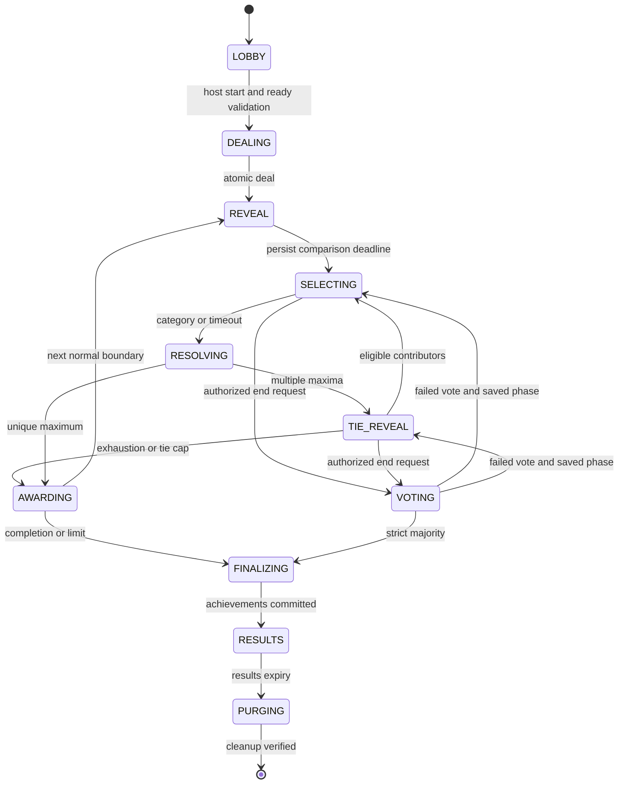
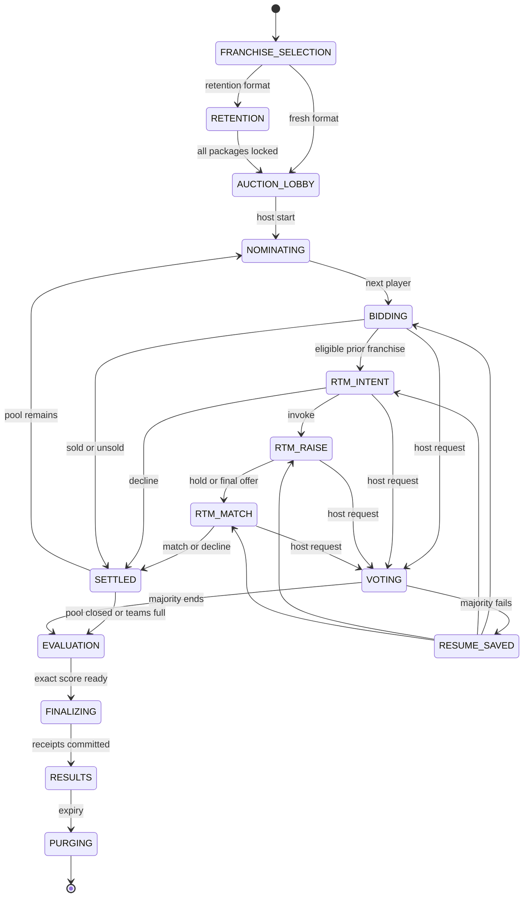
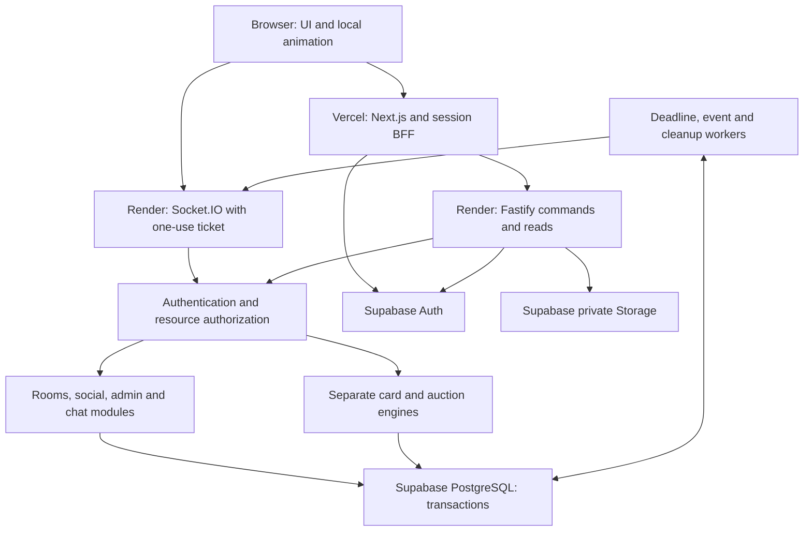
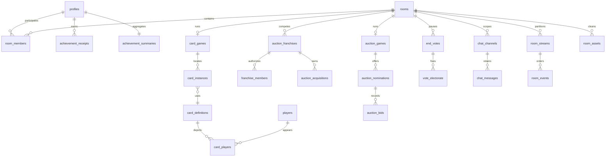

# CRICKET MULTIPLAYER PLATFORM — MASTER IMPLEMENTATION PLAN

**Working product name: STUMPS**  
**Specification version: 1.0**  
**Prepared and researched: 9 October 2026**  
**Deliverable type: implementation blueprint; no application code deployed or benchmark results claimed.**

Build a **Next.js frontend on Vercel and a Fastify modular monolith on an always-on Render service**, using **Supabase Auth, PostgreSQL and private Storage**. Use **Socket.IO for commands and permitted realtime projections**, with **PostgreSQL transactions as the authority** for cards, bids, timers, votes, achievements and cleanup. Begin with one backend instance and no Redis. Separate pure card and auction engines; share access, room, profile and social modules.

The decisive choices are durable server state rather than memory-only games, room-level transaction serialization, exact integer money, versioned historical IPL rules, explicit tie/exhaustion rules, franchise-level voting, safe opt-in automation, and a recoverable finalization workflow that saves compact achievements before deleting temporary room data. Visual quality has its own detailed acceptance criteria, but animations never decide game outcomes.

## How to use these documents

This master is self-contained: it embeds the complete game, engineering, UI and Codex specifications after the product/operations sections below. The four standalone companions contain the same normative sections for easier implementation. All five carry version 1.0. Edit the canonical companion section and regenerate its master copy together when requirements change; do not permit divergent rules.

| File | Primary use |
|---|---|
| `CRICKET_MULTIPLAYER_PLATFORM_MASTER_PLAN.md` | Complete product, evidence, architecture, operations and implementation authority |
| `GAME_RULES_AND_STATE_MACHINES.md` | Rules, data ratings, ties, auction/RTM, voting, scoring and podium |
| `DATABASE_AND_REALTIME_ARCHITECTURE.md` | Schema dictionary, security, transactions, deadlines, API/events and deletion |
| `UI_UX_DESIGN_SYSTEM.md` | Tokens, components and35 complete screen specifications |
| `CODEX_IMPLEMENTATION_PROMPTS.md` |20 sequential phase tasks and verification criteria |

Reading order: executive decisions → evidence/assumptions → gameplay → database/contracts → UI → phased implementation → operational release gates. When implementing a module, load its relevant sections, shared invariants and phase prompt rather than asking an agent to infer behavior from page mockups.

## 1. Product vision, scope and confirmed requirements

Two independent private multiplayer experiences share one premium account and social space. Card Battle is an original collectible-stat comparison game with an accumulating contested pot. Mega Auction is an IPL-inspired strategic squad builder with franchises controlled by one or more humans. Neither includes betting, cash prizes, real money purchases, player NFTs or transferable paid inventory. These exclusions clarify the product being designed, not additional required approvals.

A normal journey is: invitation code → sign in/create verified profile → choose game → create/join generated-code room → lobby and readiness → host start → authoritative gameplay → natural completion or15-second majority vote → rankings/medals → short results period → permanent profile remains while temporary live room records and objects are deleted. Auction adds franchise claim/approval, optional retention and team collaboration. Users never choose room or franchise invitation codes.

Confirmed mandatory scope includes all six card rarities and dual-player cards;1–5 reproducible stars; fair deck distribution; correct repeated ties; auditable randomness; season-aware retentions/RTM; concurrent bidding; collaborators and team approvals; offline recovery and safe auto mode; transparent XI-based squad evaluation; top-three medals; profiles/friends/public and private chats; admin access/data/operations management;35 designed screens; server-side access attempts; and recoverable room deletion.

### 1.1 Assumptions and explicit limits

| Topic | Selected assumption / constraint |
|---|---|
| Launch population | Private friends/community, India-first latency testing; public discoverability disabled |
| Account identity | Email/password with verified invitation; Supabase Auth, no anonymous competitive profiles |
| Admin separation | Separate protected admin flow using same trusted Auth provider, DB roles and required MFA; no home-grown second password database |
| Invitation secrecy | Shared gate code admits a user to authentication; it is not user identity or a role |
| Room identity |12-character cryptographic Crockford-style Base32 code (60bits), normalized for typing; hash for lookup, encrypted value for authorized copy display |
| Match deck vs collection | Owned cards in the rules are temporary match inventory; persistent collectible trading/economy is P2 and not necessary for this request |
| Official authenticity | Historical2025 preset with sourced facts and clearly marked simulator policies; current/historical team choices come from published season data |
| Default data during build | Fictional complete demo dataset and original assets; real data/branding published only after evidence/rights checks |
| Small matches | Casual11–15-player squads for short end-to-end tests; historical18–25 preset for full experience |
| Fairness | Transactional processing order, not provably equal network latency; no client-clock privilege |
| Permanent deletion | Delete from live application tables/objects after result TTL; backups/caches have separate provider retention limitations |
| Browser limitations | Site gate cannot hide generic static source bundles, prevent screenshots, or identify one human across every device/IP |
| Production grade | A set of implementation and verification requirements; not an unsupported claim that a plan alone is production-ready |

### 1.2 Prioritization and completeness

| Priority | Scope | Completion rule |
|---|---|---|
| P0 — working core | Gate/Auth/admin role, MFA, rooms, authoritative card/tie/auction/RTM, mandatory collaborators, deterministic auto/reconnect, voting, legal roster scoring, profiles/friends/basic chat, medals, cleanup, RLS, critical tests, deployment | All must work before calling the platform functional as requested |
| P1 — premium completion | All 35 polished screens, six card finishes, dual reveal, podium/audio, rich admin imports, source explainers, notifications, full responsive/a11y review, private visibility controls, operational dashboards | Required to claim the complete premium experience; not silently dropped from scope |
| P2 — optional advances | AI-assisted strategy, player entropy commitments, spectators, tournaments, season libraries, advanced coaching and licensed historical replay packs | Can follow after P0/P1 without undermining mandatory features |

Minimum end-to-end milestone is phase 15: a group finishes both games, valid medals appear on profiles, friends persist and every temporary room row/object is removed. Earlier engine demos explicitly lack some mandatory features. Full intended release requires phases16–19 plus data/rights/source gates. Do not present a card-only app or a dashboard with simulated purchases as the completed platform.

## 2. Research findings and evidence boundary

Primary sources were preferred: IPL/BCCI, an actual franchise's rules explainer, provider documentation, Socket.IO, PostgreSQL, OWASP and the data publisher. Sources below were checked9 October 2026. Published2024 rules are used for a2025 historical preset; this is not a claim they describe2026/2027 auction mechanics in full.

- IPL's regulation announcement supports a2025 auction purse distinct from its broader salary cap and combined retention/RTM limits. The named historical preset stores those values; it does not infer a later purse from the total salary cap. [S01]
- The franchise explainer supports historical squad/base-price/overseas limits. Retention floor amounts and the extra highest-bidder RTM opportunity are documented separately. Digital timers, increment schedule, custom retention aggregation and squad scoring are our simulator policies. [S02, S03, S04]
- The IPL website asserts rights over its content and branding. Availability on the web is not permission to reproduce player portraits, logos or proprietary card art. [S05, S06]
- Cricsheet's current licensing page distinguishes Open Data Commons Attribution for most datasets from CC BY4.0 for XML match data. Preserve the precise license for the downloaded format; do not assume all cricket data is CC BY. [S07]
- Render supports persistent WebSockets but deployments/maintenance can disconnect them; reconnect may reach another instance. Free instances can idle/suspend and are unsuitable as the reliability basis here. Inbound WebSocket messages now count as activity under its free-service documentation. [S08, S09]
- Socket.IO ordering does not make durable application effects exactly-once. Our receipts, outbox, replay and snapshots supply the needed recovery semantics. [S10, S11]
- Supabase connections must be pooled to fit compute limits; service credentials can bypass RLS. The plan denies direct browser access to game tables and keeps the global gate enforced on reads as well as writes. [S12, S13]
- Vercel's22 June 2026 changelog documents WebSocket support in public beta. It would be incorrect to assert categorically that Vercel cannot host WebSockets. Render remains the deliberate required host for game processes and workers. [S18]

### 2.1 Source register

| ID | Primary source | Used for / qualification |
|---|---|---|
| S01 | [IPL player regulations2025–27](https://www.iplt20.com/news/article/ipl-governing-council-announces-tata-ipl-player-regulations-2025-27) | Named historical purse/retention framework; do not equate salary cap with auction purse |
| S02 | [Rajasthan Royals2025 auction rules](https://www.rajasthanroyals.com/latest-news/indian-premier-league-ipl-2025-mega-auction-rules) | Squad18–25, max8 overseas and reserve price range |
| S03 | [Rajasthan Royals retention rules](https://www.rajasthanroyals.com/latest-news/indian-premier-league-ipl-2025-auction-rules-right-to-match-rtm) | Capped18/14/11/18/14cr and uncapped4cr floors; not a full contract circular |
| S04 | [Rajasthan Royals RTM explanation](https://www.rajasthanroyals.com/latest-news/indian-premier-league-ipl-2025-mega-auction-right-to-match-rtm-card) | Final bidder raise, match/decline and unused entitlement behavior |
| S05 | [IPL terms and conditions](https://www.iplt20.com/terms-and-conditions) | Rights statement; no implied asset license |
| S06 | [IPL image-use terms entry](https://www.iplt20.com/image-use-terms) | Asset clearance checkpoint; full PDF fetch was unavailable, so do not claim commercial reuse rights verified |
| S07 | [Cricsheet licensing](https://cricsheet.org/licensing/) | Format-dependent licenses, attribution and notices |
| S08 | [Render WebSockets](https://render.com/docs/websocket) | Connection interruption, reconnect, random instance routing, TLS and bandwidth |
| S09 | [Render free service limits](https://render.com/docs/free) | Idle15 minutes, approximately1minute wakeup,750workspace hours, ephemeral disk and possible suspension |
| S10 | [Socket.IO delivery guarantees](https://socket.io/docs/v4/delivery-guarantees/) | Ordered connection events vs at-most-once default delivery |
| S11 | [Socket.IO multiple nodes](https://socket.io/docs/v4/using-multiple-nodes/) | Adapter and transport/affinity considerations |
| S12 | [Supabase PostgreSQL connections](https://supabase.com/docs/guides/database/connecting-to-postgres) | Session/transaction pooling and prepared query considerations |
| S13 | [Supabase row-level security](https://supabase.com/docs/guides/database/postgres/row-level-security) | RLS and privileged-key boundary |
| S14 | [Supabase MFA](https://supabase.com/docs/guides/auth/auth-mfa) | Provider MFA and assurance level integration |
| S15 | [Supabase pricing](https://supabase.com/pricing) | Verified USD plan/compute assumptions; recheck before purchase |
| S16 | [Vercel pricing](https://vercel.com/pricing) and [Hobby limits](https://vercel.com/docs/plans/hobby) | Pro base and personal/noncommercial Hobby restriction |
| S17 | [Render compute plans](https://render.com/docs/compute-plans) and [provider hosting cost guide](https://render.com/articles/production-rails-hosting-guide) | Renamed compute IDs and small-service price; dynamic pricing page not fully readable |
| S18 | [Vercel WebSocket beta announcement](https://vercel.com/changelog/websocket-support-is-now-in-public-beta) | Corrects outdated blanket limitation |
| S19 | [PostgreSQL explicit locking](https://www.postgresql.org/docs/current/explicit-locking.html) | Lock coordination and deadlock considerations |
| S20 | [Supabase SSR client guidance](https://supabase.com/docs/guides/auth/server-side/creating-a-client) | Server session handling; our server-only cookie/BFF pattern is a deliberate design adaptation |
| S21 | [IPL2025 retained players announcement](https://www.iplt20.com/news/article/tata-ipl-2025-player-retentions-list-announced) | Official fixed historical packages and deductions candidate |
| S22 | [IPL playing conditions](https://www.iplt20.com/playing-conditions) | Landing page did not expose full season text; selected-season XI verification remains a publication gate |
| S23 | [OWASP password storage](https://cheatsheetseries.owasp.org/cheatsheets/Password_Storage_Cheat_Sheet.html) | Argon2id baseline and pepper storage practice |
| S24 | [Node release schedule](https://nodejs.org/en/about/previous-releases) | Supported runtime baseline; pin patched versions at implementation kickoff |
| S25 | [Cricsheet register](https://cricsheet.org/register/) and [match downloads](https://cricsheet.org/matches/) | Stable identity mapping and match data acquisition |
| S26 | [Official auction list with RTM](https://documents.iplt20.com/bcci/documents/1732248356511_TATA%20IPL%202025-%20Auction%20List%20with%20RTM%20-19.11.24.pdf) | Candidate factual eligibility/base-price source; verify downloaded revision and rights before bulk redistribution |

No exact player stats or licensed asset files are invented or supplied here. Source links support factual constraints; original architecture, economy and UX proposals are explicitly design judgments. Price estimates are assumptions plus documented base fees, not quotes or guarantees.

## 3. Cricket data and legal asset implementation workflow

Use two independently publishable packs: a **demo pack** for development and a **verified factual pack** for intended play. The demo contains at least300 fictional identities,10 original franchises, capability tags, synthetic normalized ratings, base-price tiers and original silhouettes. This permits10×25-player roster tests plus unsold options without claiming invented data are official. A small40-player fixture handles quick tests. Use a fixed seed and label DEMO in cards, auction header and results; no real player names paired with fabricated official-looking numbers.

The factual pack starts from a permitted Cricsheet download and register IDs; compute reproducible T20 aggregates and validate samples against authorized scorecards. Cricsheet does not supply a free license to franchise emblems, all headshots, official base prices, retention eligibility or injury/availability intelligence. Those use separately reviewed sources. A source ledger records URL, publisher, download date, format, license, attribution, checksum, coverage, season cutoff and reviewer. Importing public facts is different from republishing a site's compilation or photos; avoid unapproved bulk scraping.

Import pipeline: upload permitted file → validate schema/size → checksum/deduplicate → normalize IDs/country/roles/units → resolve existing external ID → flag possible name collisions for review → generate stat quality report → compute synthetic ratings → validate enough legal card/auction combinations → draft preview → second review for historical/rights claims → publish immutable data version. Conflicting identities are never automatically merged by name. Transfers change season membership; old published seasons remain intact. Base prices are season-specific, not the price from a player's most recent auction.

Corrections create a draft derived from the published version, record old/new/source/reason, run rating and legality checks, and publish a new version. Active games keep their original snapshot. Archive does not delete referenced versions. Scheduled freshness checks weekly during active season and before any new preset; manual review for auction/retention publication. No live API dependency during play. Ball data coverage gaps are shown; manual corrections require source evidence, not a famous-player bonus.

Asset route A: obtain licenses covering digital game use, territory, duration, derivative crop, player likeness, team/league marks and redistribution/caching. Store evidence and expiry per asset; use only approved published assets. Editorial image-use terms do not automatically authorize collectible-game commercial use. Asset route B: original cricket illustrations, fictional portraits, city-team names/crests, sponsor-free clothing and consistent metallic frames. Avoid close imitation of Cricket Attax trade dress. Attribution alone does not cure missing permission. A real-name factual mode may still need assessment of publicity/endorsement context; do not represent this plan as a legal clearance opinion.

Define aggregates precisely: matches from verified appearances; batting runs excluding extras; balls faced according to scoring definition; bowler wickets excluding run-outs/retired/obstructing cases; bowling legal balls excluding wides/no-balls; economy per6 legal balls; averages undefined when denominator zero. Cross-check at least20known scorecards across edge cases before publishing. Keep “game rating,”“real statistic,”“estimated” and “demo” visually and structurally separate.

## 4. Engineering decision records

Each ADR is selected for this product. Cost notes are relative engineering implications, not measured totals.

| ADR / choice | Alternatives and advantages | Risks/cons and security | Complexity/cost | Decision and reason |
|---|---|---|---|---|
| ADR01 frontend | App Router provides layouts, server session routes and route grouping; SPA/Vite simpler client-only build | App Router caching can leak private data if misconfigured; SPA needs separate SSR/session layer | Medium; Vercel standard hosting | Next App Router; no-store private responses, server auth checks and client game islands |
| ADR02 API | Fastify lightweight plugins/schema routing; Nest offers structured DI/decorators | Fastify needs explicit boundaries; Nest adds framework overhead and conventions | Fastify lower bootstrap overhead for modular monolith; similar hosting base | Fastify with module registration and shared contracts; no separate Nest layer |
| ADR03 realtime | Socket.IO gives acknowledgments, reconnect, rooms; raw ws smaller; Supabase Realtime integrates DB/broadcast | None provides game authority; raw ws needs more protocol work; DB changefeeds may expose too much or couple to schema | Socket.IO modest runtime cost; Realtime message/connection quotas avoided for gameplay | Socket.IO commands/events with PG outbox, snapshots and replay |
| ADR04 repo | Monorepo shares DTOs, tests and atomic changes; separate repos isolate teams | Accidental server imports into browser need export/lint boundaries | pnpm workspaces enough; no build orchestrator required initially | One monorepo, explicit package exports and CI dependency checks |
| ADR05 identity | Supabase Auth handles password/recovery/MFA; custom auth maximal flexibility | Custom auth increases account security/recovery burden | Provider cost already selected; BFF adds bounded session plumbing | Supabase Auth with closed enrollment; separate gate grant and DB roles |
| ADR06 game state | PostgreSQL durable transactions vs memory actors with periodic snapshots | DB latency/lock load; memory loses uncommitted state and requires distributed recovery | DB-first simpler small-scale correctness; optimize measured hotspots later | PG authoritative; room lock per mutation; memory projections only |
| ADR07 clocks | Durable deadlines with worker wakeups vs setTimeout authority | DB queue polling costs; memory timers vanish on restart | One embedded scheduler then separate worker when measured | Persist deadline+generation; DB time after lock; callbacks hints only |
| ADR08 sync | Event stream alone enables replay; full snapshots simple recovery | Event-only rebuild costs and schema history; only snapshots can hide causal UI and lose audit | Hybrid moderate implementation, small room payload | Authoritative snapshot plus audience-specific short-lived events |
| ADR09 auto | Deterministic policy predictable, cheap; LLM strategy conversational | LLM latency/cost and opaque spend; rule policy needs calibrated limits | Rules no per-action model fee; AI optional later/offline | Rules-based constrained bids through ordinary validator |
| ADR10 cleanup | Immediate delete simplest footprint; recoverable asynchronous delete preserves results and storage coordination | Async requires TTL/alerts; immediate risks lost medals/UI and external orphan files | One DB task/worker small overhead | Atomic receipts/results then120sTTL and recoverable Storage→DB deletion |
| ADR11 achievements | Per-franchise result with per-user credits vs award each user as independent competitor | Flat user ranks inflate competition and reward late joins | Compact receipts small persistent cost | Rank franchise once, credit eligible start-roster members with role/scope |
| ADR12 rule versions | Hardcoded current defaults simple; versioned config supports history/custom rooms | Config needs validation/provenance; arbitrary dynamic code would be dangerous | Moderate one-time design, low per-room overhead | Typed immutable JSON policies plus pure engine version, source metadata and hashes |
| ADR13 pooling | Direct/session connection suits stable Node; transaction pooler helps many short clients | Session features cannot be assumed through transaction pooling | Small bounded pool cheapest; pool limit not socket count |5launch connections, unnamed queries if transaction pooling, CI migration connection separate |
| ADR14 Redis | No Redis simplest; Redis adapter helps multiple Socket.IO instances | Redis outage must not change purse/ownership; adapter is not durable source | Extra service fee and operations only at horizontal scale | Omit initially; add on measured second-instance need, keep PG replay |
| ADR15 session/gate | Browser JWT simpler; server-only BFF avoids JS-readable refresh tokens | BFF adds hop and CSRF/forwarding complexity; cookies alone do not secure sockets | Extra RESThop; game commands direct secure socket | HttpOnly server Auth cookies, gate grant, one-use socket ticket and per-action ACL |

## 5. Repository layout and module implementation boundaries

Use the following paths as the common vocabulary for Codex tasks. A folder listing is illustrative structure, not generated application code.

```text
cricket-gaming-platform/
  apps/
    web/
      app/(public)/access,auth,legal/
      app/(member)/play,players,friends,notifications/
      app/(room)/rooms/[roomId]/
      app/(admin)/admin/
      app/api/v1/[...path]/route.ts
      components/{shell,cards,auction,lobby,chat,results,admin}/
      features/{session,room,cards,auction,team,profile,friends,reconnect}/
      lib/{server-auth,bff,api-client,socket,room-store,telemetry}/
      styles/tokens.css
    server/
      src/app.ts
      src/main.ts
      src/config/env.ts
      src/db/{pool,transaction,locks,repositories}/
      src/modules/{auth,access-gate,profiles,friends,rooms,presence}/
      src/modules/{cards,auctions,teams,voting,achievements,chat}/
      src/modules/{cricket-data,cleanup,admin}/
      src/realtime/{gateway,tickets,authorization,projection,dispatcher}/
      src/jobs/{deadlines,outbox,recovery,cleanup,evaluation}/
      src/observability/{logger,metrics,tracing,redaction}/
      Dockerfile
  packages/
    contracts/src/{auth,rooms,cards,auction,teams,votes,events,errors}/
    game-engines/src/{card,auction,ratings,evaluation,voting,achievements}/
    ui/src/{tokens,primitives,icons}/
    test-fixtures/src/{users,cards,auction,clocks}/
    config/{eslint,typescript}/
  supabase/{config.toml,migrations,seed,tests}/
  tests/{unit,property,integration,concurrency,security,e2e,visual,load}/
  scripts/{audit-room-deletion,bootstrap-admin,validate-data,verify-contracts}/
  docs/{spec,adr,runbooks,release-evidence}/
  infrastructure/{render.yaml,env-matrix.md}/
  .github/workflows/{ci,deploy}.yml
  pnpm-workspace.yaml
  pnpm-lock.yaml
```

`contracts` exports DTO validators and event enums only;`game-engines` is server-only, IO-free pure logic with inputs for clock/RNG/rules;`ui` contains safe reusable visuals, not business authority. `transaction` is the single place for lock/idempotency/retry scaffolding. `projection` is the single audience-redaction boundary. `dispatcher` handles durable delivery after commit. Do not duplicate socket and HTTP mutation logic; both adapters call the same command handler. Avoid optional orchestration tools until build times require them.

## 6. Security threat model and corresponding tests

Assets are access secrets, Auth sessions, private team strategy/chat, hidden card order, competitive correctness, medal integrity and administrator privileges. Actors include anonymous guessers, admitted malicious players, compromised sessions, colluding team members, overprivileged operators and accidental deployment mistakes. The system cannot prevent players discussing public cards externally or photographing screens; competitive anti-cheat focuses on authoritative state and private data boundaries.

| Threat | Technical control | Required negative test |
|---|---|---|
| Website/room password guessing | Atomic attempt buckets, Argon2id+pepper, IP/global limits, small hash worker concurrency |4parallel failures share limit; refresh and new tabs cannot reset bucket |
| Enumeration/unauthorized entry |60-bit codes, rate limits, generic invalid response, server gate+room ACL | Iterate malformed/valid-looking codes; no private metadata leak |
| Gate bypass/direct URL/API | Protected server layout plus every REST/socket action check; no direct DB reads | Real Auth JWT without gate rejected on API, socket and media URL issuance |
| Forged admin/captain/host | Database-assigned roles, resource scope, MFA for admins | Set role/isAdmin in JSON/JWT user metadata/local store; no permission gained |
| Stolen/replayed token | HttpOnly cookies, CSRF/Origin, one-use socket tickets, revocation checks | Ticket second use and wrong Origin fail; revoked session stops commands |
| Duplicate/concurrent bids | Room lock, nomination version, idempotency, unique purchase | Parallel bids/retries cannot cause two owners or negative purse |
| Card tampering/hidden cards | Server frozen stats/top-card movement, permitted projection | Submit fake rating/card ID; inspect HTTP/socket/event replay for future deck |
| Vote manipulation | Frozen electorate, one representative/franchise, unique ballot, DB deadline | Extra collaborators, duplicate/changing vote, client clock manipulation all fail |
| Forged medals | Finalizer-only receipt insert, unique award batch, atomic summary increment | Client profile counters ignored; finalizer retry mints once |
| SQL injection | Parameterized values, allowlisted sort/schema names, typed SQL repositories | Malicious username/chat/filter strings treated as data |
| XSS/chat injection | Plaintext render, strict CSP, upload reencoding, no inline unsafe HTML | Script/HTML/SVG/polyglot payload never executes |
| Private chat/strategy leakage | Current team ACL for read/write/replay, broadcast projection, no payload logs | Opponent/former member cannot fetch or subscribe to team stream |
| CSRF/cross-site WebSocket hijack | Exact Origin, CSRF token, cookie policy, ticket handshake | Foreign origin cannot rotate code, join or connect with stolen cookies |
| Flooding/reconnect storm | Per-user/room limits, backpressure, exponential jitter, bounded payloads | Burst connections/chat/commands keep legitimate room responsive |
| Storage abuse | Private buckets, safe MIME decode, size cap, prefix ownership, short reads | Other room prefix/upload path traversal and SVG rejected |
| Admin insider misuse | Least privilege, step-up, audit, immutable published versions, no default hidden-deck/private-chat inspection | Operator cannot assign admin or change active game stats; all changes audited |
| Abandoned room abuse | Active room quota, TTL, absolute lifetime, cleanup queue | Idle room cannot be kept forever with unauthenticated pings |
| Logs/backups retaining strategy | Structured redaction, temporary event retention, restore purge | Scan logs/exports for chat/code/seed; restore expired room then sweep |
| Race between revoke and action | Recheck permissions under game transaction before mutation | Revoke bidder and submit concurrently; one serial valid outcome only |

Default rate limits: ordinary commands10/second/user burst20; accepted bids at most5/second/franchise (higher than human pace, still serialized); chat5/10 seconds and30/minute/user; room create5/hour/user; room join10/minute/user+network; friend search10/minute; avatar upload5/hour. Treat these as configurable starting policies and test shared networks. Do not log rejected payloads. Overload responds with safe429/503 and never queues stale bids for later automatic acceptance.

## 7. Verification strategy, acceptance and capacity targets

Pure unit tests cover scoring math, normalization, stars, dual averages, category direction, deck transfer, eligibility, fallback, retention charge, RTM budgets, increment boundaries, auto ceilings, vote majority and medal criteria. Property tests generate2–8seats and many card distributions; assert ownership conservation, determinism and finite fallback. Test statistical fairness across many seeds as a diagnostic, not proof of perfect balance.

Integration tests run against local real PostgreSQL/Supabase with actual roles, transactions and RLS. Multiplayer browser tests use separate authenticated contexts, not fake frontend stores. Concurrent tests use multiple DB connections/processes. Fuzz commands and unknown fields to prove validation. E2E starts at gate, creates room, plays both engines, earns receipts, waits result TTL with controlled server clock and verifies deletion. Test-specific virtual clock injection is allowed only in local/staging builds; production time provider reads DB time.

| Target | Initial measurable goal | Test method / limitation |
|---|---|---|
| Bid/card acknowledgment | p95≤ 300ms, p99≤ 700ms from same-region representative clients | End-to-end RTT through real socket; separate network RTT, lock wait and SQL timing |
| Accepted event delivery | p95≤ 500ms after commit | Multi-client receipt timestamps, clock offsets; outbox lag metric |
| Room join | p95≤ 2 seconds excluding Auth/email | Room/password with bounded hashing under30connected-user load |
| Reconnect recovery | p95≤ 3 seconds after network/service available | Fresh ticket, snapshot/replay at 500 events; does not include outage time |
| Deadline dispatch lag | p95≤ 500ms in healthy service | DB deadline→settlement metric; no early close ever |
| Gameplay DB transaction | p95≤ 50ms server processing target | Query plan/lock wait split; strict budget for handlers |
| Browser responsiveness | INP≤ 200ms, LCP≤ 2.5s, CLS≤.1 at 75th percentile target | Lab throttling+real-user metrics; not yet measured |
| Animation |60fps capable devices, graceful30fps/low motion fallback | Mobile profiling; no giantfilters or per-frame React state updates |
| Room capacity | Cards8 players; auction60 humans/10 franchises default | Simultaneous action+chat+reconnect, not just idle connections |
| Accessibility | WCAG2.2AA target; allcritical actions keyboard accessible | axe plus manual screen reader/zoom/contrast audit |
| Cleanup |95%≤60s afterresults expiry absent provider fault | All T tables empty+Storageprefix absent; alert15min overdue |

Load harness profiles: normal gameplay,20bid attempts/sec across10 franchises in a burst,5chat messages/sec roomwide,10%clients reconnecting, and periodic snapshots. Test10,30,100,300,1000concurrent sockets; increase active room count independently. Run30-minute steady load,5-minute2×burst, then3backend restarts/DBfailure/reconnectstorm. Record p50/p95/p99, memory, event loop lag, pool wait, DBCPU, locks, outbox lag, errors and cleanup backlog. Stop on budget/invariant failures, not just uptime. Reports must include hardware, region, dataset, commit hash, date and untested conditions.

Deletion proof template: capture test profile/friend IDs and pregame summary; finish qualifying room; assert exactly expected unique receipts; wait TTL+worker interval; for **every T table in the schema registry** query count by room UUID and require0; list Storageprefix and requireempty; assert profiles/friendship/receipts still exist and summaries changed exactly once; repeat cleanup to prove idempotency. Test backup restore in isolated staging, then run expired-room purge before exposing restored APIs.

### 7.1 Cross-workflow Given/When/Then acceptance

| Given | When | Then |
|---|---|---|
| A browser has no gate grant | It requests dashboard/API/media/socket directly | Protected data denied; only gate/login shell appears |
| Third wrong code is entered concurrently in two tabs | Transactions resolve | Three-failure window cannot become four authorized guesses |
| An admin rotates in revoke mode | Existing user attempts bid | Reverification required; no frontend-only bypass |
| Host changes lobby rules | Ready player attempts start | Readiness is cleared and current config must be acknowledged |
| Collaborator knows team invitation code | It requests private chat before approval | Denied despite room membership |
| A captain and collaborator bid the same version | Both commands reach backend | One accepted or both safely rejected; never two deductions |
| Host starts vote while auction active |15 seconds pass with insufficient Yes | No player sold during pause; remaining auction time restored |
| Qualifying franchise wins with 3eligible members | Finalization retries twice | One franchise rank; each eligible member one team medal |
| A late advisor joins near result | Team wins | Can view authorized result but receives no unearned medal |
| Storage deletion fails | Cleaner retries after crash | Root stays inaccessible PURGING until objects absent; receipts remain |
| Server dies after commit beforeack | Browser retries same command | Original receipt returned; game effect not repeated |
| Incomplete high-score squad faces legal squad | Evaluation finishes | Incomplete squad cannot win/earn medal |

## 8. Edge-case resolution matrix

Each row defines trigger, expected outcome, backend enforcement, user feedback, recovery and a named automated acceptance scenario. Tests should use the IDs as traceability keys. Gameplay-specific numeric examples also appear in the embedded rules.

| ID | Trigger | Expected behavior | Backend handling | UI feedback | Recovery | Required test |
|---|---|---|---|---|---|---|
| E01 | Third incorrect gate code | Lock that protected window | Atomic counter/locked_until after hash failure | Remaining0 and unlock timestamp | Retry after server lockout | Parallel third/fourth requests cannot exceed limit |
| E02 | Admin rotates website code | Apply chosen preserve/revoke policy | Version/grant checks and revocation fanout | Reverify banner or unchanged valid session | New grant rebinds same membership | Old grant rejected only in revoke mode or expiry |
| E03 | Direct URL/API bypass attempt | No private data | Every action checks Auth and gate; Data API denied | Access screen/403 | Verify legitimately | Authenticated JWT alone cannot fetch room snapshot |
| E04 | Guessed room code | No room disclosure or entry | Rate-limit lookup and generic invalid response | Unable to join | Correct invitation needed | Enumerate random codes and compare safe response shape |
| E05 | Incorrect room password | No membership insertion | Argon2 check and join-attempt limit | Join failed, limited retry | Retry correct password | Wrong password produces zero membership rows |
| E06 | Lobby host disconnects | Transfer after 60s to earliest connected approved member | Lock room; ordered joined_at then UUID; old host loses host role | New host badge and event | Returning former host is ordinary member | Two transfer workers choose same successor once |
| E07 | Selector disconnects on card turn | Timer continues and deterministic default category applies | Timeout reducer, not client submit | Offline badge and automatic-selection label | Reconnect to latest comparison | Disconnected selector cannot freeze game |
| E08 | Tied player disconnects | Same tie eligibility/cards persist | Server deals next top and selects only on its turn timeout | Tie continues, offline visible | Replay own permitted state | No pot card lost or extra competitor added |
| E09 | All compared ratings equal | Pot grows among all maxima | Exact integer tie set | All tied marker | Next eligible comparison/fallback | All-player tie conserves cards |
| E10 | Repeated tie chain | Apply documented cap/fallback | Persist tie_count and committed priority | Reason and pot award explained | Next normal contest | Twelve ties cannot create unbounded loop |
| E11 | One tied player exhausts deck | Exclude from next contribution, delay elimination | able set then post-award elimination | No next card label | May survive only if fallback rule permits current set | Exhausted seat submits no phantom card |
| E12 | One player owns all cards | Natural completion | Boundary count=N, POT/ACTIVE empty | Champion ceremony | Finalization/cleanup | Exactly one natural winner and stable podium |
| E13 | Two joiners compete for last seat | One succeeds | Room lock+unique seat/capacity check | Other sees full room | Join another room | Parallel join transactions preserve cap |
| E14 | Auction captain disconnects | Connected authorized member retains control or safe auto/observe | Grace+permission-based failover | Controller/offline labels | Explicit manual takeover | Captain absence alone does not trigger competing bot |
| E15 | Captain/collaborator duplicate bids | At most one accepted for version | Nomination version+room lock+command receipt | Accepted or stale/current bid | User intentionally bids next price if desired | Same-franchise parallel commands cannot self-raise |
| E16 | Opposing simultaneous bids | First valid serialized transaction leads | Lock order and increment validation | New highest bid, loser sees current amount | Next deliberate offer | 100parallel commands yield consistent bid sequence |
| E17 | Bid exactly at deadline | Reject | DBtime afterlock strictly less than deadline | Bid too late | No retry as new offer for closed lot | Boundary test at t-1ms, t, t+1ms |
| E18 | Player gets no bids | Unsold; one second pass | Persist pass/status and finite pool order | Unsold label, next player | Second pass then final unsold | No third automatic loop |
| E19 | Franchise lacks spend reserve | Reject affordable-looking but unsafe offer | Purse minus minimum-roster reserve | Maximum permitted offer explained | Choose cheaper targets | Bid equal ceiling passes; ceiling+1 fails |
| E20 | Squad at max size | No further acquisition | Count+capacity within same transaction | Full squad, bid disabled | Observe remaining auction | Concurrent sale cannot overfill |
| E21 | Overseas slots full | Reject another overseas purchase/RTM | Frozen nationality/overseas classification and count | Overseas limit reached | Bid domestic target | Retention+auction+RTM share same count |
| E22 | Retention overspends | Cannot lock package | Total charge+remaining reserve validation | Cost breakdown and correction | Edit draft, ready again | No partial package/acquisition write |
| E23 | Offline member returns | Restore same seat/team | Auth+gate+membership, snapshot cursor vector | Missed actions summary | Confirm takeover | No duplicate seat or vote entitlement |
| E24 | Bot proposes invalid purchase | Reject through ordinary validator | Same purse/roster/deadline checks | Private reason code | Wait for new nomination/version | Auto cannot bypass reserve or spend cap |
| E25 | Same user opens multiple tabs | One controlling lease; others observe | Unique controller+epoch | Read-only tab and Take control action | Explicit fenced takeover | Old epoch commands fail after takeover |
| E26 | Crash during bid transaction | Rollback or committed receipt, never partial sale | Postgres transaction/idempotency | Recovering banner | Receipt lookup then snapshot | Kill before/after commit verifies purse invariant |
| E27 | Restart during end vote | Original deadline/electorate remain | Durable vote row; resolve expired once | Same vote or result | No fresh15 seconds | Restart twice does not extend or duplicate vote |
| E28 | End request during card tie | Freeze chain, not discard it | Saved phase/timers, pot unchanged | Voting over tie display | Fail resumes; pass restores contributions | Both vote outcomes conserve N |
| E29 | Equal Yes/No | Continue | yes>floor(N/2), not votes-cast share | Majority not reached | Restore remaining clock | N4, Yes2, No2 fails |
| E30 | No votes | Continue | Abstentions never count Yes | Vote expired, game resumes | Cooldown starts | Zero ballots produces failed vote |
| E31 | Initial room cleanup fails | Retry reliably, keep inaccessible root | cleanup_tasks with backoff/stage | Results expire; admin failure alert | Resume at failed stage | Storage error does not lose manifest |
| E32 | Finalizer repeats medal insert | No duplicate grant/counter | UQ awardBatch/user and RETURNING-only increments | One earned medal | Return existing result | Run finalizer10times, counters change once |
| E33 | Opponent requests private chat | Deny reads, write, subscribe, replay | Current team ACL and separate streams | Access denied, no message content | No recovery without approved membership | Probe known channel/event IDs across teams |
| E34 | Room deleted while result open | Loaded result may remain locally; no future fetch | Final event then cascade/no-store | Detailed results expired on reload | Profile compact receipt remains | Reload after TTL returns410/absent without transcript |
| E35 | Two cleaners execute | One advances, other skips | Same room lock+cleanup lease | No duplicate user notification | Second sees success/no root | Parallel cleaners preserve profiles/assets outside prefix |
| E36 | Unknown/banned user holds old socket | Control immediately denied | Per-command ban/session checks, disconnect stream | Session revoked | Authorized reinstatement/login only | Ban between two commands blocks latter |
| E37 | Wrong game code used in join screen | No misleading gameplay navigation | Game type check after invite validation | This invite is for another game | Offer safe matching route | Membership created only for requested valid flow |
| E38 | Host changes settings after readiness | Everyone must reconfirm | configVersion++, clear readiness | Rules changed banner | Ready on new version | Old start/config submission fails |
| E39 | Undersized catalog for chosen rarities | Cannot start | Pool/constituent uniqueness validation | Explain which rarity lacks cards | Host changes config | No silent duplicates or altered total |
| E40 | Uneven card count | Cannot start until explicit correction | Divisibility check | Offer nearest legal totals | Host chooses and players re-ready | No arbitrary leftover pot before game |
| E41 | A card has missing economy | No bogus zero wins | Raw category disabled unless complete; normalized mode marked estimate | Unavailable/estimated label | Use allowed metric | Zero denominator never beats valid economy |
| E42 | Dual card shares constituent with single | Deck rejected | Identity exclusion across definitions | Pool conflict listed | Choose different deck/pair | No hidden duplicate-player advantage |
| E43 | Lost command acknowledgment | Same command retry safe | Stored receipt and body hash | Pending then original acknowledgment | Backoff/reconnect | Effect count remains1 |
| E44 | Same idempotency key, different body | Reject | Canonical request hash mismatch | Conflicting request, refresh | Generate new deliberate action | Cannot turn an old small bid into larger accepted one |
| E45 | Out-of-order/duplicate server events | No state regression | Per-stream seq and eventId | Brief syncing if gap | Replay or fresh snapshot | Shuffle/duplicate events yields same client projection |
| E46 | Private event interleaves public event | No false public gap or disclosure | Independent stream sequences | Normal timeline | Only authorized stream replay | Public cursor contiguous without private payload |
| E47 | SQL deadlock/pool starvation | Bounded retry or503 | Consistent lock order, timeout, jitter | Retryable service message | Same command ID retry | Forced deadlock preserves transaction invariants |
| E48 | DB connection fails mid-turn | Fail closed | No memory-only authoritative changes | Actions disabled, recovering | Rebuild from durable state | No local winner/medal while DB unavailable |
| E49 | Large reconnect storm | Throttle without losing state | Jitter, rate limits, snapshot size bound | Reconnecting with backoff | Gradual admission | 30%clients reconnect while valid bids meet measured budget |
| E50 | Mobile browser sleeps beyond grace | Offline policy applies | Server heartbeat expiry | Resume recap, not frozen old clock | New ticket and snapshot | Resume cannot submit stale bid at old price |
| E51 | Clock manipulated on browser | No advantage | DB deadline only | Countdown resyncs | Fresh server offset | Advance/rewind Date cannot change sale/vote |
| E52 | Vote packet processed at expiry | Reject | cast time afterlock<expiresAt | Vote closed | See authoritative result | t-1 accepted, t rejected |
| E53 | Host leaves after starting vote | Vote still resolves | Vote independent of host connection | Countdown continues | Host transfer separate after vote if needed | No cancellation or second electorate |
| E54 | Natural completion races vote request | Single serialized outcome | Due transition first then vote validity | Result or vote, never both active | Terminal state stops new vote | One finalization hash/receipt batch |
| E55 | Only one online user remains | Do not shrink electorate | Frozen started franchises/active card seats include offline | Waiting/abstention explicit | Auto/observe or abandoned timeout | Online count1 does not produce false majority |
| E56 | Franchise representative disconnects in vote | Abstains unless already voted | Frozen representative, no mid-vote substitution | Vote pending/recorded status | Next vote can choose new representative | Collaborator cannot steal ballot after disconnect |
| E57 | RTM raised amount exceeds bidder capacity | Reject raise, standing amount remains | Same spend validator | Allowed ceiling and remaining clock | Hold or valid raise | Invalid raise never changes binding amount |
| E58 | RTM holder lacks final purse | Cannot match | Revalidate acquisition constraints | Match disabled with reason | Decline/timeout, sale to original bidder | One original-bidder purchase, RTM not consumed |
| E59 | No preconfigured automatic strategy | Observe only | Default disabled strategy | Offline team not bidding | Captain returns/next game config | No fabricated automatic purchase |
| E60 | Manual takeover races bot | One epoch controls | Locked epoch increment and bot validation | Manual confirmation/current mode | Old jobs discarded | Bot accepted only if serialized before takeover |
| E61 | Late collaborator joins winning franchise | No unearned medal | Start eligibility snapshot and attendance threshold | Observer/advisor, no current medal badge | Qualify in next match | Late join at last nomination gets0receipts for medal |
| E62 | All auction squads incomplete | No false champion | Legal roster gate before ranking | No qualifying champion, deficits listed | New match with better pacing/pool | High individual ratings cannot override legality |
| E63 | Evaluation worker crashes | Resume exact computation | Input hash, cursor, best checkpoint | Evaluation progress/recovering | Restart chunk; ignore stale result | Final score matches uninterrupted enumeration |
| E64 | Admin edits catalog mid-match | Existing results unchanged | Immutable data/rules version refs | New data applies to future rooms | New room uses new version | Running card values/budgets remain identical |
| E65 | Malformed upload or path traversal | Reject before object publication | Decode/reencode, size/type/key prefix constraints | Supported images guidance | Upload valid image | SVG/script/polyglot/../ cannot enter ready assets |
| E66 | Upload in flight at room expiry | No post-purge orphan | Freeze new writes, wait lease, delete/re-list prefix | Upload cancelled as room ends | Cleaner retries remaining objects | Delayed upload completion still removed |
| E67 | Friend block while invitation pending | No invitation-based privacy bypass | Remove edge/invalidate invite/check target block | Invite unavailable | Unblock doesn't auto-restore friendship | Old invite cannot expose activity/code |
| E68 | Room chat spam/XSS | Rate limit/plain text only | Length/rate/mute check, no HTML render | Cooldown or muted state | Wait/unmute by authorized moderator | Script text inert; spam doesn't starve bid processing |
| E69 | Admin tries to change active match outcome | No ordinary override | Immutable rules and no award/edit-bid endpoint | Action unavailable | Audited integrity abort only | Admin UI cannot silently mint winner/medal |
| E70 | Backup restore resurrects expired rooms | Purge before access enabled | Restore runbook sweeps TTL/aborted/purging roots | Maintenance until verified | Open service after deletion checks | Expired chat absent after restore+cleanup |
| E71 | Login refreshes race across tabs | One valid refreshed session | Server-side single-flight and cookie update handling | Temporary refresh retry | Read newest cookie/session | No logout loop or accidental second player |
| E72 | Counter summaries drift from receipts | Repair derived aggregate | Rebuild from immutable qualifying receipts under lock | Admin repair status | Idempotent reconciliation | Corrupt counter test restores exact receipt totals |

## 9. Deployment plan and operations

### 9.1 Accounts, environments and sequence

Create a private GitHub repository, Supabase development/staging/production projects as budget permits, a Render workspace, Vercel project, domain/DNS and SMTP sender. Local Supabase is sufficient for development; do not connect tests to production. Require operator MFA on all provider accounts. Keep production user data out of previews. Select Render and Supabase regions close to each other and to the India-first audience after measuring candidate RTT; region availability must be checked in the actual account rather than assumed.

1. Pin supported runtime/package versions; install from committed lockfile; create original demo seed and provenance ledger.
2. Configure Supabase Auth closed signup, invitation/recovery redirect allowlist, SMTP, MFA and private Storage buckets. Bootstrap the first administrator through a protected operator script after email verification; no default admin password.
3. Create restricted runtime DB role and CI migration identity. Apply migrations in a controlled CI job to staging; verify policies and browser-role denials. Seed only demo/reference catalog, never hardcoded production users or secrets.
4. Deploy Render Node service from repository root. Build command: `pnpm install --frozen-lockfile` then `pnpm --filter @stumps/server... build`. Start command: `node apps/server/dist/main.js`. Listen on `0.0.0.0` and Render's `PORT`; attach Socket.IO to the same HTTP server/path `/socket.io`.
5. Startup validates env, connects DB, confirms schema/contract compatibility, acquires coordinator lease, rebuilds missing due jobs, reconciles interrupted finalization/purge, marks overdue gameplay for recovery and only then sets readiness. Startup never creates tables or resets data. `/health/live` reports process alive; `/health/ready` confirms DB/schema/worker health without secrets; `/metrics` is restricted.
6. Deploy Vercel web application with root `apps/web`, repository workspace installation, build `pnpm --filter @stumps/web... build` and Next.js framework settings. Ensure its output path and shared-package transpilation fit the monorepo. Set server-side BFF target to Render; socket URL points directly to Render via WSS.
7. Connect `play.example.com` and `api.example.com`, TLS and exact allowed origins. Browser REST uses same-origin `/api/v1`; socket handshake accepts only the approved web origin. Auth callbacks must match production domain exactly. Do not use wildcard credentialed CORS or reflect arbitrary Origin.
8. Apply production migrations once with reviewed release workflow; deploy compatible backend before frontend for additive changes. Run smoke flows with disposable test users. Verify invitation email delivery, gate rotation, admin MFA, room join, bidding, reconnect and cleanup before admitting general users.

### 9.2 Environment-variable matrix

| Variable | Location | Secret / purpose |
|---|---|---|
| NODE_ENV, PORT, LOG_LEVEL | Render | Nonsecret runtime configuration |
| DATABASE_URL | Render runtime | Secret app_runtime connection; bounded pool |
| MIGRATION_DATABASE_URL | CI only | Secret elevated migration connection; never web/server runtime |
| SUPABASE_URL | Next server and Render | Provider origin; may be public but no private access granted |
| SUPABASE_PUBLISHABLE_KEY | Next server/Auth adapter | Public capability key, not a substitute for authorization; no game table grants |
| SUPABASE_SERVICE_ROLE_KEY or current provider secret-key equivalent | Render Auth-invite/Storage adapters only | Highly privileged; redact; never NEXT_PUBLIC |
| SUPABASE_JWT_ISSUER, SUPABASE_JWKS_URL | Render | Pin trusted issuer and key discovery; do not fetch arbitrary token URLs |
| ACCESS_CODE_PEPPER_V1, ROOM_PASSWORD_PEPPER_V1 | Render | Separate high-entropy hash peppers, versioned rotation |
| INVITE_LOOKUP_HMAC_KEY | Render | Hash room/franchise lookup codes; never stored with plain codes |
| DATA_ENCRYPTION_KEY_V1 | Render | Encrypt recoverable invitation codes and hidden RNG seed; key version in ciphertext |
| BFF_SIGNING_KEY | Next server + Render | Authenticate forwarded request metadata including IP/body/nonce |
| CSRF_SIGNING_KEY | Next server | Bind anti-CSRF token to server session |
| APP_ORIGIN, ALLOWED_ORIGINS, AUTH_REDIRECT_ORIGIN | Both | Exact per-environment origins |
| INTERNAL_API_URL | Next server | Render API; validate scheme/host |
| NEXT_PUBLIC_SOCKET_URL | Web client | Public WSS endpoint only; no credentials embedded |
| RESULTS_TTL_SECONDS | Render | Default120, validated room snapshot at creation |
| DATABASE_POOL_MAX, WORKER_BATCH_SIZE | Render | Start5 and bounded small batches; measure before increasing |
| SMTP/provider configuration | Supabase/provider secret settings | Domain-verified email; no frontend secret |
| REDIS_URL | Render, only horizontal scale phase | Optional secret adapter connection; never authority |
| OTEL_EXPORTER_ENDPOINT / monitoring token | Render and safe web telemetry adapter | Optional telemetry; payload redaction enforced |

Secrets are unique per environment. Generate with cryptographic randomness. Rotation must support current/previous decryption keys until ciphertext is rewrapped; password pepper changes need planned rehash/secret rotation because plaintext passwords are unavailable. Store provider credentials in secret managers/settings, not `.env` committed to Git. `.env.example` contains names and safe placeholders only.

### 9.3 Logs, metrics and alerts

Pino structured logs: request/command correlation, action type, safe error code, duration and pseudonymous actor where needed. Do not log code/password/auth headers, chat body, strategy ceilings, seed, undealt card order, complete HTTP payloads or room transcripts. Live room debugging uses temporary room_events; operational logs use no durable room-content copy. Default security audit retention30 days, admin audit90 days; room-specific identifiers/messages are removed with the room. Aggregate usage counts by day/game type contain no private match details.

Metrics: active sockets/rooms, successful/failed gate attempts by coarse class, accepted/rejected bids by reason, transaction duration/lock wait, deadline lag, event outbox age, reconnect success/time, evaluation backlog, cleanup failures/age, DB pool wait, process memory/event-loop lag and media bandwidth. Do not attach unbounded user/room IDs as metric labels.

Alerts: any invariant failure immediate; oldest due game job>2 seconds for60 seconds; outbox lag>2 seconds for60 seconds; p95bidack>500ms for5 minutes; memory>80% for10 minutes; poolwait>100ms for5 minutes; cleanup>15 minutes overdue; evaluation>30 seconds; authentication failure spike>5×baseline. Tune after evidence to avoid false alarms. An invariant failure pauses/aborts affected room with no new medals; operators investigate safe events and rollback code, never manually edit money to hide a bug.

### 9.4 Backup, restore, deployment and rollback

Use provider backups for persistent profiles/receipts/catalog and recovery of active state; storage objects require an independently confirmed object backup strategy because database backups do not necessarily include object bytes. Encrypt exported operational backups and restrict access. Document retention and deletion limits in product policy. Daily backup service is not a substitute for point-in-time recovery if a strict RPO is required. Launch target RPO≤ 24 hours with daily backups and RTO≤ 4 hours is a proposed operational target; test it. If medals cannot tolerate that loss, budget provider PITR and validate its current availability/cost.

Restore in isolated staging first; verify schema, receipt counters, Auth/Storage consistency and rights references; purge expired/abandoned/results/purging rooms before opening restored service. A restore must not resurrect private chat into active public sessions. Revoke stale socket tickets and require session revalidation. Keep restore audit devoid of room content. Run a monthly small restore drill and before destructive migrations.

Use expand/contract schema changes: add nullable/defaulted columns and new handlers, deploy backend supporting old/new event schema, deploy frontend, drain old sessions, then remove obsolete schema in a later release. Version handshake rejects incompatible clients with a refresh prompt. Avoid deploys during private tournaments; maintenance announcement plus brief graceful drain. Persist state on every command, not only SIGTERM. Rollback app versions only while DB schema remains compatible; use forward-fix migrations when not. Never auto-run down migrations that drop receipt tables. Keep last known good commit/config and smoke evidence.

### 9.5 Deployment verification checklist

- [ ] Provider accounts/operator MFA and separate environments verified.
- [ ] Runtime/migration/Storage/Auth keys separated and absent from browser bundles.
- [ ] Unknown origins, invalid gate, anonymous and direct table requests denied.
- [ ] Admin role assignment and AAL2 verified by backend; rotation behavior tested.
- [ ] Production private media and authorized short-lived URLs verified.
- [ ] Room code, password and franchise code/approval each independently tested.
- [ ] Two real clients play; two franchises bid; collaborator controls serialize.
- [ ] Restart during card/auction/vote recovers from PostgreSQL.
- [ ] Top-three eligibility and team-member credit validated.
- [ ] ResultTTL expires; all room tables and external room objects removed.
- [ ] No private data in logs, traces, notifications or long-lived caches.
- [ ] Health/alerts/email/backups/restore/rollback runbooks demonstrated.

## 10. Cost, capacity and scaling assumptions

All amounts below are indicative USD/month before taxes, domain, email, licensed assets, overages and developer labor; verified9 October 2026. No exchange-rate conversion is assumed. Catalog artwork traffic may dominate costs even with modest user counts. Do not size solely from registered accounts or open sockets.

Documented base assumptions: Supabase Pro starts at$25/month with a$10compute credit sufficient for one Micro project; Micro is listed at$10, Small$15, Medium$60 andLarge$110 compute. Vercel Pro lists$20/month and developer seats can add cost; Hobby is personal/noncommercial. Render's provider guide lists a512MB/0.5CPU web service at$7/month and its current compute ID is`0.5c-512mb`; the dynamic pricing page was not fully readable, so confirm checkout and workspace fees. [S15–S17]

| Scenario | Workload assumption | Starting resources and DB pool | Estimated budget, not quote | Main risks / scaling trigger |
|---|---|---|---|---|
| A:10–30concurrent |2–5active rooms, mostly idle sockets; occasional bid bursts |1Render0.5CPU/512MB at$7candidate, upgrade to 1CPU/2GB if memory/Argon2/evaluation needs; Supabase Pro Micro; pool5; embeddedworkers | Private personal minimum about$32 with Vercel Hobby, orabout$52 with one Pro developer; practical allowance$50–100 | Low-memory hashing/evaluation, media egress, SMTP; load-test30 users before promising capacity |
| B:100–300concurrent |10–30 rooms,10–60 commands/sec peak, sharedchat |1Render1–2CPU/2–4GB; Supabase Small or Medium as measured; pool10; separate evaluator if saturated | Roughly$80–220; add worker/SMTP/monitoring/extra projects as used | DBlockwait, outboxlag, snapshot fanout, burstmemory; vertical scale first |
| C:1,000+concurrent |50–150 rooms,100–300commandattempts/sec burst; not all bidders active at once |Start benchmark with 2Render2CPU/4GB instances+small Redis adapter, separatejobs; Supabase Medium/Large or more; pool10each withinDBlimit | Roughly$250–800+, potentially much higher with sustainedtraffic or larger compute | Fanout/DBwrites/workerCPU/egress; no guarantee this proposed sizing sustains1000 users |

For Redis at scenarioC, allow roughly$10–50/month as an **unverified planning allowance**, not a cited vendor quote; price the chosen compatible managed service before adding it. Redis only routes live events across instances. PostgreSQL remains authoritative; Redis loss can interrupt broadcasts, then snapshots/replay repair the view. Never make card ownership, purse or vote durability depend on its cache. A dedicated queue framework is optional later, not required for DB-backed deadlines.

Capacity model: sockets use memory; commands consume CPU/SQL; outbound events scale with room fanout. Approximate monthly outboundGB = `avgEventBytes * eventsPerSecond * meanRecipients * activeSeconds / 1e9`, plusTLS/protocol overhead and snapshots. For illustration,1KB events×50 events/sec×12recipients×4 hours/day×30 days≈259GB payload; it is not a forecast. At1000 users each downloading3MBnew artwork/day,30 days≈90GB before caching. Measure cache hit rate and use correctly sized images.

Room row/event data is temporary, but frequent deletes create PostgreSQL dead tuples rather than immediately shrinking allocated disk; monitor autovacuum/table bloat and index size. Keep event payloads compact, avoid per-second timer broadcasts, emit deadline changes only and send time-offset sync periodically. Live presence heartbeats need not all be persisted immediately; coalesce durable last_seen updates every 15 seconds while socket staleness can be assessed in memory and reconciled after restart. The rule engine uses durable decisions, not every visual heartbeat as a transaction.

**Free development path:** Vercel personal Hobby, Supabase Free, Render Free can demonstrate the flows but cannot serve as the reliable commercial configuration. Supabase Free currently has500MBdatabase,1GBstorage and inactivity pausing; paid production changes this operational risk. Renderfree can sleep/suspend even though active WebSocket messages now prevent the ordinary idle trigger. Free workspaces share hour/usage limits. No uptime bypass loop is a substitute for selecting the right plan. [S09, S15, S16]

Add horizontal instances only after the one-process benchmark or availability requirement justifies them. Before scaling: add Socket.IO adapter, test cross-instance broadcast, recheck gate/permissions globally, ensure one coordinator lease per partition, verify all DB pools fit budget and run failure tests. No sticky routing is required for WebSocket-only transport afterupgrade; polling fallback must be separately designed/tested. Introduce per-room ownership/partitionedworkers only if real lock/fanout evidence requires it.

## 11. Traceability and release risk review

| Requirement group | Normative location | Main phases and verification |
|---|---|---|
| Private gate, three attempts and rotation | Engineering sections2–3; UI S01–S03 | Phases2–3; E01–E05, E36, E71 |
| Admin roles and data management | Engineering schema/API; UI S32–S34 | Phases3,6,16–19; role forgery, MFA and audit tests |
| Two-game dashboard and lobbies | UI S04–S08, S14–S19; room contracts | Phases4–5; capacity, readiness and host tests |
| Rarities, stars, art and player data | Rules sections3–4; UI card materials; master section3 | Phase 6; ratings, licensing and pool fixtures |
| Normal cards, central pot and repeated ties | Rules sections5–7; card schema | Phases7–8; E07–E12, E39–E45 |
| Card podium and timed/early endings | Rules sections6,12–13 | Phases8,14; elimination and restoration tests |
| Auction formats, retention and RTM | Rules section8; auction schema | Phases9–10; E18–E22, E57–E58 |
| Multi-user franchises | Rules section9; team contracts; UI S17, S23 | Phases9,11; E14–E16, E60–E61 |
| Bids and durable deadlines | Engineering sections3–4; Rules section8 | Phases5,10; parallel, exact-expiry and restart tests |
| Offline automation and reconnect | Rules section9; Engineering section4 | Phase 12; E23–E27, E45–E50, E59–E60 |
| Squad scoring and XI explanations | Rules section10; UI S27 | Phase 14; optimizer oracle, bias and completeness tests |
| Medals and persistent profiles | Rules section13; Engineering section7 | Phases13–15; receipt uniqueness and team-credit tests |
| Friends and private/public chat | Engineering API/schema; UI S24–S31 | Phase 13; E33, E67–E68 |
| Fifteen-second voting | Rules section12; vote schema/API | Phase 14; E28–E30, E52–E56 |
| Automatic room deletion | Engineering sections5–7; master section7 | Phase 15; E31–E35, E66, E70 |
| Premium responsive interface | Entire UI companion,35 screens | Phases4,6,16; visual, accessibility and mobile checks |
| Architecture, schema and contracts | Entire engineering companion | Phases0–15; contract, RLS and invariant tests |
| Formal state machines | Rules sections7,11–12; durable workers | Phases7–14; invalid-transition and fault tests |
| Threat model and anti-cheat | Master section6; Engineering sections2,6,9 | Phases3–19; negative-test matrix |
| Repository and Codex prompts | Master section5; complete Codex companion | Phases0–19; phase verification reports |
| Deployment, cost and scaling | Master sections9–10; ADRs | Phases17–19; measured qualification |
| Edge cases and acceptance scenarios | Master sections7–8; Rules section14 | All phases;72 named edge cases plus numeric vectors |

### 11.1 Critical self-review

| Review area | Design result | Evidence still required before production |
|---|---|---|
| Requirements coverage | Workflows assigned, including collaborators, auto mode and deletion | Implemented traceability proving every mandatory acceptance item |
| Multiplayer correctness | One authority, room locks, receipts, durable deadlines and replay | Real transaction, property and fault tests; latency measurements |
| Security | Gate/Auth separation, resource ACLs, MFA, browser-denied tables and private Storage | Provider configuration audit, negative tests and session-refresh verification |
| Data consistency | Card location, purse sums, purchase/receipt uniqueness and purge graph explicit | Full SQL migrations and deferred constraint tests |
| Gameplay fairness | Tie, exhaustion, elimination and ending policies disclosed | Seed-distribution and card-balance playtests |
| IPL authenticity | Historical facts separated from simulator decisions | Full season playing conditions and retention circular before verified publication |
| Squad evaluation | Transparent objective, exact bounded XI search and missing-data policy | Weight calibration, fielding/role bias review and measured evaluator performance |
| UI completeness |35 screens plus component, motion and accessibility contracts | Rendered UI, rights-approved art and mobile usability testing |
| Deployment realism | Always-on backend, durable state and measured scaling triggers | Actual region/pricing confirmation and load, restore and rollback drills |
| Deletion honesty | Achievement commit precedes recoverable external/DB deletion | Provider backup/object retention checks and restore sweeps |
| Codex readiness |20 phased tasks with paths, contracts, tests and definitions of done | Repository inspection and actual verification at every implementation phase |

No perfect scores are awarded. The principal residual risks are statistical data quality, asset rights, authentication integration, evaluator calibration, actual database throughput and operational cleanup. Each is a release gate. Design completeness cannot substitute for implementation evidence.

### 11.2 Final production-readiness checklist

- [ ] Every mandatory requirement has an implemented and tested owner; no gameplay placeholders.
- [ ] Historical/simulator labels, source cutoffs and asset rights are reviewed.
- [ ] Cards conserve N through every tie, exhaustion, ending and restart path.
- [ ] Auctions never duplicate ownership, overspend, overfill or misapply RTM.
- [ ] Collaborators, bots and manual takeover cannot create conflicting control.
- [ ] Voting uses15 seconds, a frozen electorate and strict majority; no sale occurs while paused.
- [ ] Exact XI scoring and eligibility are tested; incomplete squads cannot win.
- [ ] Profiles, friends and medals persist while every temporary room record/object is removed.
- [ ] Hidden cards, team chat and strategy never leak through replay, logs or Storage.
- [ ] Role, MFA and gate checks are enforced at backend/database boundaries.
- [ ] All 35 screens pass responsive, keyboard, contrast and connection-error reviews.
- [ ] Measured load fits launch capacity with headroom; targets are reported honestly.
- [ ] Deployment, rollback, restore, cleanup and incident runbooks are demonstrated.
- [ ] Operational alerts have named owners; unverified limitations are visible.

The following parts contain the complete normative specifications and copy-ready tasks. They are embedded in full, not replaced by links.


---

# PART 12 — Game rules and state machines

<!-- BEGIN GAME_RULES_AND_STATE_MACHINES.md -->

# Game Rules and State Machines

**Specification:** STUMPS v1.0 • **Evidence date:** 9 October 2026 • **Status:** implementation blueprint; no application or performance results claimed.

This is the normative gameplay specification. STUMPS is a proposed working brand, subject to name clearance. References S01–S20 resolve in the master plan. All original rules below are simulator decisions, not assertions about Cricket Attax or IPL. Room configuration, data versions, algorithm versions and rule hashes become immutable when participants ready and the host starts. A rules change in the lobby clears all ready flags. Admin edits publish future versions and never mutate running games.

## 1. Shared constants and invariants

| Setting | Default | Allowed configuration / invariant |
|---|---|---|
| Card participants | 4 | 2–8, distinct authenticated users |
| Cards | 48 | 4–30 per participant, total ≤240, divisible by participant count |
| Card selection deadline | 20 seconds | 10–60 seconds |
| Card match limit | 45 minutes | 10–120 minutes or no soft limit; hard ceiling 120 minutes |
| Cycle guard | 3 identical normal-boundary states or 2,000 contests | Always enabled; occurrence count includes complete deck order and selector |
| Auction franchises | From selected season | 2–season franchise count; default historical season has 10 |
| Collaborators | 4 per franchise | 1–6, maximum 60 participating humans per auction |
| Spectators | Disabled | P1: maximum 20, always receive only public projection |
| Auction opening clock | 20 seconds | 10–60 seconds |
| Late-bid rule | At least 8 seconds remain | deadline = max(old deadline, accepted DB time + 8 seconds) |
| RTM decision stages | 15 seconds each | Simulator timing, configurable 10–30 seconds |
| Presence / failover | 5-second heartbeat; 15-second stale; 30-second grace | Mobile suspension counts as a disconnect |
| End-game vote | Exactly 15,000 ms | Fixed; no host override, no extension |
| Repeat-vote cooldown | 120 seconds | Measured after failed vote; max 3 failed votes per room |
| Results period | 120 seconds | 30–300 seconds; fixed at creation |
| Lobby inactivity / absolute lifetime | 30 minutes / 2 hours | Successful member action extends inactivity only |
| Running room all-human absence | 30 minutes | Abort without new medals; safe settlement first |
| Auction hard ceiling | 8 hours | At a safe boundary; unfinished roster rules still apply |

Use integer milliseconds for durations, `timestamptz` for deadlines, integer rating points 0–1000, integer rupees for money. ₹1 crore = 10,000,000 rupees; ₹1 lakh = 100,000 rupees. No binary floating-point money or comparison equality. Public rating 92.4 corresponds to 924 internal points. Times supplied by clients are diagnostic only.

**Conservation:** the card instance set never changes after dealing; each instance is in exactly one of DECK, ACTIVE, POT. No permanent user card ownership is implied: “inventory” here means a temporary match deck. Persistent paid packs, trading and real-money wagering are outside scope.

**Auction conservation:** initial purse = retention charge + completed purchase charges + remaining purse. A leading bid is a commitment, not a deducted purchase. There is only one open nomination. A player can belong to at most one franchise in a room. All budget, roster, bid and RTM transitions share the room transaction lock.

## 2. Decision register for ambiguous requirements

| ID | Proposed default | Reason / configuration |
|---|---|---|
| R01 | Reveal all participating top cards before category selection | Matches the supplied example; no choosing a card from the deck |
| R02 | A winner appends the pot at the deck bottom in contribution order | Avoids unrecorded reshuffling and makes replay reproducible |
| R03 | Original selector keeps control during ties only while eligible and funded with a next card | Ineligible selector passes clockwise by immutable seat order |
| R04 | A tied player with no next card is exhausted, not immediately eliminated | It may still win a last-card fallback pot |
| R05 | If exactly one tied player can contribute, it wins the existing pot without another contribution | Deterministic exhaustion rule; recorded visibly |
| R06 | If no tied player can contribute, use the committed fallback ranking | Uses only the current tied set, never a previously losing player |
| R07 | Twelve successive tied comparisons trigger the same fallback | Prevents an unbounded tie chain; configurable 4–30 |
| R08 | Disconnect never redistributes cards or forfeits a submitted card | The server plays top cards and uses the timeout category policy |
| R09 | All active card players / all started franchises form the voting electorate | Offline status cannot manufacture a smaller majority |
| R10 | Card exhaustion elimination occurs after a pot is awarded | Prevents premature elimination of a tied last-card participant |
| R11 | Early card end restores unresolved contributions to their contributors | Avoids inventing a pot winner after a vote; rollback only this unresolved contest chain |
| R12 | Early auction end cancels the open nomination or uncommitted RTM process | No sale during voting; prior purchases remain final |
| R13 | Host cannot kick competitors after start | Moderation mutes/bans controls; it cannot rewrite competitive results |
| R14 | Franchises have one voting representative: captain then designated co-captain | Membership size does not increase voting weight |
| R15 | Reconnection offers explicit control takeover; it does not cancel an accepted bid | Fencing epoch prevents split control |
| R16 | No configured auto strategy means observe only | Offline membership is not consent to arbitrary spending |
| R17 | Official-like presets use a named historical season | Current rules are not guessed from a previous season |
| R18 | Minimum squad legality is a medal gate | A small collection of stars cannot beat complete squads |
| R19 | Rarity is primarily visual and does not multiply ratings | No pay-to-win or secret stat boost |
| R20 | A single remaining human does not mean a single remaining competitor | Offline players/franchises still own their game positions |

The host can choose only documented alternatives exposed in the validated ruleset. R01–R06 are proposed policy fields in the versioned ruleset; v1 initially exposes one validated option per field, and additional configurations require versioned rules plus acceptance fixtures. Their names and chosen values remain visible before start. Configurable proposed rules are stored with an explicit `simulator` provenance flag.

## 3. Cricket data, comparison ratings, rarity and stars

### 3.1 Immutable card definition

A card definition version references one or two cricket identities, a season/statistics snapshot, franchise associations in that snapshot, roles, styles, image asset IDs, rarity, five-star score and a `ratingsVersion`. Each source fact stores scope, units, as-of date, source and verification status. Missing bowling style renders “Not applicable”; unknown data renders “Not available.” Neither means zero. Portraits, logos and facts have independent rights records.

Cards display name(s), franchise, country text and flag if licensed, role, batting/bowling style, rarity name, stars, six game ratings and a detail drawer of sourced raw statistics. Public card text always says **Game rating** for derived numbers; raw data says e.g. “IPL, 2022–2024, as of 31 Oct 2024.” Do not mix a 2025 ruleset with future statistics without changing the data snapshot label.

### 3.2 Reproducible synthetic ratings v1

Use a fixed T20 competition cohort and three complete seasons before the selected snapshot, weighting oldest/middle/latest season 0.2/0.3/0.5. Use only available seasons and renormalize weights. A historical 2025 simulation defaults to data ending before its auction. Recent form is the last 10 innings/appearances before that cutoff. Ball-by-ball measures require correct legal-ball, dismissal and extras definitions; verify against known scorecards before publication.

For a beneficial rate `x` with exposure `n`, shrink to a cohort prior `mu`: `x_shrunk=(n*x + k*mu)/(n+k)`. Priors are computed from the entire published cohort, never the room pool. Defaults: batting k=120 legal balls, bowling k=120 legal balls, fielding k=20 appearances. Counts use exposure-adjusted rates when measuring ability. For costly rates such as economy and bowling average, invert the percentile. Winsorize at cohort 5th/95th percentiles, use midrank empirical percentile for ties, then `Q=round(1000*percentile)`. Freeze the distribution and cohort hash with the model. No live percentile changes during a game.

| Comparison | Exact v1 input formula, after each term is normalized to 0–1000 |
|---|---|
| Batting | .35 strike rate + .25 runs per dismissal + .20 boundary-ball rate + .20 not-out adjusted innings contribution |
| Bowling | .40 wicket rate + .35 inverse economy + .25 dot-ball rate; exclude run-outs and non-bowler wickets |
| Fielding | .60 catches per appearance + .25 credited run-out involvements per appearance + .15 stumpings per keeping appearance |
| Form | .50 recent batting index + .50 recent bowling index for all-rounders; primary discipline for specialists; wicketkeepers use batting |
| Experience | Percentile of log(1 + eligible T20 appearances), same fixed cohort |
| Versatility | `round(sqrt(Batting * Bowling))`; label as synthetic breadth, not real cricket statistic |

A real zero contribution (never bowls) is zero for bowling ability; a missing source record is unknown and is not converted to zero. Missing component values use cohort 30th percentile and a visible “estimated” tag; weights remain fixed to avoid selective missing-data advantage. Unknown role or <40% observed weighted inputs makes the card unavailable in verified rooms. Casual/demo rooms may use an explicitly synthetic complete record. Fielding opportunity bias is a known weakness: wicketkeeper and outfielder opportunity priors are separate before converting to one scale; audit that keepers do not dominate by opportunity alone. Form with fewer than three appearances falls back to the shrunk historical discipline value and is marked low confidence. These are proposed game-design formulas requiring calibration, not scientifically validated player rankings.

All default comparisons are higher-is-better synthetic ratings. Raw highest score/runs/wickets may be selectable in a custom **raw-stat** mode only when every enabled card has a comparable scope and valid value. Economy/average then use lower-is-better; a missing/zero-denominator value makes the category unavailable for the entire room. No player-specific category disabling after reveal.

### 3.2.1 Metric denominator and tie precision definitions

For the proposed normalized game model: strike rate=100*runs/ballsFaced; boundary-ball rate=(fours+sixes)/ballsFaced; runs-per-dismissal uses (runs + 5*cohortMeanRunsPerDismissal)/(dismissals+5) to handle no-dismissal samples, then the stated exposure shrinkage; innings contribution is the mean of min(1, playerRuns/max(1, teamInningsRuns) + .05*notOutIndicator). Bowling wicket rate=creditedBowlerWickets/legalBalls; economy=6*concededRuns/legalBalls; dot rate=zero-total-run legal deliveries/legalBalls. Absent denominators use the documented prior, except confirmed never-performed roles which have zero contribution. Batting-style/role itself is not a numeric bonus.

Opportunity-adjusted fielding computes keeper/outfielder component percentiles separately then combines those percentiles with the fixed weights. A nonkeeper's genuine zero stumpings is zero, not missing; data gaps use the estimated prior. Phase-specific batting/bowling use the same discipline formula on powerplay overs1–6, middle7–15, death16–20 (adjust only with a versioned shortened-innings policy). Finishing rating is the death-phase batting index. Store a segment coverage flag and fall back to historical discipline index when exposure is below 30 legal balls, visibly marked estimated.

For integer calculations, use rational weights with declared denominators and round half-up once when persisting each0–1000rating; never compare display-rounded floats. A raw lower-is-better metric is stored as a scaled integer with units in its definition. Zero-denominator raw averages remain null. Release fixtures must cover0 balls,0dismissals, all-not-out, dot-ball extras and fractional weights.

### 3.3 Star calculation

Role strength `S`: batter/WK = .70 Batting + .20 Form + .10 Fielding; bowler = .70 Bowling + .20 Form + .10 Fielding; all-rounder = .40 Batting + .40 Bowling + .10 Form + .10 Fielding. Convert S to a fixed within-role cohort percentile p. Stars: 1 if p<.20; 2 if .20≤p<.45; 3 if .45≤p<.70; 4 if .70≤p<.90; 5 otherwise. If completeness <.70 or exposure <120 balls in the primary discipline, cap at 3 and display provisional. Minimum verified room completeness remains .40. Admin configures star thresholds/model versions and may correct source data and republish; manual promotional star overrides are prohibited in rated games. The UI exposes formula version, percentile and confidence.

### 3.4 Rarity and dual-player cards

Normal/Bronze/Silver/Gold/Platinum/Dual Platinum target pool mix is 40/25/15/10/8/2 percent. This is a visual catalog sampling target, independent of stars. Largest-remainder rounding with rarity enum order as tie-break allocates counts; scarce eligible cards cause an explicit pre-start validation error, never silent duplication. Host can exclude rarities, then weights renormalize.

For dual cards, calculate each comparison as the rounded arithmetic mean of its two players, capped at 950. No “take the best statistic from each player,” no additive totals, no automatic category win. A pair may contain two different franchises; show both. Pair stars use the average of the two role-strength percentiles with the same thresholds and the weaker completeness cap. Pairing constraints: distinct identities, ≤1 dual instance per match by default, no constituent individual card from either player in that same deck, no identity repeated in another pair. This sacrifices some pool size for clarity. The host sees validation when the requested pool cannot satisfy it.

Use a stratified fair-deal option by default: rating quartiles formed by mean of the six ratings, shuffle within each quartile, rotate the initial seat per quartile using the committed random stream, deal round-robin; all seats receive equal counts. It reduces initial imbalance without guaranteeing equal win probability. A casual pure-random mode is explicitly labeled. Never re-roll until a preferred player wins.

## 4. Card setup, randomness and privacy

1. Freeze participating seats, data/rules hashes and configuration. Require 2–8 ready players and enough eligible unique identities. Number of cards must divide evenly by seats; UI offers the nearest lower legal total but requires a host edit and renewed readiness.
2. Generate 256-bit cryptographic seed in the backend. Persist it encrypted and publish `SHA256(seed || roomNonce || configHash)` before dealing. Future deck order is never included in public events.
3. Create independent derived streams with HMAC-SHA256 labels `deal`, `seats`, `fallback`. For each stream, use incrementing counter blocks and rejection sampling to avoid modulo bias. Fisher–Yates shuffling consumes the defined stream; save RNG algorithm version and counter.
4. Choose initial selector uniformly among seats using the seats stream. Build a fallback seat permutation with the fallback stream. Persist every card instance and deck ordinal in one transaction. A crash retries the same initialized match, not a new shuffle.
5. Publish card counts, seed commitment and current revealed cards only. Deck order is fixed except appending winnings. Users cannot peek at their next card or alter order.
6. Reveal seed, inputs and algorithm ID only in the temporary results payload after play finishes. This enables participant auditing, not a claim of distrustless randomness: the operator still controls code and seed generation. Optional P2 player entropy commitments can reduce operator discretion, but must not introduce reveal-withholding attacks.

## 5. A normal card contest

A **contest chain** consists of one normal comparison and zero or more tie comparisons until its central pot is settled. A **comparison** is one reveal plus one selected category. Each started comparison automatically takes exactly one top card from each eligible contributor. There is no client card-submission authority; optional reveal acknowledgments are cosmetic and cannot stall the game.

At a normal boundary, eligible = non-eliminated seats with at least one deck card. If exactly one remains, it owns all cards and natural completion occurs. Otherwise move each eligible top card DECK→ACTIVE in immutable seat order; record contributor and ordinal. Publish reveal, selector, allowed categories, comparison ID and selection deadline. Everyone sees the same cards before the selector chooses. Accept only one valid category command from the selector with current comparison/version.

At timeout, choose the category maximizing the selector’s displayed rating relative to the maximum opponent rating (difference in integer points); use fixed enum order to break equal advantages. If selector became ineligible through a validated lifecycle transition, clockwise eligible successor chooses. This deterministic timeout policy is public and applies identically to offline users; no hidden stronger bot.

Move all ACTIVE cards to POT, ordered by comparison index then seat. Compare only the contributors' cards. If one highest value exists, transfer the entire POT to the winner’s deck tail, preserving contribution order. Clear pot metadata, increment decided-contest counters, and set next selector to the winner. A comparison cannot award the pot twice.

**Worked example:** A=92, B=87, C=94, D=79. C receives four cards, appended to its remaining deck. All four current cards leave ACTIVE. C selects next.

## 6. Ties, repeated ties and last-card situations

On multiple maxima, record `tiedSeats` as exactly those maxima. All contributed cards, including losers’ cards, stay in POT. Temporarily ineligible players do not contribute to tie comparisons. They retain their undealt decks and return at the next normal boundary. Keep the chain’s original selector if it is still in `tiedSeats` and has another card; otherwise use clockwise next seat among tied seats with a next card, starting after that original selector. The original selector never regains control if eliminated from the tied set later.

Before the next reveal, define `able = tiedSeats with deckCount > 0`:

- `able.length ≥2`: only able seats contribute a card; exhausted tied seats lose eligibility for this next comparison but are not yet recorded as eliminated. Resolve maximum using those submitted cards. On another tie, narrow the tied set again.
- `able.length ==1`: that seat receives the existing pot immediately; no unopposed extra card enters it. Log reason `SOLE_TIE_CONTRIBUTOR`.
- `able.length ==0`: settle among the last tiedSeats using fallback below. A player with zero deck cards can win this pot and survive.
- If the configured tie-chain comparison cap is reached, settle among the current tiedSeats without taking another card.

**Fallback (proposed fixed v1 rule):** compare tied players’ most recent contributed cards by composite `sum(six comparison ratings)`, higher wins. If equal, walk the committed fallback seat permutation rotated by `contestChainIndex mod participantCount` and select the first tied seat. This final step is an auditable precommitted random tiebreak, deterministic given the seed. Reveal its commitment before play and exact resolution at the event. It is never selected secretly by the host.

**Six-card example:** A94, B94, C82, D76 → four cards POT; eligible A, B. Next A88, B96 → B wins all six. C, D cannot join that second comparison; if they still hold cards they return afterward.

**Exhaustion example:** A and B tie using their last cards; C and D lose but retain undealt cards. With able empty, fallback chooses between A/B only, awards the four-card pot, then zero-card loser is eliminated. C or D cannot claim the pot.

**Mixed example:** A, B, C tie; A has no next card, B and C do. Only B, C submit. If B wins, A is eliminated after pot settlement. If B, C also exhaust in another tie, fallback considers B, C, not A.

### 6.1 Elimination and podium

Only after POT becomes empty, eliminate each zero-card player. Persist elimination contest index, card count at the start of that chain, total decided contests won, and committed seat priority. Simultaneous eliminations rank by: larger start-of-chain deck count, then more decided contests won, then fallback priority. That order is stored at elimination; it does not change later.

Natural result: winner first; last eliminated second; second-last eliminated third; remaining seats reverse elimination order. Only eligible participants receive medals; with two participants there is no bronze. A natural winner must own exactly all N instances at the boundary. Do not rank all eliminated users as tied because their final inventory is zero.

### 6.2 Cycle and timed endings

After each normal boundary hash `(ordered remaining decks, live seat set, selector)`. Count repeats excluding visual animation state. On third occurrence, 2,000 decided contests, or configured soft deadline, finish at that boundary. If a time limit expires mid-chain, mark `finishPending`, allow at most 60 more seconds for a chain; then restore contributions as below and finish. Hard match ceiling always applies.

Timed / approved early end ranks remaining non-eliminated players by restored deck count, decided contests won, sum of their current deck ratings, committed fallback priority. Previously eliminated players follow in reverse elimination order. Rating sum is only a final tie-break, not the main score. Label result “Time limit” or “Ended by vote.”

For an unresolved chain, restore POT and ACTIVE cards to each recorded contributor's deck front in original chronological contribution order. Contributions taken at the start of the chain become top again. Remove this chain’s provisional records and use pre-chain elimination/counter state. Completed earlier chains are untouched. The room transaction marks the chain `CANCELLED_FOR_FINALIZATION`; the restoration is idempotent. This ensures all N cards have a known owner before rankings.

## 7. Card state machine and transition function



`REVEAL`, `RESOLVING` and `AWARDING` are transactional transitions, not client-waiting states. Voting can occur only between transactions; a request arriving during resolution observes the resulting phase. `PAUSED_RECOVERY` wraps a saved phase and remaining timer without duplicating game logic; connectivity is member state, not a global DISCONNECTED phase. Illegal transitions return `STATE_CONFLICT` plus a fresh allowed-action projection.

```text
handleCardCommand(actor, command):
  begin transaction
  lock room first; validate actor, gate, membership, control epoch
  replay identical idempotency receipt if found; reject key/body mismatch
  now = DB clock after lock
  if due deadline exists: settle due transition before accepting later actions
  require current generation, phase and comparison version
  resolve selection OR timeout through same engine reducer
  move submitted cards into ordered pot; calculate maxima from frozen definitions
  if unique winner: award all pot cards; eliminate only now; test completion
  else: narrow tied set; apply exhaustion and chain cap rules; prepare next reveal
  assert card count N, unique location, no deck ordinal collisions, valid selector
  increment state version; save typed events + command receipt atomically
  commit; dispatcher sends audience-filtered events
```

## 8. Auction rulesets and official evidence boundary

**Primary preset:** `IPL_2025_MEGA_HISTORICAL_v1`. The label always includes “2025 historical simulation.” Source facts are summarized once in the master evidence register (S01–S04). A ruleset record stores source URLs, verification date, season, provenance per field, evaluator version and pool version. “Official-like” describes the mapped auction rules; timers, UI voting, automated participation, scoring, subset franchise play and digital bid ordering are simulator additions.

| Rule | Historical preset | Casual preset `CASUAL_v1` |
|---|---|---|
| Purse | 1,200,000,000 rupees | Same default, host 100–2,000 million |
| Squad | Minimum 18, maximum 25 | Minimum 11, maximum 15 by default; host 11–25 |
| Overseas | Maximum 8 squad, 4 in selected XI | Same by default, clearly custom if changed |
| Retention + completed RTM | Maximum 6; at most 5 capped, 2 uncapped Indians | 0–6; no RTM unless explicit previous-team provenance exists |
| Capped retention floor schedule | 180m, 140m, 110m, 180m, 140m rupees | Configured validated schedule |
| Uncapped retention floor | 40m rupees each | Configured fixed floor |
| Base price pool | Use verified 2025 individual entries | Synthetic tiered entries labeled DEMO |
| RTM | Previous franchise, eligible pool entry and remaining slots | Optional |
| Impact Player | Historical framework acknowledges it | XI score excludes tactical substitutions in v1; disclosed model simplification |
| Bid increments | Explicit simulator schedule below | Editable schedule |

Do not infer uncapped eligibility from age, nationality alone or absence of data. Import a reviewed season-specific classification. Register the four-overseas-XI constraint against the selected season's playing conditions before publishing the historical preset; if that check is unavailable, keep the preset in review and expose the same constraint as a simulator rule. The verified-source register identifies this release gate rather than claiming a complete legal competition rulebook was obtained.

### 8.1 Fresh and retention-based formats

Fresh mode starts every participating franchise at the same purse, removes all prior squad ownership and disables retention/RTM claims. All eligible chosen identities enter the pool once. This is a simulator modification of the historical framework, visibly labeled “Fresh reset.” With only a subset of franchises, players from absent franchises can still be auctioned, but absent teams hold no RTM rights. Such a room is casual-rated, never an exact historical replay.

Retention mode uses the pre-auction previous-season roster snapshot, before subsequent auction outcomes. Captain selects eligible retained identities and allocations. Collaborators may propose; captain submits the final package. Default charge = max(sum of nominal capped floor schedule for k capped players, sum of capped negotiated allocations) + sum(max(uncapped allocation, uncapped floor)). This aggregate-max treatment is a documented simulator interpretation pending verification of the full retention circular. To offer a fully verified historical deduction, use the official published team deduction totals and exact retained lists in a **fixed historical retention** submode. Custom retained combinations display “Simulator retention cost model,” never “official cost.”

Validate caps, no duplicate identities across franchises, previous ownership, uncapped classification, remaining purse and ability to reserve minimum remaining roster slots. Allocate any difference between the charged capped total and capped negotiated allocations proportionally to the nominal slot floors, using largest-remainder allocation to whole rupees (tie-break player UUID). Each acquisition stores its allocated charge, so their sum exactly matches total retention charge. Lock retention packages only when each captain confirms; host cannot alter someone else’s package. A change resets that franchise's readiness. Timeout never silently chooses retentions: default zero, requiring a visible preconfigured “none on timeout” consent or lobby remains waiting until abandoned.

RTM entitlement is `6 - numberRetained - successfulRTMAcquisitions`; both capped and uncapped subcaps include retentions plus successful RTM, not ordinary auction purchases. Ordinary purchase of a former player does not spend RTM. A franchise cannot RTM a player it already leads on. Pool `previousFranchiseId` is frozen and cannot be edited mid-auction.

### 8.2 Nominations, bid amounts and spend safety

Pool order: host-selected seed-shuffled order within published role/base-price sets, then stored order; optional verified historical published order. Players are nominated by server only. The host may pause or advance at an inter-player boundary, never secretly skip an active high bid. A skipped player returns to the end of the current pass and may only be skipped once. Unsold players receive one second pass at the same base price; no third automatic pass. Remaining unsold identities close as unsold.

Simulator increment schedule by current standing amount: below ₹1 crore, ₹5 lakh; ₹1–<2 crore, ₹10 lakh; at or above ₹2 crore, ₹20 lakh. The opening offer must equal base price. Later bids must equal `current + increment(current)` in v1; no arbitrary jump bids. At a threshold, use the band containing the current bid, not the resulting bid. The prompt example ₹2cr → ₹2.2cr → ₹2.4cr therefore works. Any alternative increments require a versioned custom ruleset.

For franchise f, let `P` be remaining purse, `s` squad count, `m` minimum squad, `bmin` minimum permitted base price in the frozen pool. Proposed purchase p must satisfy `p ≤ P - max(0,m-s-1)*bmin`, `s+1 ≤ maxSquad` and overseas capacity. Also validate that a legal XI remains feasible from owned plus unsold pool identities under role/overseas constraints. This necessary feasibility check and reserve floor protect spending; they do **not** guarantee other teams will leave enough cheap players available. Revalidate after each sale; show “minimum squad at risk” if market availability makes completion impossible. No imaginary free players or negative budgets.

A leading franchise cannot bid against itself. No client sends a new purse or squad. Membership capabilities and control epoch are read from the database. All bids carry a unique command ID, nomination ID and expected nomination version. Two collaborators submitting the same amount yield one accepted bid; the other is stale/already-leading. Opposing equal bids serialize: first lock-acquiring valid transaction wins, second receives the new minimum. This is server-processing order, not a claim of globally fair network-arrival order.

### 8.3 Timers, sold/unsold and RTM

A bid is accepted only when DB `clock_timestamp()` read **after acquiring the room lock** is strictly less than the persisted deadline. At exact equality it is late. A packet sent before the deadline but processed after it is rejected. Commit time may be slightly later; the authoritative acceptance timestamp remains the validation time. Set a short transaction/lock timeout and measure contention. Timer workers lock the same room, re-read generation and deadline, then either do nothing or close bidding. The browser countdown cannot sell a player.

Every valid bid extends the deadline to at least eight seconds after its acceptance. No cap forces a sale while users are actively bidding; finite money and positive increments bound a normal bidding war. While voting, all bidding/RTM/nomination timers are frozen and bids return `GAME_PAUSED`.

On bidding expiry with no bid → UNSOLD. With a bid and no eligible RTM → atomic sale. With eligible RTM → `RTM_INTENT`, without purchase or purse deduction yet. The high bidder's commitment remains reserved; no next player can begin.

1. RTM holder has 15 seconds to invoke or decline. Timeout declines.
2. If invoked, high bidder has 15 seconds for a single final increase or hold. The increase may be any integer-lakh amount ≥current bid, subject to the bidder's purse/roster validation; this is a documented simulator denomination rule. The normal step table does not restrict this one opportunity. Timeout holds. The new offer is binding if RTM is declined.
3. RTM holder gets 15 seconds to match the final offer or decline. Check budget, roster and capped/uncapped entitlement again. Timeout declines. Automation may act only under explicitly configured RTM consent and ceiling.
4. Match: purchase for RTM holder, consume one entitlement, release original bidder's commitment. Decline: purchase for original bidder at its binding final offer. Store one purchase and deduct one purse, once. A high bidder cannot retract its previously valid binding offer.

If a ban or data-integrity emergency invalidates a commitment, administrator can abort the room without medals with an audit reason; no silent reassignment. Ordinary disconnect never invalidates a standing bid.

## 9. Franchise collaboration and auto mode

Franchise selection is a locked unique claim. Captain membership is singular; proposed co-captains receive explicit flags, not unbounded role powers. Default advisor can view strategy, chat, shortlist and recommend targets but cannot bid, retain, vote or invite. An authorized bidder can bid only within the franchise-wide current control mode and own capability. Captain can designate one co-captain for vote representation and failover priority. Proposals/shortlist votes are advisory and cannot debit money.

The server generates a separate 12-character franchise code using the same strong alphabet policy as rooms; it identifies a pending join request, not approval. Requester must already be admitted to the room. Default approval is required; an explicit captain-enabled auto-join policy may accept only preapproved friend IDs. Changing the code revokes pending code-based requests unless captain separately approves them. Strategy and team chat become visible only after active membership is committed. Membership in two competing franchises in the same room is forbidden.

Before start, each team confirms its control policy: MANUAL or AUTO_ON_ABSENCE. `controlEpoch` fences commands after mode or captain changes. If any authorized bidder remains connected, the franchise stays manual; an offline captain alone does not trigger a bidding bot. After all authorized bidders are absent through grace, choose the highest-priority connected co-captain; otherwise use the saved strategy or OBSERVE.

A strategy contains per-player ceiling, per-role ceiling, total automated spend cap, maximum automated purchases, minimum cash reserve, target priority list and optional RTM permission. At each current nomination version, calculate `limit=min(playerOrRoleCeiling, remainingAutoCap, P-reserveForMinSquad, P-userReserve)`. Only bid the legal next amount if target/role need is satisfied, limit permits, roster checks pass and franchise is not already leading. Default target rule: named targets first, otherwise highest unmet role priority with rating ≥60.0 and confidence ≥.70. Unknown/missing strategy means no bid.

Schedule bots after a deterministic 700–1,300ms delay derived from public nomination sequence and franchise seat, rotating priority each nomination. Bots do not see opponents’ strategies. Schedule at most one attempt per nomination version; invalid attempts wait for new state and never hot-loop. Bot commands use the same transaction handler and deadline rules as humans and identify `actorType=AUTO` with reason codes. Bots cannot raise the max cap mid-auction.

Reconnect returns a snapshot and missed public + own-team events, highlights purchases during absence and remaining purse, then presents **Resume manual control**. Captain or designated controller confirms; transaction increments epoch, cancels pending bot jobs and returns MANUAL. Already committed purchases/bids remain. Other tabs become observers. A new captain is chosen automatically only from the preapproved ordered co-captain list; otherwise control remains observe/auto until original captain returns. Room host authority never grants franchise access.

## 10. Squad evaluation v1

This is an explainable game score, not a forecast of real IPL wins. Freeze model/data before the room starts. A legal podium squad satisfies selected min/max squad size, overseas squad cap, and has at least one legal XI. A legal XI has exactly 11 distinct available players, ≤4 overseas, ≥1 keeper, ≥5 reviewed bowling-capable players, ≥2 pace options, ≥1 spin option and ≥6 batting-capable players. A player can satisfy multiple capabilities (an all-rounder is allowed); “five bowling options” still means five distinct people. Pace/spin and batting-position tags come from versioned data, with review provenance. Unknown availability is probability 1.0 marked unknown; confirmed unavailable is excluded; probabilistic fitness gossip is never invented.

Within any XI X, compute 0–100 components using frozen synthetic skill ratings (divide integer points by 10):

- `B(X)=.45*mean(top7 batting)+.20*mean(best2 top-order-role batting)+.20*mean(best2 middle-role batting)+.15*best finishing rating`. Missing role slots score zero. “Best” includes only players in X with the reviewed tag; each department can use the same player, but not twice within its own top-k.
- `W(X)=.40*mean(top5 bowling)+.20*mean(best2 powerplay bowling)+.20*mean(best2 death bowling)+.10*best spin+.10*best pace`. Phase ratings use phase-appropriate balls with shrinkage, else a labeled historical bowling prior. At least five distinct bowling options is an eligibility gate separate from this score.
- `A(X)=.60*mean(best2 geometric-mean all-round skill)+.40*best keeper quality`. Missing all-rounders score zero; keeper quality=.70 batting+.30 opportunity-adjusted fielding.
- `C(X)=100*(.20*min(topOrderCount/2,1)+.20*min(middleCount/2,1)+.15*min(finisherCount,1)+.15*min(powerplayOptions/2,1)+.15*min(deathOptions/2,1)+.15*min(spinOptions/2,1))`.
- `D(S\X)`: mean of best backup batting, bowling and keeper role ratings (weights .4/.4/.2), multiplied by `min(benchCount/(minSquad-11),1)`. If minSquad=11, multiplier is 1 with at least one bench player and 0 with none. Missing backup roles are zero. More bench quantity beyond the minimum has no direct bonus.
- `V(S)=100*min(1, sum(expectedPrice_i)/max(1,sum(actualCost_i)))`. Here quality_i is the player role-strength S from section3.3 divided by10. Expected prices are frozen from `initialPurse/minSquad * (.5+quality_i/100)` then rescaled so the eligible pool median equals the pool median base-price reference; retained players use their allocated charge for actual cost. This is a bounded simulator value indicator, not a market valuation. No bonus for money simply left unspent.

`Score(X,S)=.30B+.30W+.10A+.15C+.10D+.05V`. Report all six components, subcomponents and confidence. Choose legal X maximizing this exact objective, not just the eleven highest individual ratings. Round only for display; compare integer fixed-point scaled totals (retain denominators or common integer scale). Freeze rounding specification in test vectors.

**Optimizer:** enumerate 11-member combinations from squads ≤25 in a worker thread (at most 4,457,400 combinations), prune insufficient remaining role/overseas feasibility, precompute masks and skill arrays, evaluate legal sets, save best score and lexicographic player-ID tie-break. Process chunks of 10,000 combinations; persist cursor/best solution with input hash so restart resumes. No heuristic fallback may be silently called optimal. If computation exceeds 30 seconds, show evaluation progress and continue/alert; do not fabricate a winner. A coarse heuristic can show a clearly provisional XI only.

Score arithmetic uses exact rational fractions (BigInt numerator/denominator with cross multiplication) for the final comparison; optional fixed-point caches must preserve ordering against that oracle. Rank eligible squads by unrounded optimized score, then min(B, W) (balanced core), C, observed-data completeness of XI, then a committed franchise-order draw. Ineligible squads appear below all eligible squads with concrete missing requirements and no medals. If no franchise is eligible, show **No qualifying champion**. A vote ending before minimum rosters can result in no medals; lobby warns about this.

Confidence is displayed separately; lower completeness is already handled in shrunk ratings. Do not apply a second arbitrary reputation bonus or penalize nationality. Audit rank sensitivity with ±5 percentage-point weight perturbations (renormalized); if leader changes often, call the outcome model-sensitive. Calibration, bias checks and examples are release gates, not claims of validation.

## 11. Auction state machine



SETTLED stores outcome SOLD/UNSOLD/SKIPPED rather than independent long-lived states. Other waiting phases may enter VOTING using the same saved-phase wrapper. Nominating/settling atomic work cannot be partially paused. Auto-mode and connection status belong to each franchise, orthogonal to the room state. Host pause is allowed only between nominations, ≤2 minutes each and ≤3 per game; only democratic voting can stop an active nomination. Recovery pauses are system-controlled.

## 12. Democratic ending and timer arbitration

At the room lock, first resolve any already-due gameplay deadline. If that naturally completes the game, refuse a new vote with `ALREADY_COMPLETED`; no competing finalization. Otherwise snapshot electorate and frozen phase. Card electorate = non-eliminated players, including current tied/exhausted-but-not-yet-eliminated seats. Auction electorate = all started franchises, including offline ones; excluded spectators and late advisors never add votes. A franchise representative is captain, or designated co-captain if captain is stale beyond grace at vote start. The representative mapping is frozen for 15 seconds. If that person disconnects it is an abstention, not a mid-vote handover.

Store `startsAt=dbNow`, `expiresAt=startsAt+15 seconds`, `N`, saved phase, each gameplay timer's remaining milliseconds and deadline generation. Cancel their active due jobs. Permit chat, reads and reconnects; reject all gameplay/bid/retention actions. Clients see the choices but no running vote totals until closure. One immutable first valid vote per electorate key; an identical retry returns the previous receipt, a changed choice gets `VOTE_ALREADY_CAST`. The host must vote explicitly; starting the vote is not an automatic Yes.

At `dbNow >= expiresAt`, end only if `yes > N/2`; threshold `floor(N/2)+1`. Abstentions, No and equality all fail. N=2 requires both Yes; N=1 requires the sole eligible voter's explicit Yes. A single online user in a larger offline electorate is not N=1. N=0 is an invalid running game and triggers operational recovery, never automatic majority.

If passed: restore unresolved card contributions or cancel open auction/RTM nomination, mark gameplay terminated, and finalize rankings. If failed: restore phase and set each gameplay deadline `dbNow + savedRemainingMs`; minimum UI visual duration does not alter this value. A saved zero deadline resolves immediately under the same transaction before any new bid. Failed vote cannot extend active gameplay time except the explicit 15-second pause. Match soft clock also pauses; absolute abandoned/hard room ceiling remains a safety bound and waits for the vote's resolution before administrative abort.

On backend restart, expired votes resolve once using their original deadline; they never receive a fresh 15 seconds. No votes received during downtime are invented. If an outage also requires recovery pause, failed vote restores phase into recovery pause, and its gameplay timer remains frozen. Clock health drift beyond 1 second between app and DB raises an alert; DB remains authority.

## 13. Qualification, medals and profile meaning

Individual participation eligibility is evaluated after competitive ranking. Medals are offered to the first three eligible competitors in rank order without changing displayed competitive ranks; store medal placement separately from competitive rank when ineligible competitors are skipped. Auction franchise eligibility is roster legality; member eligibility only governs which teammates receive that franchise medal. A qualifying game has ≥2 competitors at start and ≥5 decided card contests or ≥5 settled auction nominations. Natural games shorter than that still show a result but are labeled practice and award no medals. Approved early endings require the same threshold. Abandoned/integrity-aborted games never mint medals. Card podium eligibility additionally requires ready-at-start and presence for ≥50% of time from start to personal elimination/end. A disconnect grace interval counts at most 30 seconds; background heartbeat alone is not proof of active play and is accepted only as a practical participation proxy.

An auction collaborator must be approved before first nomination, ready at start, and present for ≥50% of the auction's active duration. Advisors qualify because analysis is useful even with zero bids. Freeze eligible roster at start; late joiners can observe/advice if captain approves but cannot receive this game's medal. Switching franchises after start is prohibited. Medal is credited once to each qualifying member of a podium franchise with `scope=FRANCHISE`, `creditedRole`, ruleset/evaluator versions and rank; profile copy says “Team gold,” so it does not imply each collaborator was a separate competitor. Franchise is ranked once.

Persistent compact receipt: opaque award-batch token, user ID, game type, competitive rank, medal placement, medal or qualifying participation flag, credited role, completion day, ruleset/evaluator version. Do not store room name, room code, opponents, bids, squad list, strategy or chat. Aggregate counters derive from these immutable receipts. Gold/silver/bronze counts use medal placement; card-game wins and auction victories require competitive rank1 and qualifying participation, so backfilled medals do not invent a competitive victory. A unique `(awardBatch,userId)` constraint and atomic counters prevent retry duplication. The token is random, not the room code or reversible user-linked game transcript.

## 14. Gameplay acceptance vectors

| Given | When | Then / executable oracle |
|---|---|---|
| Four revealed values 92,87,94,79 | Select category | C receives exactly 4; N conserved; C selector |
| Four values 94,94,82,76 then 88,96 | Resolve two comparisons | B receives 6; C/D submit once only |
| Three tied, one exhausted | Prepare tie | Other two submit; exhausted seat cannot choose |
| All tied players exhausted | Advance chain | Fallback winner comes only from last tied set |
| Unique winner had zero deck after reveal | Award | Winner survives; elimination checks happen afterward |
| Three simultaneous zero-card losers | Settle pot | Stored elimination tie-break gives stable podium |
| Same category command retried | Process twice | One transition, one receipt, one pot movement |
| Cycle state seen three times | Normal boundary | Time/cycle ranking; no endless repeat |
| A vote passes mid-tie | Finalize | Every contribution restored to correct contributor once |
| Two equal opposing bids with same version | Parallel transactions | Exactly one accepted; other stale; no double charge |
| Bid validated at exact expiry | Handle | Rejected; timer wins |
| Accepted bid leaves <8 seconds | Update | Deadline becomes at least acceptance+8 seconds |
| RTM holder matches raised offer | Resolve | One purchase, one deducted purse, entitlement decremented |
| RTM holder times out | Resolve | Original bidder buys at its binding final offer |
| Team cannot preserve minimum roster reserve | Submit bid | `BUDGET_RESERVE` with allowed ceiling |
| Bot command has old control epoch | Captain takes over first | Bot rejected without spend |
| 4 electorate, 2 Yes, 1 No, 1 abstain | Vote expires | Continue; 3 Yes required |
| Two votes same franchise via two users | Process | Frozen representative only; one ballot |
| No legal squad at auction end | Evaluate | No qualifying champion or medals |
| Only two eligible squads | Results | Gold/silver only; no fictitious bronze |
| Server crashes after medal commit | Retry finalizer | No duplicate receipt or counters |

## 15. Core auction and voting transition pseudocode

```text
submitBid(actor, command):
  transaction(room lock):
    authorize current gate/session/member/capability/controlEpoch
    if identical command receipt exists: return it
    now = database clock after lock
    if current stage deadline <= now: resolve that due stage first
    require stage BIDDING and command.nominationId/version match
    require actor franchise != current leader
    amount = basePrice if no leader else currentBid + increment(currentBid)
    require command.amount == amount
    validate squad size, overseas capacity, money and minimum-squad reserve
    require legal-XI feasibility from owned plus remaining eligible pool
    append accepted bid; increment nomination bidVersion
    update leader and deadline=max(oldDeadline,now+lateExtension)
    replace deadline job generation; append public bid/timer events; store receipt
  commit; return ack; outbox publishes

settleNomination(system, job):
  transaction(room lock):
    require job generation matches current state and DBclock >= deadline
    if room is VOTING/PAUSED_RECOVERY: no-op stale job
    if no valid bid: mark unsold and schedule second pass or next player
    else if eligible prior franchise and RTM not resolved: open RTM_INTENT
    else:
      validate binding franchise and legal acquisition invariants
      insert unique acquisition for (room,player),nomination
      subtract charged amount exactly once; close nomination
      append sold event; advance finite pool or enter evaluation
  commit

resolveEndVote(system, voteId):
  transaction(room lock):
    load vote; require open and DBclock >= original expiresAt
    count recorded Yes over frozen electorate, including abstentions in N
    if yes > N/2:
      mark passed; cancel gameplay deadline generations
      cards: restore unresolved chain contributions before ranking
      auction: cancel unsettled nomination/RTM,retain completed acquisitions
      enter FINALIZING/evaluation using fixed input hash
    else:
      mark failed; increment failed-vote count and cooldown
      restore saved phase/timer remaining values,or wrap in recovery pause
      schedule new job generations; zero remaining resolves immediately
    append vote.resolved exactly once
  commit
```

Legal-XI feasibility during bidding is a necessary check, not a promised ability to buy the remaining players. Use a small Boolean dynamic program over candidate identities, selected count0..11, overseas count0..4 and capped role-coverage counters (keeper1, bowlers5, pace2, spin1, batters6). Owned players are available candidates; unsold/available players are potential additions within remaining squad slots. Prune masks that cannot reach constraints. Full optimal-score enumeration runs only on completed squads. Re-run feasibility after each acquisition; no expensive multi-million-XI evaluation in a bid transaction.

<!-- END GAME_RULES_AND_STATE_MACHINES.md -->


---

# PART 13 — Database, backend and realtime architecture

<!-- BEGIN DATABASE_AND_REALTIME_ARCHITECTURE.md -->

# Database and Realtime Architecture

**STUMPS v1.0 • 9 October 2026 • Normative engineering companion.** Gameplay decisions are in `GAME_RULES_AND_STATE_MACHINES.md`; the master document embeds this specification. Schema and payloads below are design specifications and migration patterns, not a claim that executable migrations have been tested.

## 1. Primary architecture and module boundaries

Use a pnpm TypeScript monorepo; Next.js App Router on Vercel; Fastify modular monolith on a paid always-on Render web service; Socket.IO on that same HTTP server; Supabase Auth, PostgreSQL and private Storage. PostgreSQL owns all durable state. Node caches projections and socket membership only. Start with one backend process and embedded background workers; no Redis, Kubernetes, message broker or microservices are required at private-launch scale.



| Module | Owns | Boundary and output |
|---|---|---|
| auth | JWT validation, app sessions, account enrollment | No game role from user metadata; verified subject only |
| access-gate | Code versions, grants, attempt windows | Valid gate grant required separately from Auth |
| profiles | Public-to-members profile projection, privacy | Cannot set own medal totals |
| friends | Requests, accepted edges, blocking, presence privacy | No unrestricted email/user enumeration |
| rooms | Lobby, codes, members, host, config versions | Locks room before changing any membership/game resource |
| presence | Connections, control leases, stale detection | Never changes competitor eligibility solely from network status |
| cards | Catalog projection, pure card reducer, deck repository | Reads frozen card/rating data; no auction dependencies |
| auctions | Nominations, bids, retentions, RTM, squad evaluation | Same bid validator for manual and auto actors |
| teams | Franchise membership, capabilities, requests, control | Host role is not team membership |
| deadlines | Durable due work and recovery generations | No game-specific rules; dispatches engine commands |
| voting | Electorate, ballots, saved timer state | Uses engine pause/finish interfaces |
| achievements | Compact receipts and counters | Only finalizer may mint |
| chat | Channels, moderation, message lifetimes | Audience membership checked on every read/write |
| cricket-data | Imports, identities, statistics and version publishing | Drafts never replace active room snapshots |
| cleanup | Storage deletion and room cascade | Never deletes shared player media or profiles |
| admin | Configuration, bans, audit, health projections | AAL2 plus DB-assigned administrator role |

## 2. Authentication, invitation gate and transport

### 2.1 Public surface and session choices

Public routes are the gate, admin login, invitation/password recovery callbacks, privacy/terms and static original design assets. Protected HTML/API data require a verified gate and Supabase identity. A public JavaScript bundle or generic login page cannot be made secret by an invitation gate; all valuable data and actions are protected server-side.

Next.js acts as a narrow same-origin backend-for-frontend (BFF) for REST and session cookies. Supabase Auth tokens live in Secure, HttpOnly, SameSite=Lax cookies handled on the Next server with its supported SSR SDK, never localStorage or browser-readable cookies. Browser does not call Supabase tables directly. The BFF forwards a validated access JWT to Render along with the opaque gate-grant cookie; Render independently verifies JWT issuer, audience, expiry and subject using provider verification/JWKS, and loads current bans/session revocation and gate state. A token decode alone is insufficient.

All auth login/refresh/callback handling is confined to server routes; client components receive minimal session projection. Check Origin and a session-bound CSRF token on cookie-authenticated mutations, including login and gate changes; permit only exact production origins. BFF forwards original IP only in an HMAC-signed envelope containing method, canonical path, body hash, timestamp and request nonce. Render trusts no browser `X-Forwarded-For`. Nonce expires after 60 seconds; reject duplicates; durable or per-instance replay cache plus signature lifetime protects the forwarding envelope. Command idempotency remains a separate mechanism. If the trusted ingress IP cannot be established, rate-limit conservatively by connection/IP and report the deployment error; never silently trust arbitrary headers.

Supabase public signups and anonymous sign-ins are disabled. The gated enrollment endpoint requests an email invitation through the server-only Auth administrative client. A pending enrollment record binds email hash, one-time nonce, gate version and expiry. The invitation/callback verifies Auth's token plus the pending enrollment and gate proof, establishes email ownership, then allows password setup. Invitations expire in 1 hour; gate admission remains independently required. Do not accept user-supplied metadata as proof of invitation. Existing users sign in with email/password through server routes. Use a real SMTP provider for invitations/recovery. P2 OAuth may be added only with equivalent gate-bound callback state and closed enrollment. Admin accounts are pre-provisioned by a protected operator procedure, never an open registration form.

### 2.2 Three-attempt semantics

Initial gate request creates a 256-bit random HttpOnly signed attempt cookie; PostgreSQL holds its attempt window. Default window 15 minutes, exactly three wrong codes, lockout 15 minutes (admin 1 minute–24 hours). Concurrent submissions lock the same attempt row. Correct code while locked does not unlock it. Failure number three locks immediately. Refresh/tabs share the cookie and persisted counter. Successful verification resets only that attempt bucket after issuing a grant; security rate buckets remain.

Store website/room passwords with Argon2id, unique salt, versioned parameters and a server-held pepper. Start with at least 19 MiB memory, 2 iterations, parallelism 1 and benchmark/tune at deployment. Password length 12–128, accept strong passphrases; admin gets a generated 128-bit code option. Enforce cheap rate limits before expensive hash verification. Uniform compare/error behavior must not leak code prefix. Default IP bucket: 30 gate failures/15 minutes and 10 new attempt cookies/15 minutes; authenticated user bucket: 3 failures/window across linked sessions. Network-prefix/global thresholds trigger a challenge or degraded admission rather than locking all established players behind shared NAT. Store HMAC IP/prefix identifiers, not raw addresses, with 24-hour retention.

**Limit:** before identification, no web application can guarantee “three attempts per human across all devices/IPs.” Clearing cookies or changing network can create a new anonymous identity. The design enforces three attempts per protected bucket and layers IP/global defenses; stronger per-person enforcement requires named invitations or identity verification. Do not claim fingerprinting solves this. Offer P1 single-use named invitations if access abuse warrants it.

On success issue random opaque preauth gate grant (10-minute TTL). After Auth completion bind it to user/session; grant TTL 12 hours, idle timeout 2 hours, no extension beyond code expiration. Gate rotation increments version. Maintain `min_valid_version`: a revoking rotation advances it to the new version, while a preserving rotation leaves it unchanged. Grant verification requires access_version ≥ min_valid_version, unrevoked status and its original expiry; it does not require equality with the newest version. Default `REVOKE_EXISTING` invalidates old grants immediately at command/read checks and disconnects streams; preserve mode honors old grants until their existing expiry. The admin confirms this policy alongside rotation, not secretly. Revocation pauses human controls, not game timers: card timeout and preconsented auto/observe still apply. A gate-expired user can reverify and recover membership, never create a second seat. Old secret hash is removed after rotation; maintain only nonsecret version history in audit.

### 2.3 Admin and socket auth

Admin uses Supabase Auth with required TOTP MFA/AAL2 and a separate app-scoped admin session (30-minute idle, 8-hour absolute). Sensitive changes require step-up within 5 minutes. Admin route can bypass the global gate solely for administering access recovery; it does not grant ordinary room participation. DB role assignments come from a protected bootstrap/second-admin workflow. Never trust `user_metadata.isAdmin`; inspect current `admin_assignments` on every privileged call. A removed admin loses access on next action and stream refresh. No application endpoint creates the first super-admin.

To connect, POST `/v1/socket-tickets` through BFF. Render stores hash of a random one-use ticket with user, gate grant, auth session, allowed origin and 30-second expiry. Browser sends it in Socket.IO auth payload, not URL query. Consume atomically at connection; verify Origin; no long-lived token in logs. Every command rechecks gate/session/ban/membership and control epoch. Recheck stream authorization at most every 15 seconds and on every privacy-sensitive broadcast; revoke immediately on permission changes. Reconnect fetches a fresh ticket. CORS alone is not WebSocket authorization.

## 3. Command transaction and delivery guarantees

Use `pg` with parameterized SQL, explicit transactions and a small pool (5 connections at launch, 10 after measurement). Do not allocate a DB connection per socket. Prefer session pooler/direct for stable Node workload if network supports it; transaction pooler is acceptable with unnamed prepared queries, no session-level assumptions and `SET LOCAL` only. Migrations use a separate direct/session connection. Provider connection limit is shared across apps/jobs, so reserve ≥20% for operations. The app role cannot perform migrations.

**Lock order:** room row → memberships/franchises in UUID order → nomination/card rows → vote rows → achievements in user-ID order. No worker locks a child job first and then waits on a room while another transaction holds the room and waits on that job. Workers discover candidates without a lock, then `SELECT room ... FOR UPDATE SKIP LOCKED`, then revalidate the child/job. Global access and social transactions use sorted entity IDs. All game mutations use READ COMMITTED plus the common room row lock; SERIALIZABLE only for cross-room/global operations where invariants cannot be modeled by unique constraints. Retry deadlock/serialization failures at most 3 times with jitter and the same idempotency key.

```text
authorize actor and coarse request size/rate limits
BEGIN
  SELECT room FOR UPDATE
  verify current gate, ban, room member, capabilities, active control epoch
  lookup receipt by (room, actor, commandId)
  same canonical body hash -> return stored result without repeating
  different body hash -> IDEMPOTENCY_CONFLICT
  read DB clock; dispatch already-due deadline before later command
  validate entity version, phase, payload and invariants
  apply authoritative reducer + SQL updates
  increment room stateVersion for gameplay; nomination has own bidVersion
  append audience-specific stream events and advance those stream cursors
  insert command receipt containing safe reply
COMMIT
acknowledge command; publish via outbox worker
```

Receipts remain until room deletion. Nonroom actions have 24-hour request receipts. Any nonroom receipt that references a newly created room must store only its opaque resource pointer and be deleted at room purge; it must not retain a room snapshot/code after deletion. Authorization reconstructs the creation reply from the live room. A duplicate command after deletion cannot recreate a room/award: handlers require an extant active room; absent is `ROOM_GONE`. Persistent achievements have their own uniqueness key for finalization retry.

Socket.IO preserves ordering on a connection but its default delivery is not a durable exactly-once transaction log (S10). Application behavior is **at-least-once command retries with idempotent effects**, and **at-least-once event publication with client deduplication**. Never promise exactly-once network delivery.

### 3.1 Stream model and replay privacy

Each audience has an independent ordered stream: `room:{roomId}` public-to-room; `team:{franchiseId}`; `member:{membershipId}`. `room_streams` stores the sequence counter; events are transactionally appended with unique `(streamId,seq)`. Private events do not create apparent gaps in public sequences. Hidden decks and auto ceilings never enter public payloads. Every event has eventId, schemaVersion, type, streamId, seq, roomStateVersion, occurredAt and validated payload. Server includes only streams the subject can currently access.

Snapshot/replay handshake: authorize subscriptions → in one REPEATABLE READ transaction fetch permitted state and current per-stream cursors → send snapshot → buffer live events during that read → deliver only buffered events after those cursors. Client applies each stream in order, ignores duplicates, requests replay on a gap; maximum replay 500 events/256 KiB, otherwise fresh snapshot. Historical team messages/events are returned only to current members; a former member's cursor does not preserve access. Public deck order is absent even in reconnect snapshots.

Secret-bearing command replies (invitation codes or gate tokens) persist only an encrypted value or authorized resource pointer in receipts, never a plaintext secret. Reconstruct the authorized reply during replay. Room events double as an outbox with `published_at`, attempts and retry time. Mark publication only after dispatcher attempts delivery; crash before marking may duplicate and is safe. “Published” does not prove receipt by every client; replay is the recovery path. Database records are authoritative regardless of delivery success. At scale, Socket.IO Redis adapter distributes live events, but PostgreSQL outbox/replay remains authority. WebSocket-only transport avoids polling affinity requirements; on networks blocking WebSockets show diagnosis and retry, not a fake connected state. P1 polling fallback needs tested sticky sessions before horizontal deployment.

## 4. Deadlines, restart recovery and multiple processes

`deadline_jobs` is a durable queue keyed by `(roomId, kind, subjectId, generation)`. Target state also stores the authoritative deadline/generation; queue entries are wakeup indexes, never the sole source of truth. Poll every 250ms for gameplay deadlines and every 30 seconds for cleanup, bounded batches. In-memory `setTimeout` may wake sooner but cannot determine outcomes. Each job rechecks deadline under the room lock and no-ops when stale. Rebuild missing queue rows at startup and with a periodic invariant scan.

Service heartbeat is recorded every 2 seconds in `runtime_leases`. The initial single-process deployment has a DB-owned lease; zero-downtime deployment overlap must not create two unfenced coordinators. Lease generations fence coordinator work; transactions still check game generations. On unexpected gap >5 seconds, rooms with overdue gameplay deadlines enter PAUSED_RECOVERY under lock. Use the coordinator lease’s last durable healthy heartbeat, or the room’s later last committed mutation timestamp if any, as the outage reference. Preserve remaining time from that last healthy checkpoint (minimum zero) and use a visible 10-second recovery countdown before resuming. This is a disclosed simulator outage policy: a server outage must not silently sell many players while nobody can bid. A still-live second instance may continue normally because global service lease is healthy. Votes use their original durable deadline even through outage, then feed the restored game into recovery pause if required.

Do not infer an outage from a single user's mobile disconnect. Planned deployment drains new commands, commits in-flight transactions, emits reconnect notice and relinquishes lease. Active games may be briefly recovery-paused; never depend on graceful shutdown for persistence. Limit pause frequency and alert on repeated heartbeat gaps. A database outage fails closed: disable commands, show connection banner, never mutate a local authoritative shadow state. Replay receipts after recovery before resending uncertain commands.

Separate SQL/IO workers from CPU evaluation with worker_threads and bounded concurrency 1 initially. Evaluation checkpoints are room-scoped; worker result includes input hash and generation and is discarded if finalization state changed. Large independent room counts scale across Render instances with Redis fanout; all room mutations still serialize in PostgreSQL. A measured lock-contention problem, not a user-count milestone alone, justifies dedicated per-room actor ownership later.

## 5. Schema conventions and retention classes

All tables are in non-exposed schema `app_private`. Supabase `auth.users` is provider-owned. Unless overridden: IDs are UUID, timestamps are `timestamptz NOT NULL DEFAULT now()`, strings have explicit length checks, all FKs are indexed, composite room-scoped FKs enforce same-room relationships. UUID defaults use `gen_random_uuid()`. `NN` means NOT NULL; `?` means nullable. `UQ` means unique. All money is `bigint` rupees with nonnegative checks and JSON serialization as decimal string; safe JS integers may only be used after range checks. All version/seq fields are `bigint` and serialize as decimal strings too.

Retention/RLS shorthand in **every row below**:

- **P** persistent catalog/profile, **S** security with explicit TTL, **T** temporary room scope, **O** bounded operational.
- **B** browser denied all operations through Data API; backend service role policy/grants only. All app tables use B, including profiles, to preserve the global access gate. Supabase Auth is accessed only via its supported APIs; do not implement custom passwords for users.
- Every T table has `room_id uuid NN → rooms ON DELETE CASCADE` unless it is the root or explicitly says otherwise. Child relations also cascade where ownership is exclusive. Catalog FKs RESTRICT deletion; archive published versions instead. Profile FKs in historical achievement receipts are deleted with account-erasure policy, not with room cleanup.
- Each dictionary row includes purpose, columns, keys/constraints and extra indexes. Base PK and FK indexes are implied by these conventions. Jsonb is limited to immutable validated rule/config documents, projections, typed payloads and sparse import provenance; money, membership, cards, bids and votes are relational.

### 5.1 Persistent and security tables

| Table / purpose | Columns and keys | Constraints / indexes | Retention and RLS |
|---|---|---|---|
| profiles — member identity | user_id uuid PK→auth.users CASCADE; username text NN; display_name text NN; bio text?; avatar_asset_id uuid?; visibility text NN; activity_visible bool NN; suspended_until ts?; created_at, updated_at ts | UQ lower(username), length 3–24, `[a-z0-9_]`; display≤ 50, bio≤ 240; visibility members/friends/private; lower(username) prefix index | P/B; account erasure removes owned data |
| admin_assignments — real platform roles | user_id PK→profiles CASCADE; role text; assigned_by uuid?→profiles; assigned_at ts; revoked_at ts? | role=super_admin or operator; bootstrap may have null actor; index active role | P/B; operator cannot change roles/access secrets |
| access_config — singleton policy | id smallint PK=1; version bigint; min_valid_version bigint; code_hash text; pepper_version int; expires_at ts?; max_failures int=3; window_seconds int; lockout_seconds int; rotation_policy text; updated_by uuid→profiles; updated_at ts | window 60–86400; lockout 60–86400; version>0; no old code hashes retained | P/B; hash overwritten on rotation |
| access_attempts — server counters | bucket_hash bytea PK; kind text; window_started_at ts; failures int; locked_until ts?; expires_at ts | failures≥ 0; kind cookie/user/ip/prefix/global; index expires_at | S/B; 24h max after window expiry |
| gate_grants — opaque verification | id uuid PK; token_hash bytea UQ; token_ciphertext bytea; user_id uuid?→profiles CASCADE; auth_session_id uuid?; access_version bigint; issued_at, last_seen_at, expires_at ts; revoked_at ts?; kind preauth/bound | preauth user null, bound user NN; expiry index; user/version index | S/B; expired rows purged within 24h |
| enrollment_invites — gated signup | id uuid PK; email_hash bytea; nonce_hash bytea UQ; access_version bigint; gate_grant_id uuid→gate_grants CASCADE; expires_at ts; consumed_at ts? | partial UQ(email_hash) where consumed_at is null; expiry index | S/B; expire after 1h, delete ≤24h; no plaintext password |
| app_sessions — gate-bound Auth session control | id uuid PK; user_id→profiles; supabase_session_id uuid; refresh_lease_until ts?; created_at, last_seen_at, expires_at ts; revoked_at ts?; scope member/admin | UQ(supabase_session_id, scope); expiry index; no refresh tokens here | S/B; delete revoked/expired after 24h |
| socket_tickets — one-use connection auth | id uuid PK; token_hash bytea UQ; session_id→app_sessions CASCADE; grant_id→gate_grants CASCADE; origin text; expires_at ts; consumed_at ts? | expiry≤issued+30sec; expiry index | S/B; delete ≤5min |
| request_receipts — nonroom retry defense | actor_id uuid; command_id uuid; body_hash bytea; response jsonb; resource_id uuid?; expires_at ts; PK(actor_id, command_id) | response≤ 16KiB; expiry index; resource_id references rooms when applicable and CASCADE deletes at purge | S/B; 24h or room deletion, whichever first; exclude secrets |
| friendships — request and relationship | id uuid PK; low_user_id, high_user_id→profiles CASCADE; requested_by uuid→profiles; status pending/accepted; created_at, updated_at ts | low<high; UQ(low, high); requester one endpoint; indexes each user, status | P/B; rejection/removal deletes row |
| user_blocks — directional privacy | blocker_id, blocked_id→profiles CASCADE; created_at ts; PK(blocker, blocked) | blocker≠blocked; blocked index | P/B; removes friendship, cancels requests |
| notifications — personal inbox | id uuid PK; user_id→profiles CASCADE; type text; safe_payload jsonb; created_at, expires_at ts; read_at ts? | index(user, created_at DESC); payload≤ 4KiB; exclude room secrets | O/B; max30d; room-related invitations stored separately below |
| achievement_receipts — durable compact grants | id uuid PK; award_batch uuid; user_id→profiles CASCADE; game_type text; rank smallint?; medal_place smallint?; medal text?; scope personal/franchise; credited_role text; completion_day date; ruleset_version text; evaluator_version text?; qualifies bool | UQ(award_batch, user_id); rank≥ 1; medal null/gold/silver/bronze and medal_place1/2/3 mapping; competitive rank is independent; index(user, completion_day DESC) | P/B; no room FK or transcript |
| achievement_summaries — rebuildable counts | user_id PK→profiles CASCADE; gold, silver, bronze, games, card_wins, auction_wins bigint; updated_at ts | all≥ 0; update only from inserted qualifying receipts | P/B; can rebuild from receipts |
| players — stable cricket identity | id PK; canonical_name text; country_code char(2); primary_role text; batting_style text?; bowling_style text?; archived_at ts? | name nonempty; index normalized name for manual dedup; no name-only UQ | P/B; archive referenced players |
| player_external_ids — provenance identity map | player_id→players; source text; external_id text; PK(source, external_id) | UQ(player, source, external_id); index player | P/B; merge reviewed, never name-only |
| seasons — temporal context | id PK; competition text; label text; starts_on, ends_on date; snapshot_cutoff ts | start≤end; UQ(competition, label) | P/B; immutable published versions |
| franchises — season-independent identities | id PK; slug text UQ; name text; primary_hex char(7); emblem_asset_id uuid?; archived_at ts? | hex format; safe name length | P/B; archive |
| season_franchises — season membership | season_id→seasons; franchise_id→franchises; display_name text; PK(season, franchise) | prevents hardcoded franchise count | P/B |
| player_seasons — role/ownership facts | player_id→players; season_id→seasons; franchise_id uuid?→franchises; capped_status text; overseas bool; availability text; capability_tags text[]; source_id uuid→data_sources; PK(player, season) | capped/uncapped/unknown; reviewed tags enum; index(season, franchise) | P/B; versions published through datasets |
| data_sources — evidence and rights | id PK; publisher text; url text; fetched_at ts; licence_label text; attribution text; verification_status text; checksum text; scope text | URL allowlist for import, no arbitrary server fetch; status draft/reviewed/rejected | P/B; preserve attribution |
| data_versions — published snapshot | id PK; season_id→seasons; label text; cutoff_at ts; status text; source_manifest jsonb; content_hash text UQ; published_at ts? | immutable when published; UQ(season, label) | P/B |
| player_statistics — typed metric fact | data_version_id→data_versions; player_id→players; metric text; segment text; value numeric?; exposure numeric?; units text; source_id→data_sources; confidence numeric; PK(version, player, metric, segment) | confidence0..1; exposure≥ 0; null means unavailable; segment overall/PP/middle/death/recent | P/B; no direct in-place edit of published version |
| player_ratings — derived comparisons | data_version_id→data_versions; player_id→players; model_version text; metric text; points int; completeness numeric; provenance observed/estimated/demo; PK(version, player, model, metric) | points0..1000; completeness0..1; index(version, metric, points) | P/B; recompute new version |
| media_assets — global image/audio rights | id PK; bucket text; object_key text UQ; mime text; size_bytes bigint; owner_user_id uuid?→profiles; source_id uuid?→data_sources; rights_status text; attribution text?; expires_at ts? | approved before use; mime allowlist; size>0; user deletion only user-owned media | P/B; private bucket |
| card_definitions — immutable collectible edition | id PK; data_version_id→data_versions; label text; rarity text; stars smallint; ratings jsonb; art_asset_id uuid?→media_assets; model_version text; archived_at ts? | rarity six enums; stars1..5; strict ratings schema; index(version, rarity) | P/B; ratings JSON validated at publication |
| card_players — one/two identities | card_id→card_definitions; player_id→players; position smallint; PK(card, player) | UQ(card, position); position1..2; deferred validator exactly2 dual, else1 | P/B |
| auction_rulesets — immutable policies | id PK; name text; season_id→seasons; version int; status draft/published/archived; rules jsonb; source_manifest jsonb; rules_hash text UQ; evaluator_version text | UQ(name, version); validated schema, no executable code in JSON | P/B |
| auction_pool_entries — published offered identities | ruleset_id→auction_rulesets; player_id→players; previous_franchise_id uuid?→franchises; base_price bigint; capped_status text; set_order int; source_id→data_sources; PK(ruleset, player) | price>0; order≥ 0; index(ruleset, set_order) | P/B; new version for changes |
| admin_audit — sensitive operations | id PK; actor_id uuid?; action text; target_class text; safe_diff jsonb; occurred_at ts; request_hash text | append-only runtime, no code/password/chat/squad body; index(time, action) | O/B; 90d; room target identifiers stay in temporary events |
| security_events — bounded abuse evidence | id PK; actor_hash bytea?; ip_hash bytea?; reason text; severity text; occurred_at ts; expires_at ts | no credential/payload; index(expires_at), index(time, severity) | O/B; 30d; unlinked to deleted room |
| announcements — admin content | id PK; title text; body text; starts_at, ends_at ts; author_id→profiles | title≤ 100, body≤ 1000; start<end; plain text only | P/B; archive after end |
| runtime_leases — process coordination | name text PK; owner_id uuid; generation bigint; heartbeat_at, expires_at ts | expiry index; generation monotonic | O/B; overwrite/remove stale; no game bodies |

### 5.2 Temporary room tables

| Table / purpose | Columns and keys | Constraints / indexes | Retention and RLS |
|---|---|---|---|
| rooms — cascade root | id PK; game_type card/auction; name text; host_user_id→profiles; lifecycle text; phase text; settings jsonb; saved_phase jsonb?; match_deadline ts?; hard_deadline ts?; last_healthy_at ts; pause_count int; vote_failures int; last_vote_resolved_at ts?; config_version, state_version bigint; code_hash bytea UQ; code_ciphertext bytea; password_hash text?; ruleset_id uuid?→auction_rulesets; data_version_id→data_versions; created_at, last_activity_at, expires_at ts; result_expires_at ts?; generation bigint; award_batch uuid UQ; seed_commitment text; seed_ciphertext bytea; finalized_at ts? | lifecycle LOBBY/RUNNING/FINALIZING/RESULTS/PURGING/ABORTED; name≤ 64; index(lifecycle, expires_at); code only regenerated server-side | T/B; delete last, after storage cleanup |
| room_members — seats, host/player data | id PK; room_id; user_id→profiles; seat int?; role player/spectator; ready bool; approved_at ts; joined_at, last_seen_at ts; left_at ts?; participation_ms bigint; participation_opened_at ts?; participation_closed_at ts?; eligible_at_start bool; control_epoch bigint | UQ(room, user); partial UQ(room, seat) if seat NN; seat≥ 0; index(room, left_at) | T/B; retain participation after leave until purge |
| room_invites — friend invitations | id PK; room_id; inviter_id, recipient_id→profiles; expires_at ts; accepted_at ts? | UQ(room, recipient); no raw password; recipient/expiry index | T/B; friend removal/block invalidates |
| room_connections — tabs/devices | id PK; room_id; member_id→room_members; socket_id text UQ; instance_id uuid; last_heartbeat_at ts; is_controller bool; lease_epoch bigint; expires_at ts | partial UQ(member_id) where is_controller; index(expires_at) | T/B; delete stale ≤5min |
| room_commands — durable receipts | room_id; actor_key text; command_id uuid; body_hash bytea; response jsonb; created_at ts; PK(room, actor_key, command_id) | response≤ 16KiB; no raw secret; index(created_at) | T/B |
| room_streams — independent audience cursors | id PK; room_id; audience_kind public/team/member; audience_id uuid?; seq bigint | UQ NULLS NOT DISTINCT(room, audience_kind, audience_id); seq≥ 0 | T/B |
| room_events — replay and transactional outbox | id PK; room_id; stream_id→room_streams; seq bigint; state_version bigint; type text; payload jsonb; created_at ts; published_at ts?; attempts int; retry_at ts | UQ(stream, seq); payload≤ 64KiB; index(stream, seq); partial index retry_at where published null | T/B; no permanent log export |
| deadline_jobs — wakeups | id PK; room_id; kind text; subject_id uuid?; generation bigint; due_at ts; attempts int; last_error_code text? | UQ NULLS NOT DISTINCT(room, kind, subject, generation); index(due_at) | T/B; delete stale generation |
| card_games — room-specific engine state | room_id PK; total_cards int; selector_member_id uuid?→room_members; chain_index, comparison_index int; tie_count int; allowed_metrics text[]; phase_deadline ts?; timer_generation bigint; finish_pending bool; rng_version text; fallback_order uuid[]; completed_contests int | total 8..240; member refs same room; no phase authority duplicated from rooms | T/B |
| card_seats — elimination/counters | room_id; member_id→room_members; eliminated_chain int?; elimination_order int?; chain_start_count int; contests_won int; next_tail_ordinal bigint; PK(room, member) | counters≥ 0; partial UQ(room, elimination_order) | T/B |
| card_instances — sole location authority | id PK; room_id; definition_id→card_definitions; location DECK/ACTIVE/POT; owner_member_id uuid?→room_members; ordinal bigint?; comparison_id uuid?; contributor_member_id uuid?→room_members; pot_order bigint? | DECK requires owner+ordinal and no comparison/pot order; ACTIVE requires contributor+comparison; POT requires contributor+pot_order; partial UQ(room, owner, ordinal) DECK; UQ(room, id); index(room, location) | T/B; deferred conservation trigger |
| card_comparisons — traceable resolves | id PK; room_id; chain_index, comparison_index int; selector_id→room_members; metric text?; status open/tied/awarded/cancelled; eligible_ids uuid[]; tied_ids uuid[]; winner_id uuid?; resolved_at ts? | UQ(room, comparison_index); validated eligible/tied subsets; snapshots no hidden deck | T/B |
| card_contributions — reversible provenance | room_id; comparison_id→card_comparisons; instance_id→card_instances; contributor_id→room_members; metric_points int?; seat_order int; original_ordinal bigint; PK(comparison, instance) | UQ(comparison, contributor); points0..1000; index(room, comparison) | T/B; history not ownership |
| card_cycle_counts — finite-game guard | room_id; state_hash bytea; occurrences int; PK(room, state_hash) | occurrences≥ 1 | T/B |
| auction_games — progress/evaluation | room_id PK; format fresh/retention; nomination_index int; pool_pass int; active_nomination_id uuid?; completed_nominations int; evaluation_input_hash text?; evaluation_cursor bigint?; evaluation_best jsonb?; pacing_deadline ts? | pass1..2; counters≥ 0; active nomination same room | T/B |
| auction_franchises — purse/controller state | id PK; room_id; franchise_id→franchises; captain_member_id→room_members; initial_purse, remaining_purse, retention_charge bigint; control_mode manual/auto/observe; control_epoch bigint; ready bool; vote_delegate_member_id uuid?; takeover_due_at ts? | UQ(room, franchise); remaining≥ 0≤initial; same-room captain; index(room, control_mode) | T/B |
| franchise_members — approved capabilities | room_id; auction_franchise_id→auction_franchises; member_id→room_members; role captain/cocaptain/bidder/advisor; can_bid, can_invite, can_strategy, can_retain_propose, can_rtm, can_manage_limits bool; approved_at ts; eligible_at_start bool; failover_order int?; PK(franchise, member) | UQ(room, member); partial UQ(franchise) role captain; capability schema; index(member) | T/B |
| team_handovers — explicit captain consent | id PK; room_id; franchise_id→auction_franchises; from_member_id, to_member_id→room_members; status pending/accepted/expired; expires_at ts; created_at ts | one pending/franchise; from≠to; same-room approved members; expiry index | T/B; expires after 60 seconds |
| host_handovers — voluntary room authority | id PK; room_id; from_member_id, to_member_id→room_members; status pending/accepted/expired; expires_at ts | one pending/room; from≠to; target active member; expires60 seconds | T/B |
| franchise_invites — separate join code | id PK; room_id; franchise_id→auction_franchises; code_hash bytea UQ; code_ciphertext bytea; expires_at ts; auto_join_user_ids uuid[] | one active invite per franchise; cannot authorize arbitrary roles | T/B |
| franchise_join_requests — approval | id PK; room_id; franchise_id→auction_franchises; member_id→room_members; status pending/approved/rejected; created_at, decided_at ts?; decided_by uuid? | UQ(franchise, member); status consistency; index(franchise, status) | T/B |
| auction_pool — copied room eligibility | room_id; player_id→players; base_price bigint; previous_franchise_id uuid?→franchises; capped_status text; overseas bool; order_index int; status available/retained/sold/unsold/skipped; pass int; PK(room, player) | UQ(room, order_index); price>0; source catalog version immutable | T/B |
| auction_nominations — sole active lot | id PK; room_id; player_id→players; stage bidding/rtm_intent/rtm_raise/rtm_match/settled/cancelled; status open/sold/unsold/skipped/cancelled; high_franchise_id uuid?→auction_franchises; high_bid bigint?; bid_version bigint; deadline ts?; timer_generation bigint; rtm_franchise_id uuid?; rtm_final_bid bigint? | partial UQ(room) status open; composite FK(room, player)→auction_pool; price positive when present; index(deadline) | T/B |
| auction_bids — accepted offers only | id PK; room_id; nomination_id→auction_nominations; franchise_id→auction_franchises; actor_member_id uuid?; actor_type human/auto; amount bigint; accepted_at ts; command_id uuid; bid_version bigint; kind normal/rtm_raise/rtm_match | UQ(nomination, bid_version); amount>0; same-room refs; index(nomination, accepted_at) | T/B; rejected bid only safe response/metric |
| auction_acquisitions — squad authority | id PK; room_id; player_id→players; franchise_id→auction_franchises; nomination_id uuid?→auction_nominations; kind retention/auction/rtm; charged_price bigint; allocation_price bigint?; created_at ts | UQ(room, player); UQ(nomination) when NN; charge≥ 0; composite FK room/pool; index(franchise) | T/B; purse sums checked transactionally |
| retention_packages — proposals and final package | id PK; room_id; franchise_id→auction_franchises; proposed_by→room_members; version bigint; players_and_allocations jsonb; status draft/submitted/locked; total_charge bigint | one locked package/franchise; strict schema + server cost validator; index(franchise, status) | T/B; acquisitions materialized on locking |
| auto_strategies — private limits | room_id; franchise_id PK→auction_franchises; version bigint; enabled bool; strategy jsonb; spent_auto bigint; purchases_auto int; updated_by→room_members | strict caps schema; counters≥ 0; backend-only visibility except own team | T/B |
| team_shortlists — recommendations | room_id; franchise_id→auction_franchises; player_id→players; priority int; private_note text?; max_price bigint?; proposed_by→room_members; PK(franchise, player) | priority0..100; note≤ 500; price≥ 0 | T/B |
| shortlist_votes — advisory votes | room_id; franchise_id; player_id; member_id→room_members; value smallint; PK(franchise, player, member); composite FK→team_shortlists | value -1/1; never a purchase authorization | T/B |
| end_votes — frozen electorate and paused phase | id PK; room_id; started_by→room_members; status open/passed/failed; starts_at, expires_at ts; electorate_count int; saved_phase text; saved_timers jsonb; resolved_at ts? | expiry=starts+15 seconds; partial UQ(room) status open; index(expires_at) | T/B |
| vote_electorate — representative snapshot | room_id; vote_id→end_votes; voter_key uuid; representative_member_id→room_members; kind player/franchise; choice text?; cast_at ts?; PK(vote, voter_key) | choice end/continue/null; cast_at<vote expiry via trigger; UQ(vote, representative) | T/B; no mutable electorate |
| chat_channels — public/team audience | id PK; room_id; kind room/team; franchise_id uuid?→auction_franchises | team iff franchise NN; UQ NULLS NOT DISTINCT(room, kind, franchise) | T/B |
| chat_mutes — scoped moderation | room_id; channel_id→chat_channels; member_id→room_members; muted_by→room_members; reason text; expires_at ts; PK(channel, member) | own team captain or public-room host authority; max24h; expiry index | T/B |
| chat_messages — temporary text | id PK; room_id; channel_id→chat_channels; sender_member_id→room_members; client_message_id uuid; body text; created_at ts; removed_at ts?; moderation_reason text? | UQ(sender, client_message_id); length1..500; index(channel, created_at, id); no HTML | T/B |
| room_assets — external deletion manifest | id PK; room_id; bucket text; object_key text UQ; status uploading/ready/deleting/deleted; upload_expires_at ts; size_bytes bigint; checksum text | key begins rooms/roomUUID/; mime checks in upload; expiry index | T/B; survives until successful object deletion |
| room_results — short-lived podium | room_id PK; public_result jsonb; private_team_reports jsonb; created_at, expires_at ts; source_state_hash text | expires≤created+300 seconds; validated redacted report; no raw bid/chat copy | T/B; member filtered, deleted with room |
| cleanup_tasks — recoverable deletion | room_id PK; stage freeze/assets/rows; next_attempt_at ts; attempts int; last_error_code text?; locked_until ts? | index(next_attempt_at); idempotent root task | T/B; cascade only after assets verified absent |

For captain handover, update old captain membership to co-captain first, then target to captain, then the franchise pointer, all under one room transaction; a deferred end-of-transaction check requires exactly one captain matching the pointer. The partial unique index prevents two simultaneous captains. Required start participation is accumulated as unioned connection intervals, not a sum of overlapping tabs. Close a durable interval at min(actual disconnect, last heartbeat + grace); reconcile on reconnect and finalization. Exclude voting/recovery pauses from the participation denominator and numerator; grace is credited at most once per absence.

Host policy: lobby or running host absent beyond60 seconds transfers to the earliest joined connected non-spectator, UUID as deterministic tie-break. During an open vote defer transfer until resolution; that vote persists independently. If nobody is connected retain the host pointer until someone returns or abandonment expires. Transfer conveys room controls only, never franchise strategy or bidding rights. Rejoining old host does not regain host status automatically. Voluntary host transfer requires target acceptance within60 seconds.

Invitation generation uses12 symbols from a32-symbol unambiguous alphabet, giving60bits. Draw with a CSPRNG, use keyed HMAC digest for indexed lookup and encryption for authorized display, and retry a unique-index collision without overwriting an existing room. No password in invitation URLs. Do not reuse expired codes intentionally; uniqueness is enforced over active records and fresh randomness makes accidental reuse negligible.

No separate ownership, deck and central-pot tables compete as authorities: `card_instances.location` is the single source; contributions are history. No separate purchases/retentions tables need divergent squad accounting: acquisitions represent both, with retention proposal workflow separate. Cached purse and counts are checked against acquisitions on invariant scans, not blindly trusted.

### 5.3 ER relationships



## 6. RLS, grants and migration patterns

RLS is a second boundary, not a replacement for per-action backend authorization. The browser `anon`/`authenticated` roles have no usage on app_private, no table grants, no SECURITY DEFINER shortcut and no gameplay RPC. Normal backend DB role `app_runtime` is LOGIN, NOSUPERUSER, NOCREATEDB, NOCREATEROLE, NOBYPASSRLS; specific tables have a backend policy and least required SELECT/INSERT/UPDATE/DELETE grants. This role is deliberately trusted across users, so backend queries must scope rooms/users and enforce ACLs. Never describe this service policy as end-user row isolation. Admin mutations use guarded repositories; high-risk catalog publishing/role assignment may use a separate limited `app_admin_runtime` role. Migration owner is not the runtime role.

Supabase service-role/secret key exists only in narrowly scoped backend Auth-invite and Storage adapters; it can bypass RLS and is never exposed in frontend code, source maps, NEXT_PUBLIC variables, error payloads or general shared packages. Keys and DB passwords are separate. Storage buckets are private, no browser list/write policy; backend issues short-lived authorized read URLs (≤60 seconds for private content). URLs already issued cannot be unread; remove objects at purge and prevent new URLs immediately on revocation. To make the application private, do not put player photo buckets on public access. Original generic shell artwork may be public.

```sql
-- Pattern only: expand through versioned migrations and test on local Supabase.
CREATE SCHEMA IF NOT EXISTS app_private;
REVOKE ALL ON SCHEMA app_private FROM PUBLIC, anon, authenticated;
REVOKE ALL ON ALL TABLES IN SCHEMA app_private FROM PUBLIC, anon, authenticated;
ALTER DEFAULT PRIVILEGES IN SCHEMA app_private
  REVOKE ALL ON TABLES FROM PUBLIC, anon, authenticated;

CREATE TABLE app_private.rooms (
  id uuid PRIMARY KEY DEFAULT gen_random_uuid(),
  lifecycle text NOT NULL CHECK (lifecycle IN
    ('LOBBY','RUNNING','FINALIZING','RESULTS','PURGING','ABORTED')),
  state_version bigint NOT NULL DEFAULT 0 CHECK (state_version >= 0),
  award_batch uuid NOT NULL UNIQUE DEFAULT gen_random_uuid(),
  created_at timestamptz NOT NULL DEFAULT now()
  -- Add dictionary columns in the real migration.
);
ALTER TABLE app_private.rooms ENABLE ROW LEVEL SECURITY;
ALTER TABLE app_private.rooms FORCE ROW LEVEL SECURITY;
CREATE POLICY backend_rooms ON app_private.rooms TO app_runtime
  USING (true) WITH CHECK (true);
GRANT USAGE ON SCHEMA app_private TO app_runtime;
GRANT SELECT, INSERT, UPDATE, DELETE ON app_private.rooms TO app_runtime;

-- Required relationship pattern for every cross-reference inside a room:
ALTER TABLE app_private.room_members ADD CONSTRAINT room_member_pair
  UNIQUE (room_id,id);
-- Any selector/captain reference uses (room_id,member_id), not member_id alone.

CREATE UNIQUE INDEX one_open_nomination
 ON app_private.auction_nominations(room_id) WHERE status='open';
CREATE UNIQUE INDEX one_open_end_vote
 ON app_private.end_votes(room_id) WHERE status='open';
CREATE UNIQUE INDEX one_deck_position
 ON app_private.card_instances(room_id,owner_member_id,ordinal)
 WHERE location='DECK';
```

Deferred constraint triggers at transaction end assert per-room card count equals total, every location shape is valid, acquisitions purse sums match, same-room pointers and medal_place/medal consistency. Row-level CHECK cannot enforce another table's sum; use transaction logic plus deferred trigger for critical invariants. Avoid per-row full-table scans: collect affected room IDs and validate once per transaction. SQL functions use fixed search_path and explicit schema names; default EXECUTE revoked from PUBLIC. Security definer functions are limited to approved bootstrap/maintenance, never arbitrary query endpoints.

Migration order: 000 extensions/roles/schema; 010 profiles/security; 020 catalog/sources/versioning; 030 social/achievements; 040 rooms/streams/deadlines; 050 card engine; 060 auction/franchise/retention; 070 votes/chat/assets/results/cleanup; 080 FK strengthening/deferred invariants; 090 RLS/grants/default privileges; 100 indexes and seed fixtures. Each feature migration creates its security policy immediately, never deploys an exposed interval waiting for 090. Migration 090 verifies/reconciles all policies. Snapshot published catalog migrations are separate from data imports. Apply migrations once via CI, not from every server startup. Rollback uses forward repair; destructive schema removal waits until both app versions stop using it.

## 7. Finalization, results and deletion

1. Under the room lock, reject new gameplay, validate terminal condition, settle/restore unresolved state, compute immutable input hash and enter FINALIZING. Card ranks are immediate; auction evaluation may complete in checkpointed worker jobs. No medals before evaluation is done.
2. Lock finalizing room again, verify input hash/generation, build eligibility and podium, insert achievement receipts with unique `(award_batch,user_id)` using INSERT...ON CONFLICT DO NOTHING RETURNING. Increment summaries only for returned newly inserted rows in the same transaction. Save room_results, mark RESULTS/finalized_at and results expiry, append finalization events and cleanup task. A failure rolls back both receipts and completion, enabling a safe retry.
3. Clients get the public podium and their allowed detailed report, remain on the result view for up to the fixed 120 seconds, and can leave immediately. Reconnect during TTL can fetch it. The persistent profile receipt contains only medal/participation summary. After expiry, reload shows profile medals and “Detailed match results expired.” A client may keep an already received result in memory until navigation; service workers/localStorage never persist private match state.
4. At expiry lock room, enter PURGING and revoke codes, room grants, chat/read subscriptions and new uploads. Wait for in-flight backend uploads to settle (≤60-second upload lease). All room uploads are proxied through the backend, not long-lived presigned write URLs. Delete every manifest object through Storage API; treat already missing as success. Re-list the room prefix after upload leases end; retry until empty. Never delete only storage metadata rows because that can leave underlying objects.
5. In a DB transaction lock PURGING room, verify all assets absent, then DELETE root room. Cascades remove every T entity, including command receipts, events, chats, votes, state, files manifest and cleanup task. Invariant audit checks no room-scoped rows remain. Record only anonymous aggregate cleanup success count/timing, not retained match contents or room-linked log payloads.

Storage and PostgreSQL cannot share one atomic transaction. The recoverable task intentionally keeps an inaccessible PURGING root until external files are removed; it is better than losing deletion work. Crash after object deletion but before row deletion safely retries. Two cleaners use same lock and lease; one works, other skips. Retry schedule 1m,5m,15m,60m then hourly, alert after 15m past result expiry; do not abandon failed work silently. Objects absent with already deleted root are success.

**Honest deletion boundary:** live DB rows and Storage objects are removed; SQL DELETE is not guaranteed instantaneous physical bit erasure, and managed backups/WAL, provider logs, CDN caches, user screenshots or downloaded results may outlive it. Configure backup retention, log redaction and private no-store responses; explain those limits in the product policy. On backup restore, run cleanup against all expired results/abandoned rooms before admitting users. Use backup policy/operational restore records to avoid resurrecting deleted user data. Do not promise immediate irreversible deletion from all provider replicas and backups without that provider capability.

Lobby abandonment: delete after 30m without successful human actions, absolute2h. Running absence: after all humans gone30m, mark ABORTED, cancel unsettled nomination/restore pot, no new medals, purge without result delay. Security counters are not room data and follow bounded S/O retention; private strategy/chat is never copied into them. Periodic job detects stranded FINALIZING, RESULTS and PURGING rooms as well as orphan room prefixes; it cannot remove global/catalog assets.

## 8. Contract conventions

API root `/v1`; browser calls Next `/api/v1/...` BFF. JSON schemas in `packages/contracts`, discriminated unions, `.strict()` unknown-field rejection, payload≤ 16KiB except admin imports (max5MiB), chat≤ 500 Unicode codepoints. UUID/string types, money/versions as decimal strings, ISO8601 UTC timestamps. Mutations use `Idempotency-Key` UUID and entity version (body or If-Match). The authenticated user and current franchise are resolved server-side, never trusted from payload.

Success: `{ok:true,data,serverNow,requestId}`. Failure: `{ok:false,error:{code,message,retryable,details?},serverNow,requestId}`. HTTP400 malformed,401 auth,403 gate/role/ban,404 nonexistent or concealed resource,409 version/state/duplicate role conflict,410 ended/expired,422 rule validation,429 rate/lockout with Retry-After,503 unavailable. Socket ack uses same envelope. Retry only retryable transport/503 errors with the same command ID; do not replay rejected stale bid as a larger bid automatically. GETs use cursor pagination max50; all private endpoints `Cache-Control: private,no-store`.

Rights shorthand for the operation table: **G** live bound gate+Auth; **M** G+room member; **H** M+host; **C** M+franchise captain; **BID** approved bidder with current epoch; **A** admin+AAL2 (gate exemption only admin). All rights are database verified. `tx` refers to the shared transaction wrapper. Result field types are defined by named DTOs below and table schema; request payload list includes all operation-specific fields, inherited commandId/version are not repeated.

### 8.1 Authentication, room, social and administration operations

| Operation | Payload → result | Rights, validation and errors | DB / events / idempotency |
|---|---|---|---|
| POST /access/verify | code:string → grantStatus, remainingAttempts, expiresAt | Preauth attempt cookie;3 fails; ACCESS_LOCKED/GATE_INVALID | lock access_attempts; set opaque HttpOnly grant; code never in receipt; repeated request cannot double-count |
| GET /access/status | none → gateStatus, lockedUntil, remainingAttempts | Cookie bucket only; no valid code or hash returned | read grant/attempts; no mutation |
| POST /auth/enroll | email:string → accepted:true | Valid preauth grant; closed signup; EMAIL_LIMIT | enrollment_invites + Auth invitation; same request dedup; generic result avoids account enumeration |
| POST /auth/login | email, password → minimalSession | Valid preauth/bound gate; rate limit; BAD_CREDENTIALS | Supabase Auth server SDK; bind grant/session; auth secrets excluded from receipts |
| POST /auth/callback | providerToken, type, state → redirectPath | Single-use Auth token + bound pending enrollment; CALLBACK_EXPIRED | consume enrollment; create session; allowlisted redirect only |
| POST /auth/refresh | cookie-only → session expiry | CSRF; grant may need reverify; SESSION_REVOKED | Auth refresh SDK; rotate cookies atomically; single-flight refresh per session |
| POST /auth/logout | scope=current/all → signedOut | G or valid session for cleanup even expired gate | revoke app session(s), Auth signout, sockets disconnected; idempotent |
| POST /auth/recovery | email → accepted:true | Preauth or gate grant; strict rate limits; no email enumeration | Auth recovery email; pending state TTL; no membership change |
| POST /auth/password | verifiedRecoveryState, password → updated | Recovery token verified server-side; one-use; PASSWORD_POLICY | Supabase Auth; revoke other sessions; clear recovery state |
| POST /admin/auth/login | email, password → mfaRequired | Independent admin login; never role from body | Supabase Auth; restricted pre-MFA session |
| POST /admin/auth/mfa | factorId, challengeId, code → adminSession | Existing admin assignment and provider MFA challenge; MFA_REQUIRED | provider verification, admin session scope; no code logs |
| PUT /admin/access | newCode, expiresAt, lockoutSeconds, rotationPolicy, version → newVersion | A+fresh step-up; 3-fail max fixed; VERSION_CONFLICT | hash secret, rotate grants, audit; access.revoked member notifications |
| POST /socket-tickets | origin → ticket, expiresAt | G; exact allowlisted Origin; rate limit | socket_tickets; one-use response not persistently logged |
| POST /rooms | gameType, name, password?, settings, rulesetId?, dataVersionId → RoomLobbyDTO, roomCode | G;2 active memberships/user max1 playing; invalid config422 | rooms + host membership/streams; generated12-char code; nonroom receipt stores room pointer only; authorized replay decrypts live code |
| POST /rooms/join | code, password?, gameType → RoomLobbyDTO | G; room joinable/capacity; bad code/password generic JOIN_FAILED; full422 | lock room, UQ membership; room.memberJoined; no client code assignment |
| GET /rooms/:id/snapshot | cursors? → PermittedSnapshotDTO | M; spectator projection; expired410 | consistent read + cursor vector; never hidden deck |
| POST /rooms/:id/ready | ready:boolean, configVersion → lobbyVersion | M; all dependencies resolved; STALE_CONFIG | membership update; room.readinessChanged; idempotent |
| PATCH /rooms/:id/settings | patch, configVersion → validatedSettings | H; lobby only; invalid422 | config++, clear ready; room.settingsChanged |
| POST /rooms/:id/start | configVersion → stateVersion | H; ready/capacity/data checked; NOT_READY | freeze roster/data, engine init; game.started |
| POST /rooms/:id/leave | none → departed | M; after start surrender controls not inventory | mark left/lease; host transfer in lobby; room.memberLeft |
| POST /rooms/:id/kick | memberId → removed | H; lobby only; cannot kick self; GAME_STARTED | remove membership/privileged subscriptions; room.memberRemoved |
| POST /rooms/:id/host | memberId → hostId | H; active willing member; target accepts pending handover | host_handovers pending; target accepts with room.host.accept command, then rooms host assignment; room.hostTransferred; no franchise authority |
| POST /rooms/:id/invites | friendUserId → inviteId, expiry | M; accepted friend, not blocked, capacity informational only | room_invites; personal invite event; invitation never bypasses password |
| POST /rooms/:id/control | deviceId, currentEpoch → newEpoch | M; explicit takeover; active member | controller lease epoch++; member.controlChanged; old tab read-only |
| GET /profiles/:username | none → ProfileDTO | G; visibility/blocks; concealed404 | profile+summary; no email |
| PATCH /profiles/me | displayName, bio, avatarAssetId, privacy → ProfileDTO | G; own allowlisted fields; no counters/role | profiles; profile.updated personal |
| POST /profiles/me/avatar | approvedImage → assetId | G;≤2MiB PNG/JPEG/WebP; decode/reencode strip metadata | private Storage+media_assets; no SVG/remote fetch |
| GET /profiles/:id/achievements | cursor → receipts, nextCursor | G; privacy; max50 | compact receipts only |
| GET /members/search | query≥ 3 chars, cursor → MemberSummary[] | G;10/min; blocks/privacy; no emails | username index, max20; no realtime |
| POST /friends/requests | targetUserId → relationship | G; notself/block; max20 pending; duplicate returns same | friendships; friend.requested personal |
| POST /friends/:id/accept | none → accepted | G; recipient only; NOT_RECIPIENT | friendship update; friend.accepted |
| DELETE /friends/:id | none → removed | G; endpoint member only | delete edge; cancel associated invites; idempotent |
| POST /blocks | targetUserId → blocked | G; notself | user_blocks; remove friendship; revoke social subscriptions |
| DELETE /blocks/:id | none → unblocked | G; blocker only | remove own block; no auto-friend restoration |
| GET /friends | cursor → friends+permittedActivity | G; mutual edges only | privacy projection; no room codes |
| GET /notifications | cursor → items | G; own only | notifications + own active room_invites |
| PATCH /notifications/:id | read:true → read | G; own only | notification update; idempotent |
| GET /admin/overview | timeRange → aggregateHealth | A; operators read allowed | counts/health only; no private chat by default |
| GET /admin/rooms | cursor, gameType → operationalRooms | A; no deck/strategy payload | room/presence projection; admin access audited |
| POST /admin/catalog/imports | typedCsv, sourceMetadata → draftVersion, errors | A; bounded upload; formula/CSV injection handling | draft source/data version; no publish yet |
| PATCH /admin/catalog/:kind/:id | draftPatch, version → draft | A; kind allowlist players/cards/franchises/rulesets; published immutable | draft repository + audit |
| POST /admin/catalog/:id/publish | expectedHash → publishedVersion | A; completeness/license checks; PUBLISH_BLOCKED | freeze catalog version; catalog.published |
| POST /admin/users/:id/restrictions | until, reason → restriction | A+step-up; cannot last-admin lockout | profile/session updates; revoke controls; audit |
| POST /admin/announcements | title, body, start, end → announcement | A; plain text+length | announcements+audit; announcement.updated |
| POST /admin/cleanup/:roomId/retry | none → queued | A; RESULTS expired/PURGING only | cleanup task; no direct medal rewriting |
| POST /admin/rooms/:id/abort | reason → aborted | A+step-up; integrity/security only, no medals | audited room event, engine safe cancellation+cleanup |

Admin draft archive/delete endpoints are `POST /admin/catalog/:kind/:id/archive`, same A/version validation; hard deletion only unreferenced drafts. Admin roles are intentionally not writable by ordinary browser API; the protected operator script handles assignment with audit and last-super-admin safeguards. Game defaults are a versioned ruleset/config draft, published through the same pipeline. GET collection/detail endpoints for each admin kind return paginated drafts and permitted evidence, never secrets.

### 8.2 Gameplay, team, voting and chat commands

Each row is a `game.command` socket message with `type`, `commandId`, `roomId`, `expectedVersion`, `controlEpoch`, `payload`. The HTTP fallback for unreliable sockets is POST `/rooms/:id/commands` with the identical envelope and handler; it does not require a Socket.IO connection to be authoritative. Read-only DTOs use GET routes in the last rows.

| Command type | Payload → ack data | Rights / validation / key errors | DB / emitted event |
|---|---|---|---|
| room.host.accept | handoverId → hostId | targeted M; active, unexpired consent | host_handovers+rooms; room.hostTransferred |
| card.selectCategory | comparisonId, metric → comparisonId, stateVersion | M=current selector; enabled metric; SELECTOR_ONLY/STALE_COMPARISON | card tx; card.comparisonResolved, card.potChanged, card.roundOpened or game.finalizing |
| card.revealAcknowledged | comparisonId → accepted | M; cosmetic only; optional no stateVersion change | no game state write; no timer extension |
| auction.claimFranchise | franchiseDefinitionId → franchiseId | M; lobby; one team/member; FRANCHISE_TAKEN | lock room; team.created |
| team.requestJoin | franchiseCode → requestId, pending | M; no existing other team; code not role grant | join request; team.joinRequested private captain |
| team.decideJoin | requestId, approve, role, capabilities → decision | C; allowed capability subset; TEAM_FULL | membership + stream authorization; team.membershipChanged |
| team.invite.rotate | autoJoinUserIds? → newCode | C; friend allowlist only; phase rules | hashed/encrypted invite; private team.inviteChanged |
| team.permissions | memberId, capabilities, role → version | C; cannot create second captain; cannot grant platform rights | membership+control fencing; team.permissionsChanged |
| team.captain.propose | memberId → pendingHandover | C; approved current member; no pending vote representative change | team private event; team_handovers with 60-second expiry |
| team.captain.accept | handoverId → captainId, epoch | named member; unexpired handover | transactional captain swap; partial UQ deferrable workflow; team.captainChanged |
| team.shortlist.upsert | playerId, priority, note?, maxPrice? → entry | approved can_strategy; valid pool | team_shortlists; team.shortlistChanged private |
| team.shortlist.vote | playerId, value → recorded | team member; one per target | shortlist_votes; team.shortlistVoteChanged private |
| auction.retention.propose | playersAndAllocations → packageVersion | C or retention proposer; eligible data; RETENTION_INVALID | draft package; team.retentionProposed |
| auction.retention.lock | packageId, version → retained, cost, purse | C; cap/ownership/reserve checks; PURSE_INVALID | acquisitions+charge+pool; auction.retentionLocked public summary |
| auction.bid | nominationId, nominationVersion, amountRupees → BidAcceptedDTO | BID; epoch, step, purse, capacity, deadline; STALE_BID/BUDGET_RESERVE/LATE_BID | bid + nomination tx; auction.bidAccepted, auction.timerChanged |
| auction.rtm.intent | nominationId, invoke → stage | C or delegated RTM controller; entitlement; RTM_UNAVAILABLE | nomination stage; auction.rtmStageChanged |
| auction.rtm.finalOffer | nominationId, amountRupees → stage | standing bidder authorized; ≥current, ceilings | binding offer; auction.rtmStageChanged |
| auction.rtm.match | nominationId, match → acquisition/status | RTM authorized; all constraints again | exactly one acquisition/debit; auction.playerSold |
| auction.pause | none → boundaryPause | H; inter-player only; PAUSE_NOT_ALLOWED | deadline pause max2m; auction.paused |
| auction.resume | none → nextState | H; boundary pause only, or timer auto | new deadline generation; auction.resumed |
| auction.skip | nominationId → skipped | H; before BIDDING only, once/player | pool order; auction.playerSkipped |
| team.auto.configure | strategy, version → strategyVersion | C or explicit strategy manager; pre-start by default; no silent limit increase while absent | auto_strategies; team.autoConfigured private |
| team.auto.takeover | currentEpoch → manual, newEpoch | C/designated controller; explicit confirmation | fence bots; team.controlChanged |
| vote.start | none → voteId, expiresAt, threshold | H; running, cooldown, no existing vote; VOTE_IN_PROGRESS | electorate+saved timers; vote.started |
| vote.cast | voteId, choice → receipt | frozen representative; before expiry; VOTE_EXPIRED/ALREADY_CAST | immutable ballot; private vote.recorded; aggregate only at resolution |
| chat.send | channelId, clientMessageId, text → messageId, createdAt | M+channel team ACL; 5 messages/10s burst; CHAT_FORBIDDEN/MUTED | messages; chat.message on channel audience |
| chat.mute | channelId, memberId, durationSeconds, reason → expiresAt | H for public, C for own team;1–86400 seconds; cannot gain other-team access | chat_mutes; private chat.muted |
| chat.remove | messageId → removed | own sender or host in public channel/captain in own team; moderator reason | removed_at; chat.removed |
| chat.subscribe | channelId, afterSeq? → authorizedCursor | M+current channel ACL; not a raw socket-room name | Join server-computed audience; replay≤ 500; no state mutation |
| chat.unsubscribe | channelId → unsubscribed | current socket only | Drop delivery subscription; does not delete membership/messages |
| GET /rooms/:id/catalog | cursor, role → publicPool/cards | M; data snapshot; no hidden dealt order | catalog projection; no mutate |
| GET /rooms/:id/franchises/:f/squad | none → SquadDTO | M; acquired roster public; strategy omitted | acquisitions+public player projection |
| GET /rooms/:id/franchises/:f/strategy | none → StrategyDTO | own approved can_strategy only | ceilings/shortlist private |
| GET /rooms/:id/chat/:channel/messages | cursor → messages | channel ACL rechecked; max50 | message pagination |
| GET /rooms/:id/results | none → ResultDTO | M; TTL valid; private report own team only | room_results; expired410 |
| GET /rooms/:id/events | streamId, afterSeq → events or snapshotRequired | authorized current audience; max500 | replay; no subscription by arbitrary stream name |

**Internal-only actions** have no browser endpoint: deal, begin comparison, transfer cards, resolve tie, eliminate seat, nominate player, extend timer, close bidding, sell/unsell, bot schedule, calculate scores, resolve vote, mint medal, delete room. Each uses the same fenced room transaction infrastructure with a system actor and deterministic idempotency key `(kind,subject,generation)`. A client attempting `auction.sell` or `card.award` receives `UNKNOWN_COMMAND`; the socket dispatcher is an allowlist, not method-name reflection.

### 8.3 DTO examples and outbound events

```json
{
  "type":"auction.bid","commandId":"9e21c15b-c550-4637-a0f5-00e200000001",
  "roomId":"9e21c15b-c550-4637-a0f5-00e200000002",
  "expectedVersion":"42","controlEpoch":"3",
  "payload":{"nominationId":"9e21c15b-c550-4637-a0f5-00e200000003",
    "nominationVersion":"8","amountRupees":"22000000"}
}
```

`expectedVersion` validates relevant aggregate config/phase, but auction bid contention is governed by nominationVersion; unrelated chat/presence events never invalidate bids. Document in Zod schema that room version can be older if phase/generation remains compatible; config-changing commands require exact config version. Do not accidentally compare every command to a chat-incremented global counter.

```json
{
  "ok":true,
  "data":{"commandId":"9e21c15b-c550-4637-a0f5-00e200000001",
    "nominationVersion":"9","acceptedAmountRupees":"22000000",
    "deadline":"2026-10-09T15:20:08.000Z","stateVersion":"43"},
  "serverNow":"2026-10-09T15:20:00.000Z","requestId":"req_example"
}
```

```json
{
  "eventId":"9e21c15b-c550-4637-a0f5-00e200000004","schemaVersion":1,
  "streamId":"9e21c15b-c550-4637-a0f5-00e200000005","seq":"119",
  "roomStateVersion":"43","type":"auction.bidAccepted",
  "occurredAt":"2026-10-09T15:20:00.000Z",
  "payload":{"nominationId":"9e21c15b-c550-4637-a0f5-00e200000003",
    "franchiseId":"9e21c15b-c550-4637-a0f5-00e200000006",
    "amountRupees":"22000000","actorType":"HUMAN",
    "nominationVersion":"9","deadline":"2026-10-09T15:20:08.000Z"}
}
```

| Outbound type group | Required payload fields | Audience |
|---|---|---|
| room.snapshot | room, me, capabilities, gameProjection, presence, cursors, serverNow | personalized socket only |
| room.memberJoined/Left/Removed | memberId, displayName, seat, connectionStatus | room; no auth email |
| room.settingsChanged/readinessChanged/hostTransferred | configVersion, settings or ready or hostId | room |
| card.roundOpened | comparisonId, chainIndex, eligibleSeats, selector, visibleCards, allowedMetrics, deadline, potCount | room |
| card.comparisonResolved | comparisonId, metric, submittedValues, tiedSeats, winnerId?, reason | room |
| card.potChanged | potCount, visibleContributions, deckCounts | room; no future cards |
| card.playerEliminated | memberId, eliminationOrder, reason | room |
| auction.playerNominated/biddingOpened | playerPublicDTO, basePrice, nominationId, bidVersion, deadline | room |
| auction.bidAccepted/timerChanged | nominationId, franchiseId, amount, bidVersion, deadline, actorType | room |
| auction.playerSold/Unsold/Skipped | playerId, outcome, franchiseId?, price?, publicPursesAndCounts | room |
| auction.rtmStageChanged | stage, eligibleFranchiseId, standingBid, deadline | room; ceiling remains private |
| auction.paused/resumed | reason, phase, deadline?, generation | room |
| team.membershipChanged/captainChanged | memberId, role, approved, epoch | own team; public roster is separately redacted |
| team.controlChanged/autoDecision | mode, epoch, reasonCode, decision, ceiling? | own team; public mode only separately |
| team.shortlistChanged/retentionProposed | validated team projection | own team |
| presence.changed | memberId, status, lastSeenApprox | authorized room/friends, privacy filtered |
| vote.started | voteId, startsAt, expiresAt, electorateCount, threshold, canVote | room personalized canVote |
| vote.recorded | voteId, choice, receiptId | own voter only |
| vote.resolved | voteId, yes, no, abstain, passed, resumedPhase?, deadline? | room |
| chat.message/removed | channelId, messageId, sender, text or removed flag, time | authorized channel |
| game.finalizing/evaluationProgress | stage, progressPercent | room; no provisional medals |
| game.completed | publicResult, medalStatus, resultsExpiresAt, auditSeed | room + own-team private report separately |
| room.expiring/closed | expiresAt, reason, profileUrl | former connected members; no recoverable room payload |
| auth.revoked/control.revoked | reason, reverifyUrl?, newEpoch? | affected socket only |
| server.recovering | reason, reconnectAfterMs, recoveryGeneration | authenticated sockets |

## 9. Important security and failure assertions

All browser-table attempts fail even with a real Supabase user JWT. A user in one room cannot reference another room's member/nomination/card by UUID. An old team member cannot replay private team events. Revoked admin privileges fail without waiting for JWT expiry. Signed media URLs are short-lived and generated only after ACL checks. All chat renders as text nodes; no HTML markdown links or uploads in chat v1. Redact cookies, tokens, code/password fields, team strategy, chat, seed and raw deck order from logs/traces. Error responses carry code and correlation ID, not SQL/stack traces.

Run transaction tests against PostgreSQL, not SQLite or mocks. Fault injection must kill the process before commit, after commit/before ack, after ack/before broadcast, during vote resolution, after medal insert/before results update, during Storage deletion, and during root cascade. Verify invariants and ability to reconnect, not merely HTTP success. A detailed acceptance and edge-case matrix is in the master document.

## 10. Canonical DTO field catalogue and authorization matrix

All DTO fields are required unless suffixed `?`; arrays are empty rather than null. Dates are ISO8601, IDs UUIDs, versions decimal strings, money decimal rupee strings. DTOs are server-produced projections, not accepted write payloads.

| DTO | Exact field groups |
|---|---|
| MemberSummary | id, username, displayName, avatarUrl?, connectionStatus, seat?, ready, role; never email/Auth IDs |
| RoomLobbyDTO | roomId, gameType, name, hostMemberId, configVersion, stateVersion, lifecycle, phase, settings, ruleLabels, members:MemberSummary[], myCapabilities:string[], myMembershipId, roomCode?, expiresAt |
| PublicCardDTO | instanceId, definitionId, players:[{id, name, country, role, battingStyle, bowlingStyle?, franchiseId?, portraitUrl?}], rarity, stars, ratings:{batting, bowling, fielding, form, experience, versatility}, provenance, dataVersion, modelVersion; no undealt sequence |
| PermittedCardSnapshot | totalCards, deckCountsBySeat, visibleCards:PublicCardDTO[], potCount, contributions, comparisonId, chainIndex, selectorSeat, eligibleSeats, tiedSeats, metric?, deadline?, myAllowedActions, seedCommitment, finishPending |
| PlayerPublicDTO | id, name, country, role, capabilityTags, portraitUrl?, franchiseHistory, rawStatistics, ratings, completeness, sourceLabels, dataVersion, availability |
| NominationDTO | id, player:PlayerPublicDTO, stage, status, basePriceRupees, highBidRupees?, highFranchiseId?, bidVersion, deadline?, rtmFranchiseId?, publicFranchisePursesAndCounts, ownLegalNextBidRupees?, ownRejectionReason? |
| SquadDTO | franchiseId, acquisitions:[{player:PlayerPublicDTO, kind, costRupees}], remainingPurseRupees, reserveRupees, overseasCount, rosterCount, deficits, provisionalXI? |
| StrategyDTO | franchiseId, version, enabled, targetLimits, roleLimits, priorityOrder, totalAutoCapRupees, spentAutoRupees, maxAutoPurchases, purchasesAuto, minReserveRupees, allowRTM, rtmCeilingRupees?, controlEpoch |
| VoteDTO | id, startsAt, expiresAt, electorateCount, threshold, status, canVote, myRecordedChoice?, representativeMemberId?, savedPhaseLabel; no live totals before resolution |
| ResultDTO | gameType, completionReason, qualificationStatus, rankings:[{competitorId, displayName, rank, medalPlacement?, medal?, eligible, summary}], ownCredits, publicScoreReports?, ownPrivateReport?, rulesVersion, dataVersion, evaluatorVersion?, resultsExpiresAt, seedAudit? |
| ProfileDTO | userId, username, displayName, avatarUrl?, bio?, privacy, friendshipStatus, achievementSummary, permittedActivity?; no full room history |
| PermittedSnapshotDTO | room:RoomLobbyDTO, me:{memberId, controlEpoch, capabilities}, game:PermittedCardSnapshot or Nomination/auction state, presence, openVote?, results?, cursors:[{streamId, seq}], serverNow |

| Action | Super admin | Room host | Captain | Authorized bidder | Advisor / regular player |
|---|---|---|---|---|---|
| Change gate/site policy | WithMFA | No | No | No | No |
| Publish cricket/rule data | WithMFA/review | No | No | No | No |
| Start/settings/early-end request | Only ifalso roomhost | Yes | Only ifhost | Only ifhost | Only ifhost |
| Read undealtcards/private other-teamstrategy | No ordinary admin endpoint | No | Own strategy only | Own ifpermitted | Own ifpermitted |
| Approve team/assign capabilities | No competitive override | No | Yes | Only explicit invite delegation | No |
| Bind bid/purchase | Only if own team authorized | Only if own team authorized | Yes/current epoch | Yes/current epoch | No |
| Retention lock | No override | No | Yes | No | Propose only if delegated |
| RTM decision | No override | No | Yes orcan_rtm delegate | Only can_rtm | No |
| End vote ballot | Own competitive identity only | Own identity only | One frozen franchise representative | Only if designated representative | Card seat or designated representative |
| Mint medals | Internal finalizer only | No | No | No | No |
| Emergency abort | Audited MFA action, no medals | Vote only | Vote ifhost | No | No |

A bid is already a binding authorized purchase commitment. There is no post-sale veto or second approval that could invalidate the auction. The captain chooses who may bind purchases by granting can_bid/can_rtm and configuring ceilings. Advisors propose ceilings/targets; only captain or can_manage_limits delegate can approve/edit the team's binding limits. A separate two-person purchase approval mode is P2; it must reserve a decision deadline and cannot be implied in v1.

## 11. Durable admission idempotency and defaults

Preauth gate attempts cannot use an authenticated actor receipt. Add `access_request_receipts(bucket_hash bytea, request_id uuid, outcome text, response jsonb, grant_id uuid?, expires_at timestamptz, PRIMARY KEY(bucket_hash,request_id))`, with FK bucket_hash→access_attempts CASCADE and grant_id→gate_grants SET NULL, expiry index, S/B classification and24-hourTTL. Store no attempted code/hash/body. A retry with the same ID returns the same safe outcome/counter and does not count a second failure; if successful, bind the same opaque grant by decrypting its short-lived token_ciphertext with the versioned encryption key rather than issue unlimited grants. Client supplies a fresh request ID for a deliberate new guess. Gate correct-code requests are still counted against cheap global/IP request rates. A replayed failed ID never re-runs comparison with a different code, so it grants no extra free guess.

Add `app_config(id smallint PRIMARY KEY CHECK(id=1), version bigint, gameplay_defaults jsonb, limits jsonb, updated_by uuid REFERENCES profiles, updated_at timestamptz)` as P/B. Strict schemas carry only defaults and hardlimits, not secrets or mutable active-game rules. A validated admin update returns new version and audit entry. Defaults affect future rooms; existing rooms copy them. Migration000/010 creates this root; publish flow validates consistency with documented room bounds. Global secrets remain solely in access_config/provider settings.

For room-scoped objects and channels, add server-only signed-read issuance `POST /rooms/:id/assets/:assetId/read-url` → `{url,expiresAt}`, M plus asset ACL, maximum60 seconds and no expiry beyond room result deadline; unauthorized returns404. Room upload `POST /rooms/:id/assets` accepts authenticated multipart image≤ 2MiB, requires current room membership and an allowed room-purpose enum, proxies/reencodes data, registers upload lease and manifest before external write, and rejects after finalization. These handlers inherit command idempotency via registered upload ID. Global avatars use their separate persistent workflow. A private room asset is never reclassified as global to evade cleanup.

<!-- END DATABASE_AND_REALTIME_ARCHITECTURE.md -->


---

# PART 14 — UI/UX system and all35 screen specifications

<!-- BEGIN UI_UX_DESIGN_SYSTEM.md -->

# UI/UX Design System and Screen Specifications

**STUMPS v1.0 • 9 October 2026 • Proposed original visual identity.** This specification is implementation-ready interaction design, not a claim that finished artwork or a rendered prototype exists. All artwork must follow the rights workflow in the master plan. Real IPL/team branding is an optional licensed asset pack; the default demo uses original city teams, original crests and fictional player portraits labeled DEMO.

## 1. Product feel and information hierarchy

Create a private cricket club with two arenas: collectible cards and an auction stage. The product should feel calm before the game, precise during decisions and celebratory after an earned result. During play the first visible information is whose action is needed, how much time remains, the relevant card/player and the legal action. Connection state is always legible. Do not cover bids with confetti or move a button under a user's finger when a price changes.

Working wordmark: STUMPS, simple editorial lettering with a small three-stump motif. Card Battle accent is emerald with silver collectible framing. Mega Auction accent is muted amber with deep blue stage surfaces. No imitation of existing card frames, broadcasts, franchise emblems or recognizable sponsor layouts. Do not put IPL in the product logo or imply official affiliation. The selected historical ruleset can be described factually in the room configuration.

## 2. Design tokens

| Token | Value | Use |
|---|---|---|
| bg/base | #07111F | Main midnight background |
| bg/raised | #101E30 | Panels and navigation |
| bg/overlay | #172941 | Menus/modals |
| text/primary | #F4F7FB | Main copy |
| text/secondary | #B5C3D6 | Supporting copy |
| text/muted | #91A5C0 | Disabled/explanatory text; verify contrast per surface |
| line/default | #334B66 | Borders and separators |
| accent/card | #44E0B1 | Card mode primary action with dark text |
| accent/auction | #F0C879 | Auction primary action with dark text |
| accent/focus | #7DBAFF | 2px keyboard focus ring plus 2px offset |
| status/success | #72DDA7 | Icon + label, never color alone |
| status/warning | #FFD280 | Budget or connection warning |
| status/error | #FF9EA5 | Error text on dark surfaces |
| rarity/normal | #9AAFC4 | Neutral edge |
| rarity/bronze | #CF9466 | Warm bronze |
| rarity/silver | #D6E1ED | Cool silver |
| rarity/gold | #EBC875 | Gold foil |
| rarity/platinum | #BCE5F1 | Platinum edge |
| rarity/dual | #CBB9FF | Dual platinum spectral accent |

Self-host an appropriately licensed Inter-family font for UI, an original licensed display face or system condensed fallback for arena headings, and tabular-number features for money/timers. Record font license files. Type: 12/16px metadata, 14/20 labels, 16/24 body, 20/28 section headings, 28/34 card names, 40/46 desktop page heading, 56/60 hero only. Mobile hero 32/38; never shrink interactive body text below 14. Monetary amounts use Indian grouping and explicit lakh/crore units with a full-rupee tooltip/screen-reader label. Timer numerals do not shift width.

Spacing base4: 4,8,12,16,20,24,32,40,48,64,96px. Minimum page gutters16 mobile,24 tablet,40 desktop; max content width1440. Grid12 columns with 24px gap on desktop,8/16 tablet,4/12 mobile. Radius8 controls,12 small panels,20 major panels,24 feature tiles; card art frame16, aspect ratio5:7. Borders1px; focus2px; arena separators use solid lines, not faint glow alone.

Shadow tokens: panel `0 8px 24px rgba(0,0,0,.24)`; hover `0 16px 40px rgba(0,0,0,.32)`; overlay `0 24px 80px rgba(0,0,0,.48)`. Limit elevation to three layers. Glass is restricted to decorative hero overlays with opaque fallback; no translucent statistics or bidding controls. Metallic surfaces use layered static CSS gradients, highlights confined to frame edges and optional low-opacity texture. Avoid blur filters over full-screen animations.

Iconography: use one consistent open-source icon set, preferably Lucide with its license retained. Use20px icons in compact controls,24px in navigation and32px only for empty states; stroke width2px. Pair critical actions and connection/privacy/medal status with text. A crown means room host, a shield means franchise captain, and a lock means restricted audience; do not reuse the same symbol for different permissions. Never use an unlabeled colored dot as the only warning.

## 3. Components, interaction and motion

Buttons: primary accent fill with midnight text, secondary raised fill/border, tertiary text+icon, danger error-tinted surface with explicit label. Sizes44px minimum touch target,48px normal,56px key bid/action; icon-only buttons have accessible names. Every mutation supports idle, pending, success, rejected, offline. Pending bid label is “Submitting ₹2.2 cr…” and becomes accepted only after server ack. Do not optimistically deduct money, award cards or vote twice. Disabled buttons explain the reason beside the control; tooltips are supplementary.

Card art: 320×448px standard,240×336px compact,520×728px detail; always keep a separate accessible stat table. Portrait occupies upper55%, names across lower portrait margin, six ratings in a2×3 grid below, stars and rarity in a dedicated footer. Frame has corner geometry and etched line details, while content uses a stable grid across rarities. Bronze adds copper edge; silver cool directional reflection; gold diagonal restrained foil; platinum slow spectral border; dual splits portraits diagonally with equal name weight and both associations. No rarity effect obscures numbers or supplies false power. On a 360px phone use a single main card plus opponent strip and expand-to-compare bottom sheet, not four unreadable cards.

Motion durations: instant feedback80–120ms, panel transition160–220ms, card flip360ms, result reveal700ms, podium sequence1.8s max. Ease out for entrance, symmetric ease for reversible states. CSS handles hover, focus, opacity, skeletons and decorative sheen. Motion handles layout transitions, card movement from arena to pot, keyed reveals and interruption-safe dialogs. The engine never waits for animation completion. Each animation keys off eventId; reconnect renders current state immediately instead of replaying old celebrations. Skip-animation action is available.

Reduced motion: replace flips/particle travel with crossfade≤ 100ms, no camera shake/parallax/continuous shimmer, instant podium layout. Audio disabled until user interaction and explicit preference; independent effects mute, remembered as UI preference. Use licensed original short reveal/auction ticks; audio never conveys unique information. Do not recreate copyrighted broadcast jingles. Late-bid sound at most once per distinct accepted event. Avoid screen-reader countdown announcements each second; announce10s,5s and expiry once.

Skeletons preserve actual layout and aspect ratios. Toasts show concise result/error with an optional “Retry” only when retry is safe; persistent connection problems use a banner rather than repeating toasts. Empty states identify the missing prerequisite and a single next action. Public/team chat tabs use explicit audience labels and lock icons; color alone never identifies privacy. Modal focus is trapped and restored; destructive dialogs state consequences and primary action precisely.

## 4. Responsive and accessibility contract

Breakpoints: compact<640, medium640–1023, wide≥ 1024, very wide≥ 1440. Auction desktop has 240px franchise rail, min480px stage,320px activity panel and persistent100px action rail. At1024–1279 collapse activity to a drawer. Mobile has64px app bar, player stage, compact highest bid/clock, expandable franchise strip and bottom action area above safe-area inset; chat/squad becomes a full-height sheet. Never force landscape or horizontal page scroll. Tables may horizontally scroll inside labeled regions with sticky row labels.

All screens inherit: semantic landmarks/headings, keyboard completion, visible focus, no hover-only actions, 44px targets, screen-reader status messages, zoom200%, reflow320CSSpx, no color-only meaning, contrast target WCAG2.2AA (4.5:1 normal text,3:1 large text/nontext controls). Actual token pairs and imagery overlays must be measured, not assumed compliant. Use aria-live polite for status and assertive only for control loss/critical action errors. Toasts do not steal focus. A user must be able to play both games without drag/drop or animation.

## 5. Screen-by-screen specification

Every screen below has a purpose, desktop/mobile wireframe, component hierarchy, actions/navigation, loading/error behavior, data and accessibility/interaction details. Shared defaults in sections2–4 are mandatory, not optional shorthand.

### S01 — Website access code

**Route:** `/access`

**Purpose and visual priority:** Verify an invitation before exposing platform data.

**Desktop wireframe:** Two columns: original stadium silhouette at left60%; centered400px form at right. Logo, privacy note, input, attempts, submit in that order.

**Mobile wireframe:** Single column; small crest, short headline, masked input and full-width submit above keyboard. No auto-scrolling carousel.

**Component hierarchy:** `AccessPage > BrandPanel + AccessGate > CodeInput/AttemptsStatus/LockoutStatus`.

**Primary/secondary actions and navigation:** Enter code; show/hide; request help copy; separate small Admin link. Success navigates to auth or saved safe path.

**Required server data:** AttemptStatus, gate expiry, serverNow; never the correct code.

**Loading, empty, error and connection states:** Skeleton only while status loads; wrong code keeps input focus; lockout persists after refresh and disables submit with exact unlock time.

**Interaction, accessibility and animation:** Enter submits once; paste supported; announced remaining attempts; no client counter reset or shame language. Apply the shared motion/reduced-motion contract; important decisions never wait for an animation.

### S02 — User authentication

**Route:** `/auth`

**Purpose and visual priority:** Authenticate the already-admitted visitor.

**Desktop wireframe:** Compact card with Sign in/Create account tabs and security context; email/password and recovery link.

**Mobile wireframe:** Full-width card with visible password affordance and keyboard-aware submit.

**Component hierarchy:** `AuthPage > GateStatus + AuthForm + RecoveryLink`.

**Primary/secondary actions and navigation:** Sign in; request invitation; recover password. Success to onboarding for incomplete profile, dashboard otherwise.

**Required server data:** Auth session projection, gate validity, enrollment status.

**Loading, empty, error and connection states:** Preserve email on error; never echo password; generic invalid credentials; expired gate returns to access preserving safe destination.

**Interaction, accessibility and animation:** Proper autocomplete email/current-password/new-password; logical labels; invitation confirmation exposes no account existence. Apply the shared motion/reduced-motion contract; important decisions never wait for an animation.

### S03 — Player onboarding

**Route:** `/onboarding`

**Purpose and visual priority:** Create a recognizable private-club identity.

**Desktop wireframe:** Profile preview at right; username, display name, avatar picker and privacy fields at left.

**Mobile wireframe:** Form first, compact preview below; avatar opens sheet.

**Component hierarchy:** `OnboardingForm > UsernameField/AvatarPicker/PrivacyChoice/ProfilePreview`.

**Primary/secondary actions and navigation:** Save and enter; optional skip bio/avatar; cannot skip valid username.

**Required server data:** Own profile, username availability, approved avatar choices.

**Loading, empty, error and connection states:** Debounced availability300ms; reserve username only on save; collision offers editable suggestion; upload progress with cancel.

**Interaction, accessibility and animation:** Privacy choices plain language; preview decorative duplicate is hidden from AT; no private email display. Apply the shared motion/reduced-motion contract; important decisions never wait for an animation.

### S04 — Game selection dashboard

**Route:** `/play`

**Purpose and visual priority:** Choose a game and see friends/profile achievements.

**Desktop wireframe:** Header with identity; two equal feature tiles beneath a concise greeting; friends strip and recent earned medals below.

**Mobile wireframe:** Stack two compact illustrated tiles with both titles visible within first two screens; friends as optional drawer.

**Component hierarchy:** `AppShell > Announcement + GameSelectionCard[2] + FriendsStrip + MedalSummary`.

**Primary/secondary actions and navigation:** Play Card Battle or Enter Auction opens respective create/join hub; profile/friends navigation.

**Required server data:** ProfileDTO, summaries, announcements, permitted friend activity.

**Loading, empty, error and connection states:** Independent tile skeletons; no-friends invite guidance; announcement failure does not block games.

**Interaction, accessibility and animation:** Hover lifts≤ 4px; keyboard focus has same emphasis; ambient effects pause when offscreen. Apply the shared motion/reduced-motion contract; important decisions never wait for an animation.

### S05 — Card room creation

**Route:** `/play/cards/create`

**Purpose and visual priority:** Configure a fair card match before inviting friends.

**Desktop wireframe:** Two-thirds settings sections, one-third sticky rule summary showing player count, deck total, rarities and timer.

**Mobile wireframe:** Settings in accordion with summary before Create; inline divisibility hint.

**Component hierarchy:** `RoomCreationForm > Capacity/DeckConfig/RarityPicker/Timing/Password + RulesSummary`.

**Primary/secondary actions and navigation:** Create room; back to game hub. Changing to an uneven total requires explicit corrected choice.

**Required server data:** Card catalog capacity, permitted settings schema, preview configuration hash.

**Loading, empty, error and connection states:** Validation beside field; no eligible deck message lists constraints to loosen; submitting disables duplicate creation.

**Interaction, accessibility and animation:** Fieldsets for related settings; sliders always have numeric input; proposed tie fallback visible before create. Apply the shared motion/reduced-motion contract; important decisions never wait for an animation.

### S06 — Card room joining

**Route:** `/play/cards/join`

**Purpose and visual priority:** Join the intended game securely.

**Desktop wireframe:** Centered code field, optional password challenge and a short member identity preview.

**Mobile wireframe:** Single input group supporting pasted formatted code; password below when needed.

**Component hierarchy:** `RoomJoinForm > GeneratedCodeInput/PasswordInput/JoinStatus`.

**Primary/secondary actions and navigation:** Join; paste invitation; back. Success only to lobby, never automatically starts.

**Required server data:** Own profile, join response; no public room directory.

**Loading, empty, error and connection states:** Invalid code/password share generic response; full/game-started errors only after validated invite; retry limit shown.

**Interaction, accessibility and animation:** Normalize spaces/hyphens; no invitation code in analytics or URL query; fragment invite consumed then removed. Apply the shared motion/reduced-motion contract; important decisions never wait for an animation.

### S07 — Card lobby

**Route:** `/rooms/:id/lobby`

**Purpose and visual priority:** Agree on settings and readiness.

**Desktop wireframe:** Main participant roster with seat cards; right rule summary and invite panel; host start at bottom.

**Mobile wireframe:** Roster list then collapsible rules; sticky Ready control, host Start secondary visible.

**Component hierarchy:** `MultiplayerLobby > RoomHeader/InviteControl/PlayerRoster/RulesSummary/LobbyActions`.

**Primary/secondary actions and navigation:** Copy code/link; ready; host change settings/kick/transfer/start; leave.

**Required server data:** RoomLobbyDTO, configVersion, presence, me capabilities.

**Loading, empty, error and connection states:** Joining rows animate in; disconnected remains reserved; host transfer banner; start explains missing readiness.

**Interaction, accessibility and animation:** Copy is announced without reading password; invite modal never auto-copies password; connection has text/icon. Apply the shared motion/reduced-motion contract; important decisions never wait for an animation.

### S08 — Card preparation

**Route:** `/rooms/:id/preparing`

**Purpose and visual priority:** Explain dealing and publish fairness commitment.

**Desktop wireframe:** Central card stack with participant ring and checklist: roster frozen, data version, seed commitment, dealing.

**Mobile wireframe:** Compact stack with progress steps and full text alternative.

**Component hierarchy:** `PreparationView > FairnessSummary/DealingProgress/SeatOrder`.

**Primary/secondary actions and navigation:** View rules; copy commitment; reconnect action on failure. No client Deal button.

**Required server data:** Game started/deal events, visible commitment, config.

**Loading, empty, error and connection states:** Real stages only; no fake percentage; failed initialization offers retry via host/server recovery.

**Interaction, accessibility and animation:** Dealing animation≤ 1s; reduced motion static cards; do not reveal undealt player identities. Apply the shared motion/reduced-motion contract; important decisions never wait for an animation.

### S09 — Card arena

**Route:** `/rooms/:id/cards`

**Purpose and visual priority:** Make the current category decision and follow ownership.

**Desktop wireframe:** Arena center with revealed cards in 2×2/2×4; selector/clock above; own stats/action rail below; pot and opponent counts at sides.

**Mobile wireframe:** Main revealed card plus swipe-free opponent tabs, comparison list and bottom category buttons; pot count always visible.

**Component hierarchy:** `CardArena > TurnIndicator/VisibleCards/CardTiePot/DeckCounts/CategoryControls/ChatToggle`.

**Primary/secondary actions and navigation:** Selector selects category; others inspect; host end request; leave controls after confirmation.

**Required server data:** PermittedCardSnapshot, comparisonId, deadline, allowed metrics, deck counts.

**Loading, empty, error and connection states:** Pending selection freezes own buttons; stale response refreshes current comparison; offline disables actions with reconnect banner.

**Interaction, accessibility and animation:** Do not move stat rows between rounds; keyboard buttons; countdown announcements at milestones only. Apply the shared motion/reduced-motion contract; important decisions never wait for an animation.

### S10 — Card comparison/detail

**Route:** `/rooms/:id/cards?view=comparison`

**Purpose and visual priority:** Understand a category and its data basis.

**Desktop wireframe:** Side panel with all revealed values sorted by seat, winning direction and source details; card zoom at center.

**Mobile wireframe:** Full-height sheet with category rows, close and original arena restored.

**Component hierarchy:** `ComparisonSheet > StatTable/RatingExplanation/SourceLabel`.

**Primary/secondary actions and navigation:** Choose category if authorized; inspect raw stats; close without losing game state.

**Required server data:** Revealed cards only, rating model and provenance.

**Loading, empty, error and connection states:** Unknown raw data displays unavailable; stale comparison header identifies the new round; no auto-submit from sheet close.

**Interaction, accessibility and animation:** Actual table headers and values; rating meaning not color; announce selected category and submit separate from focus. Apply the shared motion/reduced-motion contract; important decisions never wait for an animation.

### S11 — Tie-break arena

**Route:** `/rooms/:id/cards?phase=tie`

**Purpose and visual priority:** Show who remains eligible and why the pot grows.

**Desktop wireframe:** Pot dominates center; tied cards foreground; temporarily ineligible players dim but labels readable; original-selector marker.

**Mobile wireframe:** Eligible players and pot above action rail; ineligible counts in collapsed labeled strip.

**Component hierarchy:** `TieArena > EligibilityBanner/CardTiePot/EligibleCards/SelectorControls`.

**Primary/secondary actions and navigation:** Eligible selector selects; others observe. Inspect contribution history; host may request vote.

**Required server data:** Tied IDs, able IDs, contribution order, pot size, chain count, fallback reason.

**Loading, empty, error and connection states:** Exhaustion resolves with clear reason; no blank winner; repeated-tie counter shows cap policy.

**Interaction, accessibility and animation:** Say “Waiting until tie ends” for ineligible users; never render their category controls enabled; reduced-motion pot uses count change. Apply the shared motion/reduced-motion contract; important decisions never wait for an animation.

### S12 — Card round victory reveal

**Route:** `/rooms/:id/cards#round-result`

**Purpose and visual priority:** Explain one contest result without blocking the next turn.

**Desktop wireframe:** Nonmodal overlay with winner portrait, selected category and cards gained; pot travels to deck.

**Mobile wireframe:** Compact top banner and count delta; next controls stay in fixed position.

**Component hierarchy:** `RoundWinnerReveal > WinnerLabel/ComparisonResult/CardCountDelta`.

**Primary/secondary actions and navigation:** Skip visual; inspect comparison. No Continue required for engine.

**Required server data:** One resolved eventId and next snapshot.

**Loading, empty, error and connection states:** Duplicates produce no second celebration; reconnect skips historical reveals; no audio-only result.

**Interaction, accessibility and animation:** Animation keyed by event; aria-live single announcement; cancel animation on next authoritative phase. Apply the shared motion/reduced-motion contract; important decisions never wait for an animation.

### S13 — Card final results

**Route:** `/rooms/:id/results`

**Purpose and visual priority:** Present final rankings and earned medals.

**Desktop wireframe:** Three-person podium, rank table below, completion reason and fairness audit drawer; remaining result TTL in footer.

**Mobile wireframe:** Winner first then compact2nd/3rd tiles; no phantom third place in two-player game.

**Component hierarchy:** `VictoryPodium > ResultSummary/RankingTable/QualificationStatus/AuditDrawer`.

**Primary/secondary actions and navigation:** Return dashboard; profile; copy nonprivate result text if user chooses.

**Required server data:** ResultDTO, medal receipts status, seed reveal, expiry.

**Loading, empty, error and connection states:** Finalizing skeleton until receipts commit; practice label if threshold unmet; expired result redirects to profile notice.

**Interaction, accessibility and animation:** Skip ceremony, mute, focus results heading; medals labeled earned/pending/none precisely. Apply the shared motion/reduced-motion contract; important decisions never wait for an animation.

### S14 — Auction room creation

**Route:** `/play/auction/create`

**Purpose and visual priority:** Choose rule season, format and competitive constraints.

**Desktop wireframe:** Wizard sections:ruleset, franchises, pool, pacing, privacy; sticky purse/squad/RTM summary with source badge.

**Mobile wireframe:** Single-page accordion, sticky Create and summary drawer; distinguish historical/fresh/custom labels.

**Component hierarchy:** `AuctionCreationForm > RulesetPicker/FormatSelector/PoolPicker/TimerFields/RuleSummary`.

**Primary/secondary actions and navigation:** Create; preview complete rules; reset overrides. Changes mark custom and clear official-like badge.

**Required server data:** Published rulesets, data versions, franchise list, rights availability.

**Loading, empty, error and connection states:** Unpublished rulesets unavailable; insufficient pool validator gives exact reason; price units explicit.

**Interaction, accessibility and animation:** Radio groups for format; show retention interpretation limitation before selecting custom retentions. Apply the shared motion/reduced-motion contract; important decisions never wait for an animation.

### S15 — Auction room joining

**Route:** `/play/auction/join`

**Purpose and visual priority:** Enter the room before selecting a franchise.

**Desktop wireframe:** Centered secure join panel and brief two-step explanation: room then team.

**Mobile wireframe:** Code/password form with clear distinction from franchise invitation code.

**Component hierarchy:** `AuctionJoin > RoomJoinForm/NextStepHint`.

**Primary/secondary actions and navigation:** Join; back; success routes to franchise selection, not automatic team membership.

**Required server data:** Gated identity, room join response.

**Loading, empty, error and connection states:** Wrong game code shows game mismatch after invite validation; slots count refers to humans vs franchises separately.

**Interaction, accessibility and animation:** Labels “Room code” and “Team invitation” never interchangeable; paste and keyboard submit. Apply the shared motion/reduced-motion contract; important decisions never wait for an animation.

### S16 — Franchise selection

**Route:** `/rooms/:id/franchises`

**Purpose and visual priority:** Claim a team or request collaboration.

**Desktop wireframe:** Grid of crest cards with captain, members/slots, readiness; selected team detail pane.

**Mobile wireframe:** Two-column cards collapsing to one at 320px; own selection pinned top.

**Component hierarchy:** `FranchiseSelection > FranchiseCard[]/MembershipSummary`.

**Primary/secondary actions and navigation:** Claim available team; request to join occupied team; leave selection before start.

**Required server data:** Franchise definitions, room teams, member capacities, own status.

**Loading, empty, error and connection states:** Concurrent claim loses cleanly to occupied state; team full explains capacity; stale roster auto-refresh.

**Interaction, accessibility and animation:** Emblems have name text; large hit area; each card separate action label; no color-only franchise identity. Apply the shared motion/reduced-motion contract; important decisions never wait for an animation.

### S17 — Collaboration approval

**Route:** `/rooms/:id/team/requests`

**Purpose and visual priority:** Authorize teammates and capabilities.

**Desktop wireframe:** Captain request queue at left; selected requester and explicit permission checkboxes at right.

**Mobile wireframe:** Requests list and full-screen permission sheet; default advisor role.

**Component hierarchy:** `TeamApproval > PendingRequests/CapabilityEditor/InviteCodePanel`.

**Primary/secondary actions and navigation:** Approve/reject; rotate code; configure restricted auto-join; accept handover if targeted.

**Required server data:** Own team join requests, friend allowlist, capability vocabulary.

**Loading, empty, error and connection states:** Pending request survives reconnect; expired/decided by another tab shows canonical outcome.

**Interaction, accessibility and animation:** Explain Bid/Strategy/Invite permissions in plain language; grant preview before save; focus returns to request row. Apply the shared motion/reduced-motion contract; important decisions never wait for an animation.

### S18 — Retention management

**Route:** `/rooms/:id/retentions`

**Purpose and visual priority:** Confirm retained identities and actual purse deductions.

**Desktop wireframe:** Eligible previous roster table, selected retained slots at side, purse math footer.

**Mobile wireframe:** Player list with filter, selection chips, sticky cost/confirm; explanations sheet.

**Component hierarchy:** `RetentionManager > EligibleRoster/RetentionSlots/CostBreakdown/ConfirmPanel`.

**Primary/secondary actions and navigation:** Propose; captain lock package; edit until locked/auction start per rules.

**Required server data:** Previous roster, capped tags, cost model, package version, purse reserve.

**Loading, empty, error and connection states:** Over-cap and unverified class block submit; concurrent edits conflict visibly; unknown fact never auto-assumed.

**Interaction, accessibility and animation:** Separate nominal floors, allocated amounts and charged total; factual vs simulator badge; no hidden rounding. Apply the shared motion/reduced-motion contract; important decisions never wait for an animation.

### S19 — Auction waiting lobby

**Route:** `/rooms/:id/auction-lobby`

**Purpose and visual priority:** Ensure every team is ready with safe offline settings.

**Desktop wireframe:** Franchise roster rows, retention summary, auto-policy confirmation and host start sidebar.

**Mobile wireframe:** Team readiness list and own strategy checklist; host Start remains accessible.

**Component hierarchy:** `AuctionLobby > FranchiseRoster/RetentionStatus/AutoConsent/StartChecklist`.

**Primary/secondary actions and navigation:** Ready; edit strategy; invite approved teammate; host start; leave.

**Required server data:** Teams, members, locked retention, config version, auto consent.

**Loading, empty, error and connection states:** Incomplete teams block start; disconnected counts distinct from readiness; missing strategy explicitly observe-only.

**Interaction, accessibility and animation:** Readiness cannot be enabled by another team; explain first nomination locks medal roster. Apply the shared motion/reduced-motion contract; important decisions never wait for an animation.

### S20 — Live auction stage

**Route:** `/rooms/:id/auction`

**Purpose and visual priority:** Bid safely with full market context.

**Desktop wireframe:** 240px teams rail, center spotlight/current bid+clock,320px history; persistent action bar with max legal next bid and purse.

**Mobile wireframe:** Portrait cropped above fold, current highest bid and timer centered, bid bar fixed; teams/history/chat sheets.

**Component hierarchy:** `AuctionStage > FranchiseRosterPanel/AuctionPlayerSpotlight/AuctionCountdown/AuctionHistory/BidControlPanel`.

**Primary/secondary actions and navigation:** Bid exact displayed next increment; details; squad; public/team chat; host end-vote request.

**Required server data:** NominationDTO, bidVersion, legalNextBid, own purse, reserve, roster, RTM phase, presence.

**Loading, empty, error and connection states:** Submitting state until ack; rejected stale amount never auto-increases; offline disables; voting fully blocks bids.

**Interaction, accessibility and animation:** Primary bid amount announced after changes without stealing focus; controls stay fixed; no accidental double-tap purchase. Apply the shared motion/reduced-motion contract; important decisions never wait for an animation.

### S21 — Auction player detail

**Route:** `/rooms/:id/auction?player=:id`

**Purpose and visual priority:** Inspect performance and provenance during bidding.

**Desktop wireframe:** Side drawer with photo, role tags, stat sections, source cutoff and comparisons.

**Mobile wireframe:** Full-screen sheet; compact live bid bar visible only if intentionally enabled, otherwise close-to-bid.

**Component hierarchy:** `PlayerDetail > Identity/Statistics/PhaseSkills/SourceInfo/ComparePicker`.

**Primary/secondary actions and navigation:** Shortlist; recommend max; close. Any bid uses current live controls and version.

**Required server data:** Public player stats/model/source; own shortlist only.

**Loading, empty, error and connection states:** Missing photo uses original silhouette; missing metrics marked estimated; stale player nomination label.

**Interaction, accessibility and animation:** Tabular data and expandable explanations; no motion-only charts; descriptive photo alt. Apply the shared motion/reduced-motion contract; important decisions never wait for an animation.

### S22 — Franchise squad management

**Route:** `/rooms/:id/squad`

**Purpose and visual priority:** Track roster legality and planned XI.

**Desktop wireframe:** Player table grouped by role; purse/overseas/minimum requirements side panel; provisional XI below.

**Mobile wireframe:** Role tabs, list rows and sticky deficit summary; expand a player for details.

**Component hierarchy:** `SquadManager > PurseTracker/RoleCoverage/SquadTable/ProvisionalXI`.

**Primary/secondary actions and navigation:** Inspect; filter; propose targets. No selling/trading players after purchase in v1.

**Required server data:** Acquisitions, retentions, legal counts, role tags, provisional algorithm label.

**Loading, empty, error and connection states:** Empty roster gives target needs; roster infeasible warns; final score not shown as guaranteed during auction.

**Interaction, accessibility and animation:** Text deficits (“Need 1 keeper”) not red chips alone; sortable columns announce order. Apply the shared motion/reduced-motion contract; important decisions never wait for an animation.

### S23 — Player shortlist

**Route:** `/rooms/:id/shortlist`

**Purpose and visual priority:** Coordinate private targets and ceilings.

**Desktop wireframe:** Pool search left, ranked own-team targets right with max price and notes.

**Mobile wireframe:** Search and target tabs; reorder using up/down controls.

**Component hierarchy:** `TeamShortlist > PlayerSearch/TargetList/RecommendationVotes`.

**Primary/secondary actions and navigation:** Add/remove target; set ceiling if authorized; recommend/vote.

**Required server data:** Own team shortlist/capabilities, public pool; never other-team strategies.

**Loading, empty, error and connection states:** Pending changes versioned; removed authorization closes private view; empty explains advisory nature.

**Interaction, accessibility and animation:** No drag-only priority; max prices hidden from public screen-share mode; vote is explicitly advisory. Apply the shared motion/reduced-motion contract; important decisions never wait for an animation.

### S24 — Public auction chat

**Route:** `/rooms/:id/chat/public`

**Purpose and visual priority:** Support friendly room conversation.

**Desktop wireframe:** Right drawer with Public to room header, messages, composer; game remains visible.

**Mobile wireframe:** Full-height sheet with persistent compact live status and close.

**Component hierarchy:** `PublicChat > AudienceLabel/MessageList/Composer/ModerationMenu`.

**Primary/secondary actions and navigation:** Send plain text; report/mute locally; authorized removal.

**Required server data:** Authorized room channel, cursor, own rate/mute status.

**Loading, empty, error and connection states:** Optimistic bubble marked sending until ack; failed retry reuses clientMessageId; rate-limit countdown.

**Interaction, accessibility and animation:** Log role with new-message control; do not auto-scroll if reading history; audience explicitly public to room. Apply the shared motion/reduced-motion contract; important decisions never wait for an animation.

### S25 — Private franchise chat

**Route:** `/rooms/:id/chat/team`

**Purpose and visual priority:** Keep team strategy separate and private.

**Desktop wireframe:** Distinct locked team drawer with member avatars and team name, not merely a colored tab.

**Mobile wireframe:** Dedicated sheet titled “Only [team] members”; separate composer draft.

**Component hierarchy:** `TeamChat > PrivateAudienceBanner/ApprovedMemberList/MessageList/Composer`.

**Primary/secondary actions and navigation:** Send; switch public using explicit tab; manage members only if captain.

**Required server data:** Current team membership, private channel, own messages.

**Loading, empty, error and connection states:** Revocation wipes cached private messages and closes sheet; no leak in notifications or public toast.

**Interaction, accessibility and animation:** Announcement of audience on open; separate drafts prevent accidental cross-post; no message preview on lock screen by default. Apply the shared motion/reduced-motion contract; important decisions never wait for an animation.

### S26 — Auto mode status

**Route:** `/rooms/:id/auto`

**Purpose and visual priority:** Explain offline decisions and safe return to control.

**Desktop wireframe:** Status panel with active policy, spend cap, purchases during absence and takeover button.

**Mobile wireframe:** Critical banner plus expandable decision list; takeover above list.

**Component hierarchy:** `AutoModePanel > ControlStatus/SpendLimits/MissedPurchases/TakeoverAction`.

**Primary/secondary actions and navigation:** Resume manual; inspect reasons; captain edit permitted policy at safe boundary.

**Required server data:** Control epoch, auto strategy, missed team events, purse.

**Loading, empty, error and connection states:** Takeover pending blocks local bids; old epoch error refreshes; no strategy shows observe-only.

**Interaction, accessibility and animation:** Reason text e.g. “Skipped: reserve for 4 players”; no claim AI if deterministic rules. Apply the shared motion/reduced-motion contract; important decisions never wait for an animation.

### S27 — Auction results and analysis

**Route:** `/rooms/:id/results`

**Purpose and visual priority:** Explain the winning squad and eligible shared medals.

**Desktop wireframe:** Podium with franchise, leaderboard, component score bars, recommended XI and weaknesses tabs.

**Mobile wireframe:** Winner summary then rank list; component table and XI vertically stacked.

**Component hierarchy:** `AuctionResults > VictoryPodium/FranchiseLeaderboard/ScoreBreakdown/RecommendedXI/MemberCredits`.

**Primary/secondary actions and navigation:** Return dashboard; profile; inspect model and qualification; compare teams.

**Required server data:** Exact evaluation result, legal status, team credits, TTL, model version.

**Loading, empty, error and connection states:** Progress while evaluating; incomplete teams show no-medal reason; no winner if all invalid.

**Interaction, accessibility and animation:** Charts have numeric tables; score described as game model; team medal count not number of competing humans. Apply the shared motion/reduced-motion contract; important decisions never wait for an animation.

### S28 — End-game voting

**Route:** `modal over current room`

**Purpose and visual priority:** Offer an exactly15-second democratic decision.

**Desktop wireframe:** Centered480px modal with question, server deadline, threshold and two equally clear options; frozen game visible underneath.

**Mobile wireframe:** Full-width bottom sheet with 44px targets and clear current vote; backdrop prevents game actions.

**Component hierarchy:** `VoteCountdownModal > ElectorateSummary/Countdown/EndButton/ContinueButton/RecordedChoice`.

**Primary/secondary actions and navigation:** One immutable vote; no auto-Yes from host; spectators observe; resolve returns saved phase or results.

**Required server data:** VoteDTO, canVote, representative, expiresAt, serverNow; no interim public tally.

**Loading, empty, error and connection states:** Refresh restores same vote; at expiry disable; network pending distinguishes recorded/unconfirmed; result toast.

**Interaction, accessibility and animation:** Focus trap; countdown milestones; can close visual to inspect paused game but cannot resume actions; reopen persistent vote banner. Apply the shared motion/reduced-motion contract; important decisions never wait for an animation.

### S29 — User profile

**Route:** `/players/:username`

**Purpose and visual priority:** Show identity, privacy and earned achievements.

**Desktop wireframe:** Avatar/name hero, three medal counters, game totals and compact receipt gallery; friends/action sidebar.

**Mobile wireframe:** Compact identity, counter row, achievement list, privacy edit sheet for owner.

**Component hierarchy:** `ProfileOverview > Identity/MedalStats/AchievementGallery/FriendActions`.

**Primary/secondary actions and navigation:** Edit own; request/remove friend; block; view permitted achievements.

**Required server data:** ProfileDTO, summary, compact receipts, relationship; no full match replay.

**Loading, empty, error and connection states:** Private profile explains access; zero medals says play qualifying games; deleted user generic tombstone.

**Interaction, accessibility and animation:** Gold/silver/bronze text labels; team/personal attribution; never badges from client local counts. Apply the shared motion/reduced-motion contract; important decisions never wait for an animation.

### S30 — Friends interface

**Route:** `/friends`

**Purpose and visual priority:** Manage connections and privacy-respecting invitations.

**Desktop wireframe:** Three tabs Friends/Requests/Find; list with presence privacy and invite buttons.

**Mobile wireframe:** Single column search, list, context menus; request count badge.

**Component hierarchy:** `FriendsPage > Search/FriendList/RequestPanel/InvitePicker`.

**Primary/secondary actions and navigation:** Request, accept, reject, remove, block, invite to existing permitted room.

**Required server data:** Relationship DTOs, permitted activity, own active rooms.

**Loading, empty, error and connection states:** Empty search starts only≥ 3 chars; pending errors not duplicate; blocked users absent.

**Interaction, accessibility and animation:** Invite names room but no password; confirmation for remove optional undo; keyboard list actions. Apply the shared motion/reduced-motion contract; important decisions never wait for an animation.

### S31 — Notifications center

**Route:** `/notifications`

**Purpose and visual priority:** Collect invitations, friend updates and announcements.

**Desktop wireframe:** Header popover plus dedicated page, unread filter and grouped dates.

**Mobile wireframe:** Full-screen list; touch actions mark read.

**Component hierarchy:** `NotificationCenter > Filter/NotificationList/ActionLink`.

**Primary/secondary actions and navigation:** Read; accept invite through normal join flow; open friend request.

**Required server data:** Own notifications, room invite TTL and target access status.

**Loading, empty, error and connection states:** Expired invitations disabled with explanation; deleted room link does not loop; loading pages cursor-based.

**Interaction, accessibility and animation:** No private chat body previews; unread uses text/state not color only; link destination clear. Apply the shared motion/reduced-motion contract; important decisions never wait for an animation.

### S32 — Administrator login

**Route:** `/admin/login`

**Purpose and visual priority:** Authenticate administrators independently for access recovery.

**Desktop wireframe:** Quiet centered form without game art; institutional label, email/password then TOTP challenge.

**Mobile wireframe:** Single-column form; no hidden MFA step on small screens.

**Component hierarchy:** `AdminLogin > Credentials/MFAChallenge/SessionNotice`.

**Primary/secondary actions and navigation:** Sign in; verify MFA; recover via approved operator process.

**Required server data:** Minimal admin login challenge, assignment verification; no role selector.

**Loading, empty, error and connection states:** Generic unauthorized error; AAL1 cannot load dashboard; throttled login shows cooldown.

**Interaction, accessibility and animation:** Password manager compatible; TOTP autocomplete one-time-code; no admin role in client request. Apply the shared motion/reduced-motion contract; important decisions never wait for an animation.

### S33 — Administrator dashboard

**Route:** `/admin`

**Purpose and visual priority:** Monitor operations and manage restricted configuration.

**Desktop wireframe:** Left220px sidebar, overviewcards, room status table and operations queue.

**Mobile wireframe:** Sidebar drawer, stacked metrics, table summary rows; critical failures top.

**Component hierarchy:** `AdminShell > HealthOverview/ActiveRoomTable/CleanupQueue/AuditPreview`.

**Primary/secondary actions and navigation:** Inspect health; open Access/Players/Cards/Auction/Users/Announcements/Operations.

**Required server data:** Admin aggregate metrics, active rooms, safe audit fields.

**Loading, empty, error and connection states:** Stale health badge with timestamp; partial unavailable widgets; no fake live counts.

**Interaction, accessibility and animation:** Operational status text; charts have data tables; no default private team chat or undealt-card view. Apply the shared motion/reduced-motion contract; important decisions never wait for an animation.

### S34 — Game/data configuration management

**Route:** `/admin/catalog`

**Purpose and visual priority:** Publish reviewed versions without code changes.

**Desktop wireframe:** List/filter of drafts and published versions; editor, diff/source/rights sidebar; publish checklist footer.

**Mobile wireframe:** Draft list to single-column editor; source/validation sections accordion; sticky Save draft.

**Component hierarchy:** `CatalogAdmin > VersionList/SchemaForm/SourceEditor/RightsPanel/ValidationDiff/PublishAction`.

**Primary/secondary actions and navigation:** Import, edit draft, validate, publish, archive; access management rotates code with step-up and revocation choice.

**Required server data:** Draft schemas, source provenance, rights, validation errors, config version.

**Loading, empty, error and connection states:** Row-level import errors; immutable published edit creates new draft; conflict never overwrites; publish blocked on missing evidence.

**Interaction, accessibility and animation:** Diff text explains affected future games; secret field blank on load; no reveal of stored access code. Apply the shared motion/reduced-motion contract; important decisions never wait for an animation.

### S35 — Error, maintenance and disconnection

**Route:** `global overlays and /status`

**Purpose and visual priority:** Keep users informed and prevent unsafe actions during disruption.

**Desktop wireframe:** Persistent top status banner; action area disabled as needed; main state remains legible; retry/resync panel.

**Mobile wireframe:** Compact banner above fixed action rail; no full-screen spinner hiding last confirmed bid.

**Component hierarchy:** `ConnectionBoundary > StatusBanner/RetryPanel/LastConfirmedState/RecoveryCountdown`.

**Primary/secondary actions and navigation:** Retry; reverify; return dashboard; regain control after state sync.

**Required server data:** Connectivity FSM, last ack, cursors, server recovery reason, gate status.

**Loading, empty, error and connection states:** Connecting/reconnecting/recovering/reauth/maintenance/closed distinct; backoff visible; no optimistic purchases.

**Interaction, accessibility and animation:** Assertive announcement once on control loss; polite recovery; offline status never reported as a lost game. Apply the shared motion/reduced-motion contract; important decisions never wait for an animation.

## 6. Frontend component ownership

Server state has one owner: a room session reducer/store per current room with typed permitted snapshot plus independent stream cursors. Socket handlers dispatch validated events into it. TanStack Query owns HTTP resources such as catalog, profile and friend lists; room snapshots are handed to the room store once, not kept in competing independently mutable caches. Zustand (or a small useSyncExternalStore implementation) may own the room projection; use one documented approach, not both. Choose Zustand for v1. Local React state owns drawers, animation progress, text drafts and filters. Derived purse/score displayed values come from the canonical projection, never manually adjusted local counters.

| Major component | Props / server dependency | Internal UI state | Events and accessibility |
|---|---|---|---|
| AccessGate | AttemptStatus, onSubmit | input visibility, submission pending | onVerify; input labels, lockout live region |
| GameSelectionCard | game, title, licensedArtwork, href | hover/focus only | navigation; whole tile semantic link |
| MultiplayerLobby | RoomLobbyDTO, capabilities | invite/settings sheets | ready/start/leave intents, roster live updates |
| PremiumCricketCard | PublicCardDTO, size, revealed, reducedMotion | flip progress only | inspect; semantic textual sibling, art decorative |
| CardStatComparison | visibleCards, allowedMetrics, canSelect | focused metric | category intent, table keyboard support |
| CardTiePot | count, visibleContributions, lastEventId | travel animation queue | inspect; count label, skip animation |
| TurnIndicator | selector, deadline, serverOffset | display-only clock | no authoritative timeout callback; milestone announcements |
| FranchiseSelectionCard | publicFranchise, membershipStatus | request dialog | claim/join, accessible availability |
| AuctionPlayerSpotlight | PlayerPublicDTO, nominationId | details expansion | inspect; image fallback |
| BidControlPanel | legalNextBid, ownPurse, reserve, capabilities, bidVersion | pending command ID only | bid intent; rejection reason, stable targets |
| AuctionCountdown | deadline, paused, offset | rendered seconds | no sell mutation; reduced motion |
| PurseTracker | committedPurse, reserve, standingCommitment | tooltip | text numbers and units |
| AuctionHistory | permitted ordered events | scroll position | inspect player; virtualize after 100 rows |
| TeamChat/PublicChat | channel projection, permissions | separate draft per channel | send/remove, plain text, safe audience labels |
| VoteCountdownModal | VoteDTO, canVote, myVote | pending receipt, open state | vote intent; focus trap; one submission |
| VictoryPodium | ResultDTO, qualifiedMedals | ceremony progress, mute | skip/dashboard; no medal calculation |
| ProfileOverview | ProfileDTO, summary, relationship | edit dialog | profile save/friend request; no arbitrary fields |
| FriendRequestPanel | requests, loading | action pending IDs | accept/reject once; keyboard actions |
| AdminSidebar | verified admin capabilities | collapsed state | links; not authorization boundary |

Route groups: `(public)` gate/auth/legal, `(member)` dashboard/social, `(room)` lobby/game/results, `(admin)` admin login/protected area. Protected server layouts validate session for initial request; every API/command repeats authorization. A route guard alone is insufficient. Dynamic imports separate card and auction views. Use Zod-inferred DTOs shared with backend; package exports prohibit importing `packages/game-engines` or DB/server secrets into web code. Use server-only markers for BFF/auth modules.

## 7. Practical art and asset production brief

Create six distinct frame SVG/CSS compositions with original geometry; no image generation is needed for precise stat/text layouts. Player art is an optional licensed raster layer with consistent cutout crop and neutral lighting. Request separate art assets later if needed; this planning task does not generate player likenesses or official emblems. Original fallback uses illustrated fictional cricketers in sponsor-free kits, geometric city emblems and source-labeled demonstration names. Low bandwidth mode uses static portraits and CSS frames, no video backgrounds. Store AVIF/WebP variants at 320/640/960 widths with dimensions, lazy-load noncritical images, prefetch only next visible artwork, and never preload hidden future deck identities.

Hero imagery budget≤ 250KB per game tile; current player portrait target≤ 150KB; combined initial dashboard transfer target≤ 1.5MB on compressed desktop and≤ 800KB low-data mode. These are test targets, not measured results. Do not use arbitrary remote image URLs in Next image optimization; allowlist controlled Storage origins and validate uploaded image content.

## 8. Design acceptance and review

Review at 360×800,390×844,768×1024,1024×768,1440×900 plus320px reflow,200% zoom and keyboard-only use. Capture all 35 screens, including error/reconnecting/empty variations. Test long player names, two-player names, large rupee amounts, zero cards, maximum pot, full25-player squads and60 human collaborators. The first action must remain visible with iOS safe-area and keyboard open. All errors should name the next available action. A11y tests use axe plus manual screen-reader checks; automated checks alone do not certify compliance.

A visual release is blocked by clipped bids, unreadable card stats, hidden warning text, misleading team chat labels, layout shift moving action targets, unclear pending purchase state, or animation delaying controls. Visual polish is a separate acceptance gate from transaction correctness; both must pass.

<!-- END UI_UX_DESIGN_SYSTEM.md -->


---

# PART 15 — Codex roadmap and all20 implementation prompts

<!-- BEGIN CODEX_IMPLEMENTATION_PROMPTS.md -->

# Codex Implementation Prompts

**STUMPS v1.0 • 9 October 2026.** Execute sequentially against one repository. This is a build roadmap, not evidence that any phase is implemented. The master plan is the product authority; game rules, architecture and UI companions provide normative detail. Never invent contradictory defaults. If a discovered source changes a rule, record an ADR and update all affected specifications before implementation.

## Shared execution contract

The following contract is incorporated into every copy-ready task below. Copy it together with the chosen phase prompt if the implementing conversation does not already contain these files.

```text
Read AGENTS.md and inspect the repository, package scripts, current git changes,
existing migrations and the five STUMPS v1.0 specification documents before editing.
Do not overwrite unrelated user work. Reuse established modules and conventions.
Use Next.js/React/TypeScript/Tailwind/shadcn/ui/Motion on Vercel, Fastify/Node/Socket.IO
on Render, and Supabase Auth/PostgreSQL/Storage. PostgreSQL is authoritative.
Follow the selected architecture and explicit decisions; do not choose a new stack.
Use strict TypeScript, shared Zod contracts, parameterized SQL and typed errors.
Validate every untrusted input and authorize the current actor/resource/action.
Never trust role, budget, deck, rating, outcome, score, vote count or medal from a client.
Do not expose server keys, plaintext codes, passwords, refresh tokens or private state.
For schema changes create versioned SQL migrations with RLS/grants, same-room FKs,
constraints/indexes, retention classification and local upgrade/reset verification.
Keep pure game reducers separate from IO, clock access and UI. Pass server time and
frozen rules explicitly; no Date.now/random calls hidden inside a pure reducer.
All gameplay writes use the room transaction wrapper, idempotency and durable events.
Write meaningful tests for the new invariants and failure cases. Use real PostgreSQL
for locking and RLS. Do not add shallow tests only mirroring the implementation.
Run existing relevant checks; fix failures introduced by the change. Do not claim a
check passed if not run. Report environmental blockers and untested behavior plainly.
Keep the repo runnable after this phase. Feature-flag incomplete game entry points;
never fake success to make a demo look finished. Update requirement traceability.
Finish with changed files, behavior, migrations, commands actually run, results,
remaining risks/blockers and next permitted phase. Do not auto-publish or run
production data migrations unless that deployment action is authorized in context.
```

## Required scripts and conventions

Phase 1 must define these scripts once: `pnpm dev`, `pnpm lint`, `pnpm typecheck`, `pnpm test:unit`, `pnpm test:integration`, `pnpm test:security`, `pnpm test:concurrency`, `pnpm test:e2e`, `pnpm test:load`, `pnpm build`, `pnpm db:reset`, `pnpm db:lint`, `pnpm contracts:check`. Use Vitest for unit/integration, fast-check for property tests, Playwright for browser E2E, axe for automated accessibility checks and a Node Socket.IO load harness for actual Socket.IO protocol clients. Do not use a plain WebSocket load client against Socket.IO without implementing its protocol.

Dependencies: Next.js/React matched supported versions, TypeScript, Fastify, Socket.IO server/client of compatible major versions, Zod, pg, Supabase SSR/JS SDKs, Argon2, Tailwind, shadcn/Radix primitives, `motion`, TanStack Query, Zustand, Vitest, fast-check, Playwright, axe, ESLint, Prettier, Pino. Node24 LTS is the proposed baseline; verify support and patched versions in phase 0, pin exact versions in pnpm-lock.yaml and toolchain notes. No requirement depends on a beta API. Shared packages export browser-safe DTOs/UI separately from server-only game engine/database code. Use one validation library and one animation library.

## Milestones and effort assumptions

M0 (phases0–5): private authenticated lobby with recovery primitives. M1 (6–8): fully defined playable card engine, with final medal/cleanup flow still an explicit gap. M2 (9–12): auction and mandatory multi-user/auto control complete, with results/social still incomplete. M3 (13–15): minimum complete platform—both games end, eligible users receive medals, friends persist, and room data is deleted. M4 (16–19): full premium experience, production qualification and operations. No milestone before M3 is advertised as satisfying the complete request.

Planning range, not commitment: an experienced small team using Codex should budget roughly12–20 engineer-weeks for a reliable pilot and another4–8 for visual/data/operational hardening, with parallel human disciplines where available. One developer may take3–6 months or more; rights acquisition and data cleanup are external schedule risks. AI-generated code does not remove concurrency/security review. Phase 0–3 and7–15 are high-risk correctness work; do not compress them to make a cosmetic demo deadline.

## Phase 00 — Freeze requirements and contracts

**Objective:** Convert the five specifications into versioned repository decisions and machine-readable contracts without implementing the application.

**Prerequisites and dependencies:** Phase(s) none; inspect their completed evidence before changing behavior.

**Files/modules to create or update:** docs/spec/*; docs/adr/001-012.md; docs/requirements-traceability.md; docs/source-register.md; docs/toolchain.md; packages/contracts/schema/*

**Database changes:** Design migration manifest and retention ownership map only; no production DB writes.

**API and realtime changes:** Name command/event enums, DTO schemas, errors, audience projections and version behavior.

**Frontend work:** Document S01–S35 navigation and component contracts before UI implementation.

**Security checks:** Confirm every boundary: global grant/Auth/room password/team approval/admin MFA.

**Tests and verification:** Review four/six-card examples, exact-deadline bid, RTM and vote traces against invariants.

**Definition of done:** Every mandatory requirement maps to a phase, module and acceptance test; source limitations and proposed rules are explicit.

**Common implementation mistakes:** Calling historical settings current; undocumented policy changes; choosing different architecture per task.

### Copy-ready phase task

```text
Implement STUMPS phase 00: Freeze requirements and contracts.
Apply the Shared execution contract above in full. Read the master plan and relevant
companion sections before changing code. Required previous phase(s): none.

Objective and features:
Convert the five specifications into versioned repository decisions and machine-readable contracts without implementing the application.

Inspect existing modules, then create/update these paths only as needed:
docs/spec/*; docs/adr/001-012.md; docs/requirements-traceability.md; docs/source-register.md; docs/toolchain.md; packages/contracts/schema/*

Database work (use migrations, policies, constraints and retention rules):
Design migration manifest and retention ownership map only; no production DB writes.

Transport contract and backend work:
Name command/event enums, DTO schemas, errors, audience projections and version behavior.

UI work after the relevant contract is established:
Document S01–S35 navigation and component contracts before UI implementation.

Security and fairness acceptance:
Confirm every boundary: global grant/Auth/room password/team approval/admin MFA.

Required tests and failure scenarios:
Review four/six-card examples, exact-deadline bid, RTM and vote traces against invariants.

Run applicable repository checks individually and inspect every result:
Check internal links, requirement mappings, schema/event name consistency and source dates; do not pretend application tests exist.
Use local/staging databases for destructive resets and fault/load tests. If a script
is absent, add its documented implementation or report the blocker; never mark a
missing script as passed. For phase0 do review work only, not application code.

Do not break completed earlier phases or alter game defaults silently. Specifically
avoid these common mistakes:
Calling historical settings current; undocumented policy changes; choosing different architecture per task.

This phase is done only when:
Every mandatory requirement maps to a phase, module and acceptance test; source limitations and proposed rules are explicit.

Report changed paths, migration IDs, executed checks and their actual results,
security/failure cases verified, known gaps and the next phase. Update traceability.
```

## Phase 01 — Initialize runnable monorepo

**Objective:** Set up strict TypeScript, apps, shared packages, test infrastructure and health-only backend.

**Prerequisites and dependencies:** Phase(s) 0; inspect their completed evidence before changing behavior.

**Files/modules to create or update:** package.json; pnpm-workspace.yaml; apps/web/*; apps/server/src/{app, main}.ts; packages/contracts; packages/ui; packages/game-engines; eslint.config.*; .github/workflows/ci.yml; .env.example

**Database changes:** Local Supabase config only; bootstrap no application tables yet.

**API and realtime changes:** GET /health/live and /health/ready; explicit versioned API prefix and shared error envelope.

**Frontend work:** Empty branded shell, navigation routes and ErrorBoundary using established contracts.

**Security checks:** server-only imports; env validation; secrets excluded from NEXT_PUBLIC and logs.

**Tests and verification:** Lint/typecheck/build; smoke health endpoints; dependency boundary test rejects server package imports into web.

**Definition of done:** pnpm dev starts both apps; CI lint/typecheck/test/build succeeds with no real credentials.

**Common implementation mistakes:** Installing two animation libraries; unpinned lockfile; hardcoded secrets; treating health200 as game readiness.

### Copy-ready phase task

```text
Implement STUMPS phase 01: Initialize runnable monorepo.
Apply the Shared execution contract above in full. Read the master plan and relevant
companion sections before changing code. Required previous phase(s): 0.

Objective and features:
Set up strict TypeScript, apps, shared packages, test infrastructure and health-only backend.

Inspect existing modules, then create/update these paths only as needed:
package.json; pnpm-workspace.yaml; apps/web/*; apps/server/src/{app,main}.ts; packages/contracts; packages/ui; packages/game-engines; eslint.config.*; .github/workflows/ci.yml; .env.example

Database work (use migrations, policies, constraints and retention rules):
Local Supabase config only; bootstrap no application tables yet.

Transport contract and backend work:
GET /health/live and /health/ready; explicit versioned API prefix and shared error envelope.

UI work after the relevant contract is established:
Empty branded shell, navigation routes and ErrorBoundary using established contracts.

Security and fairness acceptance:
server-only imports; env validation; secrets excluded from NEXT_PUBLIC and logs.

Required tests and failure scenarios:
Lint/typecheck/build; smoke health endpoints; dependency boundary test rejects server package imports into web.

Run applicable repository checks individually and inspect every result:
pnpm lint; pnpm typecheck; pnpm contracts:check; pnpm test:unit; pnpm build
Use local/staging databases for destructive resets and fault/load tests. If a script
is absent, add its documented implementation or report the blocker; never mark a
missing script as passed. For phase0 do review work only, not application code.

Do not break completed earlier phases or alter game defaults silently. Specifically
avoid these common mistakes:
Installing two animation libraries; unpinned lockfile; hardcoded secrets; treating health200 as game readiness.

This phase is done only when:
pnpm dev starts both apps; CI lint/typecheck/test/build succeeds with no real credentials.

Report changed paths, migration IDs, executed checks and their actual results,
security/failure cases verified, known gaps and the next phase. Update traceability.
```

## Phase 02 — Supabase foundation and catalog schema

**Objective:** Create core schema, grants, profile/security entities and local migrations.

**Prerequisites and dependencies:** Phase(s) 1; inspect their completed evidence before changing behavior.

**Files/modules to create or update:** supabase/migrations/000*–030*; apps/server/src/db/*; apps/server/src/modules/auth/*; packages/contracts/auth.ts; tests/integration/rls.spec.ts

**Database changes:** Profiles, admin assignments, gate/enrollment/session tables, catalog sources and versions, social+achievement roots; FORCE RLS and grants.

**API and realtime changes:** Auth/gate DTOs only; Auth SDK adapter; DB transaction helper with timeout and retry policy.

**Frontend work:** No new game UI; developer setup instructions for local Supabase.

**Security checks:** Browser roles denied; app_runtime no DDL/BYPASSRLS; separate migration credentials; admin bootstrap protected.

**Tests and verification:** Fresh reset; migrate from prior baseline; anon/authenticated denial; FK/cross-user tests; secret scan.

**Definition of done:** Empty DB reaches expected schema; every created table has classified retention, RLS and grants.

**Common implementation mistakes:** Using service role everywhere; postponing table security until final phase; editing provider auth tables directly.

### Copy-ready phase task

```text
Implement STUMPS phase 02: Supabase foundation and catalog schema.
Apply the Shared execution contract above in full. Read the master plan and relevant
companion sections before changing code. Required previous phase(s): 1.

Objective and features:
Create core schema, grants, profile/security entities and local migrations.

Inspect existing modules, then create/update these paths only as needed:
supabase/migrations/000*–030*; apps/server/src/db/*; apps/server/src/modules/auth/*; packages/contracts/auth.ts; tests/integration/rls.spec.ts

Database work (use migrations, policies, constraints and retention rules):
Profiles,admin assignments,gate/enrollment/session tables,catalog sources and versions,social+achievement roots; FORCE RLS and grants.

Transport contract and backend work:
Auth/gate DTOs only; Auth SDK adapter; DB transaction helper with timeout and retry policy.

UI work after the relevant contract is established:
No new game UI; developer setup instructions for local Supabase.

Security and fairness acceptance:
Browser roles denied; app_runtime no DDL/BYPASSRLS; separate migration credentials; admin bootstrap protected.

Required tests and failure scenarios:
Fresh reset; migrate from prior baseline; anon/authenticated denial; FK/cross-user tests; secret scan.

Run applicable repository checks individually and inspect every result:
pnpm lint; pnpm typecheck; pnpm contracts:check; pnpm test:unit; pnpm build; pnpm db:reset; pnpm db:lint; pnpm test:integration
Use local/staging databases for destructive resets and fault/load tests. If a script
is absent, add its documented implementation or report the blocker; never mark a
missing script as passed. For phase0 do review work only, not application code.

Do not break completed earlier phases or alter game defaults silently. Specifically
avoid these common mistakes:
Using service role everywhere; postponing table security until final phase; editing provider auth tables directly.

This phase is done only when:
Empty DB reaches expected schema; every created table has classified retention,RLS and grants.

Report changed paths, migration IDs, executed checks and their actual results,
security/failure cases verified, known gaps and the next phase. Update traceability.
```

## Phase 03 — Global gate, Auth and administration access

**Objective:** Implement exactly three failed attempts per protected bucket, rotation, invitation enrollment, login and MFA admin session.

**Prerequisites and dependencies:** Phase(s) 2; inspect their completed evidence before changing behavior.

**Files/modules to create or update:** apps/web/app/(public)/{access, auth}/*; apps/web/app/admin/login/*; apps/web/app/api/*; apps/server/src/modules/{access-gate, auth, admin}/*; packages/contracts/security.ts

**Database changes:** Complete access/session/attempt and audited rotation migrations; TTL indexes and cleanup.

**API and realtime changes:** /access/*,/auth/*,/admin/auth/*,/admin/access,/socket-tickets; same-origin BFF and signed ingress metadata.

**Frontend work:** AccessGate, AuthForm, OnboardingForm, AdminLogin; persistent lockout/remaining-attempt states.

**Security checks:** Argon2id+pepper; HttpOnly cookies; CSRF+Origin; AAL2; closed signup; direct API denial despite valid JWT without gate.

**Tests and verification:** Concurrent third failures; refresh/tabs; code rotation modes; stolen ticket reuse; fake role; invite callback replay; MFA bypass.

**Definition of done:** A new invited user can onboard; invalid/revoked gate cannot access data; admin rotates secret securely.

**Common implementation mistakes:** Claiming per-human anonymous enforcement; logging passwords; relying on Next route guard alone; infinite Auth refresh races.

### Copy-ready phase task

```text
Implement STUMPS phase 03: Global gate, Auth and administration access.
Apply the Shared execution contract above in full. Read the master plan and relevant
companion sections before changing code. Required previous phase(s): 2.

Objective and features:
Implement exactly three failed attempts per protected bucket, rotation, invitation enrollment, login and MFA admin session.

Inspect existing modules, then create/update these paths only as needed:
apps/web/app/(public)/{access,auth}/*; apps/web/app/admin/login/*; apps/web/app/api/*; apps/server/src/modules/{access-gate,auth,admin}/*; packages/contracts/security.ts

Database work (use migrations, policies, constraints and retention rules):
Complete access/session/attempt and audited rotation migrations; TTL indexes and cleanup.

Transport contract and backend work:
/access/*,/auth/*,/admin/auth/*,/admin/access,/socket-tickets; same-origin BFF and signed ingress metadata.

UI work after the relevant contract is established:
AccessGate,AuthForm,OnboardingForm,AdminLogin; persistent lockout/remaining-attempt states.

Security and fairness acceptance:
Argon2id+pepper; HttpOnly cookies; CSRF+Origin; AAL2; closed signup; direct API denial despite valid JWT without gate.

Required tests and failure scenarios:
Concurrent third failures; refresh/tabs; code rotation modes; stolen ticket reuse; fake role; invite callback replay; MFA bypass.

Run applicable repository checks individually and inspect every result:
pnpm lint; pnpm typecheck; pnpm contracts:check; pnpm test:unit; pnpm build; pnpm db:reset; pnpm db:lint; pnpm test:integration; pnpm test:security
Use local/staging databases for destructive resets and fault/load tests. If a script
is absent, add its documented implementation or report the blocker; never mark a
missing script as passed. For phase0 do review work only, not application code.

Do not break completed earlier phases or alter game defaults silently. Specifically
avoid these common mistakes:
Claiming per-human anonymous enforcement; logging passwords; relying on Next route guard alone; infinite Auth refresh races.

This phase is done only when:
A new invited user can onboard; invalid/revoked gate cannot access data; admin rotates secret securely.

Report changed paths, migration IDs, executed checks and their actual results,
security/failure cases verified, known gaps and the next phase. Update traceability.
```

## Phase 04 — Design system and dashboard

**Objective:** Build tokens, accessible primitives, game selection and profile shell from frozen contracts.

**Prerequisites and dependencies:** Phase(s) 3; inspect their completed evidence before changing behavior.

**Files/modules to create or update:** packages/ui/src/{tokens, button, dialog, card, status}/*; apps/web/app/(member)/play/*; apps/web/components/game-selection/*; docs/visual-checklist.md

**Database changes:** No critical schema change; announcements read projection if required.

**API and realtime changes:** GET own session/profile summary and active announcements with no-store caching.

**Frontend work:** S04 and shared shell, GameSelectionCard, MedalBadge, ConnectionBoundary, skeleton/error states.

**Security checks:** No private assets in public bucket; no fabricated achievements; remote image allowlist.

**Tests and verification:** Keyboard/axe/token contrast; desktop/mobile/200%zoom screenshots; private route redirect and stale gate test.

**Definition of done:** Both game entry points work, with licensed/fallback visuals and responsive design review.

**Common implementation mistakes:** Building a generic admin dashboard as the game home; heavy looping effects; optimistic medal counts.

### Copy-ready phase task

```text
Implement STUMPS phase 04: Design system and dashboard.
Apply the Shared execution contract above in full. Read the master plan and relevant
companion sections before changing code. Required previous phase(s): 3.

Objective and features:
Build tokens, accessible primitives, game selection and profile shell from frozen contracts.

Inspect existing modules, then create/update these paths only as needed:
packages/ui/src/{tokens,button,dialog,card,status}/*; apps/web/app/(member)/play/*; apps/web/components/game-selection/*; docs/visual-checklist.md

Database work (use migrations, policies, constraints and retention rules):
No critical schema change; announcements read projection if required.

Transport contract and backend work:
GET own session/profile summary and active announcements with no-store caching.

UI work after the relevant contract is established:
S04 andshared shell,GameSelectionCard,MedalBadge,ConnectionBoundary,skeleton/error states.

Security and fairness acceptance:
No private assets in public bucket; no fabricated achievements; remote image allowlist.

Required tests and failure scenarios:
Keyboard/axe/token contrast; desktop/mobile/200%zoom screenshots; private route redirect and stale gate test.

Run applicable repository checks individually and inspect every result:
pnpm lint; pnpm typecheck; pnpm contracts:check; pnpm test:unit; pnpm build; pnpm db:reset; pnpm db:lint; pnpm test:integration; pnpm test:e2e
Use local/staging databases for destructive resets and fault/load tests. If a script
is absent, add its documented implementation or report the blocker; never mark a
missing script as passed. For phase0 do review work only, not application code.

Do not break completed earlier phases or alter game defaults silently. Specifically
avoid these common mistakes:
Building a generic admin dashboard as the game home; heavy looping effects; optimistic medal counts.

This phase is done only when:
Both game entry points work, with licensed/fallback visuals and responsive design review.

Report changed paths, migration IDs, executed checks and their actual results,
security/failure cases verified, known gaps and the next phase. Update traceability.
```

## Phase 05 — Rooms, realtime and durable infrastructure

**Objective:** Implement generated-code rooms, lobby readiness, host lifecycle, command receipts, streams and deadline framework.

**Prerequisites and dependencies:** Phase(s) 4; inspect their completed evidence before changing behavior.

**Files/modules to create or update:** apps/server/src/modules/{rooms, presence, deadlines}/*; apps/server/src/realtime/*; apps/server/src/jobs/*; apps/web/features/room/*; packages/contracts/rooms.ts

**Database changes:** rooms, members, invites, connections, commands, streams, events, deadline_jobs, runtime_leases; composite same-room FKs.

**API and realtime changes:** Create/join/leave/ready/settings/start stub gates, host transfer, ticket connect, snapshot/replay; room and presence events.

**Frontend work:** S05–S07, S14–S17 lobby shells, RoomCreationDialog, RoomJoinDialog, MultiplayerLobby.

**Security checks:** Cryptographic12-char codes; password separate; max capacity under lock; duplicate tabs read-only; no browser writes.

**Tests and verification:** Two joiners last slot; wrong password; host dropout; duplicate command; unauthorized stream; replay gap; restart lease.

**Definition of done:** Two real browser contexts join with same authoritative lobby; start requires ready config; snapshots survive restart.

**Common implementation mistakes:** In-memory-only rooms; hardcoded user seat; Socket.IO channel name as authorization; child-before-room lock order.

### Copy-ready phase task

```text
Implement STUMPS phase 05: Rooms, realtime and durable infrastructure.
Apply the Shared execution contract above in full. Read the master plan and relevant
companion sections before changing code. Required previous phase(s): 4.

Objective and features:
Implement generated-code rooms, lobby readiness, host lifecycle, command receipts, streams and deadline framework.

Inspect existing modules, then create/update these paths only as needed:
apps/server/src/modules/{rooms,presence,deadlines}/*; apps/server/src/realtime/*; apps/server/src/jobs/*; apps/web/features/room/*; packages/contracts/rooms.ts

Database work (use migrations, policies, constraints and retention rules):
rooms,members,invites,connections,commands,streams,events,deadline_jobs,runtime_leases; composite same-room FKs.

Transport contract and backend work:
Create/join/leave/ready/settings/start stub gates,host transfer,ticket connect,snapshot/replay; room and presence events.

UI work after the relevant contract is established:
S05–S07,S14–S17 lobby shells,RoomCreationDialog,RoomJoinDialog,MultiplayerLobby.

Security and fairness acceptance:
Cryptographic12-char codes; password separate; max capacity under lock; duplicate tabs read-only; no browser writes.

Required tests and failure scenarios:
Two joiners last slot; wrong password; host dropout; duplicate command; unauthorized stream; replay gap; restart lease.

Run applicable repository checks individually and inspect every result:
pnpm lint; pnpm typecheck; pnpm contracts:check; pnpm test:unit; pnpm build; pnpm db:reset; pnpm db:lint; pnpm test:integration; pnpm test:security; pnpm test:concurrency
Use local/staging databases for destructive resets and fault/load tests. If a script
is absent, add its documented implementation or report the blocker; never mark a
missing script as passed. For phase0 do review work only, not application code.

Do not break completed earlier phases or alter game defaults silently. Specifically
avoid these common mistakes:
In-memory-only rooms; hardcoded user seat; Socket.IO channel name as authorization; child-before-room lock order.

This phase is done only when:
Two real browser contexts join with same authoritative lobby; start requires ready config; snapshots survive restart.

Report changed paths, migration IDs, executed checks and their actual results,
security/failure cases verified, known gaps and the next phase. Update traceability.
```

## Phase 06 — Cricket data, original cards and admin publishing

**Objective:** Implement reviewed import/version pipeline, synthetic demo fixtures, rating computation, rarity and six card renderers.

**Prerequisites and dependencies:** Phase(s) 5; inspect their completed evidence before changing behavior.

**Files/modules to create or update:** apps/server/src/modules/cricket-data/*; apps/server/src/modules/admin/catalog/*; packages/game-engines/src/ratings/*; apps/web/components/cards/*; supabase/seed/*; tests/fixtures/data/*

**Database changes:** Complete sources/statistics/ratings/media/card tables; immutable published versions and rights metadata.

**API and realtime changes:** Admin import/draft/validate/publish/archive; permitted catalog reads.

**Frontend work:** S08 preview, S10 card detail, S34 data editor; Normal through Dual Platinum variants.

**Security checks:** No arbitrary URL fetch; sanitize image uploads; prohibit published edits; source/provenance required.

**Tests and verification:** Rating determinism, missing/zero distinction, role stars, dual normalization, rare pool insufficiency; six visual variants.

**Definition of done:** A reproducible40+fictional-player fixture and configurable larger pool publish; no fake official data; cards readable mobile.

**Common implementation mistakes:** Fame-based stars; rarity multiplier; copying official images; latest data leaking into historical simulation.

### Copy-ready phase task

```text
Implement STUMPS phase 06: Cricket data, original cards and admin publishing.
Apply the Shared execution contract above in full. Read the master plan and relevant
companion sections before changing code. Required previous phase(s): 5.

Objective and features:
Implement reviewed import/version pipeline, synthetic demo fixtures, rating computation, rarity and six card renderers.

Inspect existing modules, then create/update these paths only as needed:
apps/server/src/modules/cricket-data/*; apps/server/src/modules/admin/catalog/*; packages/game-engines/src/ratings/*; apps/web/components/cards/*; supabase/seed/*; tests/fixtures/data/*

Database work (use migrations, policies, constraints and retention rules):
Complete sources/statistics/ratings/media/card tables; immutable published versions and rights metadata.

Transport contract and backend work:
Admin import/draft/validate/publish/archive; permitted catalog reads.

UI work after the relevant contract is established:
S08 preview,S10 card detail,S34 data editor; Normal through Dual Platinum variants.

Security and fairness acceptance:
No arbitrary URL fetch; sanitize image uploads; prohibit published edits; source/provenance required.

Required tests and failure scenarios:
Rating determinism,missing/zero distinction,role stars,dual normalization,rare pool insufficiency; six visual variants.

Run applicable repository checks individually and inspect every result:
pnpm lint; pnpm typecheck; pnpm contracts:check; pnpm test:unit; pnpm build; pnpm db:reset; pnpm db:lint; pnpm test:integration
Use local/staging databases for destructive resets and fault/load tests. If a script
is absent, add its documented implementation or report the blocker; never mark a
missing script as passed. For phase0 do review work only, not application code.

Do not break completed earlier phases or alter game defaults silently. Specifically
avoid these common mistakes:
Fame-based stars; rarity multiplier; copying official images; latest data leaking into historical simulation.

This phase is done only when:
A reproducible40+fictional-player fixture and configurable larger pool publish; no fake official data; cards readable mobile.

Report changed paths, migration IDs, executed checks and their actual results,
security/failure cases verified, known gaps and the next phase. Update traceability.
```

## Phase 07 — Authoritative card engine

**Objective:** Implement setup, committed randomness, fair deal, normal comparisons, ownership, timeout policy and elimination boundaries.

**Prerequisites and dependencies:** Phase(s) 6; inspect their completed evidence before changing behavior.

**Files/modules to create or update:** packages/game-engines/src/card/{types, rng, deal, reduce, invariants}.ts; apps/server/src/modules/cards/*; apps/web/features/cards/arena/*; tests/property/card-conservation.spec.ts

**Database changes:** card_games, seats, instances, comparisons, contributions, cycle_counts; location checks and deferred invariants.

**API and realtime changes:** card.selectCategory; roundOpened, comparisonResolved, potChanged; no browser award/deal methods.

**Frontend work:** S08–S10, S12; card reveal and selector controls bound to canonical room store.

**Security checks:** No future deck to clients; category+actor+phase checked; fixed-point ratings; deterministic retries.

**Tests and verification:** Four-player unique win; equal deal; duplicate definitions/constituents; unauthorized selector; kill before/after commit; conservation property.

**Definition of done:** A normal-round match runs from lobby to terminal engine state; medals/finalization stay feature-flagged until phase 14.

**Common implementation mistakes:** Client card selection; dropping cards on disconnect; animations blocking reducer; premature zero-card elimination.

### Copy-ready phase task

```text
Implement STUMPS phase 07: Authoritative card engine.
Apply the Shared execution contract above in full. Read the master plan and relevant
companion sections before changing code. Required previous phase(s): 6.

Objective and features:
Implement setup,committed randomness,fair deal,normal comparisons,ownership,timeout policy and elimination boundaries.

Inspect existing modules, then create/update these paths only as needed:
packages/game-engines/src/card/{types,rng,deal,reduce,invariants}.ts; apps/server/src/modules/cards/*; apps/web/features/cards/arena/*; tests/property/card-conservation.spec.ts

Database work (use migrations, policies, constraints and retention rules):
card_games,seats,instances,comparisons,contributions,cycle_counts; location checks and deferred invariants.

Transport contract and backend work:
card.selectCategory; roundOpened,comparisonResolved,potChanged; no browser award/deal methods.

UI work after the relevant contract is established:
S08–S10,S12; card reveal and selector controls bound to canonical room store.

Security and fairness acceptance:
No future deck to clients; category+actor+phase checked; fixed-point ratings; deterministic retries.

Required tests and failure scenarios:
Four-player unique win; equal deal; duplicate definitions/constituents; unauthorized selector; kill before/after commit; conservation property.

Run applicable repository checks individually and inspect every result:
pnpm lint; pnpm typecheck; pnpm contracts:check; pnpm test:unit; pnpm build; pnpm db:reset; pnpm db:lint; pnpm test:integration
Use local/staging databases for destructive resets and fault/load tests. If a script
is absent, add its documented implementation or report the blocker; never mark a
missing script as passed. For phase0 do review work only, not application code.

Do not break completed earlier phases or alter game defaults silently. Specifically
avoid these common mistakes:
Client card selection; dropping cards on disconnect; animations blocking reducer; premature zero-card elimination.

This phase is done only when:
A normal-round match runs from lobby to terminal engine state; medals/finalization stay feature-flagged until phase14.

Report changed paths, migration IDs, executed checks and their actual results,
security/failure cases verified, known gaps and the next phase. Update traceability.
```

## Phase 08 — Complete tie engine and card termination

**Objective:** Implement all tie narrowing, exhaustion, fallback, cycle/time endings, rank ordering and reversible unresolved chains.

**Prerequisites and dependencies:** Phase(s) 7; inspect their completed evidence before changing behavior.

**Files/modules to create or update:** packages/game-engines/src/card/{ties, ranking, termination}.ts; apps/server/src/modules/cards/tie-service.ts; apps/web/features/cards/tie-arena/*; tests/fixtures/cards/*

**Database changes:** Tie metadata, cycle hash counts and elimination ranking constraints if not already in phase 7.

**API and realtime changes:** Tie reason codes, eligible/temporarily-ineligible projections, finishPending; internal fallback only.

**Frontend work:** S11 and detailed pot history; explain proposed fallback visibly.

**Security checks:** No re-entry by losing seat; seed only revealed after terminal state; stateVersion fences tie actions.

**Tests and verification:** Exact six-card example;2/3/4-way repeated ties; all exhausted; one able; last-card winner; restoration after vote; cycle cap.

**Definition of done:** Property and fixture tests prove every configured tie path terminates or advances with N conserved; podium stable.

**Common implementation mistakes:** Giving pot to a non-tied player; considering rarity as an automatic win; ranking all losers by final zero count.

### Copy-ready phase task

```text
Implement STUMPS phase 08: Complete tie engine and card termination.
Apply the Shared execution contract above in full. Read the master plan and relevant
companion sections before changing code. Required previous phase(s): 7.

Objective and features:
Implement all tie narrowing,exhaustion,fallback,cycle/time endings,rank ordering and reversible unresolved chains.

Inspect existing modules, then create/update these paths only as needed:
packages/game-engines/src/card/{ties,ranking,termination}.ts; apps/server/src/modules/cards/tie-service.ts; apps/web/features/cards/tie-arena/*; tests/fixtures/cards/*

Database work (use migrations, policies, constraints and retention rules):
Tie metadata,cycle hash counts and elimination ranking constraints if not already in phase7.

Transport contract and backend work:
Tie reason codes,eligible/temporarily-ineligible projections,finishPending; internal fallback only.

UI work after the relevant contract is established:
S11 and detailed pot history; explain proposed fallback visibly.

Security and fairness acceptance:
No re-entry by losing seat; seed only revealed after terminal state; stateVersion fences tie actions.

Required tests and failure scenarios:
Exact six-card example;2/3/4-way repeated ties;all exhausted;one able;last-card winner;restoration after vote;cycle cap.

Run applicable repository checks individually and inspect every result:
pnpm lint; pnpm typecheck; pnpm contracts:check; pnpm test:unit; pnpm build; pnpm db:reset; pnpm db:lint; pnpm test:integration; pnpm test:e2e
Use local/staging databases for destructive resets and fault/load tests. If a script
is absent, add its documented implementation or report the blocker; never mark a
missing script as passed. For phase0 do review work only, not application code.

Do not break completed earlier phases or alter game defaults silently. Specifically
avoid these common mistakes:
Giving pot to a non-tied player; considering rarity as an automatic win; ranking all losers by final zero count.

This phase is done only when:
Property and fixture tests prove every configured tie path terminates or advances with N conserved; podium stable.

Report changed paths, migration IDs, executed checks and their actual results,
security/failure cases verified, known gaps and the next phase. Update traceability.
```

## Phase 09 — Auction rules, franchise foundation and retentions

**Objective:** Implement published historical/custom policies, franchise claims, pool freeze and retention validation before bidding UI.

**Prerequisites and dependencies:** Phase(s) 8; inspect their completed evidence before changing behavior.

**Files/modules to create or update:** packages/game-engines/src/auction/{rulesets, roster, retention, types}.ts; apps/server/src/modules/{auctions, teams}/*; apps/web/features/auction/setup/*

**Database changes:** auction_games, franchises, members, join requests, invites, pool, retention packages, acquisitions; UQ room/player.

**API and realtime changes:** claimFranchise, team request/approval basic flow, retention propose/lock; public purse projection.

**Frontend work:** S14–S19, S22 base squad view; historical vs simulator labels.

**Security checks:** Captain assignment server-owned; no two teams/member; same-room FKs; editable retained cost model identified.

**Tests and verification:** Concurrent claims; retention capped/uncapped/RTM cap; reserve protection; foreign identity; fresh disables RTM; pool feasibility.

**Definition of done:** Room can reach auction lobby with locked validated rosters and deterministic purse totals; collaborators can join but bidding capabilities finalized phase 11.

**Common implementation mistakes:** Treating salary cap as purse; applying2025 rules to every year; charging each capped allocation incorrectly.

### Copy-ready phase task

```text
Implement STUMPS phase 09: Auction rules,franchise foundation and retentions.
Apply the Shared execution contract above in full. Read the master plan and relevant
companion sections before changing code. Required previous phase(s): 8.

Objective and features:
Implement published historical/custom policies,franchise claims,pool freeze and retention validation before bidding UI.

Inspect existing modules, then create/update these paths only as needed:
packages/game-engines/src/auction/{rulesets,roster,retention,types}.ts; apps/server/src/modules/{auctions,teams}/*; apps/web/features/auction/setup/*

Database work (use migrations, policies, constraints and retention rules):
auction_games,franchises,members,join requests,invites,pool,retention packages,acquisitions; UQ room/player.

Transport contract and backend work:
claimFranchise,team request/approval basic flow,retention propose/lock; public purse projection.

UI work after the relevant contract is established:
S14–S19,S22 base squad view; historical vs simulator labels.

Security and fairness acceptance:
Captain assignment server-owned; no two teams/member; same-room FKs; editable retained cost model identified.

Required tests and failure scenarios:
Concurrent claims;retention capped/uncapped/RTM cap;reserve protection;foreign identity;fresh disables RTM;pool feasibility.

Run applicable repository checks individually and inspect every result:
pnpm lint; pnpm typecheck; pnpm contracts:check; pnpm test:unit; pnpm build; pnpm db:reset; pnpm db:lint; pnpm test:integration
Use local/staging databases for destructive resets and fault/load tests. If a script
is absent, add its documented implementation or report the blocker; never mark a
missing script as passed. For phase0 do review work only, not application code.

Do not break completed earlier phases or alter game defaults silently. Specifically
avoid these common mistakes:
Treating salary cap as purse;applying2025 rules to every year;charging each capped allocation incorrectly.

This phase is done only when:
Room can reach auction lobby with locked validated rosters and deterministic purse totals; collaborators can join but bidding capabilities finalized phase11.

Report changed paths, migration IDs, executed checks and their actual results,
security/failure cases verified, known gaps and the next phase. Update traceability.
```

## Phase 10 — Bidding, RTM and auction resolution

**Objective:** Implement serial accepted bids, durable deadlines, anti-sniping, RTM stages, purchases, unsold second pass and pause boundaries.

**Prerequisites and dependencies:** Phase(s) 9; inspect their completed evidence before changing behavior.

**Files/modules to create or update:** packages/game-engines/src/auction/{bids, rtm, nomination, invariants}.ts; apps/server/src/modules/auctions/{command, settlement}.ts; apps/web/features/auction/stage/*

**Database changes:** auction_nominations, bids, deadline generations; acquisition uniqueness; purse invariant validator.

**API and realtime changes:** auction.bid, rtm.intent/finalOffer/match, pause/resume/skip; nominated, bidAccepted, timerChanged, sold/unsold events.

**Frontend work:** S20–S22; stable BidControlPanel, live stage, RTM decisions, history.

**Security checks:** Validate time after lock; one open lot; same validator all actors; no self-raise; integer rupees; no stale auto-rebid.

**Tests and verification:** Hundreds of parallel equal-version bids; exact deadline; late extension; sale retry; all RTM branches; reserve/overseas/full roster rejection.

**Definition of done:** Auction completes a finite pool with exactly one owner/player, nonnegative purse and no double sale after restart.

**Common implementation mistakes:** setTimeout sells; amount from client accepted unchecked; deducting standing bids twice; omitting final RTM raise opportunity.

### Copy-ready phase task

```text
Implement STUMPS phase 10: Bidding,RTM and auction resolution.
Apply the Shared execution contract above in full. Read the master plan and relevant
companion sections before changing code. Required previous phase(s): 9.

Objective and features:
Implement serial accepted bids,durable deadlines,anti-sniping,RTM stages,purchases,unsold second pass and pause boundaries.

Inspect existing modules, then create/update these paths only as needed:
packages/game-engines/src/auction/{bids,rtm,nomination,invariants}.ts; apps/server/src/modules/auctions/{command,settlement}.ts; apps/web/features/auction/stage/*

Database work (use migrations, policies, constraints and retention rules):
auction_nominations,bids,deadline generations; acquisition uniqueness; purse invariant validator.

Transport contract and backend work:
auction.bid,rtm.intent/finalOffer/match,pause/resume/skip; nominated,bidAccepted,timerChanged,sold/unsold events.

UI work after the relevant contract is established:
S20–S22; stable BidControlPanel,live stage,RTM decisions,history.

Security and fairness acceptance:
Validate time after lock; one open lot; same validator all actors; no self-raise; integer rupees; no stale auto-rebid.

Required tests and failure scenarios:
Hundreds of parallel equal-version bids;exact deadline;late extension;sale retry;all RTM branches;reserve/overseas/full roster rejection.

Run applicable repository checks individually and inspect every result:
pnpm lint; pnpm typecheck; pnpm contracts:check; pnpm test:unit; pnpm build; pnpm db:reset; pnpm db:lint; pnpm test:integration; pnpm test:concurrency
Use local/staging databases for destructive resets and fault/load tests. If a script
is absent, add its documented implementation or report the blocker; never mark a
missing script as passed. For phase0 do review work only, not application code.

Do not break completed earlier phases or alter game defaults silently. Specifically
avoid these common mistakes:
setTimeout sells;amount from client accepted unchecked;deducting standing bids twice;omitting final RTM raise opportunity.

This phase is done only when:
Auction completes a finite pool with exactly one owner/player,nonnegative purse and no double sale after restart.

Report changed paths, migration IDs, executed checks and their actual results,
security/failure cases verified, known gaps and the next phase. Update traceability.
```

## Phase 11 — Full collaboration, captain transfer and strategy

**Objective:** Complete mandatory multi-user teams, capability delegation, team invite approval, shortlists and command fencing.

**Prerequisites and dependencies:** Phase(s) 10; inspect their completed evidence before changing behavior.

**Files/modules to create or update:** apps/server/src/modules/teams/{permissions, invitations, handover, strategy}.ts; apps/web/features/team/*; packages/contracts/teams.ts

**Database changes:** team_handovers, shortlists, shortlist_votes, capability fields, control lease constraints.

**API and realtime changes:** team.permissions, captain.propose/accept, invite.rotate, shortlist.upsert/vote; private events.

**Frontend work:** S17, S23; captain capability editor; strategy/approval drawers.

**Security checks:** Only team members read strategy; codes never bypass approval; host no team privilege; takeover fences old tabs.

**Tests and verification:** Captain+collaborator simultaneous same bid; revocation between command and handler; cross-team reads; handover unique captain; late medal membership.

**Definition of done:** Two humans jointly run one franchise without extra competitive vote/medal positions; team information stays private.

**Common implementation mistakes:** Using role string as trust; team code as blanket grant; giving host all franchise controls.

### Copy-ready phase task

```text
Implement STUMPS phase 11: Full collaboration,captain transfer and strategy.
Apply the Shared execution contract above in full. Read the master plan and relevant
companion sections before changing code. Required previous phase(s): 10.

Objective and features:
Complete mandatory multi-user teams,capability delegation,team invite approval,shortlists and command fencing.

Inspect existing modules, then create/update these paths only as needed:
apps/server/src/modules/teams/{permissions,invitations,handover,strategy}.ts; apps/web/features/team/*; packages/contracts/teams.ts

Database work (use migrations, policies, constraints and retention rules):
team_handovers,shortlists,shortlist_votes,capability fields,control lease constraints.

Transport contract and backend work:
team.permissions,captain.propose/accept,invite.rotate,shortlist.upsert/vote;private events.

UI work after the relevant contract is established:
S17,S23; captain capability editor; strategy/approval drawers.

Security and fairness acceptance:
Only team members read strategy;codes never bypass approval;host no team privilege;takeover fences old tabs.

Required tests and failure scenarios:
Captain+collaborator simultaneous same bid;revocation between command and handler;cross-team reads;handover unique captain;late medal membership.

Run applicable repository checks individually and inspect every result:
pnpm lint; pnpm typecheck; pnpm contracts:check; pnpm test:unit; pnpm build; pnpm db:reset; pnpm db:lint; pnpm test:integration; pnpm test:security; pnpm test:concurrency
Use local/staging databases for destructive resets and fault/load tests. If a script
is absent, add its documented implementation or report the blocker; never mark a
missing script as passed. For phase0 do review work only, not application code.

Do not break completed earlier phases or alter game defaults silently. Specifically
avoid these common mistakes:
Using role string as trust;team code as blanket grant;giving host all franchise controls.

This phase is done only when:
Two humans jointly run one franchise without extra competitive vote/medal positions;team information stays private.

Report changed paths, migration IDs, executed checks and their actual results,
security/failure cases verified, known gaps and the next phase. Update traceability.
```

## Phase 12 — Reconnect, failover and safe automation

**Objective:** Implement durable replay, recovery pauses, controller takeover and deterministic opt-in auto-bids.

**Prerequisites and dependencies:** Phase(s) 11; inspect their completed evidence before changing behavior.

**Files/modules to create or update:** apps/server/src/modules/presence/recovery.ts; apps/server/src/modules/auctions/auto-bid.ts; apps/server/src/jobs/recovery.ts; apps/web/features/reconnect/*; apps/web/features/team/auto/*

**Database changes:** auto_strategies, counters, job generations, participation intervals/accumulators, heartbeat lease indexes.

**API and realtime changes:** team.auto.configure/takeover; autoDecision/controlChanged/server.recovering; ticket renewal and snapshot cursor handshake.

**Frontend work:** S26, S35; missed purchases recap, observe-only label, explicit resume-manual button.

**Security checks:** Bots use same bid validator; strategy private; epoch prevents split control; no invented consent; revocation before replay.

**Tests and verification:** Mobile suspension; disconnect all bidders; co-captain remains; reconnect bot race; server crash; gap replay; duplicate event; outage vote exception.

**Definition of done:** Refresh/disconnect/restart restores state and shows real purchases; bot never exceeds configured caps or reserve.

**Common implementation mistakes:** Assuming Socket.IO recovery always succeeds; replaying a private stream after role loss; auto mode simply spending budget on best player.

### Copy-ready phase task

```text
Implement STUMPS phase 12: Reconnect,failover and safe automation.
Apply the Shared execution contract above in full. Read the master plan and relevant
companion sections before changing code. Required previous phase(s): 11.

Objective and features:
Implement durable replay,recovery pauses,controller takeover and deterministic opt-in auto-bids.

Inspect existing modules, then create/update these paths only as needed:
apps/server/src/modules/presence/recovery.ts; apps/server/src/modules/auctions/auto-bid.ts; apps/server/src/jobs/recovery.ts; apps/web/features/reconnect/*; apps/web/features/team/auto/*

Database work (use migrations, policies, constraints and retention rules):
auto_strategies,counters,job generations,participation intervals/accumulators,heartbeat lease indexes.

Transport contract and backend work:
team.auto.configure/takeover;autoDecision/controlChanged/server.recovering;ticket renewal and snapshot cursor handshake.

UI work after the relevant contract is established:
S26,S35; missed purchases recap,observe-only label,explicit resume-manual button.

Security and fairness acceptance:
Bots use same bid validator;strategy private;epoch prevents split control;no invented consent;revocation before replay.

Required tests and failure scenarios:
Mobile suspension;disconnect all bidders;co-captain remains;reconnect bot race;server crash;gap replay;duplicate event;outage vote exception.

Run applicable repository checks individually and inspect every result:
pnpm lint; pnpm typecheck; pnpm contracts:check; pnpm test:unit; pnpm build; pnpm db:reset; pnpm db:lint; pnpm test:integration; pnpm test:security; pnpm test:e2e
Use local/staging databases for destructive resets and fault/load tests. If a script
is absent, add its documented implementation or report the blocker; never mark a
missing script as passed. For phase0 do review work only, not application code.

Do not break completed earlier phases or alter game defaults silently. Specifically
avoid these common mistakes:
Assuming Socket.IO recovery always succeeds;replaying a private stream after role loss;auto mode simply spending budget on best player.

This phase is done only when:
Refresh/disconnect/restart restores state and shows real purchases;bot never exceeds configured caps or reserve.

Report changed paths, migration IDs, executed checks and their actual results,
security/failure cases verified, known gaps and the next phase. Update traceability.
```

## Phase 13 — Friends, chat, profiles and moderation

**Objective:** Complete persistent social UX and strictly temporary room/team chat.

**Prerequisites and dependencies:** Phase(s) 12; inspect their completed evidence before changing behavior.

**Files/modules to create or update:** apps/server/src/modules/{profiles, friends, chat}/*; apps/web/features/{profile, friends, chat, notifications}/*; tests/security/chat-acl.spec.ts

**Database changes:** friendships, blocks, notifications, chat channels/messages/mutes; temporary invitation retention.

**API and realtime changes:** Profile edit/search; friend request/accept/remove; chat.send/remove; authorized channel history.

**Frontend work:** S24–S25, S29–S31; card room optional chat.

**Security checks:** Plain text rendering;500codepoint limit; rate/mute policies; friend privacy; no email search; private messages never logged.

**Tests and verification:** Cross-team read/replay denial; XSS strings; duplicate sends; blocked invites; chat cleanup; avatar media validation.

**Definition of done:** Friends persist across rooms, private chats cannot be read by opponents, all social views respect privacy.

**Common implementation mistakes:** Using hidden UI as ACL; storing room chat in persistent notifications; storing user medal counts from profile form.

### Copy-ready phase task

```text
Implement STUMPS phase 13: Friends,chat,profiles and moderation.
Apply the Shared execution contract above in full. Read the master plan and relevant
companion sections before changing code. Required previous phase(s): 12.

Objective and features:
Complete persistent social UX and strictly temporary room/team chat.

Inspect existing modules, then create/update these paths only as needed:
apps/server/src/modules/{profiles,friends,chat}/*; apps/web/features/{profile,friends,chat,notifications}/*; tests/security/chat-acl.spec.ts

Database work (use migrations, policies, constraints and retention rules):
friendships,blocks,notifications,chat channels/messages/mutes; temporary invitation retention.

Transport contract and backend work:
Profile edit/search;friend request/accept/remove;chat.send/remove;authorized channel history.

UI work after the relevant contract is established:
S24–S25,S29–S31;card room optional chat.

Security and fairness acceptance:
Plain text rendering;500codepoint limit;rate/mute policies;friend privacy;no email search;private messages never logged.

Required tests and failure scenarios:
Cross-team read/replay denial;XSS strings;duplicate sends;blocked invites;chat cleanup;avatar media validation.

Run applicable repository checks individually and inspect every result:
pnpm lint; pnpm typecheck; pnpm contracts:check; pnpm test:unit; pnpm build; pnpm db:reset; pnpm db:lint; pnpm test:integration; pnpm test:security
Use local/staging databases for destructive resets and fault/load tests. If a script
is absent, add its documented implementation or report the blocker; never mark a
missing script as passed. For phase0 do review work only, not application code.

Do not break completed earlier phases or alter game defaults silently. Specifically
avoid these common mistakes:
Using hidden UI as ACL;storing room chat in persistent notifications;storing user medal counts from profile form.

This phase is done only when:
Friends persist across rooms,private chats cannot be read by opponents,all social views respect privacy.

Report changed paths, migration IDs, executed checks and their actual results,
security/failure cases verified, known gaps and the next phase. Update traceability.
```

## Phase 14 — Voting, evaluation, finalization and medals

**Objective:** Implement15-second frozen-electorate voting, exact squad evaluator, qualification and idempotent medal commits.

**Prerequisites and dependencies:** Phase(s) 13; inspect their completed evidence before changing behavior.

**Files/modules to create or update:** packages/game-engines/src/{voting, evaluation, achievements}/*; apps/server/src/modules/{voting, achievements}/*; apps/server/src/jobs/evaluation.ts; apps/web/features/results/*

**Database changes:** end_votes, electorate, evaluation checkpoints, room_results, receipt unique keys+summaries; source state hashes.

**API and realtime changes:** vote.start/cast; vote.started/resolved; game.finalizing/completed; evaluation progress; results read.

**Frontend work:** S13, S27, S28; podium, score explanation, practice/ineligible labels.

**Security checks:** One franchise one vote; immutable ballot; atomic receipts and summary; no client winner; no provisional medals.

**Tests and verification:** N=1/2/4 thresholds; no/tied votes; exact expiry; mid-tie restoration; auction vote no sale; crash after receipts; XI optimizer oracle small fixtures.

**Definition of done:** Both games finish with accurate results and ≤3 competitive podium ranks; eligible collaborators credited once.

**Common implementation mistakes:** Yes divided by votes cast; restarting the15 seconds on refresh; heuristic XI called optimal; full match copied into achievements.

### Copy-ready phase task

```text
Implement STUMPS phase 14: Voting,evaluation,finalization and medals.
Apply the Shared execution contract above in full. Read the master plan and relevant
companion sections before changing code. Required previous phase(s): 13.

Objective and features:
Implement15-second frozen-electorate voting,exact squad evaluator,qualification and idempotent medal commits.

Inspect existing modules, then create/update these paths only as needed:
packages/game-engines/src/{voting,evaluation,achievements}/*; apps/server/src/modules/{voting,achievements}/*; apps/server/src/jobs/evaluation.ts; apps/web/features/results/*

Database work (use migrations, policies, constraints and retention rules):
end_votes,electorate,evaluation checkpoints,room_results,receipt unique keys+summaries;source state hashes.

Transport contract and backend work:
vote.start/cast;vote.started/resolved;game.finalizing/completed;evaluation progress;results read.

UI work after the relevant contract is established:
S13,S27,S28; podium,score explanation,practice/ineligible labels.

Security and fairness acceptance:
One franchise one vote;immutable ballot;atomic receipts and summary;no client winner;no provisional medals.

Required tests and failure scenarios:
N=1/2/4 thresholds;no/tied votes;exact expiry;mid-tie restoration;auction vote no sale;crash after receipts;XI optimizer oracle small fixtures.

Run applicable repository checks individually and inspect every result:
pnpm lint; pnpm typecheck; pnpm contracts:check; pnpm test:unit; pnpm build; pnpm db:reset; pnpm db:lint; pnpm test:integration; pnpm test:concurrency
Use local/staging databases for destructive resets and fault/load tests. If a script
is absent, add its documented implementation or report the blocker; never mark a
missing script as passed. For phase0 do review work only, not application code.

Do not break completed earlier phases or alter game defaults silently. Specifically
avoid these common mistakes:
Yes divided by votes cast;restarting the15seconds on refresh;heuristic XI called optimal;full match copied into achievements.

This phase is done only when:
Both games finish with accurate results and ≤3 competitive podium ranks;eligible collaborators credited once.

Report changed paths, migration IDs, executed checks and their actual results,
security/failure cases verified, known gaps and the next phase. Update traceability.
```

## Phase 15 — Recoverable automatic cleanup

**Objective:** Implementresults TTL, freeze uploads, Storage deletion then root cascade, and abandoned-room recovery.

**Prerequisites and dependencies:** Phase(s) 14; inspect their completed evidence before changing behavior.

**Files/modules to create or update:** apps/server/src/modules/cleanup/*; apps/server/src/jobs/cleanup.ts; scripts/audit-room-deletion.ts; tests/integration/cleanup.spec.ts

**Database changes:** room_assets, cleanup_tasks; complete cascade graph; expiry indexes and stranded-state scans.

**API and realtime changes:** room.expiring/closed; admin retry; after-expiry410; no private result persistent export by default.

**Frontend work:** Results expiry footer, expired detail state, operations cleanup queue.

**Security checks:** No gameplay writes during finalization/purge; no long-lived presigned writes; no deletion of shared assets; bounded/redacted logs.

**Tests and verification:** Delete failure+retry; two cleaners; crash between Storage/DB; in-flight upload; every T table empty; profiles, friends, medals preserved; restore sweep.

**Definition of done:** First complete end-to-end milestone: both games, medals and proven temporary data deletion; no stranded artifacts.

**Common implementation mistakes:** DELETE storage metadata without objects; cascading cleanup manifest too early; claiming immediate backup erasure.

### Copy-ready phase task

```text
Implement STUMPS phase 15: Recoverable automatic cleanup.
Apply the Shared execution contract above in full. Read the master plan and relevant
companion sections before changing code. Required previous phase(s): 14.

Objective and features:
Implementresults TTL,freeze uploads,Storage deletion then root cascade,and abandoned-room recovery.

Inspect existing modules, then create/update these paths only as needed:
apps/server/src/modules/cleanup/*; apps/server/src/jobs/cleanup.ts; scripts/audit-room-deletion.ts; tests/integration/cleanup.spec.ts

Database work (use migrations, policies, constraints and retention rules):
room_assets,cleanup_tasks;complete cascade graph;expiry indexes and stranded-state scans.

Transport contract and backend work:
room.expiring/closed;admin retry;after-expiry410;no private result persistent export by default.

UI work after the relevant contract is established:
Results expiry footer,expired detail state,operations cleanup queue.

Security and fairness acceptance:
No gameplay writes during finalization/purge;no long-lived presigned writes;no deletion of shared assets;bounded/redacted logs.

Required tests and failure scenarios:
Delete failure+retry;two cleaners;crash between Storage/DB;in-flight upload;every T table empty;profiles,friends,medals preserved;restore sweep.

Run applicable repository checks individually and inspect every result:
pnpm lint; pnpm typecheck; pnpm contracts:check; pnpm test:unit; pnpm build; pnpm db:reset; pnpm db:lint; pnpm test:integration; pnpm test:security; pnpm test:e2e
Use local/staging databases for destructive resets and fault/load tests. If a script
is absent, add its documented implementation or report the blocker; never mark a
missing script as passed. For phase0 do review work only, not application code.

Do not break completed earlier phases or alter game defaults silently. Specifically
avoid these common mistakes:
DELETE storage metadata without objects;cascading cleanup manifest too early;claiming immediate backup erasure.

This phase is done only when:
First complete end-to-end milestone: both games,medals and proven temporary data deletion;no stranded artifacts.

Report changed paths, migration IDs, executed checks and their actual results,
security/failure cases verified, known gaps and the next phase. Update traceability.
```

## Phase 16 — Premium polish, accessibility and performance UX

**Objective:** Complete all 35 screens, original art treatments, mobile controls, reduced motion and result audio preferences.

**Prerequisites and dependencies:** Phase(s) 15; inspect their completed evidence before changing behavior.

**Files/modules to create or update:** packages/ui/*; apps/web/features/*; apps/web/public/original-assets/*; tests/visual/*; docs/design-review.md

**Database changes:** Only noncritical user UI preferences; no engine/schema shortcuts.

**API and realtime changes:** No new gameplay authority; continue using existing DTOs/events.

**Frontend work:** All S01–S35; six rarities, dual frame, tie pot, televised auction layout, podium, admin surfaces.

**Security checks:** Image source/rights review; private cache headers; no animation leaks hidden cards.

**Tests and verification:** Target viewports, screen readers,200%zoom, safe-area, slow network, image errors, large numbers, long names; animation interrupt/duplicate events.

**Definition of done:** Visual review passes without losing correctness, reduced motion or stable bid controls.

**Common implementation mistakes:** Polish rewrites engines; confetti blocks input; hidden critical alerts; decorative assets exceed budget.

### Copy-ready phase task

```text
Implement STUMPS phase 16: Premium polish,accessibility and performance UX.
Apply the Shared execution contract above in full. Read the master plan and relevant
companion sections before changing code. Required previous phase(s): 15.

Objective and features:
Complete all35 screens,original art treatments,mobile controls,reduced motion and result audio preferences.

Inspect existing modules, then create/update these paths only as needed:
packages/ui/*; apps/web/features/*; apps/web/public/original-assets/*; tests/visual/*; docs/design-review.md

Database work (use migrations, policies, constraints and retention rules):
Only noncritical user UI preferences;no engine/schema shortcuts.

Transport contract and backend work:
No new gameplay authority;continue using existing DTOs/events.

UI work after the relevant contract is established:
All S01–S35; sixrarities,dual frame,tie pot,televised auction layout,podium,admin surfaces.

Security and fairness acceptance:
Image source/rights review;private cache headers;no animation leaks hidden cards.

Required tests and failure scenarios:
Target viewports,screen readers,200%zoom,safe-area,slow network,image errors,large numbers,long names;animation interrupt/duplicate events.

Run applicable repository checks individually and inspect every result:
pnpm lint; pnpm typecheck; pnpm contracts:check; pnpm test:unit; pnpm build; pnpm db:reset; pnpm db:lint; pnpm test:integration; pnpm test:e2e
Use local/staging databases for destructive resets and fault/load tests. If a script
is absent, add its documented implementation or report the blocker; never mark a
missing script as passed. For phase0 do review work only, not application code.

Do not break completed earlier phases or alter game defaults silently. Specifically
avoid these common mistakes:
Polish rewrites engines;confetti blocks input;hidden critical alerts;decorative assets exceed budget.

This phase is done only when:
Visual review passes without losing correctness,reduced motion or stable bid controls.

Report changed paths, migration IDs, executed checks and their actual results,
security/failure cases verified, known gaps and the next phase. Update traceability.
```

## Phase 17 — Full security, concurrency and load qualification

**Objective:** Execute risk-driven tests and close real failures across all modules; record measured capacity.

**Prerequisites and dependencies:** Phase(s) 16; inspect their completed evidence before changing behavior.

**Files/modules to create or update:** tests/{unit, property, integration, concurrency, e2e, security, load}/*; scripts/run-fault-tests.ts; docs/release-evidence.md

**Database changes:** Validate indexes/query plans and invariant scans against realistic fixtures; no production destructive load.

**API and realtime changes:** Contract fuzzing, unknown event rejection, API/BFF/socket same behavior.

**Frontend work:** Playwright multi-context E2E including reconnect and accessibility-critical paths.

**Security checks:** Threat matrix test coverage, secret/dependency scan, CSRF/Origin, admin MFA, Data API denial.

**Tests and verification:** 10/30/100/300/1000socket profiles in staging; bid bursts; deadlocks; restarts; cleanup; DB outage; reconnect storms; record p50/p95/p99.

**Definition of done:** P0/P1 mandatory acceptance passes; measured capacity and unresolved risks stated; no unverified production-ready claims.

**Common implementation mistakes:** Testing only happy paths; using mocks for locking; assuming socket count alone represents load; load-testing real users.

### Copy-ready phase task

```text
Implement STUMPS phase 17: Full security,concurrency and load qualification.
Apply the Shared execution contract above in full. Read the master plan and relevant
companion sections before changing code. Required previous phase(s): 16.

Objective and features:
Execute risk-driven tests and close real failures across all modules;record measured capacity.

Inspect existing modules, then create/update these paths only as needed:
tests/{unit,property,integration,concurrency,e2e,security,load}/*; scripts/run-fault-tests.ts; docs/release-evidence.md

Database work (use migrations, policies, constraints and retention rules):
Validate indexes/query plans and invariant scans against realistic fixtures;no production destructive load.

Transport contract and backend work:
Contract fuzzing,unknown event rejection,API/BFF/socket same behavior.

UI work after the relevant contract is established:
Playwright multi-context E2E including reconnect and accessibility-critical paths.

Security and fairness acceptance:
Threat matrix test coverage,secret/dependency scan,CSRF/Origin,admin MFA,Data API denial.

Required tests and failure scenarios:
10/30/100/300/1000socket profiles in staging;bid bursts;deadlocks;restarts;cleanup;DB outage;reconnect storms;record p50/p95/p99.

Run applicable repository checks individually and inspect every result:
pnpm lint; pnpm typecheck; pnpm contracts:check; pnpm test:unit; pnpm build; pnpm db:reset; pnpm db:lint; pnpm test:integration; pnpm test:security; pnpm test:concurrency; pnpm test:e2e; pnpm test:load
Use local/staging databases for destructive resets and fault/load tests. If a script
is absent, add its documented implementation or report the blocker; never mark a
missing script as passed. For phase0 do review work only, not application code.

Do not break completed earlier phases or alter game defaults silently. Specifically
avoid these common mistakes:
Testing only happy paths;using mocks for locking;assuming socket count alone represents load;load-testing real users.

This phase is done only when:
P0/P1 mandatory acceptance passes;measured capacity and unresolved risks stated;no unverified production-ready claims.

Report changed paths, migration IDs, executed checks and their actual results,
security/failure cases verified, known gaps and the next phase. Update traceability.
```

## Phase 18 — Deploy Vercel, Render and Supabase

**Objective:** Create reproducible deployment manifests, apply staged migrations, deploy compatible versions and verify private access.

**Prerequisites and dependencies:** Phase(s) 17; inspect their completed evidence before changing behavior.

**Files/modules to create or update:** infrastructure/render.yaml; .github/workflows/deploy.yml; docs/runbooks/{deploy, rollback, restore, secrets}.md; apps/server/Dockerfile

**Database changes:** Separate staging/prod; CI-controlled migrations with backup/expand-contract; never auto-migrate every process.

**API and realtime changes:** Live/readinesshealth; TLS socket path; exact CORS/origins; Auth email redirects; version compatibility handshake.

**Frontend work:** Production domains, no-store dynamic pages, private image reads, status screen.

**Security checks:** Secret stores; operator MFA; least DB role; preview origins isolated fromprod; no production seed secrets.

**Tests and verification:** Real2-player card+2-team casual auction; MFA; password/rotation; restart mid-room; resultTTL purge; one email deliverability check.

**Definition of done:** Deployment evidence and rollback rehearsal exist; paid always-on configuration confirmed; no production launch if mandatory gates fail.

**Common implementation mistakes:** Render free instance treated as reliable; ephemeral disk authoritative; Vercel long-lived worker assumptions; wildcard credentialed CORS.

### Copy-ready phase task

```text
Implement STUMPS phase 18: Deploy Vercel,Render and Supabase.
Apply the Shared execution contract above in full. Read the master plan and relevant
companion sections before changing code. Required previous phase(s): 17.

Objective and features:
Create reproducible deployment manifests,apply staged migrations,deploy compatible versions and verify private access.

Inspect existing modules, then create/update these paths only as needed:
infrastructure/render.yaml; .github/workflows/deploy.yml; docs/runbooks/{deploy,rollback,restore,secrets}.md; apps/server/Dockerfile

Database work (use migrations, policies, constraints and retention rules):
Separate staging/prod;CI-controlled migrations with backup/expand-contract;never auto-migrate every process.

Transport contract and backend work:
Live/readinesshealth;TLS socket path;exact CORS/origins;Auth email redirects;version compatibility handshake.

UI work after the relevant contract is established:
Production domains,no-store dynamic pages,private image reads,status screen.

Security and fairness acceptance:
Secret stores;operator MFA;least DB role;preview origins isolated fromprod;no production seed secrets.

Required tests and failure scenarios:
Real2-player card+2-team casual auction;MFA;password/rotation;restart mid-room;resultTTL purge;one email deliverability check.

Run applicable repository checks individually and inspect every result:
pnpm lint; pnpm typecheck; pnpm contracts:check; pnpm test:unit; pnpm build; pnpm db:reset; pnpm db:lint; pnpm test:integration; pnpm test:e2e
Use local/staging databases for destructive resets and fault/load tests. If a script
is absent, add its documented implementation or report the blocker; never mark a
missing script as passed. For phase0 do review work only, not application code.

Do not break completed earlier phases or alter game defaults silently. Specifically
avoid these common mistakes:
Render free instance treated as reliable;ephemeral disk authoritative;Vercel long-lived worker assumptions;wildcard credentialed CORS.

This phase is done only when:
Deployment evidence and rollback rehearsal exist;paid always-on configuration confirmed;no production launch if mandatory gates fail.

Report changed paths, migration IDs, executed checks and their actual results,
security/failure cases verified, known gaps and the next phase. Update traceability.
```

## Phase 19 — Production operations and measured scaling

**Objective:** Establish monitoring, incident/cleanup playbooks, cost alerts, backup drills and scale only when measured.

**Prerequisites and dependencies:** Phase(s) 18; inspect their completed evidence before changing behavior.

**Files/modules to create or update:** docs/runbooks/{incidents, cleanup, capacity, cost, privacy, backup}.md; apps/server/src/observability/*; infrastructure/scaling/*

**Database changes:** Tune indexes, pool sizes and maintenance; add Redis adapter only with multi-instance load evidence and newADR.

**API and realtime changes:** Health, metrics, drain behavior andcompatible schema/event rollout; no extra public admin data.

**Frontend work:** Clear service status, admin errors queue, source freshness and asset expiry notices.

**Security checks:** Log minimization; privilege review; revocation latency checks; restore deletion sweeps; secret rotation drills.

**Tests and verification:** Staging restore, load at 2× expected launch demand, fanout replay with 2 instances if enabled, Redis outage fallback, DBpool ceiling.

**Definition of done:** Named operators, alert thresholds, monthlycost baseline andcapacity boundary documented; ongoing evidence can update plan.

**Common implementation mistakes:** Microservices before bottlenecks; claiming permanent scalability from one benchmark; leaving cleanup alerts unowned.

### Copy-ready phase task

```text
Implement STUMPS phase 19: Production operations and measured scaling.
Apply the Shared execution contract above in full. Read the master plan and relevant
companion sections before changing code. Required previous phase(s): 18.

Objective and features:
Establish monitoring,incident/cleanup playbooks,cost alerts,backup drills and scale only when measured.

Inspect existing modules, then create/update these paths only as needed:
docs/runbooks/{incidents,cleanup,capacity,cost,privacy,backup}.md; apps/server/src/observability/*; infrastructure/scaling/*

Database work (use migrations, policies, constraints and retention rules):
Tune indexes,pool sizes and maintenance;add Redis adapter only withmulti-instance load evidence and newADR.

Transport contract and backend work:
Health,metrics,drain behavior andcompatible schema/event rollout;no extra public admin data.

UI work after the relevant contract is established:
Clear service status,admin errors queue,source freshness and asset expiry notices.

Security and fairness acceptance:
Log minimization;privilege review;revocationlatency checks;restore deletion sweeps;secret rotation drills.

Required tests and failure scenarios:
Staging restore,load at2× expected launch demand,fanout replay with2instances if enabled,Redis outage fallback,DBpool ceiling.

Run applicable repository checks individually and inspect every result:
pnpm lint; pnpm typecheck; pnpm contracts:check; pnpm test:unit; pnpm build; pnpm db:reset; pnpm db:lint; pnpm test:integration; pnpm test:load
Use local/staging databases for destructive resets and fault/load tests. If a script
is absent, add its documented implementation or report the blocker; never mark a
missing script as passed. For phase0 do review work only, not application code.

Do not break completed earlier phases or alter game defaults silently. Specifically
avoid these common mistakes:
Microservices before bottlenecks;claiming permanent scalability from one benchmark;leaving cleanup alerts unowned.

This phase is done only when:
Named operators,alert thresholds,monthlycost baseline andcapacity boundary documented;ongoing evidence can update plan.

Report changed paths, migration IDs, executed checks and their actual results,
security/failure cases verified, known gaps and the next phase. Update traceability.
```

## Release blockers and change control

A phase may finish with an external dependency marked blocked only when it leaves safe behavior (for example, original demo assets rather than unlicensed photos). Do not call the full intended product complete while any mandatory workflow is still feature-flagged or absent. A source verification gap cannot be solved by inventing official rules; keep a clearly labeled simulator alternative and document the restriction. A production-readiness claim requires measured tests, operations evidence and rights/data approval—not a self-awarded10/10.

All phase prompts intentionally reference the same v1.0 contract. On an accepted requirements change, bump specification version, record reason, update shared schemas/test vectors/migrations/affected prompts and add a compatibility plan for active rooms. Room rules and data remain frozen for their lifetime. Bug fixes that change results require a new engine version and a stated policy for ongoing rooms, preferably finishing them with their original version or aborting with no competitive awards for integrity failures.

<!-- END CODEX_IMPLEMENTATION_PROMPTS.md -->
