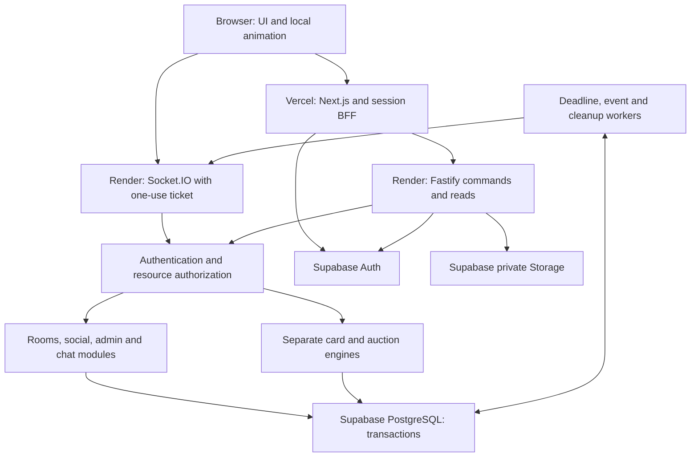
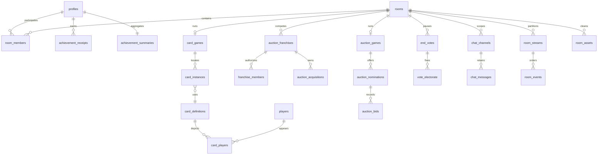

# Database and Realtime Architecture

**STUMPS v1.0 • 9 October 2026 • Normative engineering companion.** Gameplay decisions are in `GAME_RULES_AND_STATE_MACHINES.md`; the master document embeds this specification. Schema and payloads below are design specifications and migration patterns, not a claim that executable migrations have been tested.

## 1. Primary architecture and module boundaries

Use a pnpm TypeScript monorepo; Next.js App Router on Vercel; Fastify modular monolith on a paid always-on Render web service; Socket.IO on that same HTTP server; Supabase Auth, PostgreSQL and private Storage. PostgreSQL owns all durable state. Node caches projections and socket membership only. Start with one backend process and embedded background workers; no Redis, Kubernetes, message broker or microservices are required at private-launch scale.



| Module | Owns | Boundary and output |
|---|---|---|
| auth | JWT validation, app sessions, account enrollment | No game role from user metadata; verified subject only |
| access-gate | Code versions, grants, attempt windows | Valid gate grant required separately from Auth |
| profiles | Public-to-members profile projection, privacy | Cannot set own medal totals |
| friends | Requests, accepted edges, blocking, presence privacy | No unrestricted email/user enumeration |
| rooms | Lobby, codes, members, host, config versions | Locks room before changing any membership/game resource |
| presence | Connections, control leases, stale detection | Never changes competitor eligibility solely from network status |
| cards | Catalog projection, pure card reducer, deck repository | Reads frozen card/rating data; no auction dependencies |
| auctions | Nominations, bids, retentions, RTM, squad evaluation | Same bid validator for manual and auto actors |
| teams | Franchise membership, capabilities, requests, control | Host role is not team membership |
| deadlines | Durable due work and recovery generations | No game-specific rules; dispatches engine commands |
| voting | Electorate, ballots, saved timer state | Uses engine pause/finish interfaces |
| achievements | Compact receipts and counters | Only finalizer may mint |
| chat | Channels, moderation, message lifetimes | Audience membership checked on every read/write |
| cricket-data | Imports, identities, statistics and version publishing | Drafts never replace active room snapshots |
| cleanup | Storage deletion and room cascade | Never deletes shared player media or profiles |
| admin | Configuration, bans, audit, health projections | AAL2 plus DB-assigned administrator role |

## 2. Authentication, invitation gate and transport

### 2.1 Public surface and session choices

Public routes are the gate, admin login, invitation/password recovery callbacks, privacy/terms and static original design assets. Protected HTML/API data require a verified gate and Supabase identity. A public JavaScript bundle or generic login page cannot be made secret by an invitation gate; all valuable data and actions are protected server-side.

Next.js acts as a narrow same-origin backend-for-frontend (BFF) for REST and session cookies. Supabase Auth tokens live in Secure, HttpOnly, SameSite=Lax cookies handled on the Next server with its supported SSR SDK, never localStorage or browser-readable cookies. Browser does not call Supabase tables directly. The BFF forwards a validated access JWT to Render along with the opaque gate-grant cookie; Render independently verifies JWT issuer, audience, expiry and subject using provider verification/JWKS, and loads current bans/session revocation and gate state. A token decode alone is insufficient.

All auth login/refresh/callback handling is confined to server routes; client components receive minimal session projection. Check Origin and a session-bound CSRF token on cookie-authenticated mutations, including login and gate changes; permit only exact production origins. BFF forwards original IP only in an HMAC-signed envelope containing method, canonical path, body hash, timestamp and request nonce. Render trusts no browser `X-Forwarded-For`. Nonce expires after 60 seconds; reject duplicates; durable or per-instance replay cache plus signature lifetime protects the forwarding envelope. Command idempotency remains a separate mechanism. If the trusted ingress IP cannot be established, rate-limit conservatively by connection/IP and report the deployment error; never silently trust arbitrary headers.

Supabase public signups and anonymous sign-ins are disabled. The gated enrollment endpoint requests an email invitation through the server-only Auth administrative client. A pending enrollment record binds email hash, one-time nonce, gate version and expiry. The invitation/callback verifies Auth's token plus the pending enrollment and gate proof, establishes email ownership, then allows password setup. Invitations expire in 1 hour; gate admission remains independently required. Do not accept user-supplied metadata as proof of invitation. Existing users sign in with email/password through server routes. Use a real SMTP provider for invitations/recovery. P2 OAuth may be added only with equivalent gate-bound callback state and closed enrollment. Admin accounts are pre-provisioned by a protected operator procedure, never an open registration form.

### 2.2 Three-attempt semantics

Initial gate request creates a 256-bit random HttpOnly signed attempt cookie; PostgreSQL holds its attempt window. Default window 15 minutes, exactly three wrong codes, lockout 15 minutes (admin 1 minute–24 hours). Concurrent submissions lock the same attempt row. Correct code while locked does not unlock it. Failure number three locks immediately. Refresh/tabs share the cookie and persisted counter. Successful verification resets only that attempt bucket after issuing a grant; security rate buckets remain.

Store website/room passwords with Argon2id, unique salt, versioned parameters and a server-held pepper. Start with at least 19 MiB memory, 2 iterations, parallelism 1 and benchmark/tune at deployment. Password length 12–128, accept strong passphrases; admin gets a generated 128-bit code option. Enforce cheap rate limits before expensive hash verification. Uniform compare/error behavior must not leak code prefix. Default IP bucket: 30 gate failures/15 minutes and 10 new attempt cookies/15 minutes; authenticated user bucket: 3 failures/window across linked sessions. Network-prefix/global thresholds trigger a challenge or degraded admission rather than locking all established players behind shared NAT. Store HMAC IP/prefix identifiers, not raw addresses, with 24-hour retention.

**Limit:** before identification, no web application can guarantee “three attempts per human across all devices/IPs.” Clearing cookies or changing network can create a new anonymous identity. The design enforces three attempts per protected bucket and layers IP/global defenses; stronger per-person enforcement requires named invitations or identity verification. Do not claim fingerprinting solves this. Offer P1 single-use named invitations if access abuse warrants it.

On success issue random opaque preauth gate grant (10-minute TTL). After Auth completion bind it to user/session; grant TTL 12 hours, idle timeout 2 hours, no extension beyond code expiration. Gate rotation increments version. Maintain `min_valid_version`: a revoking rotation advances it to the new version, while a preserving rotation leaves it unchanged. Grant verification requires access_version ≥ min_valid_version, unrevoked status and its original expiry; it does not require equality with the newest version. Default `REVOKE_EXISTING` invalidates old grants immediately at command/read checks and disconnects streams; preserve mode honors old grants until their existing expiry. The admin confirms this policy alongside rotation, not secretly. Revocation pauses human controls, not game timers: card timeout and preconsented auto/observe still apply. A gate-expired user can reverify and recover membership, never create a second seat. Old secret hash is removed after rotation; maintain only nonsecret version history in audit.

### 2.3 Admin and socket auth

Admin uses Supabase Auth with required TOTP MFA/AAL2 and a separate app-scoped admin session (30-minute idle, 8-hour absolute). Sensitive changes require step-up within 5 minutes. Admin route can bypass the global gate solely for administering access recovery; it does not grant ordinary room participation. DB role assignments come from a protected bootstrap/second-admin workflow. Never trust `user_metadata.isAdmin`; inspect current `admin_assignments` on every privileged call. A removed admin loses access on next action and stream refresh. No application endpoint creates the first super-admin.

To connect, POST `/v1/socket-tickets` through BFF. Render stores hash of a random one-use ticket with user, gate grant, auth session, allowed origin and 30-second expiry. Browser sends it in Socket.IO auth payload, not URL query. Consume atomically at connection; verify Origin; no long-lived token in logs. Every command rechecks gate/session/ban/membership and control epoch. Recheck stream authorization at most every 15 seconds and on every privacy-sensitive broadcast; revoke immediately on permission changes. Reconnect fetches a fresh ticket. CORS alone is not WebSocket authorization.

## 3. Command transaction and delivery guarantees

Use `pg` with parameterized SQL, explicit transactions and a small pool (5 connections at launch, 10 after measurement). Do not allocate a DB connection per socket. Prefer session pooler/direct for stable Node workload if network supports it; transaction pooler is acceptable with unnamed prepared queries, no session-level assumptions and `SET LOCAL` only. Migrations use a separate direct/session connection. Provider connection limit is shared across apps/jobs, so reserve ≥20% for operations. The app role cannot perform migrations.

**Lock order:** room row → memberships/franchises in UUID order → nomination/card rows → vote rows → achievements in user-ID order. No worker locks a child job first and then waits on a room while another transaction holds the room and waits on that job. Workers discover candidates without a lock, then `SELECT room ... FOR UPDATE SKIP LOCKED`, then revalidate the child/job. Global access and social transactions use sorted entity IDs. All game mutations use READ COMMITTED plus the common room row lock; SERIALIZABLE only for cross-room/global operations where invariants cannot be modeled by unique constraints. Retry deadlock/serialization failures at most 3 times with jitter and the same idempotency key.

```text
authorize actor and coarse request size/rate limits
BEGIN
  SELECT room FOR UPDATE
  verify current gate, ban, room member, capabilities, active control epoch
  lookup receipt by (room, actor, commandId)
  same canonical body hash -> return stored result without repeating
  different body hash -> IDEMPOTENCY_CONFLICT
  read DB clock; dispatch already-due deadline before later command
  validate entity version, phase, payload and invariants
  apply authoritative reducer + SQL updates
  increment room stateVersion for gameplay; nomination has own bidVersion
  append audience-specific stream events and advance those stream cursors
  insert command receipt containing safe reply
COMMIT
acknowledge command; publish via outbox worker
```

Receipts remain until room deletion. Nonroom actions have 24-hour request receipts. Any nonroom receipt that references a newly created room must store only its opaque resource pointer and be deleted at room purge; it must not retain a room snapshot/code after deletion. Authorization reconstructs the creation reply from the live room. A duplicate command after deletion cannot recreate a room/award: handlers require an extant active room; absent is `ROOM_GONE`. Persistent achievements have their own uniqueness key for finalization retry.

Socket.IO preserves ordering on a connection but its default delivery is not a durable exactly-once transaction log (S10). Application behavior is **at-least-once command retries with idempotent effects**, and **at-least-once event publication with client deduplication**. Never promise exactly-once network delivery.

### 3.1 Stream model and replay privacy

Each audience has an independent ordered stream: `room:{roomId}` public-to-room; `team:{franchiseId}`; `member:{membershipId}`. `room_streams` stores the sequence counter; events are transactionally appended with unique `(streamId,seq)`. Private events do not create apparent gaps in public sequences. Hidden decks and auto ceilings never enter public payloads. Every event has eventId, schemaVersion, type, streamId, seq, roomStateVersion, occurredAt and validated payload. Server includes only streams the subject can currently access.

Snapshot/replay handshake: authorize subscriptions → in one REPEATABLE READ transaction fetch permitted state and current per-stream cursors → send snapshot → buffer live events during that read → deliver only buffered events after those cursors. Client applies each stream in order, ignores duplicates, requests replay on a gap; maximum replay 500 events/256 KiB, otherwise fresh snapshot. Historical team messages/events are returned only to current members; a former member's cursor does not preserve access. Public deck order is absent even in reconnect snapshots.

Secret-bearing command replies (invitation codes or gate tokens) persist only an encrypted value or authorized resource pointer in receipts, never a plaintext secret. Reconstruct the authorized reply during replay. Room events double as an outbox with `published_at`, attempts and retry time. Mark publication only after dispatcher attempts delivery; crash before marking may duplicate and is safe. “Published” does not prove receipt by every client; replay is the recovery path. Database records are authoritative regardless of delivery success. At scale, Socket.IO Redis adapter distributes live events, but PostgreSQL outbox/replay remains authority. WebSocket-only transport avoids polling affinity requirements; on networks blocking WebSockets show diagnosis and retry, not a fake connected state. P1 polling fallback needs tested sticky sessions before horizontal deployment.

## 4. Deadlines, restart recovery and multiple processes

`deadline_jobs` is a durable queue keyed by `(roomId, kind, subjectId, generation)`. Target state also stores the authoritative deadline/generation; queue entries are wakeup indexes, never the sole source of truth. Poll every 250ms for gameplay deadlines and every 30 seconds for cleanup, bounded batches. In-memory `setTimeout` may wake sooner but cannot determine outcomes. Each job rechecks deadline under the room lock and no-ops when stale. Rebuild missing queue rows at startup and with a periodic invariant scan.

Service heartbeat is recorded every 2 seconds in `runtime_leases`. The initial single-process deployment has a DB-owned lease; zero-downtime deployment overlap must not create two unfenced coordinators. Lease generations fence coordinator work; transactions still check game generations. On unexpected gap >5 seconds, rooms with overdue gameplay deadlines enter PAUSED_RECOVERY under lock. Use the coordinator lease’s last durable healthy heartbeat, or the room’s later last committed mutation timestamp if any, as the outage reference. Preserve remaining time from that last healthy checkpoint (minimum zero) and use a visible 10-second recovery countdown before resuming. This is a disclosed simulator outage policy: a server outage must not silently sell many players while nobody can bid. A still-live second instance may continue normally because global service lease is healthy. Votes use their original durable deadline even through outage, then feed the restored game into recovery pause if required.

Do not infer an outage from a single user's mobile disconnect. Planned deployment drains new commands, commits in-flight transactions, emits reconnect notice and relinquishes lease. Active games may be briefly recovery-paused; never depend on graceful shutdown for persistence. Limit pause frequency and alert on repeated heartbeat gaps. A database outage fails closed: disable commands, show connection banner, never mutate a local authoritative shadow state. Replay receipts after recovery before resending uncertain commands.

Separate SQL/IO workers from CPU evaluation with worker_threads and bounded concurrency 1 initially. Evaluation checkpoints are room-scoped; worker result includes input hash and generation and is discarded if finalization state changed. Large independent room counts scale across Render instances with Redis fanout; all room mutations still serialize in PostgreSQL. A measured lock-contention problem, not a user-count milestone alone, justifies dedicated per-room actor ownership later.

## 5. Schema conventions and retention classes

All tables are in non-exposed schema `app_private`. Supabase `auth.users` is provider-owned. Unless overridden: IDs are UUID, timestamps are `timestamptz NOT NULL DEFAULT now()`, strings have explicit length checks, all FKs are indexed, composite room-scoped FKs enforce same-room relationships. UUID defaults use `gen_random_uuid()`. `NN` means NOT NULL; `?` means nullable. `UQ` means unique. All money is `bigint` rupees with nonnegative checks and JSON serialization as decimal string; safe JS integers may only be used after range checks. All version/seq fields are `bigint` and serialize as decimal strings too.

Retention/RLS shorthand in **every row below**:

- **P** persistent catalog/profile, **S** security with explicit TTL, **T** temporary room scope, **O** bounded operational.
- **B** browser denied all operations through Data API; backend service role policy/grants only. All app tables use B, including profiles, to preserve the global access gate. Supabase Auth is accessed only via its supported APIs; do not implement custom passwords for users.
- Every T table has `room_id uuid NN → rooms ON DELETE CASCADE` unless it is the root or explicitly says otherwise. Child relations also cascade where ownership is exclusive. Catalog FKs RESTRICT deletion; archive published versions instead. Profile FKs in historical achievement receipts are deleted with account-erasure policy, not with room cleanup.
- Each dictionary row includes purpose, columns, keys/constraints and extra indexes. Base PK and FK indexes are implied by these conventions. Jsonb is limited to immutable validated rule/config documents, projections, typed payloads and sparse import provenance; money, membership, cards, bids and votes are relational.

### 5.1 Persistent and security tables

| Table / purpose | Columns and keys | Constraints / indexes | Retention and RLS |
|---|---|---|---|
| profiles — member identity | user_id uuid PK→auth.users CASCADE; username text NN; display_name text NN; bio text?; avatar_asset_id uuid?; visibility text NN; activity_visible bool NN; suspended_until ts?; created_at, updated_at ts | UQ lower(username), length 3–24, `[a-z0-9_]`; display≤ 50, bio≤ 240; visibility members/friends/private; lower(username) prefix index | P/B; account erasure removes owned data |
| admin_assignments — real platform roles | user_id PK→profiles CASCADE; role text; assigned_by uuid?→profiles; assigned_at ts; revoked_at ts? | role=super_admin or operator; bootstrap may have null actor; index active role | P/B; operator cannot change roles/access secrets |
| access_config — singleton policy | id smallint PK=1; version bigint; min_valid_version bigint; code_hash text; pepper_version int; expires_at ts?; max_failures int=3; window_seconds int; lockout_seconds int; rotation_policy text; updated_by uuid→profiles; updated_at ts | window 60–86400; lockout 60–86400; version>0; no old code hashes retained | P/B; hash overwritten on rotation |
| access_attempts — server counters | bucket_hash bytea PK; kind text; window_started_at ts; failures int; locked_until ts?; expires_at ts | failures≥ 0; kind cookie/user/ip/prefix/global; index expires_at | S/B; 24h max after window expiry |
| gate_grants — opaque verification | id uuid PK; token_hash bytea UQ; token_ciphertext bytea; user_id uuid?→profiles CASCADE; auth_session_id uuid?; access_version bigint; issued_at, last_seen_at, expires_at ts; revoked_at ts?; kind preauth/bound | preauth user null, bound user NN; expiry index; user/version index | S/B; expired rows purged within 24h |
| enrollment_invites — gated signup | id uuid PK; email_hash bytea; nonce_hash bytea UQ; access_version bigint; gate_grant_id uuid→gate_grants CASCADE; expires_at ts; consumed_at ts? | partial UQ(email_hash) where consumed_at is null; expiry index | S/B; expire after 1h, delete ≤24h; no plaintext password |
| app_sessions — gate-bound Auth session control | id uuid PK; user_id→profiles; supabase_session_id uuid; refresh_lease_until ts?; created_at, last_seen_at, expires_at ts; revoked_at ts?; scope member/admin | UQ(supabase_session_id, scope); expiry index; no refresh tokens here | S/B; delete revoked/expired after 24h |
| socket_tickets — one-use connection auth | id uuid PK; token_hash bytea UQ; session_id→app_sessions CASCADE; grant_id→gate_grants CASCADE; origin text; expires_at ts; consumed_at ts? | expiry≤issued+30sec; expiry index | S/B; delete ≤5min |
| request_receipts — nonroom retry defense | actor_id uuid; command_id uuid; body_hash bytea; response jsonb; resource_id uuid?; expires_at ts; PK(actor_id, command_id) | response≤ 16KiB; expiry index; resource_id references rooms when applicable and CASCADE deletes at purge | S/B; 24h or room deletion, whichever first; exclude secrets |
| friendships — request and relationship | id uuid PK; low_user_id, high_user_id→profiles CASCADE; requested_by uuid→profiles; status pending/accepted; created_at, updated_at ts | low<high; UQ(low, high); requester one endpoint; indexes each user, status | P/B; rejection/removal deletes row |
| user_blocks — directional privacy | blocker_id, blocked_id→profiles CASCADE; created_at ts; PK(blocker, blocked) | blocker≠blocked; blocked index | P/B; removes friendship, cancels requests |
| notifications — personal inbox | id uuid PK; user_id→profiles CASCADE; type text; safe_payload jsonb; created_at, expires_at ts; read_at ts? | index(user, created_at DESC); payload≤ 4KiB; exclude room secrets | O/B; max30d; room-related invitations stored separately below |
| achievement_receipts — durable compact grants | id uuid PK; award_batch uuid; user_id→profiles CASCADE; game_type text; rank smallint?; medal_place smallint?; medal text?; scope personal/franchise; credited_role text; completion_day date; ruleset_version text; evaluator_version text?; qualifies bool | UQ(award_batch, user_id); rank≥ 1; medal null/gold/silver/bronze and medal_place1/2/3 mapping; competitive rank is independent; index(user, completion_day DESC) | P/B; no room FK or transcript |
| achievement_summaries — rebuildable counts | user_id PK→profiles CASCADE; gold, silver, bronze, games, card_wins, auction_wins bigint; updated_at ts | all≥ 0; update only from inserted qualifying receipts | P/B; can rebuild from receipts |
| players — stable cricket identity | id PK; canonical_name text; country_code char(2); primary_role text; batting_style text?; bowling_style text?; archived_at ts? | name nonempty; index normalized name for manual dedup; no name-only UQ | P/B; archive referenced players |
| player_external_ids — provenance identity map | player_id→players; source text; external_id text; PK(source, external_id) | UQ(player, source, external_id); index player | P/B; merge reviewed, never name-only |
| seasons — temporal context | id PK; competition text; label text; starts_on, ends_on date; snapshot_cutoff ts | start≤end; UQ(competition, label) | P/B; immutable published versions |
| franchises — season-independent identities | id PK; slug text UQ; name text; primary_hex char(7); emblem_asset_id uuid?; archived_at ts? | hex format; safe name length | P/B; archive |
| season_franchises — season membership | season_id→seasons; franchise_id→franchises; display_name text; PK(season, franchise) | prevents hardcoded franchise count | P/B |
| player_seasons — role/ownership facts | player_id→players; season_id→seasons; franchise_id uuid?→franchises; capped_status text; overseas bool; availability text; capability_tags text[]; source_id uuid→data_sources; PK(player, season) | capped/uncapped/unknown; reviewed tags enum; index(season, franchise) | P/B; versions published through datasets |
| data_sources — evidence and rights | id PK; publisher text; url text; fetched_at ts; licence_label text; attribution text; verification_status text; checksum text; scope text | URL allowlist for import, no arbitrary server fetch; status draft/reviewed/rejected | P/B; preserve attribution |
| data_versions — published snapshot | id PK; season_id→seasons; label text; cutoff_at ts; status text; source_manifest jsonb; content_hash text UQ; published_at ts? | immutable when published; UQ(season, label) | P/B |
| player_statistics — typed metric fact | data_version_id→data_versions; player_id→players; metric text; segment text; value numeric?; exposure numeric?; units text; source_id→data_sources; confidence numeric; PK(version, player, metric, segment) | confidence0..1; exposure≥ 0; null means unavailable; segment overall/PP/middle/death/recent | P/B; no direct in-place edit of published version |
| player_ratings — derived comparisons | data_version_id→data_versions; player_id→players; model_version text; metric text; points int; completeness numeric; provenance observed/estimated/demo; PK(version, player, model, metric) | points0..1000; completeness0..1; index(version, metric, points) | P/B; recompute new version |
| media_assets — global image/audio rights | id PK; bucket text; object_key text UQ; mime text; size_bytes bigint; owner_user_id uuid?→profiles; source_id uuid?→data_sources; rights_status text; attribution text?; expires_at ts? | approved before use; mime allowlist; size>0; user deletion only user-owned media | P/B; private bucket |
| card_definitions — immutable collectible edition | id PK; data_version_id→data_versions; label text; rarity text; stars smallint; ratings jsonb; art_asset_id uuid?→media_assets; model_version text; archived_at ts? | rarity six enums; stars1..5; strict ratings schema; index(version, rarity) | P/B; ratings JSON validated at publication |
| card_players — one/two identities | card_id→card_definitions; player_id→players; position smallint; PK(card, player) | UQ(card, position); position1..2; deferred validator exactly2 dual, else1 | P/B |
| auction_rulesets — immutable policies | id PK; name text; season_id→seasons; version int; status draft/published/archived; rules jsonb; source_manifest jsonb; rules_hash text UQ; evaluator_version text | UQ(name, version); validated schema, no executable code in JSON | P/B |
| auction_pool_entries — published offered identities | ruleset_id→auction_rulesets; player_id→players; previous_franchise_id uuid?→franchises; base_price bigint; capped_status text; set_order int; source_id→data_sources; PK(ruleset, player) | price>0; order≥ 0; index(ruleset, set_order) | P/B; new version for changes |
| admin_audit — sensitive operations | id PK; actor_id uuid?; action text; target_class text; safe_diff jsonb; occurred_at ts; request_hash text | append-only runtime, no code/password/chat/squad body; index(time, action) | O/B; 90d; room target identifiers stay in temporary events |
| security_events — bounded abuse evidence | id PK; actor_hash bytea?; ip_hash bytea?; reason text; severity text; occurred_at ts; expires_at ts | no credential/payload; index(expires_at), index(time, severity) | O/B; 30d; unlinked to deleted room |
| announcements — admin content | id PK; title text; body text; starts_at, ends_at ts; author_id→profiles | title≤ 100, body≤ 1000; start<end; plain text only | P/B; archive after end |
| runtime_leases — process coordination | name text PK; owner_id uuid; generation bigint; heartbeat_at, expires_at ts | expiry index; generation monotonic | O/B; overwrite/remove stale; no game bodies |

### 5.2 Temporary room tables

| Table / purpose | Columns and keys | Constraints / indexes | Retention and RLS |
|---|---|---|---|
| rooms — cascade root | id PK; game_type card/auction; name text; host_user_id→profiles; lifecycle text; phase text; settings jsonb; saved_phase jsonb?; match_deadline ts?; hard_deadline ts?; last_healthy_at ts; pause_count int; vote_failures int; last_vote_resolved_at ts?; config_version, state_version bigint; code_hash bytea UQ; code_ciphertext bytea; password_hash text?; ruleset_id uuid?→auction_rulesets; data_version_id→data_versions; created_at, last_activity_at, expires_at ts; result_expires_at ts?; generation bigint; award_batch uuid UQ; seed_commitment text; seed_ciphertext bytea; finalized_at ts? | lifecycle LOBBY/RUNNING/FINALIZING/RESULTS/PURGING/ABORTED; name≤ 64; index(lifecycle, expires_at); code only regenerated server-side | T/B; delete last, after storage cleanup |
| room_members — seats, host/player data | id PK; room_id; user_id→profiles; seat int?; role player/spectator; ready bool; approved_at ts; joined_at, last_seen_at ts; left_at ts?; participation_ms bigint; participation_opened_at ts?; participation_closed_at ts?; eligible_at_start bool; control_epoch bigint | UQ(room, user); partial UQ(room, seat) if seat NN; seat≥ 0; index(room, left_at) | T/B; retain participation after leave until purge |
| room_invites — friend invitations | id PK; room_id; inviter_id, recipient_id→profiles; expires_at ts; accepted_at ts? | UQ(room, recipient); no raw password; recipient/expiry index | T/B; friend removal/block invalidates |
| room_connections — tabs/devices | id PK; room_id; member_id→room_members; socket_id text UQ; instance_id uuid; last_heartbeat_at ts; is_controller bool; lease_epoch bigint; expires_at ts | partial UQ(member_id) where is_controller; index(expires_at) | T/B; delete stale ≤5min |
| room_commands — durable receipts | room_id; actor_key text; command_id uuid; body_hash bytea; response jsonb; created_at ts; PK(room, actor_key, command_id) | response≤ 16KiB; no raw secret; index(created_at) | T/B |
| room_streams — independent audience cursors | id PK; room_id; audience_kind public/team/member; audience_id uuid?; seq bigint | UQ NULLS NOT DISTINCT(room, audience_kind, audience_id); seq≥ 0 | T/B |
| room_events — replay and transactional outbox | id PK; room_id; stream_id→room_streams; seq bigint; state_version bigint; type text; payload jsonb; created_at ts; published_at ts?; attempts int; retry_at ts | UQ(stream, seq); payload≤ 64KiB; index(stream, seq); partial index retry_at where published null | T/B; no permanent log export |
| deadline_jobs — wakeups | id PK; room_id; kind text; subject_id uuid?; generation bigint; due_at ts; attempts int; last_error_code text? | UQ NULLS NOT DISTINCT(room, kind, subject, generation); index(due_at) | T/B; delete stale generation |
| card_games — room-specific engine state | room_id PK; total_cards int; selector_member_id uuid?→room_members; chain_index, comparison_index int; tie_count int; allowed_metrics text[]; phase_deadline ts?; timer_generation bigint; finish_pending bool; rng_version text; fallback_order uuid[]; completed_contests int | total 8..240; member refs same room; no phase authority duplicated from rooms | T/B |
| card_seats — elimination/counters | room_id; member_id→room_members; eliminated_chain int?; elimination_order int?; chain_start_count int; contests_won int; next_tail_ordinal bigint; PK(room, member) | counters≥ 0; partial UQ(room, elimination_order) | T/B |
| card_instances — sole location authority | id PK; room_id; definition_id→card_definitions; location DECK/ACTIVE/POT; owner_member_id uuid?→room_members; ordinal bigint?; comparison_id uuid?; contributor_member_id uuid?→room_members; pot_order bigint? | DECK requires owner+ordinal and no comparison/pot order; ACTIVE requires contributor+comparison; POT requires contributor+pot_order; partial UQ(room, owner, ordinal) DECK; UQ(room, id); index(room, location) | T/B; deferred conservation trigger |
| card_comparisons — traceable resolves | id PK; room_id; chain_index, comparison_index int; selector_id→room_members; metric text?; status open/tied/awarded/cancelled; eligible_ids uuid[]; tied_ids uuid[]; winner_id uuid?; resolved_at ts? | UQ(room, comparison_index); validated eligible/tied subsets; snapshots no hidden deck | T/B |
| card_contributions — reversible provenance | room_id; comparison_id→card_comparisons; instance_id→card_instances; contributor_id→room_members; metric_points int?; seat_order int; original_ordinal bigint; PK(comparison, instance) | UQ(comparison, contributor); points0..1000; index(room, comparison) | T/B; history not ownership |
| card_cycle_counts — finite-game guard | room_id; state_hash bytea; occurrences int; PK(room, state_hash) | occurrences≥ 1 | T/B |
| auction_games — progress/evaluation | room_id PK; format fresh/retention; nomination_index int; pool_pass int; active_nomination_id uuid?; completed_nominations int; evaluation_input_hash text?; evaluation_cursor bigint?; evaluation_best jsonb?; pacing_deadline ts? | pass1..2; counters≥ 0; active nomination same room | T/B |
| auction_franchises — purse/controller state | id PK; room_id; franchise_id→franchises; captain_member_id→room_members; initial_purse, remaining_purse, retention_charge bigint; control_mode manual/auto/observe; control_epoch bigint; ready bool; vote_delegate_member_id uuid?; takeover_due_at ts? | UQ(room, franchise); remaining≥ 0≤initial; same-room captain; index(room, control_mode) | T/B |
| franchise_members — approved capabilities | room_id; auction_franchise_id→auction_franchises; member_id→room_members; role captain/cocaptain/bidder/advisor; can_bid, can_invite, can_strategy, can_retain_propose, can_rtm, can_manage_limits bool; approved_at ts; eligible_at_start bool; failover_order int?; PK(franchise, member) | UQ(room, member); partial UQ(franchise) role captain; capability schema; index(member) | T/B |
| team_handovers — explicit captain consent | id PK; room_id; franchise_id→auction_franchises; from_member_id, to_member_id→room_members; status pending/accepted/expired; expires_at ts; created_at ts | one pending/franchise; from≠to; same-room approved members; expiry index | T/B; expires after 60 seconds |
| host_handovers — voluntary room authority | id PK; room_id; from_member_id, to_member_id→room_members; status pending/accepted/expired; expires_at ts | one pending/room; from≠to; target active member; expires60 seconds | T/B |
| franchise_invites — separate join code | id PK; room_id; franchise_id→auction_franchises; code_hash bytea UQ; code_ciphertext bytea; expires_at ts; auto_join_user_ids uuid[] | one active invite per franchise; cannot authorize arbitrary roles | T/B |
| franchise_join_requests — approval | id PK; room_id; franchise_id→auction_franchises; member_id→room_members; status pending/approved/rejected; created_at, decided_at ts?; decided_by uuid? | UQ(franchise, member); status consistency; index(franchise, status) | T/B |
| auction_pool — copied room eligibility | room_id; player_id→players; base_price bigint; previous_franchise_id uuid?→franchises; capped_status text; overseas bool; order_index int; status available/retained/sold/unsold/skipped; pass int; PK(room, player) | UQ(room, order_index); price>0; source catalog version immutable | T/B |
| auction_nominations — sole active lot | id PK; room_id; player_id→players; stage bidding/rtm_intent/rtm_raise/rtm_match/settled/cancelled; status open/sold/unsold/skipped/cancelled; high_franchise_id uuid?→auction_franchises; high_bid bigint?; bid_version bigint; deadline ts?; timer_generation bigint; rtm_franchise_id uuid?; rtm_final_bid bigint? | partial UQ(room) status open; composite FK(room, player)→auction_pool; price positive when present; index(deadline) | T/B |
| auction_bids — accepted offers only | id PK; room_id; nomination_id→auction_nominations; franchise_id→auction_franchises; actor_member_id uuid?; actor_type human/auto; amount bigint; accepted_at ts; command_id uuid; bid_version bigint; kind normal/rtm_raise/rtm_match | UQ(nomination, bid_version); amount>0; same-room refs; index(nomination, accepted_at) | T/B; rejected bid only safe response/metric |
| auction_acquisitions — squad authority | id PK; room_id; player_id→players; franchise_id→auction_franchises; nomination_id uuid?→auction_nominations; kind retention/auction/rtm; charged_price bigint; allocation_price bigint?; created_at ts | UQ(room, player); UQ(nomination) when NN; charge≥ 0; composite FK room/pool; index(franchise) | T/B; purse sums checked transactionally |
| retention_packages — proposals and final package | id PK; room_id; franchise_id→auction_franchises; proposed_by→room_members; version bigint; players_and_allocations jsonb; status draft/submitted/locked; total_charge bigint | one locked package/franchise; strict schema + server cost validator; index(franchise, status) | T/B; acquisitions materialized on locking |
| auto_strategies — private limits | room_id; franchise_id PK→auction_franchises; version bigint; enabled bool; strategy jsonb; spent_auto bigint; purchases_auto int; updated_by→room_members | strict caps schema; counters≥ 0; backend-only visibility except own team | T/B |
| team_shortlists — recommendations | room_id; franchise_id→auction_franchises; player_id→players; priority int; private_note text?; max_price bigint?; proposed_by→room_members; PK(franchise, player) | priority0..100; note≤ 500; price≥ 0 | T/B |
| shortlist_votes — advisory votes | room_id; franchise_id; player_id; member_id→room_members; value smallint; PK(franchise, player, member); composite FK→team_shortlists | value -1/1; never a purchase authorization | T/B |
| end_votes — frozen electorate and paused phase | id PK; room_id; started_by→room_members; status open/passed/failed; starts_at, expires_at ts; electorate_count int; saved_phase text; saved_timers jsonb; resolved_at ts? | expiry=starts+15 seconds; partial UQ(room) status open; index(expires_at) | T/B |
| vote_electorate — representative snapshot | room_id; vote_id→end_votes; voter_key uuid; representative_member_id→room_members; kind player/franchise; choice text?; cast_at ts?; PK(vote, voter_key) | choice end/continue/null; cast_at<vote expiry via trigger; UQ(vote, representative) | T/B; no mutable electorate |
| chat_channels — public/team audience | id PK; room_id; kind room/team; franchise_id uuid?→auction_franchises | team iff franchise NN; UQ NULLS NOT DISTINCT(room, kind, franchise) | T/B |
| chat_mutes — scoped moderation | room_id; channel_id→chat_channels; member_id→room_members; muted_by→room_members; reason text; expires_at ts; PK(channel, member) | own team captain or public-room host authority; max24h; expiry index | T/B |
| chat_messages — temporary text | id PK; room_id; channel_id→chat_channels; sender_member_id→room_members; client_message_id uuid; body text; created_at ts; removed_at ts?; moderation_reason text? | UQ(sender, client_message_id); length1..500; index(channel, created_at, id); no HTML | T/B |
| room_assets — external deletion manifest | id PK; room_id; bucket text; object_key text UQ; status uploading/ready/deleting/deleted; upload_expires_at ts; size_bytes bigint; checksum text | key begins rooms/roomUUID/; mime checks in upload; expiry index | T/B; survives until successful object deletion |
| room_results — short-lived podium | room_id PK; public_result jsonb; private_team_reports jsonb; created_at, expires_at ts; source_state_hash text | expires≤created+300 seconds; validated redacted report; no raw bid/chat copy | T/B; member filtered, deleted with room |
| cleanup_tasks — recoverable deletion | room_id PK; stage freeze/assets/rows; next_attempt_at ts; attempts int; last_error_code text?; locked_until ts? | index(next_attempt_at); idempotent root task | T/B; cascade only after assets verified absent |

For captain handover, update old captain membership to co-captain first, then target to captain, then the franchise pointer, all under one room transaction; a deferred end-of-transaction check requires exactly one captain matching the pointer. The partial unique index prevents two simultaneous captains. Required start participation is accumulated as unioned connection intervals, not a sum of overlapping tabs. Close a durable interval at min(actual disconnect, last heartbeat + grace); reconcile on reconnect and finalization. Exclude voting/recovery pauses from the participation denominator and numerator; grace is credited at most once per absence.

Host policy: lobby or running host absent beyond60 seconds transfers to the earliest joined connected non-spectator, UUID as deterministic tie-break. During an open vote defer transfer until resolution; that vote persists independently. If nobody is connected retain the host pointer until someone returns or abandonment expires. Transfer conveys room controls only, never franchise strategy or bidding rights. Rejoining old host does not regain host status automatically. Voluntary host transfer requires target acceptance within60 seconds.

Invitation generation uses12 symbols from a32-symbol unambiguous alphabet, giving60bits. Draw with a CSPRNG, use keyed HMAC digest for indexed lookup and encryption for authorized display, and retry a unique-index collision without overwriting an existing room. No password in invitation URLs. Do not reuse expired codes intentionally; uniqueness is enforced over active records and fresh randomness makes accidental reuse negligible.

No separate ownership, deck and central-pot tables compete as authorities: `card_instances.location` is the single source; contributions are history. No separate purchases/retentions tables need divergent squad accounting: acquisitions represent both, with retention proposal workflow separate. Cached purse and counts are checked against acquisitions on invariant scans, not blindly trusted.

### 5.3 ER relationships



## 6. RLS, grants and migration patterns

RLS is a second boundary, not a replacement for per-action backend authorization. The browser `anon`/`authenticated` roles have no usage on app_private, no table grants, no SECURITY DEFINER shortcut and no gameplay RPC. Normal backend DB role `app_runtime` is LOGIN, NOSUPERUSER, NOCREATEDB, NOCREATEROLE, NOBYPASSRLS; specific tables have a backend policy and least required SELECT/INSERT/UPDATE/DELETE grants. This role is deliberately trusted across users, so backend queries must scope rooms/users and enforce ACLs. Never describe this service policy as end-user row isolation. Admin mutations use guarded repositories; high-risk catalog publishing/role assignment may use a separate limited `app_admin_runtime` role. Migration owner is not the runtime role.

Supabase service-role/secret key exists only in narrowly scoped backend Auth-invite and Storage adapters; it can bypass RLS and is never exposed in frontend code, source maps, NEXT_PUBLIC variables, error payloads or general shared packages. Keys and DB passwords are separate. Storage buckets are private, no browser list/write policy; backend issues short-lived authorized read URLs (≤60 seconds for private content). URLs already issued cannot be unread; remove objects at purge and prevent new URLs immediately on revocation. To make the application private, do not put player photo buckets on public access. Original generic shell artwork may be public.

```sql
-- Pattern only: expand through versioned migrations and test on local Supabase.
CREATE SCHEMA IF NOT EXISTS app_private;
REVOKE ALL ON SCHEMA app_private FROM PUBLIC, anon, authenticated;
REVOKE ALL ON ALL TABLES IN SCHEMA app_private FROM PUBLIC, anon, authenticated;
ALTER DEFAULT PRIVILEGES IN SCHEMA app_private
  REVOKE ALL ON TABLES FROM PUBLIC, anon, authenticated;

CREATE TABLE app_private.rooms (
  id uuid PRIMARY KEY DEFAULT gen_random_uuid(),
  lifecycle text NOT NULL CHECK (lifecycle IN
    ('LOBBY','RUNNING','FINALIZING','RESULTS','PURGING','ABORTED')),
  state_version bigint NOT NULL DEFAULT 0 CHECK (state_version >= 0),
  award_batch uuid NOT NULL UNIQUE DEFAULT gen_random_uuid(),
  created_at timestamptz NOT NULL DEFAULT now()
  -- Add dictionary columns in the real migration.
);
ALTER TABLE app_private.rooms ENABLE ROW LEVEL SECURITY;
ALTER TABLE app_private.rooms FORCE ROW LEVEL SECURITY;
CREATE POLICY backend_rooms ON app_private.rooms TO app_runtime
  USING (true) WITH CHECK (true);
GRANT USAGE ON SCHEMA app_private TO app_runtime;
GRANT SELECT, INSERT, UPDATE, DELETE ON app_private.rooms TO app_runtime;

-- Required relationship pattern for every cross-reference inside a room:
ALTER TABLE app_private.room_members ADD CONSTRAINT room_member_pair
  UNIQUE (room_id,id);
-- Any selector/captain reference uses (room_id,member_id), not member_id alone.

CREATE UNIQUE INDEX one_open_nomination
 ON app_private.auction_nominations(room_id) WHERE status='open';
CREATE UNIQUE INDEX one_open_end_vote
 ON app_private.end_votes(room_id) WHERE status='open';
CREATE UNIQUE INDEX one_deck_position
 ON app_private.card_instances(room_id,owner_member_id,ordinal)
 WHERE location='DECK';
```

Deferred constraint triggers at transaction end assert per-room card count equals total, every location shape is valid, acquisitions purse sums match, same-room pointers and medal_place/medal consistency. Row-level CHECK cannot enforce another table's sum; use transaction logic plus deferred trigger for critical invariants. Avoid per-row full-table scans: collect affected room IDs and validate once per transaction. SQL functions use fixed search_path and explicit schema names; default EXECUTE revoked from PUBLIC. Security definer functions are limited to approved bootstrap/maintenance, never arbitrary query endpoints.

Migration order: 000 extensions/roles/schema; 010 profiles/security; 020 catalog/sources/versioning; 030 social/achievements; 040 rooms/streams/deadlines; 050 card engine; 060 auction/franchise/retention; 070 votes/chat/assets/results/cleanup; 080 FK strengthening/deferred invariants; 090 RLS/grants/default privileges; 100 indexes and seed fixtures. Each feature migration creates its security policy immediately, never deploys an exposed interval waiting for 090. Migration 090 verifies/reconciles all policies. Snapshot published catalog migrations are separate from data imports. Apply migrations once via CI, not from every server startup. Rollback uses forward repair; destructive schema removal waits until both app versions stop using it.

## 7. Finalization, results and deletion

1. Under the room lock, reject new gameplay, validate terminal condition, settle/restore unresolved state, compute immutable input hash and enter FINALIZING. Card ranks are immediate; auction evaluation may complete in checkpointed worker jobs. No medals before evaluation is done.
2. Lock finalizing room again, verify input hash/generation, build eligibility and podium, insert achievement receipts with unique `(award_batch,user_id)` using INSERT...ON CONFLICT DO NOTHING RETURNING. Increment summaries only for returned newly inserted rows in the same transaction. Save room_results, mark RESULTS/finalized_at and results expiry, append finalization events and cleanup task. A failure rolls back both receipts and completion, enabling a safe retry.
3. Clients get the public podium and their allowed detailed report, remain on the result view for up to the fixed 120 seconds, and can leave immediately. Reconnect during TTL can fetch it. The persistent profile receipt contains only medal/participation summary. After expiry, reload shows profile medals and “Detailed match results expired.” A client may keep an already received result in memory until navigation; service workers/localStorage never persist private match state.
4. At expiry lock room, enter PURGING and revoke codes, room grants, chat/read subscriptions and new uploads. Wait for in-flight backend uploads to settle (≤60-second upload lease). All room uploads are proxied through the backend, not long-lived presigned write URLs. Delete every manifest object through Storage API; treat already missing as success. Re-list the room prefix after upload leases end; retry until empty. Never delete only storage metadata rows because that can leave underlying objects.
5. In a DB transaction lock PURGING room, verify all assets absent, then DELETE root room. Cascades remove every T entity, including command receipts, events, chats, votes, state, files manifest and cleanup task. Invariant audit checks no room-scoped rows remain. Record only anonymous aggregate cleanup success count/timing, not retained match contents or room-linked log payloads.

Storage and PostgreSQL cannot share one atomic transaction. The recoverable task intentionally keeps an inaccessible PURGING root until external files are removed; it is better than losing deletion work. Crash after object deletion but before row deletion safely retries. Two cleaners use same lock and lease; one works, other skips. Retry schedule 1m,5m,15m,60m then hourly, alert after 15m past result expiry; do not abandon failed work silently. Objects absent with already deleted root are success.

**Honest deletion boundary:** live DB rows and Storage objects are removed; SQL DELETE is not guaranteed instantaneous physical bit erasure, and managed backups/WAL, provider logs, CDN caches, user screenshots or downloaded results may outlive it. Configure backup retention, log redaction and private no-store responses; explain those limits in the product policy. On backup restore, run cleanup against all expired results/abandoned rooms before admitting users. Use backup policy/operational restore records to avoid resurrecting deleted user data. Do not promise immediate irreversible deletion from all provider replicas and backups without that provider capability.

Lobby abandonment: delete after 30m without successful human actions, absolute2h. Running absence: after all humans gone30m, mark ABORTED, cancel unsettled nomination/restore pot, no new medals, purge without result delay. Security counters are not room data and follow bounded S/O retention; private strategy/chat is never copied into them. Periodic job detects stranded FINALIZING, RESULTS and PURGING rooms as well as orphan room prefixes; it cannot remove global/catalog assets.

## 8. Contract conventions

API root `/v1`; browser calls Next `/api/v1/...` BFF. JSON schemas in `packages/contracts`, discriminated unions, `.strict()` unknown-field rejection, payload≤ 16KiB except admin imports (max5MiB), chat≤ 500 Unicode codepoints. UUID/string types, money/versions as decimal strings, ISO8601 UTC timestamps. Mutations use `Idempotency-Key` UUID and entity version (body or If-Match). The authenticated user and current franchise are resolved server-side, never trusted from payload.

Success: `{ok:true,data,serverNow,requestId}`. Failure: `{ok:false,error:{code,message,retryable,details?},serverNow,requestId}`. HTTP400 malformed,401 auth,403 gate/role/ban,404 nonexistent or concealed resource,409 version/state/duplicate role conflict,410 ended/expired,422 rule validation,429 rate/lockout with Retry-After,503 unavailable. Socket ack uses same envelope. Retry only retryable transport/503 errors with the same command ID; do not replay rejected stale bid as a larger bid automatically. GETs use cursor pagination max50; all private endpoints `Cache-Control: private,no-store`.

Rights shorthand for the operation table: **G** live bound gate+Auth; **M** G+room member; **H** M+host; **C** M+franchise captain; **BID** approved bidder with current epoch; **A** admin+AAL2 (gate exemption only admin). All rights are database verified. `tx` refers to the shared transaction wrapper. Result field types are defined by named DTOs below and table schema; request payload list includes all operation-specific fields, inherited commandId/version are not repeated.

### 8.1 Authentication, room, social and administration operations

| Operation | Payload → result | Rights, validation and errors | DB / events / idempotency |
|---|---|---|---|
| POST /access/verify | code:string → grantStatus, remainingAttempts, expiresAt | Preauth attempt cookie;3 fails; ACCESS_LOCKED/GATE_INVALID | lock access_attempts; set opaque HttpOnly grant; code never in receipt; repeated request cannot double-count |
| GET /access/status | none → gateStatus, lockedUntil, remainingAttempts | Cookie bucket only; no valid code or hash returned | read grant/attempts; no mutation |
| POST /auth/enroll | email:string → accepted:true | Valid preauth grant; closed signup; EMAIL_LIMIT | enrollment_invites + Auth invitation; same request dedup; generic result avoids account enumeration |
| POST /auth/login | email, password → minimalSession | Valid preauth/bound gate; rate limit; BAD_CREDENTIALS | Supabase Auth server SDK; bind grant/session; auth secrets excluded from receipts |
| POST /auth/callback | providerToken, type, state → redirectPath | Single-use Auth token + bound pending enrollment; CALLBACK_EXPIRED | consume enrollment; create session; allowlisted redirect only |
| POST /auth/refresh | cookie-only → session expiry | CSRF; grant may need reverify; SESSION_REVOKED | Auth refresh SDK; rotate cookies atomically; single-flight refresh per session |
| POST /auth/logout | scope=current/all → signedOut | G or valid session for cleanup even expired gate | revoke app session(s), Auth signout, sockets disconnected; idempotent |
| POST /auth/recovery | email → accepted:true | Preauth or gate grant; strict rate limits; no email enumeration | Auth recovery email; pending state TTL; no membership change |
| POST /auth/password | verifiedRecoveryState, password → updated | Recovery token verified server-side; one-use; PASSWORD_POLICY | Supabase Auth; revoke other sessions; clear recovery state |
| POST /admin/auth/login | email, password → mfaRequired | Independent admin login; never role from body | Supabase Auth; restricted pre-MFA session |
| POST /admin/auth/mfa | factorId, challengeId, code → adminSession | Existing admin assignment and provider MFA challenge; MFA_REQUIRED | provider verification, admin session scope; no code logs |
| PUT /admin/access | newCode, expiresAt, lockoutSeconds, rotationPolicy, version → newVersion | A+fresh step-up; 3-fail max fixed; VERSION_CONFLICT | hash secret, rotate grants, audit; access.revoked member notifications |
| POST /socket-tickets | origin → ticket, expiresAt | G; exact allowlisted Origin; rate limit | socket_tickets; one-use response not persistently logged |
| POST /rooms | gameType, name, password?, settings, rulesetId?, dataVersionId → RoomLobbyDTO, roomCode | G;2 active memberships/user max1 playing; invalid config422 | rooms + host membership/streams; generated12-char code; nonroom receipt stores room pointer only; authorized replay decrypts live code |
| POST /rooms/join | code, password?, gameType → RoomLobbyDTO | G; room joinable/capacity; bad code/password generic JOIN_FAILED; full422 | lock room, UQ membership; room.memberJoined; no client code assignment |
| GET /rooms/:id/snapshot | cursors? → PermittedSnapshotDTO | M; spectator projection; expired410 | consistent read + cursor vector; never hidden deck |
| POST /rooms/:id/ready | ready:boolean, configVersion → lobbyVersion | M; all dependencies resolved; STALE_CONFIG | membership update; room.readinessChanged; idempotent |
| PATCH /rooms/:id/settings | patch, configVersion → validatedSettings | H; lobby only; invalid422 | config++, clear ready; room.settingsChanged |
| POST /rooms/:id/start | configVersion → stateVersion | H; ready/capacity/data checked; NOT_READY | freeze roster/data, engine init; game.started |
| POST /rooms/:id/leave | none → departed | M; after start surrender controls not inventory | mark left/lease; host transfer in lobby; room.memberLeft |
| POST /rooms/:id/kick | memberId → removed | H; lobby only; cannot kick self; GAME_STARTED | remove membership/privileged subscriptions; room.memberRemoved |
| POST /rooms/:id/host | memberId → hostId | H; active willing member; target accepts pending handover | host_handovers pending; target accepts with room.host.accept command, then rooms host assignment; room.hostTransferred; no franchise authority |
| POST /rooms/:id/invites | friendUserId → inviteId, expiry | M; accepted friend, not blocked, capacity informational only | room_invites; personal invite event; invitation never bypasses password |
| POST /rooms/:id/control | deviceId, currentEpoch → newEpoch | M; explicit takeover; active member | controller lease epoch++; member.controlChanged; old tab read-only |
| GET /profiles/:username | none → ProfileDTO | G; visibility/blocks; concealed404 | profile+summary; no email |
| PATCH /profiles/me | displayName, bio, avatarAssetId, privacy → ProfileDTO | G; own allowlisted fields; no counters/role | profiles; profile.updated personal |
| POST /profiles/me/avatar | approvedImage → assetId | G;≤2MiB PNG/JPEG/WebP; decode/reencode strip metadata | private Storage+media_assets; no SVG/remote fetch |
| GET /profiles/:id/achievements | cursor → receipts, nextCursor | G; privacy; max50 | compact receipts only |
| GET /members/search | query≥ 3 chars, cursor → MemberSummary[] | G;10/min; blocks/privacy; no emails | username index, max20; no realtime |
| POST /friends/requests | targetUserId → relationship | G; notself/block; max20 pending; duplicate returns same | friendships; friend.requested personal |
| POST /friends/:id/accept | none → accepted | G; recipient only; NOT_RECIPIENT | friendship update; friend.accepted |
| DELETE /friends/:id | none → removed | G; endpoint member only | delete edge; cancel associated invites; idempotent |
| POST /blocks | targetUserId → blocked | G; notself | user_blocks; remove friendship; revoke social subscriptions |
| DELETE /blocks/:id | none → unblocked | G; blocker only | remove own block; no auto-friend restoration |
| GET /friends | cursor → friends+permittedActivity | G; mutual edges only | privacy projection; no room codes |
| GET /notifications | cursor → items | G; own only | notifications + own active room_invites |
| PATCH /notifications/:id | read:true → read | G; own only | notification update; idempotent |
| GET /admin/overview | timeRange → aggregateHealth | A; operators read allowed | counts/health only; no private chat by default |
| GET /admin/rooms | cursor, gameType → operationalRooms | A; no deck/strategy payload | room/presence projection; admin access audited |
| POST /admin/catalog/imports | typedCsv, sourceMetadata → draftVersion, errors | A; bounded upload; formula/CSV injection handling | draft source/data version; no publish yet |
| PATCH /admin/catalog/:kind/:id | draftPatch, version → draft | A; kind allowlist players/cards/franchises/rulesets; published immutable | draft repository + audit |
| POST /admin/catalog/:id/publish | expectedHash → publishedVersion | A; completeness/license checks; PUBLISH_BLOCKED | freeze catalog version; catalog.published |
| POST /admin/users/:id/restrictions | until, reason → restriction | A+step-up; cannot last-admin lockout | profile/session updates; revoke controls; audit |
| POST /admin/announcements | title, body, start, end → announcement | A; plain text+length | announcements+audit; announcement.updated |
| POST /admin/cleanup/:roomId/retry | none → queued | A; RESULTS expired/PURGING only | cleanup task; no direct medal rewriting |
| POST /admin/rooms/:id/abort | reason → aborted | A+step-up; integrity/security only, no medals | audited room event, engine safe cancellation+cleanup |

Admin draft archive/delete endpoints are `POST /admin/catalog/:kind/:id/archive`, same A/version validation; hard deletion only unreferenced drafts. Admin roles are intentionally not writable by ordinary browser API; the protected operator script handles assignment with audit and last-super-admin safeguards. Game defaults are a versioned ruleset/config draft, published through the same pipeline. GET collection/detail endpoints for each admin kind return paginated drafts and permitted evidence, never secrets.

### 8.2 Gameplay, team, voting and chat commands

Each row is a `game.command` socket message with `type`, `commandId`, `roomId`, `expectedVersion`, `controlEpoch`, `payload`. The HTTP fallback for unreliable sockets is POST `/rooms/:id/commands` with the identical envelope and handler; it does not require a Socket.IO connection to be authoritative. Read-only DTOs use GET routes in the last rows.

| Command type | Payload → ack data | Rights / validation / key errors | DB / emitted event |
|---|---|---|---|
| room.host.accept | handoverId → hostId | targeted M; active, unexpired consent | host_handovers+rooms; room.hostTransferred |
| card.selectCategory | comparisonId, metric → comparisonId, stateVersion | M=current selector; enabled metric; SELECTOR_ONLY/STALE_COMPARISON | card tx; card.comparisonResolved, card.potChanged, card.roundOpened or game.finalizing |
| card.revealAcknowledged | comparisonId → accepted | M; cosmetic only; optional no stateVersion change | no game state write; no timer extension |
| auction.claimFranchise | franchiseDefinitionId → franchiseId | M; lobby; one team/member; FRANCHISE_TAKEN | lock room; team.created |
| team.requestJoin | franchiseCode → requestId, pending | M; no existing other team; code not role grant | join request; team.joinRequested private captain |
| team.decideJoin | requestId, approve, role, capabilities → decision | C; allowed capability subset; TEAM_FULL | membership + stream authorization; team.membershipChanged |
| team.invite.rotate | autoJoinUserIds? → newCode | C; friend allowlist only; phase rules | hashed/encrypted invite; private team.inviteChanged |
| team.permissions | memberId, capabilities, role → version | C; cannot create second captain; cannot grant platform rights | membership+control fencing; team.permissionsChanged |
| team.captain.propose | memberId → pendingHandover | C; approved current member; no pending vote representative change | team private event; team_handovers with 60-second expiry |
| team.captain.accept | handoverId → captainId, epoch | named member; unexpired handover | transactional captain swap; partial UQ deferrable workflow; team.captainChanged |
| team.shortlist.upsert | playerId, priority, note?, maxPrice? → entry | approved can_strategy; valid pool | team_shortlists; team.shortlistChanged private |
| team.shortlist.vote | playerId, value → recorded | team member; one per target | shortlist_votes; team.shortlistVoteChanged private |
| auction.retention.propose | playersAndAllocations → packageVersion | C or retention proposer; eligible data; RETENTION_INVALID | draft package; team.retentionProposed |
| auction.retention.lock | packageId, version → retained, cost, purse | C; cap/ownership/reserve checks; PURSE_INVALID | acquisitions+charge+pool; auction.retentionLocked public summary |
| auction.bid | nominationId, nominationVersion, amountRupees → BidAcceptedDTO | BID; epoch, step, purse, capacity, deadline; STALE_BID/BUDGET_RESERVE/LATE_BID | bid + nomination tx; auction.bidAccepted, auction.timerChanged |
| auction.rtm.intent | nominationId, invoke → stage | C or delegated RTM controller; entitlement; RTM_UNAVAILABLE | nomination stage; auction.rtmStageChanged |
| auction.rtm.finalOffer | nominationId, amountRupees → stage | standing bidder authorized; ≥current, ceilings | binding offer; auction.rtmStageChanged |
| auction.rtm.match | nominationId, match → acquisition/status | RTM authorized; all constraints again | exactly one acquisition/debit; auction.playerSold |
| auction.pause | none → boundaryPause | H; inter-player only; PAUSE_NOT_ALLOWED | deadline pause max2m; auction.paused |
| auction.resume | none → nextState | H; boundary pause only, or timer auto | new deadline generation; auction.resumed |
| auction.skip | nominationId → skipped | H; before BIDDING only, once/player | pool order; auction.playerSkipped |
| team.auto.configure | strategy, version → strategyVersion | C or explicit strategy manager; pre-start by default; no silent limit increase while absent | auto_strategies; team.autoConfigured private |
| team.auto.takeover | currentEpoch → manual, newEpoch | C/designated controller; explicit confirmation | fence bots; team.controlChanged |
| vote.start | none → voteId, expiresAt, threshold | H; running, cooldown, no existing vote; VOTE_IN_PROGRESS | electorate+saved timers; vote.started |
| vote.cast | voteId, choice → receipt | frozen representative; before expiry; VOTE_EXPIRED/ALREADY_CAST | immutable ballot; private vote.recorded; aggregate only at resolution |
| chat.send | channelId, clientMessageId, text → messageId, createdAt | M+channel team ACL; 5 messages/10s burst; CHAT_FORBIDDEN/MUTED | messages; chat.message on channel audience |
| chat.mute | channelId, memberId, durationSeconds, reason → expiresAt | H for public, C for own team;1–86400 seconds; cannot gain other-team access | chat_mutes; private chat.muted |
| chat.remove | messageId → removed | own sender or host in public channel/captain in own team; moderator reason | removed_at; chat.removed |
| chat.subscribe | channelId, afterSeq? → authorizedCursor | M+current channel ACL; not a raw socket-room name | Join server-computed audience; replay≤ 500; no state mutation |
| chat.unsubscribe | channelId → unsubscribed | current socket only | Drop delivery subscription; does not delete membership/messages |
| GET /rooms/:id/catalog | cursor, role → publicPool/cards | M; data snapshot; no hidden dealt order | catalog projection; no mutate |
| GET /rooms/:id/franchises/:f/squad | none → SquadDTO | M; acquired roster public; strategy omitted | acquisitions+public player projection |
| GET /rooms/:id/franchises/:f/strategy | none → StrategyDTO | own approved can_strategy only | ceilings/shortlist private |
| GET /rooms/:id/chat/:channel/messages | cursor → messages | channel ACL rechecked; max50 | message pagination |
| GET /rooms/:id/results | none → ResultDTO | M; TTL valid; private report own team only | room_results; expired410 |
| GET /rooms/:id/events | streamId, afterSeq → events or snapshotRequired | authorized current audience; max500 | replay; no subscription by arbitrary stream name |

**Internal-only actions** have no browser endpoint: deal, begin comparison, transfer cards, resolve tie, eliminate seat, nominate player, extend timer, close bidding, sell/unsell, bot schedule, calculate scores, resolve vote, mint medal, delete room. Each uses the same fenced room transaction infrastructure with a system actor and deterministic idempotency key `(kind,subject,generation)`. A client attempting `auction.sell` or `card.award` receives `UNKNOWN_COMMAND`; the socket dispatcher is an allowlist, not method-name reflection.

### 8.3 DTO examples and outbound events

```json
{
  "type":"auction.bid","commandId":"9e21c15b-c550-4637-a0f5-00e200000001",
  "roomId":"9e21c15b-c550-4637-a0f5-00e200000002",
  "expectedVersion":"42","controlEpoch":"3",
  "payload":{"nominationId":"9e21c15b-c550-4637-a0f5-00e200000003",
    "nominationVersion":"8","amountRupees":"22000000"}
}
```

`expectedVersion` validates relevant aggregate config/phase, but auction bid contention is governed by nominationVersion; unrelated chat/presence events never invalidate bids. Document in Zod schema that room version can be older if phase/generation remains compatible; config-changing commands require exact config version. Do not accidentally compare every command to a chat-incremented global counter.

```json
{
  "ok":true,
  "data":{"commandId":"9e21c15b-c550-4637-a0f5-00e200000001",
    "nominationVersion":"9","acceptedAmountRupees":"22000000",
    "deadline":"2026-10-09T15:20:08.000Z","stateVersion":"43"},
  "serverNow":"2026-10-09T15:20:00.000Z","requestId":"req_example"
}
```

```json
{
  "eventId":"9e21c15b-c550-4637-a0f5-00e200000004","schemaVersion":1,
  "streamId":"9e21c15b-c550-4637-a0f5-00e200000005","seq":"119",
  "roomStateVersion":"43","type":"auction.bidAccepted",
  "occurredAt":"2026-10-09T15:20:00.000Z",
  "payload":{"nominationId":"9e21c15b-c550-4637-a0f5-00e200000003",
    "franchiseId":"9e21c15b-c550-4637-a0f5-00e200000006",
    "amountRupees":"22000000","actorType":"HUMAN",
    "nominationVersion":"9","deadline":"2026-10-09T15:20:08.000Z"}
}
```

| Outbound type group | Required payload fields | Audience |
|---|---|---|
| room.snapshot | room, me, capabilities, gameProjection, presence, cursors, serverNow | personalized socket only |
| room.memberJoined/Left/Removed | memberId, displayName, seat, connectionStatus | room; no auth email |
| room.settingsChanged/readinessChanged/hostTransferred | configVersion, settings or ready or hostId | room |
| card.roundOpened | comparisonId, chainIndex, eligibleSeats, selector, visibleCards, allowedMetrics, deadline, potCount | room |
| card.comparisonResolved | comparisonId, metric, submittedValues, tiedSeats, winnerId?, reason | room |
| card.potChanged | potCount, visibleContributions, deckCounts | room; no future cards |
| card.playerEliminated | memberId, eliminationOrder, reason | room |
| auction.playerNominated/biddingOpened | playerPublicDTO, basePrice, nominationId, bidVersion, deadline | room |
| auction.bidAccepted/timerChanged | nominationId, franchiseId, amount, bidVersion, deadline, actorType | room |
| auction.playerSold/Unsold/Skipped | playerId, outcome, franchiseId?, price?, publicPursesAndCounts | room |
| auction.rtmStageChanged | stage, eligibleFranchiseId, standingBid, deadline | room; ceiling remains private |
| auction.paused/resumed | reason, phase, deadline?, generation | room |
| team.membershipChanged/captainChanged | memberId, role, approved, epoch | own team; public roster is separately redacted |
| team.controlChanged/autoDecision | mode, epoch, reasonCode, decision, ceiling? | own team; public mode only separately |
| team.shortlistChanged/retentionProposed | validated team projection | own team |
| presence.changed | memberId, status, lastSeenApprox | authorized room/friends, privacy filtered |
| vote.started | voteId, startsAt, expiresAt, electorateCount, threshold, canVote | room personalized canVote |
| vote.recorded | voteId, choice, receiptId | own voter only |
| vote.resolved | voteId, yes, no, abstain, passed, resumedPhase?, deadline? | room |
| chat.message/removed | channelId, messageId, sender, text or removed flag, time | authorized channel |
| game.finalizing/evaluationProgress | stage, progressPercent | room; no provisional medals |
| game.completed | publicResult, medalStatus, resultsExpiresAt, auditSeed | room + own-team private report separately |
| room.expiring/closed | expiresAt, reason, profileUrl | former connected members; no recoverable room payload |
| auth.revoked/control.revoked | reason, reverifyUrl?, newEpoch? | affected socket only |
| server.recovering | reason, reconnectAfterMs, recoveryGeneration | authenticated sockets |

## 9. Important security and failure assertions

All browser-table attempts fail even with a real Supabase user JWT. A user in one room cannot reference another room's member/nomination/card by UUID. An old team member cannot replay private team events. Revoked admin privileges fail without waiting for JWT expiry. Signed media URLs are short-lived and generated only after ACL checks. All chat renders as text nodes; no HTML markdown links or uploads in chat v1. Redact cookies, tokens, code/password fields, team strategy, chat, seed and raw deck order from logs/traces. Error responses carry code and correlation ID, not SQL/stack traces.

Run transaction tests against PostgreSQL, not SQLite or mocks. Fault injection must kill the process before commit, after commit/before ack, after ack/before broadcast, during vote resolution, after medal insert/before results update, during Storage deletion, and during root cascade. Verify invariants and ability to reconnect, not merely HTTP success. A detailed acceptance and edge-case matrix is in the master document.

## 10. Canonical DTO field catalogue and authorization matrix

All DTO fields are required unless suffixed `?`; arrays are empty rather than null. Dates are ISO8601, IDs UUIDs, versions decimal strings, money decimal rupee strings. DTOs are server-produced projections, not accepted write payloads.

| DTO | Exact field groups |
|---|---|
| MemberSummary | id, username, displayName, avatarUrl?, connectionStatus, seat?, ready, role; never email/Auth IDs |
| RoomLobbyDTO | roomId, gameType, name, hostMemberId, configVersion, stateVersion, lifecycle, phase, settings, ruleLabels, members:MemberSummary[], myCapabilities:string[], myMembershipId, roomCode?, expiresAt |
| PublicCardDTO | instanceId, definitionId, players:[{id, name, country, role, battingStyle, bowlingStyle?, franchiseId?, portraitUrl?}], rarity, stars, ratings:{batting, bowling, fielding, form, experience, versatility}, provenance, dataVersion, modelVersion; no undealt sequence |
| PermittedCardSnapshot | totalCards, deckCountsBySeat, visibleCards:PublicCardDTO[], potCount, contributions, comparisonId, chainIndex, selectorSeat, eligibleSeats, tiedSeats, metric?, deadline?, myAllowedActions, seedCommitment, finishPending |
| PlayerPublicDTO | id, name, country, role, capabilityTags, portraitUrl?, franchiseHistory, rawStatistics, ratings, completeness, sourceLabels, dataVersion, availability |
| NominationDTO | id, player:PlayerPublicDTO, stage, status, basePriceRupees, highBidRupees?, highFranchiseId?, bidVersion, deadline?, rtmFranchiseId?, publicFranchisePursesAndCounts, ownLegalNextBidRupees?, ownRejectionReason? |
| SquadDTO | franchiseId, acquisitions:[{player:PlayerPublicDTO, kind, costRupees}], remainingPurseRupees, reserveRupees, overseasCount, rosterCount, deficits, provisionalXI? |
| StrategyDTO | franchiseId, version, enabled, targetLimits, roleLimits, priorityOrder, totalAutoCapRupees, spentAutoRupees, maxAutoPurchases, purchasesAuto, minReserveRupees, allowRTM, rtmCeilingRupees?, controlEpoch |
| VoteDTO | id, startsAt, expiresAt, electorateCount, threshold, status, canVote, myRecordedChoice?, representativeMemberId?, savedPhaseLabel; no live totals before resolution |
| ResultDTO | gameType, completionReason, qualificationStatus, rankings:[{competitorId, displayName, rank, medalPlacement?, medal?, eligible, summary}], ownCredits, publicScoreReports?, ownPrivateReport?, rulesVersion, dataVersion, evaluatorVersion?, resultsExpiresAt, seedAudit? |
| ProfileDTO | userId, username, displayName, avatarUrl?, bio?, privacy, friendshipStatus, achievementSummary, permittedActivity?; no full room history |
| PermittedSnapshotDTO | room:RoomLobbyDTO, me:{memberId, controlEpoch, capabilities}, game:PermittedCardSnapshot or Nomination/auction state, presence, openVote?, results?, cursors:[{streamId, seq}], serverNow |

| Action | Super admin | Room host | Captain | Authorized bidder | Advisor / regular player |
|---|---|---|---|---|---|
| Change gate/site policy | WithMFA | No | No | No | No |
| Publish cricket/rule data | WithMFA/review | No | No | No | No |
| Start/settings/early-end request | Only ifalso roomhost | Yes | Only ifhost | Only ifhost | Only ifhost |
| Read undealtcards/private other-teamstrategy | No ordinary admin endpoint | No | Own strategy only | Own ifpermitted | Own ifpermitted |
| Approve team/assign capabilities | No competitive override | No | Yes | Only explicit invite delegation | No |
| Bind bid/purchase | Only if own team authorized | Only if own team authorized | Yes/current epoch | Yes/current epoch | No |
| Retention lock | No override | No | Yes | No | Propose only if delegated |
| RTM decision | No override | No | Yes orcan_rtm delegate | Only can_rtm | No |
| End vote ballot | Own competitive identity only | Own identity only | One frozen franchise representative | Only if designated representative | Card seat or designated representative |
| Mint medals | Internal finalizer only | No | No | No | No |
| Emergency abort | Audited MFA action, no medals | Vote only | Vote ifhost | No | No |

A bid is already a binding authorized purchase commitment. There is no post-sale veto or second approval that could invalidate the auction. The captain chooses who may bind purchases by granting can_bid/can_rtm and configuring ceilings. Advisors propose ceilings/targets; only captain or can_manage_limits delegate can approve/edit the team's binding limits. A separate two-person purchase approval mode is P2; it must reserve a decision deadline and cannot be implied in v1.

## 11. Durable admission idempotency and defaults

Preauth gate attempts cannot use an authenticated actor receipt. Add `access_request_receipts(bucket_hash bytea, request_id uuid, outcome text, response jsonb, grant_id uuid?, expires_at timestamptz, PRIMARY KEY(bucket_hash,request_id))`, with FK bucket_hash→access_attempts CASCADE and grant_id→gate_grants SET NULL, expiry index, S/B classification and24-hourTTL. Store no attempted code/hash/body. A retry with the same ID returns the same safe outcome/counter and does not count a second failure; if successful, bind the same opaque grant by decrypting its short-lived token_ciphertext with the versioned encryption key rather than issue unlimited grants. Client supplies a fresh request ID for a deliberate new guess. Gate correct-code requests are still counted against cheap global/IP request rates. A replayed failed ID never re-runs comparison with a different code, so it grants no extra free guess.

Add `app_config(id smallint PRIMARY KEY CHECK(id=1), version bigint, gameplay_defaults jsonb, limits jsonb, updated_by uuid REFERENCES profiles, updated_at timestamptz)` as P/B. Strict schemas carry only defaults and hardlimits, not secrets or mutable active-game rules. A validated admin update returns new version and audit entry. Defaults affect future rooms; existing rooms copy them. Migration000/010 creates this root; publish flow validates consistency with documented room bounds. Global secrets remain solely in access_config/provider settings.

For room-scoped objects and channels, add server-only signed-read issuance `POST /rooms/:id/assets/:assetId/read-url` → `{url,expiresAt}`, M plus asset ACL, maximum60 seconds and no expiry beyond room result deadline; unauthorized returns404. Room upload `POST /rooms/:id/assets` accepts authenticated multipart image≤ 2MiB, requires current room membership and an allowed room-purpose enum, proxies/reencodes data, registers upload lease and manifest before external write, and rejects after finalization. These handlers inherit command idempotency via registered upload ID. Global avatars use their separate persistent workflow. A private room asset is never reclassified as global to evade cleanup.
