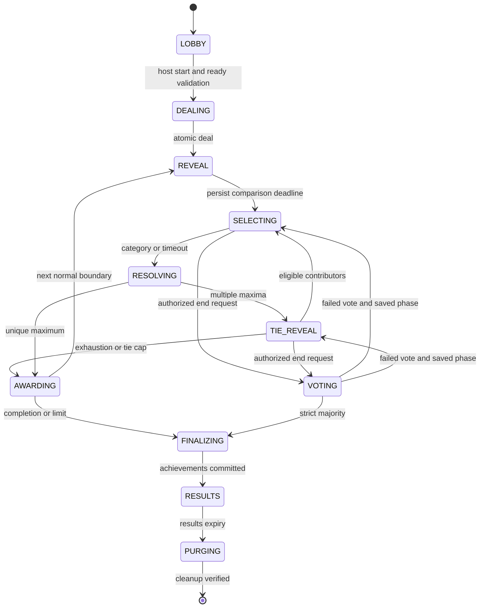
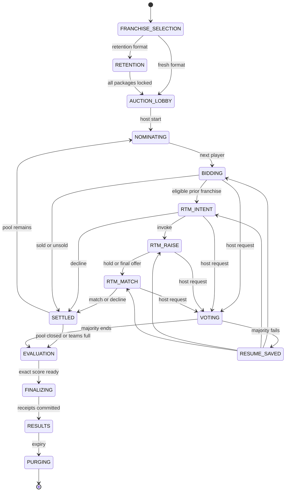

# Game Rules and State Machines

**Specification:** STUMPS v1.0 • **Evidence date:** 9 October 2026 • **Status:** implementation blueprint; no application or performance results claimed.

This is the normative gameplay specification. STUMPS is a proposed working brand, subject to name clearance. References S01–S20 resolve in the master plan. All original rules below are simulator decisions, not assertions about Cricket Attax or IPL. Room configuration, data versions, algorithm versions and rule hashes become immutable when participants ready and the host starts. A rules change in the lobby clears all ready flags. Admin edits publish future versions and never mutate running games.

## 1. Shared constants and invariants

| Setting | Default | Allowed configuration / invariant |
|---|---|---|
| Card participants | 4 | 2–8, distinct authenticated users |
| Cards | 48 | 4–30 per participant, total ≤240, divisible by participant count |
| Card selection deadline | 20 seconds | 10–60 seconds |
| Card match limit | 45 minutes | 10–120 minutes or no soft limit; hard ceiling 120 minutes |
| Cycle guard | 3 identical normal-boundary states or 2,000 contests | Always enabled; occurrence count includes complete deck order and selector |
| Auction franchises | From selected season | 2–season franchise count; default historical season has 10 |
| Collaborators | 4 per franchise | 1–6, maximum 60 participating humans per auction |
| Spectators | Disabled | P1: maximum 20, always receive only public projection |
| Auction opening clock | 20 seconds | 10–60 seconds |
| Late-bid rule | At least 8 seconds remain | deadline = max(old deadline, accepted DB time + 8 seconds) |
| RTM decision stages | 15 seconds each | Simulator timing, configurable 10–30 seconds |
| Presence / failover | 5-second heartbeat; 15-second stale; 30-second grace | Mobile suspension counts as a disconnect |
| End-game vote | Exactly 15,000 ms | Fixed; no host override, no extension |
| Repeat-vote cooldown | 120 seconds | Measured after failed vote; max 3 failed votes per room |
| Results period | 120 seconds | 30–300 seconds; fixed at creation |
| Lobby inactivity / absolute lifetime | 30 minutes / 2 hours | Successful member action extends inactivity only |
| Running room all-human absence | 30 minutes | Abort without new medals; safe settlement first |
| Auction hard ceiling | 8 hours | At a safe boundary; unfinished roster rules still apply |

Use integer milliseconds for durations, `timestamptz` for deadlines, integer rating points 0–1000, integer rupees for money. ₹1 crore = 10,000,000 rupees; ₹1 lakh = 100,000 rupees. No binary floating-point money or comparison equality. Public rating 92.4 corresponds to 924 internal points. Times supplied by clients are diagnostic only.

**Conservation:** the card instance set never changes after dealing; each instance is in exactly one of DECK, ACTIVE, POT. No permanent user card ownership is implied: “inventory” here means a temporary match deck. Persistent paid packs, trading and real-money wagering are outside scope.

**Auction conservation:** initial purse = retention charge + completed purchase charges + remaining purse. A leading bid is a commitment, not a deducted purchase. There is only one open nomination. A player can belong to at most one franchise in a room. All budget, roster, bid and RTM transitions share the room transaction lock.

## 2. Decision register for ambiguous requirements

| ID | Proposed default | Reason / configuration |
|---|---|---|
| R01 | Reveal all participating top cards before category selection | Matches the supplied example; no choosing a card from the deck |
| R02 | A winner appends the pot at the deck bottom in contribution order | Avoids unrecorded reshuffling and makes replay reproducible |
| R03 | Original selector keeps control during ties only while eligible and funded with a next card | Ineligible selector passes clockwise by immutable seat order |
| R04 | A tied player with no next card is exhausted, not immediately eliminated | It may still win a last-card fallback pot |
| R05 | If exactly one tied player can contribute, it wins the existing pot without another contribution | Deterministic exhaustion rule; recorded visibly |
| R06 | If no tied player can contribute, use the committed fallback ranking | Uses only the current tied set, never a previously losing player |
| R07 | Twelve successive tied comparisons trigger the same fallback | Prevents an unbounded tie chain; configurable 4–30 |
| R08 | Disconnect never redistributes cards or forfeits a submitted card | The server plays top cards and uses the timeout category policy |
| R09 | All active card players / all started franchises form the voting electorate | Offline status cannot manufacture a smaller majority |
| R10 | Card exhaustion elimination occurs after a pot is awarded | Prevents premature elimination of a tied last-card participant |
| R11 | Early card end restores unresolved contributions to their contributors | Avoids inventing a pot winner after a vote; rollback only this unresolved contest chain |
| R12 | Early auction end cancels the open nomination or uncommitted RTM process | No sale during voting; prior purchases remain final |
| R13 | Host cannot kick competitors after start | Moderation mutes/bans controls; it cannot rewrite competitive results |
| R14 | Franchises have one voting representative: captain then designated co-captain | Membership size does not increase voting weight |
| R15 | Reconnection offers explicit control takeover; it does not cancel an accepted bid | Fencing epoch prevents split control |
| R16 | No configured auto strategy means observe only | Offline membership is not consent to arbitrary spending |
| R17 | Official-like presets use a named historical season | Current rules are not guessed from a previous season |
| R18 | Minimum squad legality is a medal gate | A small collection of stars cannot beat complete squads |
| R19 | Rarity is primarily visual and does not multiply ratings | No pay-to-win or secret stat boost |
| R20 | A single remaining human does not mean a single remaining competitor | Offline players/franchises still own their game positions |

The host can choose only documented alternatives exposed in the validated ruleset. R01–R06 are proposed policy fields in the versioned ruleset; v1 initially exposes one validated option per field, and additional configurations require versioned rules plus acceptance fixtures. Their names and chosen values remain visible before start. Configurable proposed rules are stored with an explicit `simulator` provenance flag.

## 3. Cricket data, comparison ratings, rarity and stars

### 3.1 Immutable card definition

A card definition version references one or two cricket identities, a season/statistics snapshot, franchise associations in that snapshot, roles, styles, image asset IDs, rarity, five-star score and a `ratingsVersion`. Each source fact stores scope, units, as-of date, source and verification status. Missing bowling style renders “Not applicable”; unknown data renders “Not available.” Neither means zero. Portraits, logos and facts have independent rights records.

Cards display name(s), franchise, country text and flag if licensed, role, batting/bowling style, rarity name, stars, six game ratings and a detail drawer of sourced raw statistics. Public card text always says **Game rating** for derived numbers; raw data says e.g. “IPL, 2022–2024, as of 31 Oct 2024.” Do not mix a 2025 ruleset with future statistics without changing the data snapshot label.

### 3.2 Reproducible synthetic ratings v1

Use a fixed T20 competition cohort and three complete seasons before the selected snapshot, weighting oldest/middle/latest season 0.2/0.3/0.5. Use only available seasons and renormalize weights. A historical 2025 simulation defaults to data ending before its auction. Recent form is the last 10 innings/appearances before that cutoff. Ball-by-ball measures require correct legal-ball, dismissal and extras definitions; verify against known scorecards before publication.

For a beneficial rate `x` with exposure `n`, shrink to a cohort prior `mu`: `x_shrunk=(n*x + k*mu)/(n+k)`. Priors are computed from the entire published cohort, never the room pool. Defaults: batting k=120 legal balls, bowling k=120 legal balls, fielding k=20 appearances. Counts use exposure-adjusted rates when measuring ability. For costly rates such as economy and bowling average, invert the percentile. Winsorize at cohort 5th/95th percentiles, use midrank empirical percentile for ties, then `Q=round(1000*percentile)`. Freeze the distribution and cohort hash with the model. No live percentile changes during a game.

| Comparison | Exact v1 input formula, after each term is normalized to 0–1000 |
|---|---|
| Batting | .35 strike rate + .25 runs per dismissal + .20 boundary-ball rate + .20 not-out adjusted innings contribution |
| Bowling | .40 wicket rate + .35 inverse economy + .25 dot-ball rate; exclude run-outs and non-bowler wickets |
| Fielding | .60 catches per appearance + .25 credited run-out involvements per appearance + .15 stumpings per keeping appearance |
| Form | .50 recent batting index + .50 recent bowling index for all-rounders; primary discipline for specialists; wicketkeepers use batting |
| Experience | Percentile of log(1 + eligible T20 appearances), same fixed cohort |
| Versatility | `round(sqrt(Batting * Bowling))`; label as synthetic breadth, not real cricket statistic |

A real zero contribution (never bowls) is zero for bowling ability; a missing source record is unknown and is not converted to zero. Missing component values use cohort 30th percentile and a visible “estimated” tag; weights remain fixed to avoid selective missing-data advantage. Unknown role or <40% observed weighted inputs makes the card unavailable in verified rooms. Casual/demo rooms may use an explicitly synthetic complete record. Fielding opportunity bias is a known weakness: wicketkeeper and outfielder opportunity priors are separate before converting to one scale; audit that keepers do not dominate by opportunity alone. Form with fewer than three appearances falls back to the shrunk historical discipline value and is marked low confidence. These are proposed game-design formulas requiring calibration, not scientifically validated player rankings.

All default comparisons are higher-is-better synthetic ratings. Raw highest score/runs/wickets may be selectable in a custom **raw-stat** mode only when every enabled card has a comparable scope and valid value. Economy/average then use lower-is-better; a missing/zero-denominator value makes the category unavailable for the entire room. No player-specific category disabling after reveal.

### 3.2.1 Metric denominator and tie precision definitions

For the proposed normalized game model: strike rate=100*runs/ballsFaced; boundary-ball rate=(fours+sixes)/ballsFaced; runs-per-dismissal uses (runs + 5*cohortMeanRunsPerDismissal)/(dismissals+5) to handle no-dismissal samples, then the stated exposure shrinkage; innings contribution is the mean of min(1, playerRuns/max(1, teamInningsRuns) + .05*notOutIndicator). Bowling wicket rate=creditedBowlerWickets/legalBalls; economy=6*concededRuns/legalBalls; dot rate=zero-total-run legal deliveries/legalBalls. Absent denominators use the documented prior, except confirmed never-performed roles which have zero contribution. Batting-style/role itself is not a numeric bonus.

Opportunity-adjusted fielding computes keeper/outfielder component percentiles separately then combines those percentiles with the fixed weights. A nonkeeper's genuine zero stumpings is zero, not missing; data gaps use the estimated prior. Phase-specific batting/bowling use the same discipline formula on powerplay overs1–6, middle7–15, death16–20 (adjust only with a versioned shortened-innings policy). Finishing rating is the death-phase batting index. Store a segment coverage flag and fall back to historical discipline index when exposure is below 30 legal balls, visibly marked estimated.

For integer calculations, use rational weights with declared denominators and round half-up once when persisting each0–1000rating; never compare display-rounded floats. A raw lower-is-better metric is stored as a scaled integer with units in its definition. Zero-denominator raw averages remain null. Release fixtures must cover0 balls,0dismissals, all-not-out, dot-ball extras and fractional weights.

### 3.3 Star calculation

Role strength `S`: batter/WK = .70 Batting + .20 Form + .10 Fielding; bowler = .70 Bowling + .20 Form + .10 Fielding; all-rounder = .40 Batting + .40 Bowling + .10 Form + .10 Fielding. Convert S to a fixed within-role cohort percentile p. Stars: 1 if p<.20; 2 if .20≤p<.45; 3 if .45≤p<.70; 4 if .70≤p<.90; 5 otherwise. If completeness <.70 or exposure <120 balls in the primary discipline, cap at 3 and display provisional. Minimum verified room completeness remains .40. Admin configures star thresholds/model versions and may correct source data and republish; manual promotional star overrides are prohibited in rated games. The UI exposes formula version, percentile and confidence.

### 3.4 Rarity and dual-player cards

Normal/Bronze/Silver/Gold/Platinum/Dual Platinum target pool mix is 40/25/15/10/8/2 percent. This is a visual catalog sampling target, independent of stars. Largest-remainder rounding with rarity enum order as tie-break allocates counts; scarce eligible cards cause an explicit pre-start validation error, never silent duplication. Host can exclude rarities, then weights renormalize.

For dual cards, calculate each comparison as the rounded arithmetic mean of its two players, capped at 950. No “take the best statistic from each player,” no additive totals, no automatic category win. A pair may contain two different franchises; show both. Pair stars use the average of the two role-strength percentiles with the same thresholds and the weaker completeness cap. Pairing constraints: distinct identities, ≤1 dual instance per match by default, no constituent individual card from either player in that same deck, no identity repeated in another pair. This sacrifices some pool size for clarity. The host sees validation when the requested pool cannot satisfy it.

Use a stratified fair-deal option by default: rating quartiles formed by mean of the six ratings, shuffle within each quartile, rotate the initial seat per quartile using the committed random stream, deal round-robin; all seats receive equal counts. It reduces initial imbalance without guaranteeing equal win probability. A casual pure-random mode is explicitly labeled. Never re-roll until a preferred player wins.

## 4. Card setup, randomness and privacy

1. Freeze participating seats, data/rules hashes and configuration. Require 2–8 ready players and enough eligible unique identities. Number of cards must divide evenly by seats; UI offers the nearest lower legal total but requires a host edit and renewed readiness.
2. Generate 256-bit cryptographic seed in the backend. Persist it encrypted and publish `SHA256(seed || roomNonce || configHash)` before dealing. Future deck order is never included in public events.
3. Create independent derived streams with HMAC-SHA256 labels `deal`, `seats`, `fallback`. For each stream, use incrementing counter blocks and rejection sampling to avoid modulo bias. Fisher–Yates shuffling consumes the defined stream; save RNG algorithm version and counter.
4. Choose initial selector uniformly among seats using the seats stream. Build a fallback seat permutation with the fallback stream. Persist every card instance and deck ordinal in one transaction. A crash retries the same initialized match, not a new shuffle.
5. Publish card counts, seed commitment and current revealed cards only. Deck order is fixed except appending winnings. Users cannot peek at their next card or alter order.
6. Reveal seed, inputs and algorithm ID only in the temporary results payload after play finishes. This enables participant auditing, not a claim of distrustless randomness: the operator still controls code and seed generation. Optional P2 player entropy commitments can reduce operator discretion, but must not introduce reveal-withholding attacks.

## 5. A normal card contest

A **contest chain** consists of one normal comparison and zero or more tie comparisons until its central pot is settled. A **comparison** is one reveal plus one selected category. Each started comparison automatically takes exactly one top card from each eligible contributor. There is no client card-submission authority; optional reveal acknowledgments are cosmetic and cannot stall the game.

At a normal boundary, eligible = non-eliminated seats with at least one deck card. If exactly one remains, it owns all cards and natural completion occurs. Otherwise move each eligible top card DECK→ACTIVE in immutable seat order; record contributor and ordinal. Publish reveal, selector, allowed categories, comparison ID and selection deadline. Everyone sees the same cards before the selector chooses. Accept only one valid category command from the selector with current comparison/version.

At timeout, choose the category maximizing the selector’s displayed rating relative to the maximum opponent rating (difference in integer points); use fixed enum order to break equal advantages. If selector became ineligible through a validated lifecycle transition, clockwise eligible successor chooses. This deterministic timeout policy is public and applies identically to offline users; no hidden stronger bot.

Move all ACTIVE cards to POT, ordered by comparison index then seat. Compare only the contributors' cards. If one highest value exists, transfer the entire POT to the winner’s deck tail, preserving contribution order. Clear pot metadata, increment decided-contest counters, and set next selector to the winner. A comparison cannot award the pot twice.

**Worked example:** A=92, B=87, C=94, D=79. C receives four cards, appended to its remaining deck. All four current cards leave ACTIVE. C selects next.

## 6. Ties, repeated ties and last-card situations

On multiple maxima, record `tiedSeats` as exactly those maxima. All contributed cards, including losers’ cards, stay in POT. Temporarily ineligible players do not contribute to tie comparisons. They retain their undealt decks and return at the next normal boundary. Keep the chain’s original selector if it is still in `tiedSeats` and has another card; otherwise use clockwise next seat among tied seats with a next card, starting after that original selector. The original selector never regains control if eliminated from the tied set later.

Before the next reveal, define `able = tiedSeats with deckCount > 0`:

- `able.length ≥2`: only able seats contribute a card; exhausted tied seats lose eligibility for this next comparison but are not yet recorded as eliminated. Resolve maximum using those submitted cards. On another tie, narrow the tied set again.
- `able.length ==1`: that seat receives the existing pot immediately; no unopposed extra card enters it. Log reason `SOLE_TIE_CONTRIBUTOR`.
- `able.length ==0`: settle among the last tiedSeats using fallback below. A player with zero deck cards can win this pot and survive.
- If the configured tie-chain comparison cap is reached, settle among the current tiedSeats without taking another card.

**Fallback (proposed fixed v1 rule):** compare tied players’ most recent contributed cards by composite `sum(six comparison ratings)`, higher wins. If equal, walk the committed fallback seat permutation rotated by `contestChainIndex mod participantCount` and select the first tied seat. This final step is an auditable precommitted random tiebreak, deterministic given the seed. Reveal its commitment before play and exact resolution at the event. It is never selected secretly by the host.

**Six-card example:** A94, B94, C82, D76 → four cards POT; eligible A, B. Next A88, B96 → B wins all six. C, D cannot join that second comparison; if they still hold cards they return afterward.

**Exhaustion example:** A and B tie using their last cards; C and D lose but retain undealt cards. With able empty, fallback chooses between A/B only, awards the four-card pot, then zero-card loser is eliminated. C or D cannot claim the pot.

**Mixed example:** A, B, C tie; A has no next card, B and C do. Only B, C submit. If B wins, A is eliminated after pot settlement. If B, C also exhaust in another tie, fallback considers B, C, not A.

### 6.1 Elimination and podium

Only after POT becomes empty, eliminate each zero-card player. Persist elimination contest index, card count at the start of that chain, total decided contests won, and committed seat priority. Simultaneous eliminations rank by: larger start-of-chain deck count, then more decided contests won, then fallback priority. That order is stored at elimination; it does not change later.

Natural result: winner first; last eliminated second; second-last eliminated third; remaining seats reverse elimination order. Only eligible participants receive medals; with two participants there is no bronze. A natural winner must own exactly all N instances at the boundary. Do not rank all eliminated users as tied because their final inventory is zero.

### 6.2 Cycle and timed endings

After each normal boundary hash `(ordered remaining decks, live seat set, selector)`. Count repeats excluding visual animation state. On third occurrence, 2,000 decided contests, or configured soft deadline, finish at that boundary. If a time limit expires mid-chain, mark `finishPending`, allow at most 60 more seconds for a chain; then restore contributions as below and finish. Hard match ceiling always applies.

Timed / approved early end ranks remaining non-eliminated players by restored deck count, decided contests won, sum of their current deck ratings, committed fallback priority. Previously eliminated players follow in reverse elimination order. Rating sum is only a final tie-break, not the main score. Label result “Time limit” or “Ended by vote.”

For an unresolved chain, restore POT and ACTIVE cards to each recorded contributor's deck front in original chronological contribution order. Contributions taken at the start of the chain become top again. Remove this chain’s provisional records and use pre-chain elimination/counter state. Completed earlier chains are untouched. The room transaction marks the chain `CANCELLED_FOR_FINALIZATION`; the restoration is idempotent. This ensures all N cards have a known owner before rankings.

## 7. Card state machine and transition function



`REVEAL`, `RESOLVING` and `AWARDING` are transactional transitions, not client-waiting states. Voting can occur only between transactions; a request arriving during resolution observes the resulting phase. `PAUSED_RECOVERY` wraps a saved phase and remaining timer without duplicating game logic; connectivity is member state, not a global DISCONNECTED phase. Illegal transitions return `STATE_CONFLICT` plus a fresh allowed-action projection.

```text
handleCardCommand(actor, command):
  begin transaction
  lock room first; validate actor, gate, membership, control epoch
  replay identical idempotency receipt if found; reject key/body mismatch
  now = DB clock after lock
  if due deadline exists: settle due transition before accepting later actions
  require current generation, phase and comparison version
  resolve selection OR timeout through same engine reducer
  move submitted cards into ordered pot; calculate maxima from frozen definitions
  if unique winner: award all pot cards; eliminate only now; test completion
  else: narrow tied set; apply exhaustion and chain cap rules; prepare next reveal
  assert card count N, unique location, no deck ordinal collisions, valid selector
  increment state version; save typed events + command receipt atomically
  commit; dispatcher sends audience-filtered events
```

## 8. Auction rulesets and official evidence boundary

**Primary preset:** `IPL_2025_MEGA_HISTORICAL_v1`. The label always includes “2025 historical simulation.” Source facts are summarized once in the master evidence register (S01–S04). A ruleset record stores source URLs, verification date, season, provenance per field, evaluator version and pool version. “Official-like” describes the mapped auction rules; timers, UI voting, automated participation, scoring, subset franchise play and digital bid ordering are simulator additions.

| Rule | Historical preset | Casual preset `CASUAL_v1` |
|---|---|---|
| Purse | 1,200,000,000 rupees | Same default, host 100–2,000 million |
| Squad | Minimum 18, maximum 25 | Minimum 11, maximum 15 by default; host 11–25 |
| Overseas | Maximum 8 squad, 4 in selected XI | Same by default, clearly custom if changed |
| Retention + completed RTM | Maximum 6; at most 5 capped, 2 uncapped Indians | 0–6; no RTM unless explicit previous-team provenance exists |
| Capped retention floor schedule | 180m, 140m, 110m, 180m, 140m rupees | Configured validated schedule |
| Uncapped retention floor | 40m rupees each | Configured fixed floor |
| Base price pool | Use verified 2025 individual entries | Synthetic tiered entries labeled DEMO |
| RTM | Previous franchise, eligible pool entry and remaining slots | Optional |
| Impact Player | Historical framework acknowledges it | XI score excludes tactical substitutions in v1; disclosed model simplification |
| Bid increments | Explicit simulator schedule below | Editable schedule |

Do not infer uncapped eligibility from age, nationality alone or absence of data. Import a reviewed season-specific classification. Register the four-overseas-XI constraint against the selected season's playing conditions before publishing the historical preset; if that check is unavailable, keep the preset in review and expose the same constraint as a simulator rule. The verified-source register identifies this release gate rather than claiming a complete legal competition rulebook was obtained.

### 8.1 Fresh and retention-based formats

Fresh mode starts every participating franchise at the same purse, removes all prior squad ownership and disables retention/RTM claims. All eligible chosen identities enter the pool once. This is a simulator modification of the historical framework, visibly labeled “Fresh reset.” With only a subset of franchises, players from absent franchises can still be auctioned, but absent teams hold no RTM rights. Such a room is casual-rated, never an exact historical replay.

Retention mode uses the pre-auction previous-season roster snapshot, before subsequent auction outcomes. Captain selects eligible retained identities and allocations. Collaborators may propose; captain submits the final package. Default charge = max(sum of nominal capped floor schedule for k capped players, sum of capped negotiated allocations) + sum(max(uncapped allocation, uncapped floor)). This aggregate-max treatment is a documented simulator interpretation pending verification of the full retention circular. To offer a fully verified historical deduction, use the official published team deduction totals and exact retained lists in a **fixed historical retention** submode. Custom retained combinations display “Simulator retention cost model,” never “official cost.”

Validate caps, no duplicate identities across franchises, previous ownership, uncapped classification, remaining purse and ability to reserve minimum remaining roster slots. Allocate any difference between the charged capped total and capped negotiated allocations proportionally to the nominal slot floors, using largest-remainder allocation to whole rupees (tie-break player UUID). Each acquisition stores its allocated charge, so their sum exactly matches total retention charge. Lock retention packages only when each captain confirms; host cannot alter someone else’s package. A change resets that franchise's readiness. Timeout never silently chooses retentions: default zero, requiring a visible preconfigured “none on timeout” consent or lobby remains waiting until abandoned.

RTM entitlement is `6 - numberRetained - successfulRTMAcquisitions`; both capped and uncapped subcaps include retentions plus successful RTM, not ordinary auction purchases. Ordinary purchase of a former player does not spend RTM. A franchise cannot RTM a player it already leads on. Pool `previousFranchiseId` is frozen and cannot be edited mid-auction.

### 8.2 Nominations, bid amounts and spend safety

Pool order: host-selected seed-shuffled order within published role/base-price sets, then stored order; optional verified historical published order. Players are nominated by server only. The host may pause or advance at an inter-player boundary, never secretly skip an active high bid. A skipped player returns to the end of the current pass and may only be skipped once. Unsold players receive one second pass at the same base price; no third automatic pass. Remaining unsold identities close as unsold.

Simulator increment schedule by current standing amount: below ₹1 crore, ₹5 lakh; ₹1–<2 crore, ₹10 lakh; at or above ₹2 crore, ₹20 lakh. The opening offer must equal base price. Later bids must equal `current + increment(current)` in v1; no arbitrary jump bids. At a threshold, use the band containing the current bid, not the resulting bid. The prompt example ₹2cr → ₹2.2cr → ₹2.4cr therefore works. Any alternative increments require a versioned custom ruleset.

For franchise f, let `P` be remaining purse, `s` squad count, `m` minimum squad, `bmin` minimum permitted base price in the frozen pool. Proposed purchase p must satisfy `p ≤ P - max(0,m-s-1)*bmin`, `s+1 ≤ maxSquad` and overseas capacity. Also validate that a legal XI remains feasible from owned plus unsold pool identities under role/overseas constraints. This necessary feasibility check and reserve floor protect spending; they do **not** guarantee other teams will leave enough cheap players available. Revalidate after each sale; show “minimum squad at risk” if market availability makes completion impossible. No imaginary free players or negative budgets.

A leading franchise cannot bid against itself. No client sends a new purse or squad. Membership capabilities and control epoch are read from the database. All bids carry a unique command ID, nomination ID and expected nomination version. Two collaborators submitting the same amount yield one accepted bid; the other is stale/already-leading. Opposing equal bids serialize: first lock-acquiring valid transaction wins, second receives the new minimum. This is server-processing order, not a claim of globally fair network-arrival order.

### 8.3 Timers, sold/unsold and RTM

A bid is accepted only when DB `clock_timestamp()` read **after acquiring the room lock** is strictly less than the persisted deadline. At exact equality it is late. A packet sent before the deadline but processed after it is rejected. Commit time may be slightly later; the authoritative acceptance timestamp remains the validation time. Set a short transaction/lock timeout and measure contention. Timer workers lock the same room, re-read generation and deadline, then either do nothing or close bidding. The browser countdown cannot sell a player.

Every valid bid extends the deadline to at least eight seconds after its acceptance. No cap forces a sale while users are actively bidding; finite money and positive increments bound a normal bidding war. While voting, all bidding/RTM/nomination timers are frozen and bids return `GAME_PAUSED`.

On bidding expiry with no bid → UNSOLD. With a bid and no eligible RTM → atomic sale. With eligible RTM → `RTM_INTENT`, without purchase or purse deduction yet. The high bidder's commitment remains reserved; no next player can begin.

1. RTM holder has 15 seconds to invoke or decline. Timeout declines.
2. If invoked, high bidder has 15 seconds for a single final increase or hold. The increase may be any integer-lakh amount ≥current bid, subject to the bidder's purse/roster validation; this is a documented simulator denomination rule. The normal step table does not restrict this one opportunity. Timeout holds. The new offer is binding if RTM is declined.
3. RTM holder gets 15 seconds to match the final offer or decline. Check budget, roster and capped/uncapped entitlement again. Timeout declines. Automation may act only under explicitly configured RTM consent and ceiling.
4. Match: purchase for RTM holder, consume one entitlement, release original bidder's commitment. Decline: purchase for original bidder at its binding final offer. Store one purchase and deduct one purse, once. A high bidder cannot retract its previously valid binding offer.

If a ban or data-integrity emergency invalidates a commitment, administrator can abort the room without medals with an audit reason; no silent reassignment. Ordinary disconnect never invalidates a standing bid.

## 9. Franchise collaboration and auto mode

Franchise selection is a locked unique claim. Captain membership is singular; proposed co-captains receive explicit flags, not unbounded role powers. Default advisor can view strategy, chat, shortlist and recommend targets but cannot bid, retain, vote or invite. An authorized bidder can bid only within the franchise-wide current control mode and own capability. Captain can designate one co-captain for vote representation and failover priority. Proposals/shortlist votes are advisory and cannot debit money.

The server generates a separate 12-character franchise code using the same strong alphabet policy as rooms; it identifies a pending join request, not approval. Requester must already be admitted to the room. Default approval is required; an explicit captain-enabled auto-join policy may accept only preapproved friend IDs. Changing the code revokes pending code-based requests unless captain separately approves them. Strategy and team chat become visible only after active membership is committed. Membership in two competing franchises in the same room is forbidden.

Before start, each team confirms its control policy: MANUAL or AUTO_ON_ABSENCE. `controlEpoch` fences commands after mode or captain changes. If any authorized bidder remains connected, the franchise stays manual; an offline captain alone does not trigger a bidding bot. After all authorized bidders are absent through grace, choose the highest-priority connected co-captain; otherwise use the saved strategy or OBSERVE.

A strategy contains per-player ceiling, per-role ceiling, total automated spend cap, maximum automated purchases, minimum cash reserve, target priority list and optional RTM permission. At each current nomination version, calculate `limit=min(playerOrRoleCeiling, remainingAutoCap, P-reserveForMinSquad, P-userReserve)`. Only bid the legal next amount if target/role need is satisfied, limit permits, roster checks pass and franchise is not already leading. Default target rule: named targets first, otherwise highest unmet role priority with rating ≥60.0 and confidence ≥.70. Unknown/missing strategy means no bid.

Schedule bots after a deterministic 700–1,300ms delay derived from public nomination sequence and franchise seat, rotating priority each nomination. Bots do not see opponents’ strategies. Schedule at most one attempt per nomination version; invalid attempts wait for new state and never hot-loop. Bot commands use the same transaction handler and deadline rules as humans and identify `actorType=AUTO` with reason codes. Bots cannot raise the max cap mid-auction.

Reconnect returns a snapshot and missed public + own-team events, highlights purchases during absence and remaining purse, then presents **Resume manual control**. Captain or designated controller confirms; transaction increments epoch, cancels pending bot jobs and returns MANUAL. Already committed purchases/bids remain. Other tabs become observers. A new captain is chosen automatically only from the preapproved ordered co-captain list; otherwise control remains observe/auto until original captain returns. Room host authority never grants franchise access.

## 10. Squad evaluation v1

This is an explainable game score, not a forecast of real IPL wins. Freeze model/data before the room starts. A legal podium squad satisfies selected min/max squad size, overseas squad cap, and has at least one legal XI. A legal XI has exactly 11 distinct available players, ≤4 overseas, ≥1 keeper, ≥5 reviewed bowling-capable players, ≥2 pace options, ≥1 spin option and ≥6 batting-capable players. A player can satisfy multiple capabilities (an all-rounder is allowed); “five bowling options” still means five distinct people. Pace/spin and batting-position tags come from versioned data, with review provenance. Unknown availability is probability 1.0 marked unknown; confirmed unavailable is excluded; probabilistic fitness gossip is never invented.

Within any XI X, compute 0–100 components using frozen synthetic skill ratings (divide integer points by 10):

- `B(X)=.45*mean(top7 batting)+.20*mean(best2 top-order-role batting)+.20*mean(best2 middle-role batting)+.15*best finishing rating`. Missing role slots score zero. “Best” includes only players in X with the reviewed tag; each department can use the same player, but not twice within its own top-k.
- `W(X)=.40*mean(top5 bowling)+.20*mean(best2 powerplay bowling)+.20*mean(best2 death bowling)+.10*best spin+.10*best pace`. Phase ratings use phase-appropriate balls with shrinkage, else a labeled historical bowling prior. At least five distinct bowling options is an eligibility gate separate from this score.
- `A(X)=.60*mean(best2 geometric-mean all-round skill)+.40*best keeper quality`. Missing all-rounders score zero; keeper quality=.70 batting+.30 opportunity-adjusted fielding.
- `C(X)=100*(.20*min(topOrderCount/2,1)+.20*min(middleCount/2,1)+.15*min(finisherCount,1)+.15*min(powerplayOptions/2,1)+.15*min(deathOptions/2,1)+.15*min(spinOptions/2,1))`.
- `D(S\X)`: mean of best backup batting, bowling and keeper role ratings (weights .4/.4/.2), multiplied by `min(benchCount/(minSquad-11),1)`. If minSquad=11, multiplier is 1 with at least one bench player and 0 with none. Missing backup roles are zero. More bench quantity beyond the minimum has no direct bonus.
- `V(S)=100*min(1, sum(expectedPrice_i)/max(1,sum(actualCost_i)))`. Here quality_i is the player role-strength S from section3.3 divided by10. Expected prices are frozen from `initialPurse/minSquad * (.5+quality_i/100)` then rescaled so the eligible pool median equals the pool median base-price reference; retained players use their allocated charge for actual cost. This is a bounded simulator value indicator, not a market valuation. No bonus for money simply left unspent.

`Score(X,S)=.30B+.30W+.10A+.15C+.10D+.05V`. Report all six components, subcomponents and confidence. Choose legal X maximizing this exact objective, not just the eleven highest individual ratings. Round only for display; compare integer fixed-point scaled totals (retain denominators or common integer scale). Freeze rounding specification in test vectors.

**Optimizer:** enumerate 11-member combinations from squads ≤25 in a worker thread (at most 4,457,400 combinations), prune insufficient remaining role/overseas feasibility, precompute masks and skill arrays, evaluate legal sets, save best score and lexicographic player-ID tie-break. Process chunks of 10,000 combinations; persist cursor/best solution with input hash so restart resumes. No heuristic fallback may be silently called optimal. If computation exceeds 30 seconds, show evaluation progress and continue/alert; do not fabricate a winner. A coarse heuristic can show a clearly provisional XI only.

Score arithmetic uses exact rational fractions (BigInt numerator/denominator with cross multiplication) for the final comparison; optional fixed-point caches must preserve ordering against that oracle. Rank eligible squads by unrounded optimized score, then min(B, W) (balanced core), C, observed-data completeness of XI, then a committed franchise-order draw. Ineligible squads appear below all eligible squads with concrete missing requirements and no medals. If no franchise is eligible, show **No qualifying champion**. A vote ending before minimum rosters can result in no medals; lobby warns about this.

Confidence is displayed separately; lower completeness is already handled in shrunk ratings. Do not apply a second arbitrary reputation bonus or penalize nationality. Audit rank sensitivity with ±5 percentage-point weight perturbations (renormalized); if leader changes often, call the outcome model-sensitive. Calibration, bias checks and examples are release gates, not claims of validation.

## 11. Auction state machine



SETTLED stores outcome SOLD/UNSOLD/SKIPPED rather than independent long-lived states. Other waiting phases may enter VOTING using the same saved-phase wrapper. Nominating/settling atomic work cannot be partially paused. Auto-mode and connection status belong to each franchise, orthogonal to the room state. Host pause is allowed only between nominations, ≤2 minutes each and ≤3 per game; only democratic voting can stop an active nomination. Recovery pauses are system-controlled.

## 12. Democratic ending and timer arbitration

At the room lock, first resolve any already-due gameplay deadline. If that naturally completes the game, refuse a new vote with `ALREADY_COMPLETED`; no competing finalization. Otherwise snapshot electorate and frozen phase. Card electorate = non-eliminated players, including current tied/exhausted-but-not-yet-eliminated seats. Auction electorate = all started franchises, including offline ones; excluded spectators and late advisors never add votes. A franchise representative is captain, or designated co-captain if captain is stale beyond grace at vote start. The representative mapping is frozen for 15 seconds. If that person disconnects it is an abstention, not a mid-vote handover.

Store `startsAt=dbNow`, `expiresAt=startsAt+15 seconds`, `N`, saved phase, each gameplay timer's remaining milliseconds and deadline generation. Cancel their active due jobs. Permit chat, reads and reconnects; reject all gameplay/bid/retention actions. Clients see the choices but no running vote totals until closure. One immutable first valid vote per electorate key; an identical retry returns the previous receipt, a changed choice gets `VOTE_ALREADY_CAST`. The host must vote explicitly; starting the vote is not an automatic Yes.

At `dbNow >= expiresAt`, end only if `yes > N/2`; threshold `floor(N/2)+1`. Abstentions, No and equality all fail. N=2 requires both Yes; N=1 requires the sole eligible voter's explicit Yes. A single online user in a larger offline electorate is not N=1. N=0 is an invalid running game and triggers operational recovery, never automatic majority.

If passed: restore unresolved card contributions or cancel open auction/RTM nomination, mark gameplay terminated, and finalize rankings. If failed: restore phase and set each gameplay deadline `dbNow + savedRemainingMs`; minimum UI visual duration does not alter this value. A saved zero deadline resolves immediately under the same transaction before any new bid. Failed vote cannot extend active gameplay time except the explicit 15-second pause. Match soft clock also pauses; absolute abandoned/hard room ceiling remains a safety bound and waits for the vote's resolution before administrative abort.

On backend restart, expired votes resolve once using their original deadline; they never receive a fresh 15 seconds. No votes received during downtime are invented. If an outage also requires recovery pause, failed vote restores phase into recovery pause, and its gameplay timer remains frozen. Clock health drift beyond 1 second between app and DB raises an alert; DB remains authority.

## 13. Qualification, medals and profile meaning

Individual participation eligibility is evaluated after competitive ranking. Medals are offered to the first three eligible competitors in rank order without changing displayed competitive ranks; store medal placement separately from competitive rank when ineligible competitors are skipped. Auction franchise eligibility is roster legality; member eligibility only governs which teammates receive that franchise medal. A qualifying game has ≥2 competitors at start and ≥5 decided card contests or ≥5 settled auction nominations. Natural games shorter than that still show a result but are labeled practice and award no medals. Approved early endings require the same threshold. Abandoned/integrity-aborted games never mint medals. Card podium eligibility additionally requires ready-at-start and presence for ≥50% of time from start to personal elimination/end. A disconnect grace interval counts at most 30 seconds; background heartbeat alone is not proof of active play and is accepted only as a practical participation proxy.

An auction collaborator must be approved before first nomination, ready at start, and present for ≥50% of the auction's active duration. Advisors qualify because analysis is useful even with zero bids. Freeze eligible roster at start; late joiners can observe/advice if captain approves but cannot receive this game's medal. Switching franchises after start is prohibited. Medal is credited once to each qualifying member of a podium franchise with `scope=FRANCHISE`, `creditedRole`, ruleset/evaluator versions and rank; profile copy says “Team gold,” so it does not imply each collaborator was a separate competitor. Franchise is ranked once.

Persistent compact receipt: opaque award-batch token, user ID, game type, competitive rank, medal placement, medal or qualifying participation flag, credited role, completion day, ruleset/evaluator version. Do not store room name, room code, opponents, bids, squad list, strategy or chat. Aggregate counters derive from these immutable receipts. Gold/silver/bronze counts use medal placement; card-game wins and auction victories require competitive rank1 and qualifying participation, so backfilled medals do not invent a competitive victory. A unique `(awardBatch,userId)` constraint and atomic counters prevent retry duplication. The token is random, not the room code or reversible user-linked game transcript.

## 14. Gameplay acceptance vectors

| Given | When | Then / executable oracle |
|---|---|---|
| Four revealed values 92,87,94,79 | Select category | C receives exactly 4; N conserved; C selector |
| Four values 94,94,82,76 then 88,96 | Resolve two comparisons | B receives 6; C/D submit once only |
| Three tied, one exhausted | Prepare tie | Other two submit; exhausted seat cannot choose |
| All tied players exhausted | Advance chain | Fallback winner comes only from last tied set |
| Unique winner had zero deck after reveal | Award | Winner survives; elimination checks happen afterward |
| Three simultaneous zero-card losers | Settle pot | Stored elimination tie-break gives stable podium |
| Same category command retried | Process twice | One transition, one receipt, one pot movement |
| Cycle state seen three times | Normal boundary | Time/cycle ranking; no endless repeat |
| A vote passes mid-tie | Finalize | Every contribution restored to correct contributor once |
| Two equal opposing bids with same version | Parallel transactions | Exactly one accepted; other stale; no double charge |
| Bid validated at exact expiry | Handle | Rejected; timer wins |
| Accepted bid leaves <8 seconds | Update | Deadline becomes at least acceptance+8 seconds |
| RTM holder matches raised offer | Resolve | One purchase, one deducted purse, entitlement decremented |
| RTM holder times out | Resolve | Original bidder buys at its binding final offer |
| Team cannot preserve minimum roster reserve | Submit bid | `BUDGET_RESERVE` with allowed ceiling |
| Bot command has old control epoch | Captain takes over first | Bot rejected without spend |
| 4 electorate, 2 Yes, 1 No, 1 abstain | Vote expires | Continue; 3 Yes required |
| Two votes same franchise via two users | Process | Frozen representative only; one ballot |
| No legal squad at auction end | Evaluate | No qualifying champion or medals |
| Only two eligible squads | Results | Gold/silver only; no fictitious bronze |
| Server crashes after medal commit | Retry finalizer | No duplicate receipt or counters |

## 15. Core auction and voting transition pseudocode

```text
submitBid(actor, command):
  transaction(room lock):
    authorize current gate/session/member/capability/controlEpoch
    if identical command receipt exists: return it
    now = database clock after lock
    if current stage deadline <= now: resolve that due stage first
    require stage BIDDING and command.nominationId/version match
    require actor franchise != current leader
    amount = basePrice if no leader else currentBid + increment(currentBid)
    require command.amount == amount
    validate squad size, overseas capacity, money and minimum-squad reserve
    require legal-XI feasibility from owned plus remaining eligible pool
    append accepted bid; increment nomination bidVersion
    update leader and deadline=max(oldDeadline,now+lateExtension)
    replace deadline job generation; append public bid/timer events; store receipt
  commit; return ack; outbox publishes

settleNomination(system, job):
  transaction(room lock):
    require job generation matches current state and DBclock >= deadline
    if room is VOTING/PAUSED_RECOVERY: no-op stale job
    if no valid bid: mark unsold and schedule second pass or next player
    else if eligible prior franchise and RTM not resolved: open RTM_INTENT
    else:
      validate binding franchise and legal acquisition invariants
      insert unique acquisition for (room,player),nomination
      subtract charged amount exactly once; close nomination
      append sold event; advance finite pool or enter evaluation
  commit

resolveEndVote(system, voteId):
  transaction(room lock):
    load vote; require open and DBclock >= original expiresAt
    count recorded Yes over frozen electorate, including abstentions in N
    if yes > N/2:
      mark passed; cancel gameplay deadline generations
      cards: restore unresolved chain contributions before ranking
      auction: cancel unsettled nomination/RTM,retain completed acquisitions
      enter FINALIZING/evaluation using fixed input hash
    else:
      mark failed; increment failed-vote count and cooldown
      restore saved phase/timer remaining values,or wrap in recovery pause
      schedule new job generations; zero remaining resolves immediately
    append vote.resolved exactly once
  commit
```

Legal-XI feasibility during bidding is a necessary check, not a promised ability to buy the remaining players. Use a small Boolean dynamic program over candidate identities, selected count0..11, overseas count0..4 and capped role-coverage counters (keeper1, bowlers5, pace2, spin1, batters6). Owned players are available candidates; unsold/available players are potential additions within remaining squad slots. Prune masks that cannot reach constraints. Full optimal-score enumeration runs only on completed squads. Re-run feasibility after each acquisition; no expensive multi-million-XI evaluation in a bid transaction.
